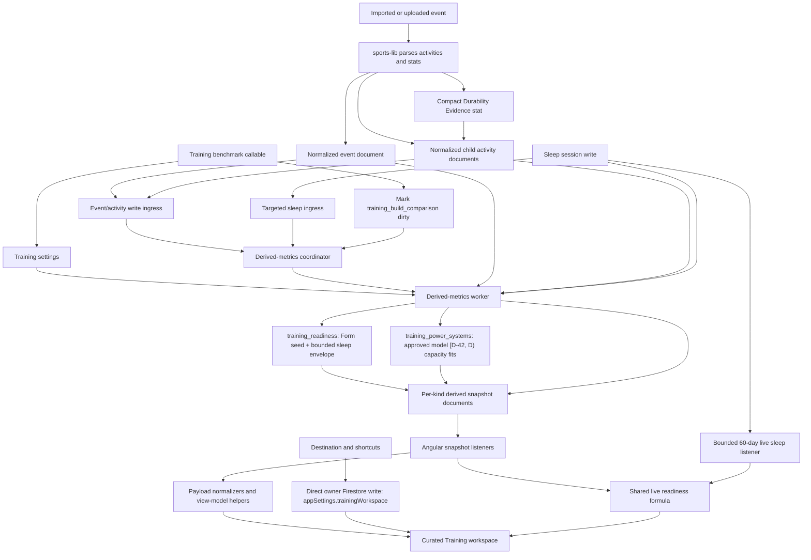

# Training Workspace Architecture and Maintenance Guide

## Optional post-workout reflection (Item 10)

The owner's Edit details action on a saved event summary opens one Material bottom sheet for event metadata and
post-workout feedback: Feeling, the existing whole-recording RPE, and optional private reflection text. There is no
separate reflection icon or dialog. All fields are staged until one Save changes action; Cancel discards the entire
draft. No auto-prompt interrupts recording import. A workout with one selectable activity uses the whole-recording
note without a target selector. For multiple activities, the user explicitly chooses the whole recording or a real
activity for the note; benchmark/ambiguous merged events are excluded. Three optional prompts cover overall feel, sport-relevant
conditions/technique, and fatigue/recovery. One bounded exact completion-link lookup can replace the last prompt with
planned-versus-felt context, only for one exact matching target. A malformed or out-of-recording link, an ambiguous
target, or more than 25 returned links keeps the generic prompt. Valid links to other activities do not imply a match
for this selection. It does not infer a completion, fetch a provider prescription, or establish that the current
authored workout matches the historical recording.

QS uses optional athlete-authored context, without copying an adaptation pipeline or voice transport. Voice entry,
automatic plan adaptation, injury diagnosis and provider feedback delivery remain outside this implementation.

### Model, ownership and retention

`shared/workout-reflection.ts` owns validation and optimistic/retry semantics. Private fixed leaves live under
`users/{uid}/events/{eventId}/workoutReflections`: `recording` or `activity_{actualActivityId}`. Each leaf contains exactly
`schemaVersion: 1`, monotonic `revision`, UUID `mutationId`, `deleted`, and nullable `note`.
Text is trimmed, limited to 2000 characters, rejects control characters except newline/tab/carriage return, and is
untrusted athlete context. A note save needs nonblank text. There is no reflection effort field. The one RPE selector
in Edit details edits the existing recording stat and preserves zero and imported fractional values until explicitly
changed. Planned RPE is unchanged. This unreleased feature has no data migration or reparse requirement.

The app-only saveEventDetails path in WorkoutReflectionService combines a sanitized patch limited to four editable
event fields with an optional revision-checked note change in one Firestore transaction. Only changed name, description,
Feeling or RPE fields are patched; unrelated event stats are preserved. Each edited event field checks its original
value, while an already committed unchanged retry is accepted. Reflection conflicts prevent both writes. Details-only
edits never read or rewrite a note and remain available while the optional note read is pending or has failed.
The in-memory event is updated only after a successful commit. A staged Delete reflection review is applied by the
same Save changes action; Keep reflection cancels that deletion. Account changes invalidate the whole draft.

The editor reads its exact leaf with lazily loaded Firestore Lite REST using the same app's Auth/App Check providers,
avoiding the full SDK's persisted missing-document state. That read is bounded to 30 seconds and rechecks the owner
after module loading and the response; failure never supplies revision zero. Owner SDK transactions read the current
parent, target membership and leaf before writing. Rules additionally check
active-account/deletion fences, benchmark exclusion, exact keys, text bounds and monotonically increasing
revisions. Public event access never grants reflection access; collection listing and descendants are denied.
Unknown/corrupt leaves fail closed. Cancel and an unchanged draft never write. Concurrent revisions require reload;
an uncertain unchanged retry preserves its mutation UUID. UUID creation uses the shared browser compatibility guard;
an unavailable UUID reports a browser error and preserves the editable draft without writing. Account changes clear private form state and invalidate
pending results. Accepted target/rating selections own selection haptics; async saves own success/error feedback.

Deletion overwrites text with null in a content-free monotonic tombstone, preventing a stale create/edit retry
from resurrecting that deleted reflection. There is no recoverable reflection history. Current content remains until
reflection, recording or account deletion. The event cleanup hook deletes fixed leaves in transactions of at most 200,
checking event absence on every page so recreated deterministic event IDs are protected. Account recursive cleanup
covers the same subtree. No independent user-data root or queue is added. Reparse leaves exact attachments untouched
and does not remap new activity IDs by similarity; a reflection whose original activity ID no longer exists is
inaccessible until parent cleanup. No event reparse or derived schema bump is required for this private context.

### MCP and Assistant impact review

The additive surface is `get_workout_reflection`, `save_workout_reflection`, and `delete_workout_reflection` under
independent `workout-reflections:read` / `workout-reflections:write`, both dependent on `activity-details:read`; writes
also require reflection read. Existing activity, event, Training, Health, measurement, description and Timeline grants
never authorize this content. Strict inputs select an existing owner/connection-bound activity reference and explicit
recording/activity target. Outputs expose only that reference/target, revision/presence and selected private text; never whole events, links, provider data, raw IDs or receipts. Admin transactions recheck
stored grant/Assistant generation and account deletion. External writes use native host approval; server code cannot
inspect automatic approval settings. Built-in Gemini sees current reads and local prepare-only tools through an independent
chat choice, on for fresh and New chats and user-disableable. Existing off choices, legacy missing flags and old retries
retain their selected access. This default does not expand external MCP grants or change tool schemas or calculations.
Preparation requires current-turn activity/date discovery and an exact target/revision read;
QS shows the target and current/new text, with explicit permanent deletion, before app Apply. Permission changes,
New chat, expiry, stale proposals/revisions and deletion fences fail closed. At most one current content proposal is kept.

Planning review: recipes, planning mutation kinds, completion/link lifecycle and provider delivery are unchanged.
Combining the app form has no MCP wire impact: scopes, schemas, projections, tool descriptions and the registered
contract digest are unchanged. MCP/Assistant reflection changes still write only the private note; combining the app
form does not grant either surface event-stat mutation authority or require a bundled-plugin rebuild.
Reflection context never marks completion or enters readiness/load/durability calculations, and does not authorize
adaptation. Exact-link reads are already covered by the current planning surface; no relevant plan-read extension is
missing. Separate reflection coverage is implemented in this change, so no #583 deferral is required. Public contract,
help/policies/feature page and Activity, Training and cross-domain bundled guidance are updated together. Source support
requires a separate server/Rules release, registered app developer refresh/rescan and plugin sync; none are authorized
by implementation or PR creation.

## Planning access through MCP and the Assistant

The #690 planning surface exposes current plans, standalone/associated workouts, complete v1 instructions, chronological
calendar queries, exact single/bulk stored completion links, local provider-mapping assessments, existing delivery
summaries, and a preview/native-approval/apply workflow. It does not modify
`WorkoutStructureV1`. The tools, strict scopes, projection and bounds are documented in
[MCP server](mcp-server.md#training-plans-and-planned-workouts-690). Source support is not a deployed or
registered-client promise. Deployment, registered-contract promotion and plugin installation
remain separate. The approval workflow implements the bounded #652 dependency. #651 is exact-marker-only; fallback/manual
matching and audited unlink/relink are out of scope.

Independent `training-plans:read` consent is available without a UID or Pro gate. Manual planning is available to every
signed-in account; provider delivery remains separately gated by readiness, connection authority, explicit consent and Pro.
The Assistant's default-off Training plans choice is conversation-owned, not a UI gate. Current calendar reads default to
standalone plus active-plan workouts, include skipped, exclude deleted, and allow explicit inactive-plan/all scopes.
Historical dates still read current records, not history. Calendar dates are not instants or delivery timezones.
The legacy registered workout query retains document order; the additive chronological query orders by local date and
document ID and is the preferred source for upcoming-session questions. Its continuation binds both values plus the
exact filters and schedule revision. Bulk completion reads accept at most 25 unique current workout references, preserve
input order and reuse the same exact-evidence projection as the single-workout read.
Full structures preserve canonical primitives, ordered node IDs, notes, repeat limits and Sports Lib owner-unit formatting.
The registered instruction reads add no `Data*` classes, completed-event metrics or inferred duration estimates.
The separate prescription-analysis read below exposes explicit recipe-based ranges. Completion reads return only
an existing exact stored link; they never infer a match. The optional activity reference additionally requires
`activity-details:read`.

The read-only compatibility assessment operates on one persisted canonical recipe and selected or all provider mapping
fixtures. It returns bounded safe exact/degraded/unsupported issues without reading connection authority, Pro status,
destination identity, mapping digests, ledgers or provider APIs. It includes Wahoo's time-only dated-workout duration
constraint and never estimates a duration for another ending. Delivery preview remains authoritative for current
connection/readiness/horizon/consent and approval binding.

`training-plans:write` and `training-delivery:write` are independent child scopes of `training-plans:read`. The former
allows the bounded authored lifecycle: create/edit/move/copy/skip/archive/activate/shift, recoverable workout deletion,
and explicit plan deletion. Plan deletion must be the sole proposal change, requires a convert-workouts-to-standalone or
permanently-delete-workouts choice, and permanently removes the plan revision history. An interruption after its deletion
lock is acquired keeps the proposal resumable so the same approved apply can finish idempotent finalization or cleanup.
Permanent single-workout deletion and history restoration remain excluded. The latter allows plan delivery
enablement and workout send/resume/stop/retry/check/approval. Delivery remains Pro and is gated by provider connection,
permissions, configuration, compatibility and explicit consent.
The additive `preview_training_deletion` offers the manual UI's optional older-copy cleanup for one current plan or
recoverable workout deletion. With both existing child write grants, the client asks whether to also remove older,
uncompleted copies from connected services (unless already explicitly chosen), then supplies a required
`removePastProviderCopies` boolean. The proposal binds that choice to the existing deletion transaction, revisions,
owner/connection/grant and approval. Plan deletion still requires its workout disposition. Upcoming eligible copies
already withdraw by default; completed activities are never deleted. Cleanup needs current same-account access and
provider support, and is not app/watch removal proof. No provider HTTP occurs in preview or MCP apply. The frozen
batch deletion remains available without this opt-in; clients must explain its older-copy limitation rather than
silently substitute it for requested full cleanup. Removal does not require Pro. Source implementation needs separate
deployment and catalog refresh. MCP read-impact review: current plan/workout recipes, units, completion links and sync
projections remain unchanged; cleanup intent stays server-only. Verification covers explicit yes/no choices, both plan
dispositions, preview without provider I/O, lost-reply replay, revoked grants, completed-copy protection and removal after
Pro expiry in `npm run test:functions-emulators -- mcp-data`, plus the existing provider cleanup regressions in the
`delivery` emulator group. Assistant tests keep follow-up choices prepare-only and require the app-owned Apply. Routing
follows only an uninterrupted deletion clarification chain; cancellation, another task, and removal from a plan must
not inherit an earlier deletion intent. This runtime-only routing correction changes no MCP wire contract or read
projection. Public contract tests check all three transports, scope isolation and recursive private-field rejection. No new callable,
provider adapter, consent scope or cleanup store is introduced.
External clients prepare one strict proposal of at most 25 changes, then invoke the separately approval-gated
`apply_training_changes` write tool. ChatGPT, Claude and other MCP hosts own their native tool-approval UI; QS does not
use MCP elicitation for a second confirmation round. A host may let its user configure automatic tool approval, which QS
cannot detect, so per-proposal review depends on leaving per-call approval enabled in that client. Proposals expire after
15 minutes. Claude users must not choose **Allow always**, and should disable Training write tools while using Research
because Research can invoke connector tools without another approval. Proposals bind owner, OAuth connection/grant,
schedule revision and entity creation time, and retain an idempotent
terminal result for safe retries. Provider outcomes are independent: a failed send never rolls back a successfully
authored standalone workout.

Compatible MCP schedule changes share one bounded Firestore transaction while preserving each change's own immutable
revision and idempotency receipt; oversized revision-history batches fall back to sequential transactions. Structured
apply diagnostics expose only operation counts, stage/total durations, outcome and slowest stage. No owner identifiers,
opaque references or authored content are logged. A five-second total duration emits one slow-apply warning.

### Prescription fidelity when translating a supplied plan

Schema validity and a successful Apply prove that QS stored the submitted recipe, not that an external model correctly
translated a spreadsheet. `functions/src/shared/training-authoring-guidance.ts` is shared by hosted MCP write instructions
and the built-in Assistant; the focused Training plugin workflow carries the same rules. Resolve explicit source units,
preserve ordered work/recovery definitions and repeats, and encode numeric HR/power/pace/cadence guidance as typed targets
when the source clearly assigns it. Five three-minute efforts are five passes of a 180-second work step, not a five-mile
run. Missing recoveries, warm-ups, athlete references or unclear units require clarification, not guesses. Titles, phase
names and notes are untrusted authored context, never executable prescription or change authority.

Current create/update/copy schedule previews include a compact summary derived only from the validated resulting recipe:
defined leaf steps, repeat blocks (with pass count for one block), ending kinds and target kinds, including **targets none**.
Where the remaining summary budget permits, previews append an ordered sample of actual endings and numeric targets
using the owner's existing Sports Lib-backed units. Nodes are omitted whole with an explicit count, never cut through a
value or expanded repeat; titles/range/pool/early-Lap disclosures retain priority. This is not complete instruction or
note review. Definition counts do not expand repeats. Strength previews identify the v1 recipe as a compatibility summary and require
full exercise review. New-plan previews disclose paused versus active creation; activation still requires explicit intent
and may pause the previous active plan. Long titles, plan-range extensions, selected pool length and early-Lap removal
remain visible within the existing 500-character per-change bound. No text-to-recipe translator, new stored field, schema, scope,
callable, automatic activation or provider action is added.

Before approval, compare every proposed recipe with the original source, not just its title or note. For a large external
import, verify the first accepted batch before continuing, retain returned references, audit counts/dates/association with
bounded chronological pages and read distinct full prescriptions and edge cases against the source. The small first
batch should cover each relevant prescription family: timed repeats, explicit recovery and targets, distance units,
mixed sessions and races. Compare every first-batch full recipe's canonical values, ordered steps, repeat counts and
target assignments; later different numeric values need review even when the shape looks the same. Target-free workouts
remain valid when no target was prescribed. Report saved count, exact checked coverage and unresolved prescriptions
separately; discrepancies stop further batches, activation and sending. Report the actual
verification coverage: a sample cannot certify every workout. Stop within existing budgets and disclose unresolved items;
never loop, recreate records or claim a complete import from counts alone. The built-in Assistant remains prepare-only
and cannot claim storage before app Apply. Saving, activation, sync consent, provider acceptance and watch receipt remain
separate outcomes; delivery windows come from current evidence.

New/replaced non-strength MCP recipes also get narrow, conservative literal-title contradiction checks before a proposal
is stored: explicit `5 x 3 mins` efforts missing from the time-ended work steps, a labelled numeric HR range with no
structured HR target anywhere, and an explicitly labelled race distance inconsistent with a single distance step.
Negated/contextual titles, unitless numbers, notes and qualitative intensity do not supply a prescription. The checks
do not rewrite JSON, assign targets/recoveries, sum mixed race totals or prove source fidelity. Full recipe review still
checks target values and their actual step assignments. An unchanged legacy title/recipe on a date/scope-only edit,
copy, move or lifecycle action is not revalidated as newly authored content. A contradictory batch leaves no proposal,
authored write or provider request; correct the recipe against the source or clarify the title, never rename as a bypass
or loop on the same failure. Existing valid proposals retain their original approval contract.

This is not general automatic source-fidelity detection. Repairing previously authored data requires the original prescription and
separate authorization. MCP impact is changed server instructions and truthful existing summary text, not changed wire
shapes. Preserve the frozen baseline/history and prior pending additions; deployment, exact registered-client rescan and
bundled-plugin sync remain separate. No reauthorization, Rules/index change, migration or reparse is introduced.
Verification uses synthetic collapsed-versus-structured recipes, explicit race-unit and HR-omission regressions, benign
ambiguity and note-injection cases, rejected-batch atomicity and exact approved read-back through owner-bound public
references. Real loopback Firestore tests cover external MCP and the Assistant's app-owned confirmation, paused creation
without delivery, every ending/target label, unchanged legacy edits, strict outputs and maximum-size reviews. Deterministic
contract/transaction fixtures do not prove how a live ChatGPT/Claude model will translate a new spreadsheet.

First-party write rechecks normalize omitted optional permissions to off. Schedule-only and delivery-only consent
work independently; changed consent or conversation generations still stop the read before releasing a proposal,
without a grounded retry. Live first-party review diagnostics distinguish preview-schema validation, complete-review
loading and final review validation without logging recipes, notes, exception messages, references or identity. These private diagnostic stages
do not change the MCP wire contract, read projections, consent or app help.
Delivery intent ignores explicit negation such as “No provider sync”, “don’t sync” and directly coordinated
“don’t send or sync”; an independent affirmative
send/sync clause remains actionable. A schedule-only request must not enter the forced provider-preview correction path.
For ordinary first-party Training turns, previews are withheld from the model until a successful Training read supplies
a safe current schedule revision. The pre-collected daily-workout path already supplies its validated context. Gemini's
private union projection describes each exact object shape and its required/optional keys, discouraging guessed revisions
and mixed plan/step/repeat/target fields. These descriptions are derived from the existing MCP schemas; they do not loosen
those strict schemas, normalize rejected payloads or change external clients' contracts or approval requirements.
Repeated projected recipe references are deduplicated before outer batch unions merge, preserving the same step/repeat
and ending/target shape guidance in focused and batch previews instead of merging it a second time.
A failed or revision-less read keeps previews unavailable. If the model stops there, the delivery correction must not
issue a required-tool request with an empty tool list or echo an unsupported success claim. It returns fixed no-proposal
guidance; existing grounded-answer checks still apply. After a successful read, correction preserves the requested
provider action and destinations instead of hard-coding Send (notably for Stop sync). Completion checks also run after
the last allowed continuation, without spending another model/tool-call budget. These are private Assistant
implementation fixes, with no MCP wire, permission, persistence, provider adapter or app-help contract change.
Common explanatory/advisory and sync-status/settings questions or problem reports do not trigger forced delivery previews.
This fallback requires action/preview request phrasing; an independently requested action after a sentence, “then” or
“but” remains supported. Decimal points are not sentence boundaries.
This private intent hint grants no authority and does not replace source verification or app Apply. Tool execution is
limited to the names advertised for that exact model response. A successful first read cannot retroactively authorize
an unadvertised preview in the same parallel response, and a preview-only correction cannot call other tools.

First-party Training guidance and preview descriptions do not direct Gemini to external apply tools. Tool-specific
guidance follows the current generation's catalog, with the same read-first gate, focused-preview selection, six-call
budget and mandatory app Apply. Safe rejection/budget diagnostics distinguish an unknown name, a tool outside the turn
and a temporarily unadvertised tool without retaining model arguments or user text. No planning read/write schema,
consent, provider action, quota policy, public MCP digest or bundled guidance changes; no planning coverage is deferred.

### Plan activation and optional sync next steps

Shared MCP/Assistant write guidance and the bundled Training workflow offer one next choice after confirmed plan creation
or an explicit next-steps question. A paused plan can be made active, putting its workouts in the main Calendar and pausing
the previous active plan. Activation can resume existing, still-authorized plan sync for eligible upcoming workouts;
it does not grant consent to a new service. After confirmed activation, offer optional sync when not configured, asking
for explicit destinations and an IANA timezone. Do not infer all providers or treat a bare yes to a combined ambiguous
offer as both choices. Preserve explicit choices already requested, respect declines, and resolve prescription
discrepancies first. Use current verified results or bounded metadata/status reads, not polling or another import audit.
Existing evidence is not live availability; only a requested delivery preview checks readiness, connection, Pro,
compatibility and scheduling windows. Future/outside-window workouts are waiting, never claimed sent. Missing grants
use existing permission recovery; external changes still need native approval and Assistant changes need app Apply.

Plans shows a surface-free, body-small hint and **Activate plan** action for the selected paused plan, including the
name of the plan it will pause. Active and archived plans do not get the hint; archived activation remains in Plan actions.
The action reuses the existing lifecycle mutation, revision checks and feedback. Pending activation has a stable
spinner/label, blocks duplicate actions, retains failure recovery and suppresses late feedback after an owner/route change.
Optional Pro sync gets a small explanatory line only after settings are known, no existing service records are present
and setup is available. Loading, errors, archived plans, unavailable services, retained settings and signed-out state
never acquire a misleading new-sync hint. No cards, expansion panels, onboarding store or new callable are introduced.

MCP impact: server instructions change, but tools, strict schemas, scopes, read projections, approval and provider
transport remain unchanged. The pending digest preserves all earlier additions and frozen registered baselines/history.
Separate server release, registered-client rescan and bundled-plugin sync are still required; no reauthorization is
introduced by this guidance. Verification includes real component actions, paused/active/archived states, revision-bound
activation, loading/failed settings, duplicate and owner-change fences, haptics, consent-specific initialize instructions,
Assistant guidance, strict outputs, plugin validators and responsive layout checks. Model guidance cannot guarantee that
every external client/model will offer the follow-up; no user data, activation or provider action occurs during QA.

### Lost MCP apply replies (#791)

The 25-change limit bounds the proposal shape, not the time an MCP host will wait. Redacted read-only logs from the
October 1, 2026 combined 20-operation case show a durable `applied` result after 75.617 seconds and a matching modern
Streamable HTTP request returning HTTP 200 after 76.002 seconds. This establishes successful server acceptance and a
long response, not which connector/host stage lost the reply or its exact deadline. A connector internal error or
timeout is not evidence that the source writes failed. Apply diagnostics additionally label unexpected operation,
output-validation and serialization failures, and log only the final serialized byte count when the reply is ready.

The additive external MCP `get_training_change_status` takes only the original `proposalRef` and `permissionMode`.
It performs a field-masked, owner/connection/grant-bound read-only transaction, retaining the original Training read
and child-write grants and account-deletion fence. It does not fetch recipes, approve, write, renew a lease, resume work,
call a provider, or enter the built-in Assistant's model tools. No consent or mutation capability is added.
Terminal `applied`/`partially_applied` replies return the same strict durable apply result during its 30-day retention;
that is authored/delivery-intent acceptance, not cloud delivery or watch receipt. `not_started`, `applying`,
`interrupted`, `cancelled` and `expired` distinguish available nonterminal receipts. Active applies return a bounded
wait hint. Checkpoint counts are a lower bound: a provider command can have committed before its proposal checkpoint.
Missing, malformed or expired terminal receipts fail closed; absence never proves that nothing applied.

After a lost reply, discover the status read and use the exact preview reference and permission mode before any retry.
Wait while applying. Retry only the same still-approved proposal through the host's native approval boundary; never
replay a declined/cancelled call through another interface. If a proposal expired, was cancelled, lost authority or
is unavailable, review current records and obtain a fresh preview/approval only for genuinely remaining work.
Never invent references, create replacement workouts, or silently split/reorder an already-approved proposal. Smaller
proposals may be agreed with the user before preview where a host has a short deadline. This recovery tool and guidance
require a separately approved Functions deployment, registered-client rescan and bundled-plugin refresh; local source
and isolated emulator proof are not live-client verification.

Single-workout creation has an additive focused MCP preview. The caller supplies the current schedule revision, optional
plan reference, calendar date, title and complete canonical recipe; the server supplies the proposal-local key and routes
the result through the same proposal, native approval and idempotent apply boundary. When the same new workout should be
sent immediately, an optional delivery object adds selected/all-connected providers and an explicit IANA time zone; this
also requires the independent delivery-write grant. Connections without that grant are advertised a focused schema with
no delivery field. It intentionally excludes the batch operation union. Clients use the
existing batch preview for edits, later provider actions and genuinely multi-change requests, and must not retry rejected
input unchanged. Repeated malformed previews are stopped after three per connection per minute (six per owner) with a
ten-minute invalid-call cooldown. The server completes blocked calls as ordinary MCP `isError` tool results over HTTP 200,
with bounded issue codes and safe schema paths; it emits neither a JSON-RPC protocol error nor `Retry-After`, while
correctly formed previews remain available immediately. Only the first cooldown transition is logged. This prevents an MCP
host from turning a schema failure into a transport retry loop. Repeated recipe components are advertised through
draft-07 references, without a second embedded 2020-12 definition set. Both schedule-only and delivery-enabled focused
create descriptors have a 16 KiB budget that retains the complete sport catalog. Runtime Zod validation, recipe
semantics and read projections remain identical; this metadata-only correction adds no Training capability or consent.

The built-in Assistant has separate default-off **Training plans**, **Plan and workout changes**, and **Planned-workout
sync changes** choices. Only applicable focused/batch preview tools enter Gemini context. The model cannot apply changes; Quantified Self
stores one bounded proposal under the current server-owned conversation and the user must apply or dismiss it in the app.
Single plan/workout deletion reviews use explicit **Delete plan** / **Delete workout** actions, preserving the exact
server preview's workout disposition and service-copy choice. Their receipts state authored deletion separately from
unconfirmed background service cleanup; declined older-copy removal stays declined. Missing or failed deletion results
do not get success messaging or haptics. The Training access sheet explains both required change toggles and removal
without Pro. This Assistant presentation and receipt-wording change adds no MCP tool, field, scope, provider action or
read projection; no registered-contract or bundled-plugin update is needed. Verification uses the Assistant component,
helper and callable specs and the deletion cases in the `mcp-data` emulator group, including both plan dispositions
and both cleanup choices. Backend/frontend deployment remains separate.
Plan-level and provider-only actions select the batch preview before a sport keyword can select a focused recipe editor;
a combined historical comparison and workout recommendation keeps live daily and completed-activity reads available.
For a dated workout recommendation, the server prepares Form, Form Now, ramp-rate and Training Summary snapshots before the
daily report, then reads the ready Form, ramp-rate and Training Summary payloads. It also reads canonical daily
`Duration` buckets and today's completed activities. The model-only bucket projection supplies local weekday labels;
server code counts positive-duration dates in the 28-day local window, including today, without changing MCP output or
Training calculations. With separate consent, the server reads recent Timeline notes for up to two bounded pages,
marks each ended, ongoing or upcoming from its actual dates, and never treats an ended sickness note as current illness. Closed
notes precede ongoing notes, so an incomplete scan cannot prove their absence. With Training plans read access, it
reads the requested day's calendar and one bounded bulk exact-completion result for its listed workouts; a planned lifecycle is
not completion evidence. The server appends these verified facts and gaps to the recommendation. Incomplete activity,
note or calendar scans block a workout preview. Note access remains independent of Training read/write choices;
missing consent is reported rather than treated as an empty history. This Assistant-only orchestration changes no MCP
tool, schema, scope, projection, consent or provider action, and needs no registered-client or plugin update.
The recommendation date is resolved from the current request or its uninterrupted dated user-message chain, using stored
message timestamps and the turn's IANA timezone. “Tomorrow” does not drift to today or roll forward when inherited after
midnight. Weekday consistency matches the target day, while readiness, sleep and recorded activities describe the current
evidence day; fresh reads override earlier answers. Future recommendations are conditional on a later readiness check.
“Today is done” and a no-plan hypothetical remain explicit constraints for short follow-ups, never provider/write consent.
An ambiguous date requires clarification; a create preview on a different date is rejected before MCP. Consented notes
include upcoming dated context through the requested day within the existing 366-day query and two-page bounds; incomplete
coverage blocks a preview. No historical answer establishes today's completed volume or future readiness.
Preview selection treats a negated existing-workout change as context, including contracted `doesn't`/`doesn’t`,
so avoiding duplicate plan workouts keeps one focused create preview. Explicit additional mutations still use the batch preview.
Proposal references bind the exact conversation generation, so permission changes, New chat, stale tabs and account
switches cannot reuse them. The dedicated App Check callable rechecks the conversation before applying and clears the
pending proposal after either apply or dismiss. Internal Training reads recognize both the fixed first-party Assistant
identity and its conversation-bound suffix as server-owned authority while retaining that complete identity in opaque
reference binding. They never require or synthesize an external MCP connection record.
The existing Assistant evidence array retains a compact, server-authored Apply/Dismiss result, including authored counts
and grouped service-request outcomes. It survives a concurrent follow-up completion, remains generation/deletion fenced,
and distinguishes accepted delivery intent from confirmed provider delivery. No retention extension, cross-chat memory,
new persistence model or callable is introduced. See [Assistant context and lifecycle](assistant.md).
MCP impact review: these changes affect first-party orchestration and existing chat evidence only. Public tools, recipe
JSON, scopes, schemas, safe projections, native approval and bundled-plugin contracts are unchanged. Verification includes
date/follow-up/model-context unit cases, real Firestore Apply/Dismiss plus concurrent-history fixtures, frontend contracts
and registered MCP compatibility checks. No registered-client refresh, reauthorization or plugin rebuild is required.

External MCP clients and the built-in Assistant have different recovery paths for missing Training access. An external
client must start OAuth authorization again and approve `training-plans:read` plus either independent child scope as
needed; a connection display can report status but cannot initiate that client-bound flow. The prior grant stays active
until the new exchange succeeds, and a client may need a tool-catalog refresh or new chat afterward. The Assistant uses
its own **Examples & data access** toggles instead, which start a fresh conversation. A missing delivery permission is
separate from Pro, provider connection, provider configuration and compatibility checks.

The shared delivery-summary helper provides UI wording and MCP machine outcomes from the same current evidence. Whole-plan
counts include every current non-deleted workout, with no success claim for incomplete scans, empty plans, stale evidence
or old-account copies. Confirmation is provider-side workout delivery, never receipt on a watch or native provider plan.
Read-only Firestore snapshots and fresh revision/deletion/consent fences prevent releasing obsolete schedules.
MCP input accounting covers complete fetched pages, including unused tail records, without double-counting cached
projections. Valid sync-off settings without a destination remain readable. Planning-only plugin questions must route
directly to planning reads without asking for metric permission or catalog access.

Every planning feature PR must assess MCP impact using the root instructions and MCP skill. New recipe targets require
explicit public schemas, formatters, exhaustive discriminant coverage and read/write JSON round-trip tests in the same
PR. The coverage gate must fail closed when the shared version, node, purpose, ending, target, reference or presentation
variants change; it must never auto-expose a stored field. MCP authoring guidance must preserve canonical units, stable
IDs and explicit relative-target snapshots rather than inventing athlete thresholds. Presentation-only spacing can
document no wire impact;
private provider artifact metadata must remain excluded. Review safe projections, lifecycle semantics, scope isolation,
pagination/bytes, unit formatting, Assistant evidence/routing and bundled skills together. A real deferral needs a focused
#583 subissue in Project 2 before completion. Existing write scopes never implicitly authorize new lifecycle mutations,
provider actions, wider consent or deployment.

The first-party identity correction and Assistant callable memory floor are implementation-only reliability changes.
They add no MCP tool, scope, schema, projected field, provider action or consent. The registered public contract and
bundled plugin remain unchanged.

The built-in Assistant keeps enabled Training access visible after its access sheet closes and groups the read and two
dependent change permissions as compact rows on desktop and mobile. This is a presentation and failure-copy correction:
it changes no Training projection, mutation contract, consent meaning, tool registration, schema or MCP wire behavior.

This document is the implementation guide for the authenticated `/training` workspace. It is intended for product
engineers, data engineers, reviewers, and AI coding agents. Update it whenever the Training product contract, a derived
metric payload, the sports-lib durability protocol, or the refresh pipeline changes.

Private [Timeline notes](timeline-notes.md) are managed from Dashboard, Health, or Calendar, independently of Training
plan checks. Training keeps a hidden shared notes workspace outside its header to supply the bounded note context to readiness, load/Form,
freshness forecast, power-system history, swimming trends and weekly durability charts. Notes preserve each
chart's existing calendar convention; weekly tooltips retain actual dates. They never change Training inputs, formulas,
readiness, forecasts, persisted snapshots or sport filters. The manager owns editing and account-scoped settings; charts
never fetch private notes. The owner’s Dashboard reuses these adapters for Form and Freshness Forecast alongside HRV,
Sleep, and its calendars through one shared notes workspace. Public/library previews and non-calendar charts are not opted in.
Note-only changes merge marker/shading series through the shared ECharts host; they do not rebuild Training options
or reset metric series, zoom or legends. Normal data/theme changes still render the complete chart, retaining the
weekly/date-offset adapters. Explicit time bounds bypass sample scans when projecting notes, and range registrations
remain deduplicated until disposal. Readiness date labels use the bounded shared Intl formatter cache;
local-time formatting remains uncached. Date, time, and number formatter calls that omit a locale resolve through the
app-wide regional-formatting policy: an explicit account preference wins, **Automatic** uses the browser's first
supported language, and unsupported or missing locales fall back to `en-GB`, never silently to Angular's built-in US
patterns. Explicit UTC, provider-offset, and saved delivery-zone semantics remain unchanged. These are
presentation-only optimizations with no Training calculation, planning, or MCP contract impact.

### Active sickness context in Today and Training

`ActiveSicknessNoteComponent` registers a bounded UTC-today ± one-day window with the existing owner-scoped
Timeline notes workspace, so the context does not depend on scrolling a chart into view. That union covers today's
calendar date in every captured note timezone. It uses only visible `sickness` category notes whose start/end dates
include today in their original timezone; end dates are inclusive, and ongoing notes must have started. Global and
per-note visibility remain authoritative. Ended/future notes and text that merely mentions sickness do not qualify.
The shared component refreshes its clock each visible minute and on foreground return, pauses while hidden, and disposes its timer, listeners and
range registration with the view. Ownerless/public contexts render nothing and register no reads.
Same-day minute ticks do not re-register ranges; same-owner note refreshes do not restart the clock. Unchanged active
note lists retain their identity, and date filtering resolves today only once per captured timezone. Range requests
coalesce with chart windows through the existing workspace; no polling request, metric listener or chart rebuild is added.
The workspace resolves the moving current-day window at read time, so an overnight foreground return does not first
query yesterday's window. Complete chart unions satisfy current context without another read. A capped broad history
triggers a bounded current-window validation through the same cache/query service; partial results cannot erase known
current evidence. A complete bounded result replaces it, and explicit edits/deletions, owner or visibility changes clear
it immediately. Retained current projections remain capped at the existing record limit and never widen chart history.

Today places one surface-free, muted Material text action below the load caption; Training places it below the sport
navigation for every destination. The link uses the app date/number formatters, includes a count for overlapping notes,
and opens the existing note manager through the workspace's owner-fenced selection callback, which owns its one haptic.
It introduces no banner, icon, tinted surface or new panel. While a qualifying note is visible, only the `Fresh` caption
changes from `Ready to train` to `Low training load`. The state, readiness score, scales, metrics and forecasts are
unchanged; removing/ending/hiding the note restores the normal caption. No note title/details are copied into metrics.

This is frontend presentation over existing private note reads, not a planning feature. MCP/Assistant tools, scopes,
strict schemas, safe projections, consent, provider actions and bundled skills are unchanged. No new callable, Rule,
index, migration, reparse or derived-schema change is required. Verification covers dated filtering/timezones, current
range registration without charts, owner changes, stale clicks, disposal, Material rendering and unchanged metric models.

Current compatibility baseline:

- Quantified Self derived-metric schema: `22`
- Installed `@sports-alliance/sports-lib`: `23.9.0` in both app and Functions
- Training sport groups: twenty-three benchmark-capable families plus data-backed Fitness & Gym and Other training groups
- Imported FTP/VO2 capacity disciplines: Running and Cycling only
- Rolling power-system capacity: every canonical activity type with usable persisted power curves; only Cycling/Road Cycling and Running/Road Running share histories
- Calendar boundaries: UTC unless a section explicitly says otherwise

Sports Lib 21.4.0 adds bounded, nonnumeric Wahoo app FIT Plan/Workout references. QS consumes them only at the
trusted Wahoo import boundary, outside event/activity JSON and metric discovery. No event/route reparse, Training
recomputation, Firestore migration, new index, Rules change, or MCP wire change is required. The installed-version
reparse target advances automatically; both automatic scanners must remain disabled for this additive release.
Generic reparsing does not write completion evidence and is not a backfill for this feature.

Sports Lib 21.3.0 adds an independent `weightUnits` preference. Quantified Self defaults legacy accounts to kg,
lets the athlete choose kg or lb in Settings → Units, and uses Sports Lib `DataWeight` for body-weight and planned
strength external-load display and for converting manual lb inputs back to canonical kg. A distance preset never changes
the weight choice. Health observations, Training trend points, MCP body-measurement values, and future strength
external loads remain stored as kg; editing an unchanged rounded lb value preserves its original kg value.
This upgrade changes no persisted Sports Lib metric JSON, derived-metric schema, planned-workout recipe, or MCP
wire contract. It needs no event/route reparse, Training recomputation, or Firestore migration. The version-based
reparse target does advance to 21.3.0, so do not enable a runtime reparse scan merely for this display/input change.
The package adds about 5.17 kB to the production total-script output; production and beta `allScript` budgets
move together from 12,320 to 12,328 kB while the 1,440 kB initial budget remains unchanged. The combined
sports/strength feature raises the production and beta `allScript` budget to 12,344 kB (from the expansion
branch's 12,336 kB); the 1,440 kB initial budget is unchanged. The strength editor snapshots weight units when opened,
retains exact canonical kg for an unchanged rounded lb display, and converts edited lb input through Sports Lib.
Subsequent bundle growth raises the production and beta `allScript` budget to 12,400 kB; the initial budget stays at
1,440 kB.

## Product Contract

Training is a curated analytical workspace, not a second configurable dashboard. Its purpose is to answer:

1. What is the athlete doing now compared with their normal training?
2. What caused the change in load?
3. How are fitness, fatigue, freshness, and intensity changing?
4. What recent performance evidence supports imported settings such as FTP or VO2 max, and what does the rolling
   power-duration evidence support for CP, W′, and Pmax?
5. Is long-session durability changing?
6. How does the current build compare with a deliberately selected historical build?
7. What recovery and sleep context was recorded alongside those builds?
8. What do the available current load and recorded recovery signals say right now?

The following rules are architectural constraints:

- The frontend must not query activity or event history to calculate Training insights.
- The frontend must not download or reparse source files to calculate Training insights.
- Historical and comparative Training calculations belong in derived-metric builders or sports-lib, not Angular
  components. Readiness uses one environment-neutral formula in `shared/readiness.ts`: the frontend applies it to live
  Form/ramp plus bounded sleep evidence, while Functions applies it at each daily cutoff for the historical series.
- Dashboard remains the user's modular chart and map surface. The current TSS-only Training state and recovery-aware
  Readiness are fixed parts of the optional Dashboard Today summary rather than configurable tiles, while Training owns
  their deeper current and historical presentation.
  Curated Training-only insights do not become hidden Dashboard dependencies. An explicitly configured Dashboard Aerobic
  Capacity or Aerobic Durability tile may opt into only its matching Training snapshot kind.
- Missing TSS, zones, pace, sleep, power, heart rate, or durability evidence remains unavailable. Missing values are not
  converted to zero.
- Merged benchmark events are excluded from Training. Multisport parent events are retained, but their normalized child
  activities are classified and counted separately.
- Changing the Training destination changes presentation only. **All training** owns global state, readiness, load,
  sleep, intensity, and the compact cross-sport mix. A sport destination owns that family's detailed mix,
  Training Mix plus any capability-matched Best Build, rolling power types, or specialist evidence. Neither destination nor shortcuts change
  derived calculations or discard a sport from the account.
- Sleep is context. It never changes the Training state and is not presented as a causal explanation of performance.
- Imported FTP and VO2 max values are settings or source observations. They are not silently relabeled as new estimates.
- Durability shown on Training comes only from the persisted sports-lib `Durability Evidence` activity stat.
- Standard mountain biking retains the steady-aerobic Cycling durability protocol. Enduro MTB, E-Enduro MTB and
  Downhill Cycling retain saved TSS and reliable recorded summaries, with intensity-zone and durability exclusions.
  Training does not infer downhill runs or lift/uplift segments.
- Rowing participates in Training Mix and Best Build, but it does not have a durability adapter in this release.
- The parser does not generate CP, W′, Pmax, or three-dimensional workout strain. Rolling power-system capacity is a
  Training-derived snapshot built from persisted activity power curves and Sports-lib's public dated-capacity fitter.
- Rolling capacity pools only Cycling with Road Cycling, and Running with Road Running. Every other canonical type
  has a separate history. It is separate from TSS, Form, Readiness, and imported FTP; only components that pass
  Sports-lib's `ready` gates expose a value.
- Power systems remains available to every authenticated user, but its exact activity types are routed into a matching
  power-systems-capable sport destination. Types in a volume-only family or outside the modeled registry are routed to
  **Other power activities**. No
  combined all-sports capacity value is created.
- Complex cards lead with a plain-language conclusion, followed by an explicit, calm evidence-quality statement. A
  `What to look at next` prompt appears only when the available evidence supports that specific follow-up; it is never a
  workout prescription. Numeric tables remain compact source-of-truth comparisons and retain their deltas.
- In athlete-facing Training copy, a recorded sport leg is called a **workout**. `Activity` remains the technical term
  for normalized Firestore and sports-lib records, and `sleep session` remains the term for overnight sleep data.
- Bounded current scores use the shared lightweight metric indicator rather than a chart instance. Readiness uses a
  0–100 track with its canonical 55 and 75 category boundaries; eligible source sleep scores use a 0–100 track without
  inventing new thresholds. Four discrete segments communicate readiness signal coverage independently from score and
  confidence. HRV shows its seven-day average, 60-day personal range, status and date-labelled latest HRV value using
  the shared `readiness-hrv-display.helper.ts` formatter. Overnight HR retains the baseline-centered ±20% display and exact ratio
  text (lower Overnight HR may be supportive). Score fills start at zero and remain visible beneath
  their threshold markers. Missing evidence leaves an empty track, never zero.
- Training-time and workout-count comparisons may use the same baseline-centered visual, but CTL, ATL, Form, ramp,
  ACWR, monotony, strain, FTP, VO2 max, recovery time, and power-system capacity must not be normalized into arbitrary
  0–100 bars. Those metrics retain exact values, semantic status/delta treatments, or their existing time-series charts.
  The shared indicator is native HTML/CSS for accessibility and low per-row cost; ECharts remains reserved for actual
  trends, distributions, forecasts, and interactive chart surfaces.
  These display-only indicators use pointer pass-through so dragging over their tracks, fills, or coverage segments
  reaches the surrounding scroll surface in Training and Dashboard Today. Their progressbar roles and accessible
  labels remain exposed; they must not become sliders or intercept touch gestures.

## Ownership: Sports-lib Versus Quantified Self

| Concern | Owner | Source of truth |
| --- | --- | --- |
| Canonical activity types and activity groups | sports-lib | `src/activities/activity.types.ts` in sports-lib |
| Sport-aware Cadence versus Stroke Rate semantics | sports-lib | `src/activities/activity.metric-semantics.ts` in sports-lib |
| Activity-level durability input selection | sports-lib | `src/events/utilities/activity-durability.ts` |
| Activity-level durability eligibility and formulas | sports-lib | `activity-durability.ts` and `data.durability-evidence.ts` |
| Compact durability stat creation and invalidation | sports-lib | `activity.utilities.ts` and the durability source fingerprint |
| Power-curve interpolation and window comparison | sports-lib | `src/events/utilities/power-curve-sampling.ts` |
| Dated power-duration envelope and confidence-gated CP/W′/Pmax fitting | sports-lib | `src/events/utilities/three-dimensional-capacity.ts` |
| Curated Training disciplines | Quantified Self shared layer | `shared/training-disciplines.ts` |
| Joining normalized activities to parent events | Quantified Self Functions | `functions/src/derived-metrics/derived-metrics.service.ts` |
| Pair-aware 42-day window policy and rolling capacity history | Quantified Self Functions | `training_power_systems` builder in `derived-metrics.service.ts` |
| Current, usual, weekly, and benchmark windows | Quantified Self Functions | derived-metric builders |
| Derived snapshot persistence and refresh | Quantified Self Functions | coordinator, triggers, ingress worker, and derived worker |
| Workspace destination and shortcut preferences | Quantified Self frontend | owner-writable `appSettings.trainingWorkspace` |
| Training benchmark settings | Quantified Self Functions/shared contracts | authenticated benchmark callable and `shared/derived-metrics.ts` |
| Payload validation and view models | Quantified Self frontend | `dashboard-derived-metrics.service.ts` and Training helpers |
| Shared readiness scoring, labels, and confidence | Quantified Self shared layer | `shared/readiness.ts` |
| Historical 14-day readiness series | Quantified Self Functions | `training_readiness` derived builder |
| Layout, wording, empty states, and charts | Quantified Self frontend | `training-workspace.component.*` and child components |

In short:

```text
sports-lib answers:       Is durability valid, and what CP/W′/Pmax fit is supported by the dated curves supplied?
Quantified Self answers:  Which dated curves belong in each approved 42-day model window, and how is the result persisted and shown?
```

Do not duplicate sports-lib durability formulas or the CP/W′/Pmax fitter inside Functions. Functions owns the dated
window policy and passes the resulting curves to Sports-lib. Do not move Training history queries into the frontend.

## Architecture Overview



The page is eventually consistent. A complete event/activity historical scan happens in the worker, never in the
browser. The browser can continue showing the latest complete payload while a newer generation is building. The only
live contextual read added by Readiness is the bounded sleep-session listener shown above; it does not read event or
activity history. A readiness-only worker refresh reuses a compatible Form snapshot seed and fetches only the bounded
sleep envelope when the Form seed is compatible. Sleep/HRV-triggered Best Build comparison can reuse the workout
portion of its completed snapshot, so a combined Best Build + Readiness refresh can also avoid both historical scans.
Missing or stale seeds fall back to the existing full build; event-driven all-metric builds still share their loaded
Form history and canonical parent/activity join.

## Route and Frontend Entry Points

- Route: `src/app/app.routing.module.ts`
- Public SEO overview: `/features/training-analysis` via `src/app/components/public-seo/public-seo-pages.content.ts`
- Public Training Plans overview: `/features/training-plans` via `src/app/components/public-seo/public-seo-pages.content.ts`
- Compact Training Plans homepage content: `src/app/components/public-seo/training-plans-home.content.ts`
- Route-only Training Plans metadata and long-form content: `src/app/components/public-seo/training-plans-page.content.ts`
- Lazy routing module: `src/app/training.routing.module.ts`
- Angular module: `src/app/modules/training.module.ts`
- Workspace controller: `src/app/components/training/training-workspace.component.ts`
- Workspace template: `src/app/components/training/training-workspace.component.html`
- Workspace styles: `src/app/components/training/training-workspace.component.scss`
- Shared readiness formula: `shared/readiness.ts`
- Shared readiness snapshot validator: `shared/training-readiness-metric.ts`
- Historical readiness builder: `functions/src/derived-metrics/derived-metrics.service.ts`
- Benchmark dialog: `src/app/components/training/training-build-benchmark-dialog.component.*`
- Sport-shortcuts dialog: `src/app/components/training/training-sport-visibility-dialog.component.*`
- Mobile destination sheet: `src/app/components/training/training-mobile-destination-sheet.component.*`
- Swimming chart: `src/app/components/training/training-swim-performance-chart.component.*`
- Durability trajectory: `src/app/components/training/training-durability-trajectory-chart.component.*`
- Readiness history chart: `src/app/components/training/training-readiness-trend-chart.component.*`
- Shared status/comparison cards: `src/app/components/shared/training-summary/training-summary-cards.component.*`
- Shared exact-value metric grid: `src/app/components/shared/training-summary/training-metric-grid.component.*`
- Snapshot service: `src/app/services/dashboard-derived-metrics.service.ts`
- Shared payload contracts: `shared/derived-metrics.ts`
- Shared discipline registry: `shared/training-disciplines.ts`
- User help copy: `src/app/shared/help.content.ts`

Training is available to signed-in users from the sidenav. Its route header uses the shared `app-page-header` route
primitive for the title, compact update disclosure, **Plans** navigation to `/training/plans`, and conditional derived-metrics
**Retry** action. Plans uses the shared right-aligned action slot on desktop and a labelled action row below the subtitle
on phones/tablets. Training uses a compact 12px gap before the sport navigation at every width, without negative margins.
Expanded update details use 8px below the header and 12px before the sport controls. Timeline notes, Feedback,
Calendar, and Dashboard shortcuts are omitted from this header; use app navigation for Calendar and Dashboard and the
Training help article's email action for feedback. This presentation changes no chart-note reads, Training calculations,
planning/MCP contract, consent, or mutation. The Dashboard header does not duplicate the Training or Health navigation
links; its calendar icon opens the mini calendar. Dashboard does not add curated Training snapshots as default
Dashboard dependencies or configurable tiles.

The lightweight status/comparison cards and exact-value load grid are shared presentation primitives. The authenticated
Training workspace supplies their live, normalized view models; the public homepage supplies a static example view model
and selects the compact preview density. These components own the repeated semantic markup, numeric token formatting,
indicator placement, and responsive layout, but they never subscribe to data or calculate a metric.
The metric grid can mount `MetricHistoryChartComponent` below an existing value. Its presentation model contains
already formatted values and dated observations; the child owns the viewport-aware ECharts host, shared tooltip,
mobile series-tap feedback, theme, resize and disposal behavior. It does not import account or data services.
Training remains the source of truth for calculations and athlete-specific wording, while the homepage remains safe
to render during SSR and prerendering and supplies deterministic examples only.

The homepage and `/features/training-analysis` also share `TrainingExplorerPreviewComponent`: a 14-day readiness
example and a compact tabbed explorer for sport mix, Best Build metrics, power-system history, and durability.
The readiness, power-system, and durability charts are the same standalone components used by Training, including
their tooltip, haptic, theme, resize, and disposal behavior. Training and the explorer both use
`TrainingMixDetailsComponent` and `TrainingBuildMetricsComponent` under `shared/training-summary/`; keep their
markup and responsive styles there rather than copying them into a public page.
On a selected sport, the live Training mix comparison uses the full section width. Its summary, intensity balance, and
sport-context metrics form a responsive internal grid on wide containers and collapse into the same ordered stack on
narrow cards and phones. Do not reserve a sibling grid column for the Overview-only intensity chart.
The explorer supplies deterministic synthetic view models from `training-explorer-preview.data.ts`, visibly labeled
as example data and wrapped in native `data-nosnippet`. It does not load account data, trigger snapshot refreshes, or
import the Training workspace/module. Public SSR retains descriptive copy and placeholders; the explorer is deferred
until visible and chart tabs mount only when selected. Public example distances and durations use the canonical
unit-aware formatter. This is presentation reuse only: no Training formula, planning workflow, MCP contract, consent,
or read scope changes.
These explorer examples share a fixed UTC cutoff. Power spans the same 84-day bound as Training, and durability uses
twelve completed Monday–Sunday weeks before that cutoff. Readiness endpoints are derived from its points. The shared
power trend renders its actual dated endpoints (also in accessible text), never an unconditional `Today` label, so both
public fixtures and retained/stale Training snapshots identify the period they really describe.

The authenticated `/training` route is deliberately `noindex`. Its public, prerendered `/features/training-analysis`
overview is the indexable search entry point: it describes the curated workspace, sports, derived-data boundaries, and
non-prescriptive treatment of readiness and sleep without exposing account-specific data. Keep that public page, the
Features hub, homepage link, Help link, sitemap, and `robots.txt` aligned when the Training product contract changes.

## Training Planning

Training planning is a separate authored-workout workflow at authenticated `/training/plans`; it does not change the analytical
meaning of `/training`. Manual planning is available without a provider connection. A scheduled workout may belong to a
plan or remain standalone, so a user can add a workout without creating a plan. Provider delivery is an opt-in Pro action
and must never be inferred from merely connecting a service.

### Generate a workout from a Calendar day

Owned Calendar and Dashboard selected-day previews, the day sheet and the full day page expose
**Generate with AI** last in **Add workout**, after **Add from library**, for today through 365 days ahead. All day-context presentations share one
menu, including empty days; manual plan, standalone and library options remain available for past dates. This opens an unsaved review workflow. The date stays on the selected Calendar day. Main controls are supported manual sport (including
strength aliases), available minutes, purpose and destination. Sport uses the shared searchable Activities picker in
single-selection mode, with sport icons and only `DAY_WORKOUT_SPORTS` options. Choosing a sport returns to the draft;
the existing reset/validation and busy/uncertain-save guards still apply. Thirty minutes is an explicit editable starting
value; a fitting active plan is preselected, otherwise Standalone. Strength shows equipment, initially Bodyweight.
More options include strict endurance timing, target preference, simple/automatic structure and strength focus.
The separate **Personalization** section starts expanded, using two compact Material checkbox columns on desktop
and phones from 360 px, and one column below that width to preserve readable labels. An 8 px row gap and 4 px
outer padding keep Material's 48 px touch targets separate without changing Material internals. The heading and
selection count share a row with the disclosure control; a short caption avoids repeating the default selection. Every applicable option starts selected: freshness/training load, HRV, sleep, overnight heart rate,
readiness, recent activities, Training routine, existing Feeling/RPE, Training plans/workouts, Timeline notes and matching previously
planned strength weights. The heading summarizes the selection count and its Show/Hide control preserves choices.
Users can turn each off before generating. Disabling Training context also disables matching planned weights.
Turning off freshness, HRV, sleep or overnight heart rate clears and disables combined Readiness; after re-enabling
all sources, the user can select Readiness again. The server independently withholds the combined score whenever any
source is excluded, rather than inventing a differently weighted score. Changing a choice invalidates the draft/request.
Explicit signal false values remain false at the server and malformed values fail validation. Older requests omitting
new signal choices preserve the original automatic behavior and stable fingerprint/replay identity; the original
Training/Timeline/weight choices still require explicit booleans. These draft-only options never modify chat grants,
provider consent, stored metrics or feedback.

`generateDayWorkout` is a private first-party callable using the existing Assistant model, legal/access checks,
App Check and quota. It receives a strict allowlisted `shared/day-workout.ts` request and cannot mutate a schedule.
The model has no tools. The server parses a canonical prescription, allows one bounded correction, rejects
unsupported editor endings, and enforces strict time across all timed steps and repeat passes. Targets require
an exact, unambiguous saved athlete reference; absent references lead to effort guidance rather than invented
thresholds. Rest returns no workout. A strength planning-time range is labelled as an AI estimate for review only;
repetition endings, rests and unknown canonical duration remain unchanged.

Model output uses a sport-specific JSON shape derived from the existing MCP Training recipe/strength schemas.
Endurance replies cannot include strength-only fields or null placeholders; the requested sport is fixed in the
shape. Decoder-only numeric, length, pattern and array bounds are omitted to avoid Gemini's nested-schema
complexity limit; the canonical parsers and generation validator still enforce all of those limits after generation.
See [Gemini structured-output limits](https://ai.google.dev/gemini-api/docs/structured-output#limitations).
Validation corrections include only server-authored reasons. Failure diagnostics record the stage, billable flag,
error category and validation issue codes, never raw model replies, prompts, recovery evidence or Timeline text.

The existing daily collector supplies the same current recovery evidence used by Assistant chat, Training snapshots,
and actual Feeling/RPE minimum/maximum buckets. The generator replaces its all-sport recording-day buckets with
the selected-sport Training routine described below; Assistant chat retains its existing weekday-count behavior. The modal names the automatic inputs
before generation through its selected checkboxes: freshness (Form), training load, HRV, sleep, overnight heart rate, readiness and recent activities.
Selected signal reads run independently of the Training-plan and Timeline choices. The daily report owns current Form
and ramp rate (including its existing current-day/fallback rules), sleep and comparison, HRV's personal range,
overnight heart-rate baseline, readiness score/confidence, and recent/usual Training volume. No extra reads or
new feedback fields are added. The private generation reader projects only selected report fields and readiness
drivers, including removal of duplicate HRV/heart-rate vitals from a selected sleep summary. It skips deselected
activity, feedback and Training-snapshot reads and omits disabled activities/patterns and feedback rather than sending
zero counts. When every signal is off, no recovery/activity tools are read. Selected Timeline prose and authored
workout notes stay untrusted; the model must not reconstruct an unchecked signal from that text. The generation
prompt explicitly uses the selected signals to choose intensity, volume or rest,
compares the requested sport with its recorded baseline where available, treats minutes as a budget, and explains
which evidence affected the choice. It does not count readiness twice with its own drivers or assume higher HRV
always means better recovery. Future suggestions require rechecking recovery closer to the selected day.

**Training routine** is selected by default and requires **Recent activities**. Its private reader reuses existing
`query_activities` projections and server-side sport filtering, with at most two pages of 100 summaries. The query pads
its UTC start to cover the complete first local day; the reducer keeps only the previous 28 complete local dates,
excluding today, and uses the selected workout date's weekday. A distant future workout still uses current recorded
history, not a forecast. Strength Training and Weight Training share this generic strength pattern; other strength
and endurance disciplines stay exact, so calisthenics or trail running cannot silently become a gym/running habit.
Repeated references are deduplicated and multiple sessions on one date count as one weekday occurrence. The usual
session duration is the median positive persisted `stats.durationSeconds` for matching sessions, withheld unless
usable durations occur on at least two separate dates. Fewer than two matching recorded dates is insufficient for a
usual pattern. Empty/missing duration remains unknown rather than elapsed-time derivation or zero.

The model receives only an identity-free sport/weekday summary: window dates, recorded-day count, four weekday
opportunities, session count, optional median duration and an explicit missing-days-are-unknown flag. Partial scans,
looping/missing cursors, overlarge pages or tool failures withhold the entire routine and disclose the gap. Recorded
weekday frequency appears under review Context; it never proves location, start-time punctuality, missed training or
adherence. The prompt uses the routine as descriptive preference context within explicit sport, equipment, purpose
and minutes, subordinate to recovery and existing planned sessions. Turning off Training routine removes its history
reads and model evidence; turning off Recent activities also disables it. No new stored feedback, scores, provider
calls or model calls are added. The old all-sport duration-bucket query is skipped for this generator.

MCP impact review for Training routine: **no public contract or authority impact**. The existing activity summary
already exposes sport, dates and persisted duration under existing read grants. This first-party-only aggregation
adds no MCP tool, output field, stored metric, mutation, consent, provider action or bundled instruction. Focused
routine/context tests cover selected-sport/date boundaries, pagination, opt-outs and identity redaction; existing
plan/workout read and proposal/confirmation contracts are unchanged. No reparse, migration, registered-client refresh
or plugin rebuild is required. Deploying the changed generation callable requires separate approval.

Review context distinguishes available signals, missing values and explicitly turned-off choices; its collapsed
summary identifies context that is off or unavailable without presenting every opt-out as a failed read. A nonempty daily-report object or overall
snapshot preparation status cannot establish readiness/freshness availability. Zero Form and negative ramp rate remain
valid; HRV or overnight heart-rate readings with insufficient baseline remain recorded evidence, with the unavailable
comparison disclosed. Historical load snapshots are not substituted for missing current freshness.
Local-date normalization includes the entire first local day;
empty metric buckets stay missing even when activities matched the range. Imported and QS-edited feedback are
not distinguishable here. This adds no feedback fields, punctuality/adherence score, check-in, or inferred skipped
training. Current readiness is explicitly an observation, not a forecast for a future workout.

With Training context enabled, complete selected-day schedule/completion checks and stable schedule revisions
are required. A private adapter reads date-bounded summaries within seven days of the target, caps each query at
401 to detect overflow, and loads at most the nearest 25 full prescriptions. It includes the selected plan's phase.
Optional previous-weight context reads up to five recent full strength companions in the existing 28-day window,
validates companion revision/projection, and matches normalized exercise names plus the complete set/rest
prescription. Equipment words remain significant. Only a unique most recent date match can supply stored loads;
zero and fractional kilograms survive, while every model-invented load is removed. Bodyweight-only selections
never inherit positive external weights, even for ambiguous exercise names; explicit zero remains valid. The review labels the source
as previously planned with its date, never performed or progressed. Optional missing/truncated evidence is
disclosed; incomplete required schedule reads block generation.

Generation replay state is isolated at `users/{uid}/assistantConversations/day-workout`, separate from chat.
It reuses the existing browser-denied collection, index exemptions, seven-day TTL and account erasure. One
four-minute lease, at most 128 recent receipts and four full responses, and a 400 kB serialized cap bound it.
Older full responses are evicted as needed to stay within the UTF-8 byte cap while retaining their replay receipts;
large earlier replies must not prevent a new valid result from being saved.
Generation accepts the existing `TrainingPlansService.createMutationId` prefix/colon ID format (UUID and fallback),
with the same bounded safe-character validation and no path characters. IDs remain opaque stored values, never paths.
An exact retry replays a cached response without another quota charge. Within the seven-day retention window,
expired leases and evicted/failed replies cannot silently generate again. Explicit **Generate again** creates a
new request. Quota is reserved before context and charged once before the model attempts. Unused reservations
are released on pre-model failure, including a failed quota finalization.
Each new generation shares the Assistant chat allowance: rest suggestions, failed model attempts and the bounded
correction consume one request total. Exact retries, editing and saving do not consume another request.
The modal's fixed action footer displays the shared Assistant allowance as remaining requests out of the limit, using
`AssistantQuotaService` and the existing `getAssistantQuotaStatus` callable. It reads on open and refreshes after every
generation attempt, including failed attempts and exact retries; it never decrements an optimistic local counter.
Loading and unavailable states stay distinct from zero remaining. Per-read sequencing, owner checks and destruction
checks discard stale/account-switched replies. The footer stays visible with a reviewed draft and wraps above the
buttons on phones. The rest action uses **Try easy session** so Cancel and the primary action stay on the same
row at 320 px, including short screens. Reading/displaying allowance does not consume it; the existing backend remains authoritative.
No fitness-provider secrets or delivery actions are available to this callable. It is synchronous and introduces
no queue or provider lifecycle.

Review includes the complete interval/strength prescription in owner units, including interval effort notes,
rationale, used/missing context, observation time, selected day/destination, existing workouts and inherited
plan-sync disclosure. After generation, settings collapse behind **Change options** without discarding the draft;
changing a value requires a new generation. Context evidence uses the shared flat summary disclosure, with missing
context and current-readiness limits visible while collapsed. Strength prescriptions reuse shared compact rows;
all sets and interval steps remain visible. New reviews and generation/save errors receive programmatic focus
and scroll into view after rendering, following the Training workspace pattern; unrelated option/quota updates do
not steal focus. The global dialog surface, Material controls and QS scrollbar skin
apply without per-dialog skins. The footer has Cancel and one primary action; Edit and Generate again sit with
the prescription. Paused plans are labelled. **Edit workout** passes the full unsaved draft and save identity through owner-bound memory to the
existing editor; auth changes clear it. **Add workout** uses the existing revision-bound `create-workout`
mutation. Extending plan dates requires confirmation. A lost save reply retains the exact request and workout
identity; the dialog locks changes until **Retry Add** resolves it. Definitive revision conflicts retain the draft
and require review of the current schedule. This is always an additional workout. It never replaces a session,
creates new sync consent, or invokes Send; existing plan sync may process an eligible new plan workout normally.

MCP impact review: existing public read schemas, mutation kinds, proposal/confirmation contracts and scopes are
unchanged. Generated workouts persist the same canonical root and full strength companion used by manual editing.
`assistant/day-workout.emulator.spec.ts` verifies their read-back through `get_planned_workout_v3` and
`get_strength_workout_details`, including exact repeated recoveries, zero/fractional loads and complete sets.
Review-note rendering, compact UI disclosures and private cache/quota fixes preserve these same public contracts
and read-back coverage. Private request-ID validation, signal-selection controls and sport-specific model output reuse those contracts without
changing public tools, scopes, stored workout fields or mutation authority. Per-draft signal projections do not change
the shared daily collector or the public daily-report response. Existing canonical workout read-back coverage remains
applicable because these controls do not enter saved prescriptions. The shared day-context entry-point menu has no MCP wire or authority impact: it opens the
same owner/date-guarded generation service. Reusing the Activities sport picker also changes no supported recipe
sports, MCP read coverage, scopes or proposal/confirmation contracts. Default-on context affects only explicit
first-party generation controls submitted from the reviewed dialog; independent opt-outs and the same read scope
checks remain enforced. External MCP grants and Assistant chat settings are unchanged. Explicit recovery guidance and signal-level
availability use the existing validated daily-report payload only; no public schema, calculation, read coverage or
consent changes are needed. The same canonical prescription and MCP read-back tests still apply. Presentation changes, including reuse of the existing first-party Assistant quota-status read in the modal footer,
do not alter public MCP contracts, stored prescriptions, consent or provider delivery.
No read coverage is deferred and no public generation tool is introduced. The private callable is registered in
full/lazy entrypoints, endpoint metadata checks, the shared manifest and least-privilege secret policy. Release the
backend endpoint before its frontend under separate deployment approval; no new Rules, index, secret value or
schema migration is needed. For local development, the Functions emulator must load a build containing
`generateDayWorkout`; a stale `functions/lib` can make this new endpoint fail preflight while Assistant chat works.
Use the initial build and ongoing `build:watch` workflow in README and `.agent/workflows/start-emulators.md`.
This local build workflow changes no MCP contract or authorization policy.

### Remembered Plans view

The Plans/Standalone selector saves the last explicit choice in the owner settings document at
`appSettings.trainingWorkspace.plansView` (`plans` or `standalone`). Opening the general `/training/plans` page restores
that choice; missing or invalid values default to Plans without a write or migration. Restored Standalone uses its
canonical browse URL with replacement navigation. Explicit plan, workout, create, Standalone and library links retain
their own scope, and live settings updates never replace a draft. This does not remember a specific plan or activate one.

The existing `AppUserSettingsQueryService.updateTrainingWorkspacePreferences` validates and owner-fences the narrow
leaf merge, preserving destinations, shortcuts and other settings. Rapid selections save in order through a shared
service queue, including across route destruction/recreation; account changes
discard queued writes and stale feedback. A failed save leaves the chosen view usable and reports that it could not
be remembered. Hydration/no-op choices are silent; accepted switches retain one selection haptic.

MCP impact review: **no wire or authority impact**. This account-owned navigation preference is not a plan/workout
field, scheduling/completion rule, read projection or mutation. Existing independently consented planning reads and
strict proposals remain unchanged; no relevant MCP coverage is deferred. No new callable, Rules/index deployment,
plugin update, derived refresh or provider action is required. Component and settings-service regressions cover
restoration, explicit route priority, narrow writes, failures, queued choices, ownership and draft preservation.

### Public discovery and launch claims

`/features/training-plans` is the canonical public, prerendered and indexable discovery page. It is registered in the
public layout, startup-route registry, prerender list and sitemap with no authentication or rollout guard. The
authenticated `/training/plans` route family remains client-rendered, owner-scoped and `noindex, follow`; it never enters
the sitemap. There are no aliases or redirects between these route families.

Public discovery leads with the planning workflow rather than internal rollout labels such as **manual-first** or badges
such as **Manual and free**. Plans and standalone structured workouts created in Quantified Self are available on the
free tier and require no provider connection, but that boundary belongs in supporting copy and pricing rather than as
the feature's identity. The homepage, public page, and Help also make the separately permissioned MCP planning surface
and opt-in provider delivery discoverable. They distinguish source implementation from released MCP client availability,
and describe provider workout delivery as a distinct Pro capability with explicit actions, compatibility checks and
provider-specific readiness. Garmin, Suunto and Wahoo are available to eligible connected Pro users after explicit
standalone-send or plan-sync consent. COROS plan sync, plan-workout resume and standalone Send are currently disabled at
the shared frontend/backend admission boundary and omitted from Training UI. Existing COROS settings and delivery records
remain stored but inactive. The public feature page and Help explain that connecting any provider never sends a planned workout.
The homepage keeps delivery discovery concise: supported providers, Pro access, explicit plan sync or single-workout
Send. Provider availability (including COROS coming soon), sport/device compatibility, scheduling windows, mapping losses
and verification limits belong on the public feature page, in Help and in the in-app delivery review, not in a homepage
compatibility matrix or implementation-status paragraph. Cloud acceptance is not evidence that a workout appeared
on a particular app or device.

The page and homepage reuse `PlanScheduleCalendarComponent`, the canonical plan/workout parsers, plan appearance helper
and Sports Lib-backed workout formatters through a deterministic synthetic recipe. One local reference date is captured
when the deferred component is created; the fixed workout offsets then keep the selected month current for the visitor
without reading account state or changing during that render. Tests inject an explicit reference date. The generated
fixture spans multiple weeks and months, includes Running and Cycling recipes, fixed repeats, time/distance endings,
heart-rate/power/pace/cadence targets, including a two-target step, a skipped workout, an exact synthetic completed-workout marker on the selected date and
an empty selectable date. The deferred preview stays inside a native `data-nosnippet` boundary and
has an SSR-stable placeholder. It may add presentation-only calendar inputs with authenticated defaults, but it must not
inject authentication, Firestore, Functions, delivery services or account state. Planned examples never contribute to
completed totals or Training analysis.

The same deferred sample offers **Calendar** and **Workout profile** views. Profile inspection reuses
`WorkoutProfileComponent` and the shared prescription-total formatter over the same validated synthetic recipes;
visitors can choose a workout and inspect its steps and target ranges locally. It is explicitly read-only, not a
public editor or saved-workout action. Empty calendar selections remain empty until a sample workout is chosen.
The shared profile reads the applied CSS theme through `RenderedThemeService`, a read-only, browser-only class observer
with destruction cleanup; this avoids bringing authentication, Firebase or account settings into its public import graph.
Homepage discovery highlights live editor profiles, step reordering/duplication, richer targets and the Workout Library
without duplicating the authenticated workspace or importing account/provider runtimes. Help's existing editor,
profile and library instructions remain applicable; its overview link also describes the read-only profile sample.

The homepage and public feature page keep their composition separate. Compact homepage rows live in
`training-plans-home.content.ts`; SEO metadata and long-form route-only sections live in
`training-plans-page.content.ts`. Keep these modules physically separate so route-only copy cannot enter homepage
startup, and keep page-only detail, FAQ and launch-boundary sections out of a generic homepage configuration renderer.

This discovery surface and its relative-date/completion/profile presentation have no MCP wire impact: its copy makes the existing separately permissioned planning surface
discoverable but adds no tool, schema, field, scope, consent, projection, Assistant authority, provider action or
bundled-skill behavior. It reads canonical frontend types only to validate and render synthetic data; the existing
Training plan read/write contract, release lifecycle, and independent consent remain unchanged.

### Explicit plan rest days

A rest day is an authored local calendar date on one plan, not an empty workout or an inference from missing
activity. In Plans, select an in-range day and choose **Mark as rest day** / **Remove rest day**. Planned workouts
in that same plan/date must first be moved, skipped or removed. Standalone workouts, skipped sessions and completed
activities are not deleted or reclassified. A date without a workout and without this marker remains unscheduled.
The selected plan calendar shows these dates even for inactive plans. Calendar, its day details, Dashboard's calendar
and Today picker use the existing active-plan overlay; dotted marks distinguish rest days from planned/skipped
workouts. Day details link to their plan for management. Today and Training show a quiet rest-day link and use **Low training
load**, rather than **Ready to train**, for a Fresh state on an authored rest day. No score or calculation changes.

`TrainingPlanV1.restDays?: string[]` contains at most 366 unique, sorted, valid local date labels inside the plan's
inclusive range. Missing stays missing on legacy plans; removing the final marker removes the optional field.
The strict `set-plan-rest-days` operation uses the existing schedule mutation endpoint, owner/deletion fences,
state/plan revision checks, receipt and history paths. The final invariant also rejects create, copy, bulk placement,
move or unskip into a same-plan rest date; it never silently drops a marker. Range edits must retain all rest dates.
Shift dates moves markers with the plan; history reconstructs/restores them, including legacy absence. Plan deletion
removes them with plan metadata, never converts them into standalone workouts. Rest dates do not affect workout
capacity/counts, completion, recorded totals, TSS, load, readiness, recipes or provider consent/delivery.

Today reuses a ref-counted per-owner active-plan stream: restore fence, fresh verified schedule state and one exact
plan document. It does not query workout history, recipes, activity documents or provider status. Account changes
immediately withhold earlier-owner context. Calendar reuses its existing bounded schedule read and shared overlay;
there is no extra per-day query, timer or polling loop.

The active-plan-only context clears when a replacement plan starts loading, but preserves the same plan's context
during routine schedule-revision refreshes so its rest indicator and Training caption do not flicker. Paused, archived
or temporarily missing plan snapshots withhold the badge without ending the state subscription: plan/state snapshots
can arrive in either order during activation. A failed or inconsistent exact-plan read also withholds context, with a later verified state
emission able to start a fresh read. The stream remains shared and releases listeners after its last subscriber leaves.
Failed or malformed state verifications likewise withhold only this nullable context and recover on a later SDK
invalidation; full and Calendar schedule reads still reject/retry failures rather than claiming an empty schedule.
Rest-day authoring binds dispatch and feedback to the captured owner and workspace generation, including callable
readiness/retry waits. Leaving that account or view releases its busy state; an old result cannot clear a newer save,
revive after returning to the same account/view, or display late success/error feedback.
Successful rest-day edits reuse the confirmed plan/state response until the independent live schedule catches up,
including the correct revisions for an immediate subsequent edit. This is confirmation, not an optimistic update:
failed saves leave intent unchanged. Rest-edit acknowledgements apply only to plans still present in the live
schedule, so they cannot reinsert a deleted plan. No additional query or polling is needed.

This lifecycle follow-up has no MCP impact: it changes only frontend context, confirmation and cancellation behavior. Stored plan
fields, revision checks, read projections, preview/confirmation schemas, consent, provider behavior and contract digest
remain unchanged. Existing Help instructions still apply. Focused tests cover ordered plan transitions, delayed reads,
shared listener cleanup, replacement badge rendering, stable same-plan refreshes, delayed live confirmation,
failed saves/deleted-plan exclusion, state-verification recovery and account/view/destroy cancellation with
overlapping saves.

AI workout generation checks the selected destination plan (otherwise the active plan) under its existing optional
Training context and schedule revision fence. A declared rest day returns a deterministic rest response, without a
model call or generation charge. Training context off does not read plan rest dates. The chat Assistant reads active
plan rest dates before offering a daily-workout create preview; unavailable evidence is not a free training day.
It can explain a hypothetical without authoring a workout. Removing rest intent requires an explicit separate edit.

**MCP impact:** additive `get_training_plan_rest_days` requires `training-plans:read`, an owner/connection-bound
plan reference and a dedicated measured field mask. It returns schedule/plan revisions, range and complete dates;
legacy registered plan outputs remain frozen. Additive `preview_training_rest_days` additionally requires
`training-plans:write`, exact expected revisions and the full replacement list. Its strict `restDayReview` contains
plan name/range and complete before/after lists. Existing native-approved idempotent Apply and app-owned Assistant
Apply recheck authority/revisions; the model is prepare-only. No provider action, new scope, callable, Rules, index,
migration or metrics schema change is introduced. Training, Activity and cross-domain bundled guidance explains the
distinction. The registered baseline/history is unchanged; the pending compatible contract digest requires the
normal separately authorized backend release, client catalog refresh and plugin refresh. No deployment is implied.

Rest-day server guidance follows the same independent grants: reading intent remains available with Training reads,
while naming the editing preview requires plan/workout changes permission. Provider-delivery permission alone cannot
enable that guidance or tool. Regression coverage checks external no-access, read-only, delivery-only, editing and
combined connections plus the Assistant permission matrix. This instruction correction preserves all read/write
schemas, projections and approval contracts; its pending digest follows the existing server-instruction refresh lifecycle.

Release the affected Training backend readers/writers before exposing authoring in the frontend: older strict plan
parsers do not recognize the optional field. Keep rest-day support when rolling back a backend that has already
authored markers; do not remove stored dates or deploy an older strict parser as an implicit rollback migration.

Verification covers strict dates/range/legacy absence, conflicts and shifts, real emulator preview/apply/replay,
history restore, grant/revision/reference rejection, no provider delivery, separate Assistant approval, full review
rendering, shared calendars, Today owner isolation, bounded reads and AI rest behavior. Browser fixtures contain
synthetic app components, not writes to a real user's plan or live provider tests.

### Training plan phases (Training 12)

Phases are optional authored context on one current plan. **Plan actions → Phases** edits their names, inclusive
calendar dates, optional descriptions and named palette colors. Base, Build, Recovery and Taper are suggestions,
not an enum or a prescription. Custom names, gaps and single-day phases are allowed; overlapping boundary dates are
not. A phase never generates workouts, changes recipes/targets, implies rest or completion, changes load/readiness
calculations, or grants provider consent. No provider receives phase metadata.

`TrainingPlanV1.phases` is an optional `{version: 1, items}` envelope. Each item has a stable plan-local structural
`id`, a trimmed 1–80-character `name`, `startLocalDate`/`endLocalDate`, optional 1–1000-character `description` and optional
existing palette `color`. Missing color inherits the plan color. Unknown fields, malformed dates, control characters,
duplicate IDs, overlaps, more than 32 phases and an envelope above 32 KiB UTF-8 fail closed. The canonical codec sorts
by start date and ID and requires every phase inside the plan's existing maximum 366-day inclusive range. Missing
phases is the legacy empty state; saving an empty list removes the field. No migration or derived schema bump is needed.

The existing sanitized Training mutation owns `set-plan-phases`, one complete replacement plus exact resulting plan
start/end dates and `confirmPlanRangeExtension`. Both state and plan revisions are mandatory. Widening either boundary
requires explicit confirmation of that exact range; changing either date in the dialog clears confirmation. Shrinking
cannot exclude any current non-deleted workout or resulting phase. One save writes one plan revision, leaving workout
revisions, completion links, recipe identity and provider settings unchanged. The editor keeps failed drafts, locks
controls during saving, uses captured revisions, and reuses an exact draft's mutation ID after an uncertain reply.
It never rebases a stale draft automatically or saves after an owner switch. Closing the editor permanently invalidates
its callback, including late feedback or a pending range-confirmation retry if the user returns to the same account.

Full plan before/after history and checkpoints preserve phases. Restore can add, edit or remove phases, including
restoring legacy absence. `shift-plan` moves plan, phase and current workout calendar labels by the same integer day
offset, including DST/leap/year boundaries, preserving phase IDs and metadata. Ordinary and staged history paths use
the same codec. Plan deletion removes embedded phases and all plan history; conversion to standalone does not copy
phases onto workouts. Account cleanup uses the existing plan tree; phases create no descendant collection or cleanup job.

Plans shows the selected plan's phases for active, paused and archived views. The main Calendar and owner day context
show only the active plan's phases, with names, boundary text, inclusive ranges and accessible labels. A phase-only
day remains visible without creating a planned session, recorded activity or completed total. Private planning access,
owner identity and ready schedule state gate overlays; changing owners removes the context. Calendar grids remain
bounded and touch-scrollable, while the dialog wraps at phone widths with the shared scrollbar skin. Overlay expansion
stops at the inclusive end date without advancing beyond the supported date range.

Public discovery covers phases in the homepage Training Plans copy and synthetic calendar preview, the Features hub,
Training Plans and Activity Calendar pages, the Training Plans metadata and FAQ, and homepage/feature structured data.
Public preview phases use the canonical plan codec and real plan calendar; they never load account data or save edits.
These content and fixture changes add no MCP tools, fields, grants, mutation kinds or provider authority.

MCP impact is **additive**: `get_training_plan_phases` deliberately projects only phases and plan/schedule revision and
date metadata under `training-plans:read`. Its Firestore mask excludes neighboring private fields; existing plan reads
keep their frozen outputs. `preview_training_plan_phases` needs the independent read plus `training-plans:write` grants
and accepts one full phase replacement with an opaque plan reference, exact schedule/plan revisions, date range and
explicit extension choice. Its complete before/after review includes descriptions, colors and both date ranges.
The existing native-approval-gated idempotent Apply executes the owner/connection/grant/revision/expiry-bound proposal.
No new scope, callable, provider action or delivery authority is introduced. Phase text remains untrusted private
context, never instructions, diagnoses, causal evidence or permission to adapt training.

The built-in Assistant reads phases only with its independent Training choice. Requested phase changes select the
focused preview; the model cannot apply. The app renders all before/after details before Apply/Dismiss and rechecks
conversation generation and current permission. A phase mentioned as context for a workout does not select phase
authoring. Phase edits and workout, plan-lifecycle or provider edits need separate reviews; a mixed request asks which
change to review first. These internal routing and Calendar corrections do not change the public MCP contract, grants
or provider authority. Daily recommendations read the active plan's phase for the requested
calendar date using matching schedule/plan revisions; gaps, missing capabilities and stale evidence are explicit.
A phase name alone cannot prescribe intensity or alter readiness. Bundled Training, Activity and cross-domain guidance
discovers the live capability and routes changes through the separate approval workflow.

Release requires **reader-first backend rollout**: separately approve and deploy the existing Training mutation/read,
history/restore/deletion and MCP/Assistant readers before enabling the updated frontend writer. Older strict backend
readers reject the new optional field; do not roll them back after phases have been saved. Roll back the frontend writer
while retaining compatible backend readers if needed. Reload cached browser tabs before using the phase writer;
pre-phase strict frontend readers can reject a plan containing phase metadata. No reparse, migration, provider requeue, Rules/index change or
production write is part of this implementation. Refresh/rescan the registered MCP app against the exact pending digest
before promotion; preserve registered baselines/history and earlier pending additions. Validate bundled guidance and
sync only the intended profile. Local fixture validation does not release or prove client availability.

Verification includes codec bounds/Unicode/overlap/legacy cases, date shifts, optimistic range checks, exact retries,
owner-gated Calendar display, complete Assistant review, matching dated evidence, all three MCP transports and strict
leakage fixtures. Loopback demo Firestore tests cover preview-only behavior, idempotent Apply, masked legacy/read
projections, full history/restore, embedded deletion cleanup, grant conflicts, app confirmation and an already-enabled
provider remaining unchanged after a phase edit. Browser QA must cover keyboard, 320px wrapping and light/dark overflow;
mocked haptics verify ownership but do not prove physical device vibration.

### Shared workout prescription analysis (Training 04)

`shared/planned-workout-analysis.ts` owns the pure deterministic `analyzeWorkoutStructureV1(value)` contract.
It validates through the canonical codec, reads no athlete/provider data, returns detached primitive values, and never
persists an estimate or rewrites a recipe. Version 1 returns `counts`, `summary`, `byPurpose`, and bounded `steps`.
Sports Lib remains the scalar/unit authority; there are no new DataStore classes, event metrics, stored fields,
recipe migration, dependency upgrades, derived-schema changes, or backfills.

Counts have distinct meanings: `structuralNodes` includes repeat containers and each defined child once;
`definedSteps` counts leaves once; `executedSteps` multiplies each leaf by its enclosing repeat's total pass count.
The 100-node/100-repeat canonical limits permit at most 9,900 executions but fewer than 100 repeated definitions.
Each step result preserves `stepId`, nullable `repeatId`, authored `purpose`, `multiplier`, and `allowEarlyLap`. Its prescribed seconds,
prescribed metres, and duration classification describe one execution; summaries apply the multiplier. No expanded
execution array is created. Notes, target objects, provider metadata and full strength details are not analysis fields.

Duration rules:

- A time ending supplies an exact duration. Distance endings supply exact prescribed metres but no exact time.
- These are nominal prescribed limits, not guaranteed athlete elapsed time or distance. A numeric ending with
  `allowEarlyLap: true` retains its limit/classification and contributes to `earlyLapSteps` in whole, purpose and
  aggregate summaries; its execution may end sooner. Absence and false both analyze as no early-Lap allowance,
  without rewriting their distinct authored recipe forms. Manual/Lap remains an unknown ending.
- Distance plus absolute speed supplies an estimated range `[metres / maximumSpeed, metres / minimumSpeed]`.
  Pace presentation does not change the canonical m/s calculation. Equal bounds remain a point estimate.
- Relative speed uses only the recipe's saved threshold-speed snapshot times percentage points divided by 100.
  Current athlete thresholds, population defaults, midpoint estimates and inferred speed from HR/power/cadence are excluded.
- Manual/Lap, repetitions and kilojoules remain unknown with distinct reasons. A distance without speed is
  `missing-speed`; canonically valid zero lower speed/percentage bounds are `unbounded-speed`.
- Invalid/missing/inverted canonical fields fail validation. Arithmetic overflow or positive-value underflow throws
  `WorkoutAnalysisArithmeticError`; no Infinity, NaN, fabricated zero, or implicit JSON-to-null conversion is returned.

Every summary (whole recipe and all six authored purposes) separates exact prescribed subtotals and contribution counts
from `completeExactSeconds` / `completeExactMeters`. Duration additionally separates `estimatedSubtotalRange` from
`coveredSubtotalRange` (exact plus estimated), and returns `completeRange` only when every execution has a justified
basis. Coverage is `none`, `partial`, or `complete`. Nullable complete values and range fields distinguish unknown
from the zero subtotal of an absent contribution. An unused purpose has zero counts, `none` coverage and null totals.
Distance is never inferred from a timed speed target. Purpose totals describe authored labels, not physiological intensity.

Example: 600 seconds warmup plus four passes of 1,000 metres at 4–5 min/km followed by a manual recovery yields
600 exact seconds, 4,000 prescribed metres, approximately 960–1,200 estimated seconds, and 1,560–1,800 covered seconds.
Duration has 1 exact, 4 estimated and 4 unknown executions; complete duration/range are null. Distance is partial because
warmup/recovery distances are unspecified. Counts are 4 structural nodes, 3 definitions and 9 executions. IEEE-754
calculation values retain their precision; only display is rounded.

`aggregateWorkoutAnalysesV1(analyses, { sourceComplete })` combines the same counts, subtotals and authored purposes
without expanding steps. Incomplete source scans withhold complete totals even if every fetched step is timed.
Training 09 consumers must select unique recipes using their own inclusive dates, timezone/week-start, lifecycle and
exact stored completion rules; the analyzer neither selects weeks nor joins recorded activities. Keep completed recorded
volume separate and avoid counting completed prescription plus remaining prescription twice. Do not treat one page
as a whole week or invent TSS. Training 02 can consume per-definition IDs, multipliers and duration classifications;
an unknown duration prevents an honest complete elapsed-time domain, so use a step domain or explicitly partial domain.
This foundation does not implement either consumer's chart/calendar feature.

`shared/planned-workout-analysis-display.ts` applies Sports Lib and owner unit settings to Plans/library summaries,
preserving existing swimming/rowing display rules. Exact time is labelled as a timed subtotal when incomplete;
estimated covered time retains an estimate label and the count of steps with unknown duration. Prescribed distance is
labelled as a subtotal unless every execution is distance-ended. An arithmetic failure shows unavailable totals while
retaining the ordered instructions. Early-Lap recipes additionally label totals as prescribed limits and show the number
of executions that allow early Lap. Summaries never enter canonical persistence or provider payloads.

The Plans, Standalone and Workout library editors also show a compact **Workout totals** row above the profile or
strength exercises. A shared computed canonical draft feeds both the interval profile and prescription summary;
steps, repeat counts, endings and targets update the owner-unit display before saving. Strength drafts use the existing
validated compatibility projection, including timed holds/rest and unknown repetition duration. Invalid, incomplete or
loading drafts clear previous totals and show a short completion prompt. The summary remains visible when the profile
is collapsed, wraps naturally at phone widths, and adds no card, disclosure, live announcement or persistence path.
MCP impact review for this editor presentation: no wire impact. It uses the same analysis already exposed by
`get_workout_prescription_analysis`, adds no saved field or calculation semantics, and changes no read/write schema,
consent, Assistant authority, provider behavior or plugin content. Unsaved editor state remains local.

MCP impact: additive `get_workout_prescription_analysis({ source: scheduled | saved, reference })` under existing
`training-plans:read` returns the current record revision, applicable schedule/library revision, sport, strict analysis,
and owner-unit `displaySummary`. It reuses owner/connection-bound references, masked snapshot reads, recipe/strength
companion validation, record-creation identity, deletion/bulk-lock/grant-generation/revision fences and existing byte
budgets. It returns at most 100 definitions and never echoes titles, notes, internal IDs, delivery provenance or target
snapshots. Existing instruction/library read schemas and all mutation contracts remain frozen. The Assistant uses the
same read and stores compact uncertainty/count evidence without references or step identities. Focused and cross-domain
bundled workflows discover the analysis capability and preserve its coverage. New tools require separately approved
server release and registered-app rescan; updated bundled guidance requires later plugin sync. The pending digest retains
all earlier unpromoted changes; local verification does not promote it or install into a real profile.

Provider impact: no provider integration or delivery behavior changes. `wahooDurationSeconds` remains the existing
complete exact time-only calculation; a regression fixture proves that speed-based estimates (including point estimates)
never satisfy Wahoo duration. Strength analysis uses the validated compatibility projection for timing/counts, never
as a complete exercise prescription. No new scope, consent, write kind, provider action, Function, Rules or index is added.

### Canonical workout boundary

The built-in Assistant presents the existing strict MCP recipe and change inputs through a Gemini-compatible typed
projection. This is model guidance only: the unchanged MCP schema and shared `WorkoutStructureV1` validator remain
authoritative for every proposal. When extending a node, ending, target, or change variant, verify both the MCP
contract and the all-permissions Assistant tool-schema regression test so an incompatible declaration cannot block
unrelated Assistant reads. It advertises only one context-selected Training proposal tool to Gemini per turn, while
the first-party MCP session retains every authorized tool. This repair adds no Training permission, provider action,
or stored field.

Quantified Self currently owns the versioned planned-workout contract in `shared/planned-workout.ts`. It stores only
plain canonical primitives: Sports Lib `ActivityTypes` strings, seconds, metres, bpm, watts, metres per second, rpm,
kilojoules, percentage points, and positive repetition counts. It does not persist Sports Lib class instances or
event-stat JSON. Sports Lib remains authoritative for activity types, canonical unit semantics, conversions, and scalar
formatting; Quantified Self owns workout ordering, provider compatibility, scheduling, lifecycle, history, entitlement,
and localized UI language.

`WorkoutStructureV1` has stable node IDs, ordered steps or one-level repeats, purposes, endings, and typed targets. An
optional pool-only `poolLength: { meters, presentation }` records physical pool size in canonical metres with the
athlete's metre/yard presentation choice. It is independent of step distance and absent from legacy v1 JSON. The
strict codec rejects unknown fields and discriminants, unsupported versions or sports, duplicate IDs, non-finite or
negative values, non-positive endings/reference snapshots, inverted ranges, more than 100 nodes, repeat counts above
100, nested repeats, and more than two targets per step. Its JSON output must remain Firestore-safe and must round-trip through stringify/parse without changing
the persisted v1 value. The manual editor exposes 45 canonical sports: the original 14 choices (Running, Trail Running,
Treadmill, Cycling, Mountain Biking, Indoor Cycling, E-Biking, Hand Cycle, Swimming labelled Pool swimming, Open Water
Swimming, Walking, Hiking, Rowing and Indoor Rowing), plus the 31 approved aliases below, with date-only,
time/distance/lap-button, fixed-repeat, and up to two unique absolute or relative HR/power/speed/cadence targets. Both swim profiles enter distance steps in metres
rather than kilometres, and pace targets follow the user's swim-pace preference (/100 m or /100 yd). Changing an unsaved
editor sport converts displayed distances and paces without changing their canonical values. The pool editor may
select an optional physical length; a 25 m step alone never asserts a 25 m pool, and open-water swimming has no pool
length. Other providers do not receive the selected length and require explicit degradation review. These are Sports Lib activity-type strings, not provider profile IDs.

### Sport names and provider profiles

`shared/planned-workout-sport-aliases.ts` is the approved planning-only alias table. The authored canonical sport remains
on the QS recipe, its JSON round trip and the destination-bound approval digest. Delivery reuses the provider's existing
tested base profile and that profile's target, ending, step and repeat limits. A more specific QS name does not establish
a provider's native support for that subtype. Existing degradation review and stale-approval invalidation still apply.

| Additional authored sports | Suunto profile | Garmin profile | COROS profile | Wahoo profile |
| --- | --- | --- | --- | --- |
| Road Running, Track Running, Ultra Running, Crosscountry Running, Indoor Track Running, Obstacle Racing | Running | Running | Running | Running |
| Vertical Running | Trail Running | Running | Trail Running | Trail Running |
| Indoor Running | Treadmill | Running | Running | Treadmill |
| Virtual Running | Treadmill | Running | Running | Virtual Running |
| Road Cycling, Gravel Cycling, Track Cycling, Cyclocross, Recumbent Cycling, Velomobile, BMX, Kickbiking | Cycling | Cycling | Cycling | Cycling |
| LES MILLS RPM, LES MILLS SPRINT, LES MILLS THE TRIP | Indoor Cycling | Cycling | Cycling | Indoor Cycling |
| Virtual Cycling | Indoor Cycling | Cycling | Cycling | Virtual Cycling |
| Indoor Hand Cycle | Hand Cycle | Cycling | Cycling | Hand Cycle |
| Mountain Bike Orienteering | Mountain Biking | Cycling | Cycling | Mountain Biking |
| E-Mountain Biking, E-Enduro MTB | E-Biking | Cycling | Cycling | E-Biking |
| Enduro MTB, Downhill Cycling | Mountain Biking | Cycling | Cycling | Mountain Biking |
| Speed Walking, Nordic Walking, Indoor Walking | Walking | Walking | Unsupported | Walking |
| Trekking | Hiking | Hiking | Unsupported | Hiking |

COROS walking/hiking aliases remain unsupported with delivery disabled. Wahoo walking/hiking aliases inherit the
existing timed/untargeted envelope, and every alias keeps its base profile's existing limitations. The table adds neither
recorded-activity import mappings nor provider transports. Broader FIT sport catalogs alone never authorize planned
workout delivery. The manual editor presents and preserves the exact authored sport while compatibility review explains
the base profile delivered to each selected provider.

The interval editor's **End by → Lap button press** choice is available for every purpose (warmup, work, recovery,
cooldown, rest, other), including repeat children and library recipes. It stores the existing strict `{ kind: 'manual' }`
ending; the numeric input is hidden and any retained editor-only numeric draft value is never serialized. A step waits
for the lap button with no time/distance limit, not a combined timer-or-button rule. Within the same unsaved editor,
temporarily selecting Lap button preserves the exact previous distance, including when switching sports changes its
display unit. Selecting Time or editing the distance discards that distance cache. Reopening a saved lap-ended step
does not recover a previous numeric draft: only the manual ending is persisted. Reopening and resaving preserves
the step ID, purpose, targets, instructions and fixed repeats. Garmin maps it to `OPEN`, Suunto to `manualLap`, and
COROS to `EndManually` for supported sports; COROS delivery remains disabled. Wahoo remains unsupported and cannot
receive a guessed timed replacement. Lap advances a step; it does not stop the recording or create a QS completion link.
MCP impact: existing recipe read and strict proposal/confirmation contracts already support `manual` endings across
purposes and repeat children. Regression tests cover full recipe reads and compatibility without synthesizing duration
or dropping targets/instructions. No stored/wire schema, scope, consent, tool registration, metric, provider transport,
or bundled plugin/skill changes are required for exposing this existing ending in the editor. Other editor limitations
(kJ/repetition endings) remain unchanged. Target expansion is described below.

Running and cycling distance-step inputs follow the owner's `distanceUnits` preference (kilometres or miles), while
their pace-target inputs independently follow the first selected `paceUnits` preference (min/km or min/mi). The editor
also offers **Speed**, including for cycling, using numeric minimum/maximum inputs in the first selected `speedUnits`
preference (for example km/h or mph). Speed targets reopen for editing, preserve exact canonical m/s until changed,
and select Speed in the profile. Switching Pace/Speed converts the bounds while preserving the physical range.
Absolute zero-speed bounds cannot be converted into a finite pace range and clear the converted inputs. Unfinished drafts
retain their independently convertible fields, as described below.
Both presentations remain explicit authored choices. Duplicate steps copy their speed snapshots independently.
The existing absolute speed recipe variant, provider mappings and MCP contracts are unchanged.
The editor captures normalized units when opened so a settings update in another tab cannot reinterpret an unsaved number. Existing
metre and m/s values display at readable precision but retain their exact canonical values on an unchanged edit;
newly typed values convert to canonical metres and m/s before the existing schedule mutation. One international mile
is 1609.344 metres. Sports Lib 21.3 supplies the owner-unit display formatters, but no matching inverse editor API
for distance, swim distance, or pace; QS keeps exact metre/yard/mile input conversion rather than using a rounded
display value or Sports Lib's approximate metres-to-miles helper for canonical storage. Pace inputs require the Faster
value to be no greater than the Slower value; the editor does not silently reorder an inverted range. Tiny positive canonical values remain positive when displayed for editing rather
than rounding to zero. No recipe field, schedule history or stored workout requires migration. Garmin and Suunto consume
canonical metres directly; COROS applies its existing documented integer-metre rounding and degradation approval;
Wahoo's dated Workout delivery still rejects distance-ended recipes because its required complete exact timed duration is unavailable, even when prescription analysis can estimate a range.

The shared `WorkoutTargetsEditorComponent` and `planned-workout-target-editor.helper.ts` expose all existing v1
absolute/relative target variants in Plans, Standalone and the Workout library, including repeat children. Draft steps
use ordered `targets[]`; no target, one target or two different kinds are allowed. Add/remove/reorder are explicit,
duplicate kinds are disabled, and the strict shared parser remains the final save boundary. Range and single-value
controls serialize the same canonical bounds; single values have equal bounds. Switching kind or absolute/relative
mode clears incompatible numeric inputs rather than assigning them new semantics. Speed/pace presentation switches
convert valid prescriptions without changing canonical m/s; unfinished fields remain editable.
An unfinished range or percentage does not clear another filled bound or speed reference when switching presentation:
completed fields convert independently, absolute pace/speed bounds exchange positions, and saved references retain their exact m/s.
Completed newly typed fields also retain their exact canonical speed in a separate local `speedSource` snapshot while
neighboring fields are unfinished. Presentation/sport conversions update its displayed values, duplication copies it
independently, and kind/mode changes discard it. Missing fields never acquire invented canonical values.

Relative references are typed snapshots: maximum/threshold HR in bpm, FTP/critical power in watts, threshold speed
in m/s, and preferred cadence in rpm. The current user settings model supplies units but no explicit athlete reference
settings. New references therefore require manual positive input; no imported threshold, population value or zone ID
is substituted. Reopening retains saved snapshots independently of settings changes or missing settings. Percentage edits
and presentation/sport conversions preserve a saved reference's provenance; converting a manually entered or edited
reference does not label it as saved. These labels track persistence, independently of the local precision caches. Percentages
are percentage points (80 means 80%) and may exceed 100. Relative pace percentages scale speed, not reciprocal pace;
zero percent stays a valid prescription with an unavailable finite-pace explanation. A canonical resolved range uses
the existing Sports Lib formatter. Cadence remains canonical cadence, including saved swimming/rowing targets;
those targets never acquire invented stroke-rate semantics or measured provider counterparts.

Each target's local source snapshot tracks displayed bounds/reference independently. Editing one bound preserves the
other exact canonical bound; percentage-only edits preserve the reference's exact saved m/s. Valid presentation/sport
changes rehydrate those snapshots. Setting an edited bound equal to the untouched displayed bound uses that bound's exact
canonical value, avoiding rounding-induced inversion; an entirely untouched range still keeps both original bounds even
when they display equally. Duration/distance caches remain independent, and an unchanged rounded yard pool
length now preserves its exact saved metres. Source caches, range controls and reference input fields are never
serialized into recipes or Firestore. New speed inputs use exact physical inverse factors for km/h, mph, m/s, ft/s
and knots, including an international mile of 1609.344 metres; Sports Lib remains the display/unit authority. Pace/distance
inputs retain the exact physical mile/yard denominators described above. Open editors capture normalized owner units.

MCP impact review: no wire expansion. Existing strict scheduled/library recipe reads and complete-recipe proposals
already represent all eight target variants, all six reference kinds, both speed presentations and ordered two-target
steps. Added schema fixtures cover fractional values, zero and >100% bounds, repeats, order and rejection of local
editor/private fields; loopback proposal tests preserve exact mixed targets through approved create/update, history
and idempotent replay. Existing read projection, native approval, scope/owner/connection/grant/revision fences and
provider compatibility remain authoritative. No stored migration, new mutation kind, provider action, consent,
registered-contract digest, Assistant schema/guidance or plugin refresh is introduced. Bundled Training and cross-domain
guidance already require explicit references and authoritative live tools. Frontend, provider serializer, structured
output and registered-contract checks verify this coverage; device receipt and physical haptics need separate QA.

Interval draft ordering and duplication use `planned-workout-editor-actions.helper.ts` with the existing v1 ordered
node arrays. Plans, Standalone and Workout Library share the same editor controls. A move preserves every node ID and
moves a repeat with its children; a child can move only within its own repeat. Duplication inserts immediately after the
source, generates unique bounded IDs for the copied block and every copied child, and independently copies exact-duration,
distance and target snapshots as well as purpose, note, repeat count and draft fields. Pool settings remain workout-level.
Partial/invalid fields remain editable and are still rejected by the existing save conversion. The canonical 100-node
limit counts both repeat blocks and children; additions and copies are disabled when the complete addition cannot fit.
Strength exercises/sets use their separate editor and are deliberately outside this interval feature.

Dedicated Angular CDK handles support pointer moves with a 200 ms touch delay; form controls never serve as handles.
The outer list and each child list remain unconnected. Material Actions menus provide Move up, Move down and Duplicate
for touch/keyboard users, with disabled boundary actions. Accepted moves/copies announce the resulting position, focus
the affected row's Actions button and emit one selection haptic. CDK's live announcer clears and delays each message so
identical consecutive results are announced again; editor cancellation, account changes and destruction replace pending
announcements with an empty message. Actions menus use the shared QS menu panel styling and their capacity state reads
the computed total once per template binding instead of rescanning the recipe. Menu dismissal restores the trigger. Cancelled/outside,
unchanged, stale-session, changed-list, cross-parent and busy drops leave the draft and feedback unchanged. Copy/move only
changes the local editor: Save reuses the existing revision-checked schedule or library mutation; failure retains the draft
and Cancel discards it. Existing history, completion links and delivery reconciliation remain owned by those mutations.

MCP impact review: ordering changes prescription content, but requires no new wire shape or mutation kind. Existing
`get_planned_workout`, v2 and saved-recipe reads preserve node/child order and public structural IDs; complete-recipe
create/update proposals already represent the resulting content through their existing strict approval/revision boundary.
Focused read/schema fixtures cover reordered/copied repeats, fresh IDs, notes, fractional seconds, exact metres and m/s,
display order, scope/reference isolation and rejection of editor-cache/provider fields. No scopes, provider actions,
Assistant permission, migration, registered digest or plugin build/refresh changes are required. Bundled Training,
Activity and cross-domain guidance already discover the authoritative recipe and preview/apply contracts.
Verification covers draft helpers, real Material menus/focus, native mouse drag/drop through separate outer/child handles
(with synthetic geometry in JSDOM), repeated announcements and their lifecycle, busy/cancelled/stale operations,
plan/standalone/library save/reopen and revision-conflict retention. Isolated rendered-fixture browser checks verify
layout in light/dark at desktop and 320 px; physical touch dragging/vibration still require device QA.

Timed interval steps use separate Hours, Minutes and Seconds inputs, including fixed-repeat children and the shared
Workout Library editor. Hours/minutes are nonnegative integers, minutes/seconds are below 60, and the total is positive;
fractional seconds remain representable. The editor's internal minute boundary is unchanged (1.25 → 75 seconds,
1.5 → 90 seconds), while persisted v1 endings remain canonical seconds. Reopened times retain their exact saved seconds
in an editor-only cache; unchanged saves and temporary Lap button → Time toggles cannot round the prescription.
Distance selection discards that cache; duration edits replace it with the new prescription. Cleared/invalid drafts stay
editable and fail before mutation. Retyping an unchanged displayed part or pace is a no-op, preserving exact source values.
New duration input events also carry exact authored seconds to the editor-only cache: integer inputs such as 31 or 123
seconds must not gain arithmetic noise by passing through decimal minutes. Neither event metadata nor the cache persists.
Pace inputs accept m:ss (and h:mm:ss for long splits) plus legacy decimal minutes; Sports Lib's duration formatter
renders editable splits in the already-selected denominator. Exact unchanged saved m/s targets keep the existing cache,
including running min/km or min/mi, swimming /100 m or /100 yd and rowing /500 m. Range inversion remains an error.
Strength's existing timed-hold/rest seconds inputs are unchanged; this change concerns the interval step editor.
MCP impact: presentation only. Existing strict recipe reads and approval-gated proposals still use seconds and m/s;
no tool, field, schema, consent, provider action, Assistant permission, skill, Sports Lib type or migration changes.
Provider serializers, scheduling/history and completed-activity totals are unchanged. Verification covers real input
events, plan/standalone/library saves, repeat children, exact reopen/resave, invalid drafts, units and pending controls.

Timed-step review also spells out Sports Lib duration display tokens (for example, `Rest for 15 seconds` versus
`Rest for 15 minutes`) in a live summary. Rest shows the preceding Rest duration and, where unambiguous, the next
step's ending in the athlete's units. A Rest of at least 300 seconds and at least five times the previous timed Rest
shows a non-blocking informational comparison; it is not a prescription limit and does not change the saved time.
Invalid drafts show `Set a duration` rather than stale values. Pace-target inputs and Strength's separate editor
do not gain this summary or default behavior.

Only a newly added, untouched Time step may replace its generic initial duration when its Purpose becomes Rest.
It adopts the exact seconds of the preceding valid timed Rest, or requires an explicit duration when none exists.
Context follows recipe order through the first pass of repeat blocks without expanding them. A manual or invalid
Rest clears the duration reference; active Recovery is not substituted for Rest. Repeat exits with different next
steps on later passes omit the next-step label. Reopened recipes, duplicated steps, edited durations and changed
ending types are never silently defaulted. The editor-only `untouchedDuration` marker is consumed on adoption,
duration entry, ending-type change or duplication and is excluded by the existing save conversion. Choosing Rest
uses the existing single selection haptic; typing, initialization, unchanged choices and busy actions stay silent.

MCP impact review: no wire or consent change. The new default is a local draft proposal that still requires the
existing explicit editor save. Canonical recipes retain exact seconds; existing complete-recipe MCP/Assistant
proposal and confirmation contracts already represent those values. Focused v1/v2/v3 read fixtures distinguish
15-second and 900-second Rest steps, preserve fractional seconds and reject editor-only fields. No new tool,
registered digest, plugin rebuild, backend deployment, historical rewrite or provider action is needed.
Verification covers native duration inputs and Material purpose selections, first-Rest validation, draft preservation,
repeat children, plan/standalone/library saves, helper unit preferences and non-blocking longer-Rest warnings.

MCP impact: #734 adds `get_planned_workout_v2` and `preview_planned_workout_v2_change` while preserving registered v1
schemas. The read uses existing Training plans consent and includes only an authored pool length in canonical metres
plus its metre/yard presentation; a distance step never implies pool size. The focused create/update preview uses
the existing Training plans write grant and revision-bound, approval-gated proposal/apply flow without provider
delivery. A v1 edit of a selected-length swim is rejected rather than silently dropping the pool setting. The
v2 preview discloses the canonical length and presentation, or explicitly states that the selection will be removed;
Assistant edits of existing pool swims use v2 even if the request does not repeat the saved length. Existing pool swims
without an authored length remain valid; open-water recipes cannot carry one. No new scope, consent,
provider action, storage migration or recorded-event metric is introduced. Deployment and client catalog refresh
are separate from local code verification.
The shared contract remains broader so saved v1 data does
not need a redesign when later UI slices are enabled.

Walking and Hiking retain their exact Sports Lib activity strings in the same v1 time/distance/repeat editor. Rowing and
Indoor Rowing also reuse v1: distance entry is metres, a pace target is entered and displayed as minutes per 500 m,
and stored speed remains m/s. Rowing distance and split display use Sports Lib duration/distance primitives with a
fixed 500 m sport-specific denominator, including when the owner's general distance preference is miles. No new
planned-workout `Data*` type or event metric is introduced. Suunto Guide activity recommendations are Walking `0`,
Hiking `11`, Rowing `15`, and Indoor Rowing `57`. The zero ID is retained as a real value in JSON and transport;
Garmin delivers these four sports through an explicit `GENERIC` fallback, not a native sport profile, after mapping
approval. Generic workouts work only on some Garmin devices; native sport tracking and display are not guaranteed.
COROS remains unsupported for these four sports under its current workout contract.
Wahoo maps outdoor Walking/Hiking to the account-tested family `9` and exact Workout types `6`/`9`, with timed,
untargeted steps only. Rowing/Indoor Rowing and pool/open-water swimming also support timed, untargeted Wahoo delivery.
All 21 profiles have integrated account readback and owner-confirmed native profile/timed playback (#789); an
activity-type enum alone is not that proof. Distance endings and intensity targets remain unsupported for these sports.
The current browser, provider and MCP paths retain the authored sport; a provider's recorded-activity support never
implies workout delivery support. #738 and #739 are complete: approved account-side Guide delivery and the owner's
confirmation of all four sports on the watch are recorded there. Synthetic tests and positive API reads alone do not
prove app/watch visibility, completed activities or behavior on other devices.

The exercise-aware editor supports Strength Training and the seven approved strength aliases below. Its strict `StrengthWorkoutDetailsV1`
companion lives at `users/{uid}/scheduledWorkouts/{workoutId}/strengthDetails/current` and contains ordered exercises,
individual repetition or timed-hold sets, optional external load in canonical kilograms, and optional rest seconds.
Only server mutation paths write it. `ScheduledWorkoutV1.structure` stays a valid v1, server-derived compatibility
summary so older clients remain readable; that summary is never sufficient to edit or deliver strength. Create,
update, copy, transfer, history/checkpoint, restore, plan deletion/conversion, account deletion and delivery load the
companion and fail closed on missing or mismatched data. The companion content revision changes only with prescription
edits; schedule shifts preserve it. Sports Lib `DataWeight` uses the owner's independent kg/lb preference for
external-load display and converts edited pounds back to canonical kilograms; changing distance units does not
change load units. An unchanged rounded pound display preserves its stored kilogram value.

Separately, generic interval recipes authored as `Weight Training`, `Core Training`, `LES MILLS CORE`,
`LES MILLS GRIT Strength` or `LES MILLS BODYPUMP` use Suunto's existing Gym (`23`) profile through the
`Strength Training` planning alias for Suunto interval recipes. These substitutions are degraded
and require the existing explicit mapping review. `Kettlebell` and `Calisthenics` use their own native Suunto
recommendation profiles (`63` and `104`), with HR-only default live readings and no profile-substitution loss.
Additional approved Suunto generic-interval profiles use HR-only default live readings:

| QS recipe sport | Suunto recommendation | Profile substitution |
| --- | --- | --- |
| Yoga | Yoga (`121`) | None |
| Pilates | Pilates (`120`) | None |
| Stretching / Flexibility Training | Stretching (`58`) | Flexibility Training requires review |
| Crossfit | Crossfit (`54`) | None |
| Circuit Training | Circuit training (`73`) | None |
| Aerobics | Aerobics (`69`) | None |
| Crosstrainer / Elliptical Trainer | Crosstrainer (`55`) | Elliptical Trainer requires review |
| Meditation / Breathwork | Meditation (`112`) | Breathwork requires review |

`Virtual Rowing` uses Suunto Indoor Rowing (`57`), Garmin's existing Indoor Rowing → `GENERIC` fallback,
and Wahoo's Indoor Rowing Plan family `6`, indoor location `0` and dated Workout type `22`. All three substitutions
require mapping review. Garmin retains its device-support warning and authored-name description. Wahoo retains
timed, untargeted steps only, including exact repeat durations; distance/manual endings and intensity targets remain
unsupported even after approval. COROS remains unsupported for rowing. Garmin additionally maps Yoga, Pilates and
Cardio Training to native `YOGA`, `PILATES` and `CARDIO_TRAINING` profiles documented by Training API V2 §3.2.1.
Their original recipe, ordered steps and values are preserved; no exercise names, poses or repetitions are inferred.
These three native profiles have local serializer and strict MCP read/compatibility coverage, not new Garmin account
or device proof. Wahoo additionally maps Yoga (`66`), Elliptical Trainer (`20`) and Cardio Training (`43`, disclosed
Cardio Class substitution), all using indoor Gym Plan family `6`. These support timed steps without intensity targets
only, including inside repeats. Authorized direct API probes on 20 October 2026 verified Plan metadata, exact downloaded
JSON prescriptions, dated Workout type/duration, and the independent Plan association for all three; every temporary
test copy was removed and removal checked. This is cloud evidence, not app/watch playback or an integrated QS queue
test. No deployment or QS workout/plan creation was performed. The approved follow-up mappings are:

| Authored QS sport | Garmin | Wahoo | COROS |
| --- | --- | --- | --- |
| Weight Training, Kettlebell, Calisthenics, Core Training, LES MILLS CORE, LES MILLS GRIT Strength, LES MILLS BODYPUMP | Strength Training, complete companion and verified exercise names required | Gym / type `42`, complete companion and timed sets/rests required | Existing full-strength mapper; delivery disabled |
| Crossfit, Circuit Training, Aerobics, HIIT, AMRAP, EMOM, Tabata | Cardio Training | Cardio Class / type `43` | Unsupported |
| Crosstrainer, Elliptical Trainer | Cardio Training | Elliptical / type `20` | Unsupported |
| Stretching, Flexibility Training, Meditation, Breathwork | Generic; timed steps without targets | Gym / type `42`; timed steps without targets | Unsupported |
| Pilates | Existing native Pilates | Gym / type `42`; timed steps without targets | Unsupported |

All substitutions require the existing content-bound mapping review. Wahoo's cardio and elliptical mappings also
require timed steps without intensity targets. Garmin cardio retains its existing validated interval/target rules.
QS preserves the original sport in the recipe, editor, library, JSON, copies and revision history. The Strength editor
now offers all eight names; no exercises, repetitions, loads or durations are inferred. Legacy Suunto interval recipes
under these names can remain generic intervals without a companion; that does not admit them to Garmin, Wahoo or
COROS strength delivery. A present companion must match the source workout and its projection. Editing, copying,
plan transfer, library placement, history and restore retain it; restoring history that would drop it is blocked.
Library updates to a strength sport must include the complete prescription when the saved item already has one;
app and MCP previews reject summary-only replacements. MCP save previews validate companion identity and projection
for all eight strength names, while interval-only legacy aliases can be saved without inventing exercise details.
Opening an older interval-only workout preserves title/date edits made during its companion lookup, and changing
its interval sport preserves the authored steps.
Suunto rich-strength aliases keep native Kettlebell/Calisthenics recommendations; the other five use Gym, with the
existing manual-repetition and instruction-only load limitation. Generic interval behavior remains available separately.

Authorized API probes on 20 October 2026 checked all 14 cardio/mobility source names and all seven full-strength
aliases: Plan metadata, exact downloaded JSON, dated Workout type/duration and independent Plan association.
Every temporary test Plan and Workout was removed and checked. This proves Cloud acceptance and readback, not
watch playback. The strength fixture included fractional and explicit zero loads, timed sets and final rests.

The same probes found that Wahoo rejects fractional `workout[minutes]` values, including numeric JSON `1.5`, `1.6`
and `2.5`, despite its public API describing the field as Number. Whole-minute controls succeeded. New Wahoo Sends
are therefore blocked before provider writes unless their exact authored total is a positive whole number of minutes.
QS does not round or pad steps; adjust the recipe explicitly. Exact seconds remain in the Plan file and historical
payload reconstruction remains available for recovery. Recovery still validates the original digest and complete
prescription, and may inspect an older fractional-minute attempt so its retained Plan can be withdrawn through Stop.
This exception permits no new create or update; current delivery compatibility remains mandatory for creates and
updates. Compatibility reads disclose this scheduling limit using the
existing issue contract. This restriction applies to all Wahoo planned-workout sports, not just strength.
The whole-minute check sums stored decimal seconds and repeat counts exactly. For example, 10.2 + 21.9 + 27.9
seconds is one minute, despite binary addition producing 59.99999999999999; it sends `minutes=1` with the authored
Plan seconds unchanged. No tolerance, rounding or padding admits a truly fractional total, including a tiny fraction
above or below a minute. The historical floating-point total remains frozen in delivery digests. Only recovery of
the same validated attempt also accepts its historical minutes representation; normal writes require the exact
whole-minute value. Existing recipe/compatibility reads expose this correction through the same issue contract;
no MCP schema, metadata, scope, consent, provider action or bundled workflow changes. Help's whole-minute restriction
remains accurate. Monitoring coverage is unchanged: this arithmetic correction retains the existing Wahoo worker,
queue, lease, retry, outcome and telemetry lifecycle.
Virtual Rowing shares the rowing display rule: prescribed distances stay metric, and pace targets, profile
bounds/axes, summaries, MCP display steps and the Suunto app preview use 500 m splits under metric or imperial
preferences. Canonical distance and speed values remain unchanged. This display classification does not add a
manual-editor option or claim control over the watch's native pace units. MCP schemas and recipe round trips stay
unchanged; focused public-read, chart, summary and Guide-preview regressions cover this rule.
All keep their authored sport in storage, history and public recipe reads; they do not become exercise-aware
strength workouts or gain repetition/load tracking or new manual-editor choices. On normal delivery reconciliation,
previously unsupported eligible workouts are
reassessed: substitutions become `approval_required`, while native mappings can become `pending` with existing valid
service consent. Other mapping losses still require review. No migration,
recorded-activity reparse or manual provider replay is needed, and deployment alone does not rewrite saved status.
The local compatibility read and mutation preview share this mapping. MCP impact: the existing sport, issue code
and exact/degraded/unsupported contracts already cover it; no schema, scope, consent, tool or plugin change.
Focused strict read/JSON, serializer and delivery-intent tests verify all 19 preserved names, native recommendations,
HR targets, manual transitions, unsupported repetition endings, approval boundaries and other-provider exclusions.
The audit checked all 283 recipe-valid catalog sports across four assessors and serializers (1,132 timed, untargeted
cases), with no assessment/serialization disagreement. All 45 manual interval-editor sports have Suunto, Garmin and
Wahoo mappings; COROS keeps its nine documented exclusions. Suunto maps 65 names, with 218 other catalog names
remaining outside planned delivery support. Recorded import, route delivery and provider activity recording are
separate contracts; other catalog sports do not gain outbound support from their group. The existing Training
monitoring bundle still covers these unchanged adapters, queue states and provider labels; no monitoring changes.
The preceding Suunto/Virtual Rowing batch preserved all 180 previously supported serializer results byte for byte;
its additions were the 11 approved Suunto sport names and the Garmin/Wahoo Virtual Rowing pairs.
The subsequent native-fitness audit again checked all 1,132 timed, untargeted cases: all 193 previously supported
serializer artifacts and compatibility levels remained unchanged. Only Garmin Yoga/Pilates/Cardio Training and Wahoo
Yoga/Elliptical Trainer/Cardio Training became supported. Their profiles do not expand the manual editor or grant
strength-companion, repetition/load or new COROS support. Strict MCP compatibility reads use the same local assessment;
no wire schema, scope, consent, tool, mutation or plugin changed. Existing provider-labelled delivery workers, queues
and terminal outcomes remain covered by the unchanged Training monitoring bundle.

The current follow-up catalog audit checked all 1,132 timed/untargeted sport-provider pairs, found no assessment/serializer
disagreement and preserved all 199 previously supported serializer artifacts and mapping levels. Exactly 26 generic
recipe/provider pairs became supported; full-strength aliases are tested separately with matching companions.
Monitoring decision: unchanged. Existing garmin/wahoo/suunto adapters, provider labels, delivery queues, failure and
approval states remain covered by the Training monitoring bundle; no new endpoint, retry, worker or telemetry label.
MCP impact: strict read and update coverage extends to all seven companions and preserves the authored sport.
Registered wire schemas, scopes, confirmation and provider actions remain unchanged.

Suunto maps strength to a dated Gym (`23`) Guide containing exercise/set instructions. Rep sets use manual transitions,
so mapping remains degraded and is not native strength tracking. This standard limitation is disclosed during normal
Send/Enable plan sync; it does not require separate per-workout or per-edit mapping approval. Additional losses, such
as shortened exercise instructions, still require explicit review of the current mapping. COROS's backend maps the full
companion to strength Reps/Second, optional Rest and fixed equipment weight in kilograms through its implemented batch
adapter. COROS production transport and Training UI remain disabled until entitlement and account-side push/update/delete proof
(#741); local implementation and synthetic tests do not satisfy that proof. Garmin's #782 companion-aware strength
mapping is live for verified exercise names, with cloud create/update/reschedule/withdrawal and owner-confirmed
Garmin Connect/watch evidence recorded in the completed ticket. Wahoo's completed #783 mapping
supports timed sets/rests through Gym family `6` and indoor Workout type `42`, with exercise/load instructions only.
Repetition sets remain unsupported and are never converted to estimated time. Its integrated lifecycle, automatic
completion link and completed-copy Stop protection are recorded in #783; this is not native rep/load tracking.
No live provider acceptance, app/watch receipt or completed-activity link is claimed from isolated
emulator tests. The additive MCP strength read and preview use existing independent Training permissions; the registered
v1 recipe tool remains only a compatibility summary. See `docs/mcp-server.md` for the exact wire boundary.

The 6 October 2026 #741 evidence reconciliation reuses the completed #784 Suunto strength QA rather than repeating
provider calls. Its [initial create/readback](https://github.com/jimmykane/quantified-self/issues/784#issuecomment-5992787121)
verified a Gym (`23`) Guide with two five-repetition Squat sets, a timed Plank and rests. Its
[5 October lifecycle checks](https://github.com/jimmykane/quantified-self/issues/784#issuecomment-5994088069) edited the
complete strength companion, rescheduled and restored the workout, and applied explicit Retry. Independent Guide-file
GETs and complete bounded inventories confirmed the expected content/date, the same Guide ID and exactly one copy.
The owner's positive strength report in #741 and [final functional sign-off in #784](https://github.com/jimmykane/quantified-self/issues/784#issuecomment-5994494394)
are retained as app/watch evidence, not universal device certification. This live fixture had no external load;
load handling remains covered by the existing companion/serializer/emulator tests, not a new live load-edit claim.
The current authorized full-strength read and stored Suunto delivery evidence remain consistent, but the strength QA
completion read is unlinked: #784's recorded running completion must not be attributed to strength. #741 therefore
retains COROS entitlement, account-side strength lifecycle and app/watch proof only. This reconciliation changes no
MCP tools, schemas, permissions, consent, provider actions, recipe or completion semantics and enables no provider.

Production delivery wrappers bind the complete provider policy methods instead of forwarding a fixed argument list.
This preserves the strength companion in compatibility assessment and the existing explicit past-removal opt-in.
A valid Suunto strength companion is degraded, not unsupported; missing, foreign or mismatched details still fail
closed. Load-only edits change the delivery content/mapping digest even when the v1 summary is unchanged. Ordinary
reconciliation reassesses old `unsupported`/`approval_required` rows. Existing valid sync consent covers the standard
Gym Guide limitation; Pro, active-plan, account-generation and Stop/suppression checks remain authoritative. Other
degraded mappings default to requiring a matching approved digest. The internal `requiresApproval` policy flag is not
persisted into workout recipes or provider artifacts; unchanged prescriptions retain their mapping version and digest.
The callable preview distinguishes `approvalRequiredCount` from `warningCount`, so informative limitations remain
visible without being described as blockers. Wrapper unit tests and synthetic-provider Firestore tests cover recovery,
normal-consent create/update/reschedule, concurrent sends, additional-loss approval and MCP preview/apply.
Past-copy removal remains opt-in, completed copies stay protected, and COROS's past-deletion restriction is unchanged.
This policy changes no registered MCP tool, schema, scope, permission or response field. Existing strength compatibility
reads still report degraded, and delivery previews disclose manual transitions without implying extra mapping approval.
Normal MCP proposal confirmation/apply remains required. Product Help explains both the standard limitation and the
additional-loss review boundary.

Do not add planned-workout `Data*` types, `DataStore` entries, FIT parser behavior, or MCP fields merely to share this
recipe. Extract the neutral structure, codec, validator, and reusable analysis to Sports Lib only after Garmin and COROS
pass separately authorized create/update/reschedule/delete round trips, Wahoo and Suunto mapping fixtures are complete, the provider adapters
have not contaminated the neutral model, and persisted Quantified Self fixtures round-trip unchanged through a locally
packed Sports Lib package. That gate is tracked by GitHub issue #654 under epic #583.

### Calendar period planned and recorded summaries (Training 09)

Calendar **Month** retains its original thin recorded Distance/Duration/Ascent strip below the grid and day panel.
When the anchored month has eligible workouts, an extra thin row below it shows the scheduled workout count,
with-activity and remaining counts, plus planned/remaining time and skipped counts. Activity totals remain visible
with their original icons and 53px height; the workout row is 60px tall when it includes a 24px caption touch target,
or 53px without a caption.
Empty months omit the workout row and caption. Live refreshes and selected-day changes keep both available totals
visible without a source toggle. Unknown completion counts stay unavailable, partial schedule counts are lower
bounds, and estimated/early-Lap times remain qualified. Unknown time totals are omitted from the compact caption;
known times and nonzero skipped counts remain visible. If none are available, the caption and its space are omitted.
The calendar card has no bottom padding.
The caption button provides the full totals and coverage
explanation on tap, hover or keyboard focus; its accessible name retains the visible skipped count. The monthly
calculations, bounded readers and completion markers remain intact. Workout-read failures retain a retry action.
Calendar **Week** keeps recorded parent-event volume above its day grid. The period summary labels its saved
TSS statistic **Recorded TSS**; it does not claim to apply private load controls. Selected-day Training impact and
Training metrics use modeled load. This distinction preserves recorded-statistic queries and avoids adding a
per-event metadata join to the period summary. Excluded workouts retain their recorded statistics and volume. A flat,
initially collapsed **Planned workouts** panel appears only for a period with eligible workouts; its heading shows
scheduled and remaining counts. Opening it exposes planned and remaining non-skipped totals plus nonzero or unknown
status counts. **With an activity** describes exact stored completion evidence without implying adherence. Zero planning
counts and empty totals are omitted. Header size stays consistent during expansion and grows to fit enlarged text.
Metric columns remain stable during
loading. The panel remains in place until its collapse finishes, with leaving content immediately inaccessible;
reveal/expansion motion respects reduced motion. Live updates retain the disclosure choice; period
navigation closes it. Failed or partial reads still show plain-language warnings and failures offer **Try again**.
A fully read empty period needs no completion evidence and does not show irrelevant activity-match errors. It does not add prescriptions to recorded totals or calculate planned TSS,
recommended load bands, adherence, or physiological forecasts. 30-day/Year modes and Dashboard retain their existing
summaries. Weeks use the owner's configured week start and seven local calendar dates, including DST and year boundaries.
Month uses the first local date through the last local date, including leap months. Both modes read the complete
visible grid so adjoining dates remain selectable, but the summary uses only the exact primary period. Month retains
recorded ascent through the shared Calendar elevation exclusions and owner-unit display, with missing eligible metrics
labelled as subtotals. Recorded events use the closed-open instant window; scheduled workouts use inclusive local-date labels.

`calendar-period-summary.helper.ts` reuses Training 04's shared analysis and aggregate rather than estimating another
workout duration. Exact fractional time/distance, explicit speed ranges, repeat execution counts, unknown endings and
early-Lap prescribed limits remain distinct. Mixed sports use the general owner distance preference for aggregate
prescription distance. Strength compatibility timing is not exercise/repetition volume. Missing recorded metrics stay
unavailable; partially covered metrics are labelled subtotals with their observed source count. Current TSS takes
precedence over legacy Power TSS, including valid zero; unique parent IDs prevent multisport double counting.

Scheduled counts include current active-plan and standalone workouts, including skipped workouts, but exclude deleted,
inactive-plan and out-of-period records. Exact completion links take precedence over skipped lifecycle in the count
partition. Unlinked skipped workouts contribute no remaining prescription. Links survive date/plan changes; their
at-link scheduled date is never used to select current-period completion evidence. A recording stays in its own recording
period even if linked to a prescription scheduled elsewhere. Changed linked revisions are disclosed, because a link does
not prove the current edited prescription was performed. Future-revision, conflicting-plan-at-the-same-revision and
ambiguous links make completion coverage unknown rather than making a workout appear unlinked.
The summary and day markers share this validity boundary. Invalid links never create a completed marker; unavailable
completion coverage labels unlinked observations as **completion unknown** and suppresses unlinked-workout highlights.

Owner-scoped reads are bounded: recorded events have a 1,000-parent cap plus one lookahead; scheduled records have a
400-record cap plus one lookahead, with only the exact active-plan document read for presentation. Deleted and inactive
records can consume that bounded date scan, so a lookahead identifies counts as **At least** and leaves complete prescription totals unavailable.
Completion listeners read exact selected workout IDs in batches of at most 30, never an account-wide completion history.
The restore-availability fence remains authoritative. These readers wait for server-confirmed snapshots; cached or pending
writes cannot establish an empty/complete period. Loading, errors and incomplete reads stay distinct. Account/range/retry
changes clear source state, and completion results bind to the current owner and selection before use. Independent live
listeners are not a transactional schedule/completion snapshot. The retry action resubscribes all period sources.
The bounded Calendar reader and full schedule reader share the same state-verification path: the acknowledged
state watch invalidates an uncached exact-document read from the same Firebase app, and only its result selects the
active plan and schedule revision. Both retain 30-second initial acknowledgement, verification and final restore-fence
lookup bounds with two retries. Failed or superseded verification cannot establish an empty schedule or stale revision.
Week/Month availability, active-plan and workout listeners also bound their initial acknowledgement to 30 seconds;
completion coverage waits for every selected batch within that bound, and the recorded-event reader has the same
initial-read limit. Timeouts reach the existing source error/Retry UI without establishing empty data. Acknowledged
live listeners do not expire during idle periods. Training availability errors retry through the Calendar action;
inner schedule reads retain their existing two retries.
Incomplete scans with no eligible prescriptions still show a missing-workouts warning; they do not establish an empty plan. Activity coverage also follows
the bounded read into the grid and selected-day panel: observed activities remain navigable, but day totals, aggregate
day training impact and period sport-volume totals are withheld. Accessible day labels and empty states do not claim
there are no activities or planned workouts without complete coverage. Opening **Full day** loads that date independently.

MCP impact review: **no wire impact**. The existing chronological date query provides calendar-visible lifecycle and
bounded scan coverage; exact bulk completion reads preserve out-of-period links and changed revisions; the additive
Training 04 prescription analysis provides every planned volume/uncertainty input. The feature MCP regressions combine
these strict reads, with inactive/deleted exclusion, skipped/unlinked entries, fractional time/manual recovery and private
activity identity/independent-consent checks. Recorded metrics remain in their separately consented existing domain.
Monthly coverage also exercises a 29-day leap month across chronological continuations and bounded completion batches,
with adjacent-date exclusion, skipped/inactive/deleted filtering, cross-month links and independent consent.
The frontend period label and recorded ascent compose existing inputs; neither changes a safe read projection.
No new tool, exposed metric, schema, grant, mutation, stored field, provider action, contract digest or plugin guidance
is needed for this local composition. No deployment or registered-client refresh is performed.

Verification: Week/Month helper/service/page/presentation specs, existing Calendar date/overlay specs, MCP Training reads
and strict transport contracts, TypeScript, frontend local build and Functions contract check. Browser layout checks use
only synthetic rendered markup at 320px and desktop widths in light/dark; physical haptics require device verification.

### Workout visual profiles

`WorkoutProfileComponent` is the shared read-only interval renderer for the live Plans/Standalone/library editor
and the **Show profile** disclosure on saved scheduled and library workouts. Saved inspection consumes the complete
canonical recipe independently of the narrower manual editor: relative snapshots,
two simultaneous targets, and manual/kJ/repetition endings remain readable. Strength retains its exercise editor;
the v1 strength compatibility summary is not presented as a complete exercise profile. Scheduled cards for all eight
approved strength names label the steps **Interval summary only** and direct athletes to **Edit** for the complete
workout and any saved lifting loads. This is a sport-based reminder, not a claim that a companion exists: legacy
interval-only aliases keep their chart and instructions. Browsing does not fetch companions or add per-card reads;
the existing revision/owner-guarded editor lookup validates them only when Edit is opened.

`workout-profile.helper.ts` shapes presentation only. The horizontal axis is explicitly step order with equal widths,
never elapsed time or distance. The shared prescription analyzer now supplies canonical timing and coverage for
consumers; this renderer keeps its explicit step domain and does not estimate widths, average pace, zones or generic
intensity. A future time-scaled view must consume that shared analysis and its uncertainty.
One target metric is shown at a time (HR, power, pace, speed or cadence). Both authored targets remain in accessible
inline details. Editor/profile pickers label pool/open-water pace as **Swim pace** and
outdoor/indoor rowing pace as **Rowing pace**; these are sport-specific labels for the existing pace presentation.
Constant targets, including warm-up/cool-down targets, are rectangles rather than invented ramps;
untargeted steps have empty metric spaces and a separately labelled purpose strip. Relative ranges resolve only from
their saved reference snapshot, with percentage/reference and resolved-range text; missing/invalid snapshots fail closed.
A valid relative pace target starting at 0% speed has no finite pace range. Its authored percentage/reference remains
in inline details with an explicit explanation; only that band is omitted, while all other steps remain visible.
If no finite bands exist, the purpose strip remains available and accessible text distinguishes that from no targets.
Pace axes reverse speed bounds and use explicit time intervals in the owner's selected pace denominator,
with Sports Lib labels for running/swimming and fixed per-500-m rowing pace. Whole-second ticks avoid floating-point
truncation after unit conversion. Authored bounds, including unusually slow limits, stay visible; recorded-stream
outlier filtering does not apply to prescriptions. Range rectangles end at their exact axis coordinates; constant
targets are centered markers. Speed uses round numeric intervals chosen after conversion to the owner's selected
speed unit, so grid lines land on values such as 10/20/30 km/h. Other metrics retain their numeric axes.
Editor and profile pickers prioritize Pace for running/swimming/rowing and Power/Speed for cycling, without
changing authored targets or an explicit profile metric selection. The editor selects the preferred presentation only
when creating a new speed/pace target. New cadence targets are offered for running/cycling; saved cadence on other sports
remains selectable and editable. The manual editor supports absolute/relative cadence
for running/cycling, with rpm-labelled absolute bounds and canonical `minimumRpm`/`maximumRpm` storage;
relative bounds use percentages and an explicit preferred-cadence snapshot. Changing to/from
cadence clears incompatible draft bounds; changing sport preserves the target. Saved cadence remains editable on
other sports but is never relabelled or converted to stroke rate. New swim/rowing stroke targets are not inferred.
Physical pool length is explicit metadata and is never inferred from distance steps.

Profiles expand at most 128 occurrences. Above that presentation budget, each repeat shows one selectable pass,
the complete occurrence count is disclosed, and every pass (including the last of 9,900 legal occurrences) remains
inspectable. This is grouping, not truncation or a lower recipe limit. Selection keys combine canonical step ID,
repeat ID and iteration; canonical IDs and recipe JSON never change. Editor selection highlights the source step and
survives reordering and crossing the expansion budget: a selected repeat pass remains selected when grouping becomes
necessary. Invalid drafts remove the chart instead
of retaining the last valid preview. Owner/editor/revision
context changes clear presentation selection. Saved disclosures shape data and instantiate charts only when opened.

Rendering uses the shared ECharts loader/host controller and theme/resize helpers. Floating profile tooltips are
disabled on phones and desktops because selected-step details already show endings, both targets and notes below the
chart; the redundant overlay could obscure editor controls. Material selectors, labelled purpose
markers, text details, pressed-state buttons and arrow/Home/End navigation provide touch and keyboard equivalents.
Accepted selection owns haptics; raw chart pointer feedback is disabled to avoid duplicate/no-op feedback. Component
tests cover silent hydration/context changes, selection and disposal; browser checks use synthetic recipes, not private
exports. Physical vibration still needs device verification.

The strength-alias guidance follow-up updates MCP tool descriptions/server instructions, built-in Assistant guidance
and the bundled Training/cross-domain skills. All eight names direct readers to the complete strength-details tool;
an unavailable read must not be treated as proof of a legacy interval-only workout. Existing alias updates preserve
the authored sport; the unchanged strict strength-create schema still creates Strength Training, so other new strength
names use the app editor. Named strength recipe edits select the existing complete-strength preview; provider/lifecycle
requests retain their existing routes, and write guidance remains gated on the advertised preview after the successful
current-schedule read. The seven alias names must describe the requested workout to select the strength editor;
incidental mentions in another sport's notes do not change its editor. If the complete-strength preview is missing,
the Assistant withholds other Training previews rather than substituting a summary-only writer. This private routing
repair preserves the public contract and existing guidance, so it needs no additional metadata digest or plugin refresh.
`trainingWorkoutRoutingContext` excludes quoted note content, note-preservation clauses and negated actions before
all preview-selection decisions, including library, phase and Garmin replacement routing. Quoted notes also supply
no provider-delivery intent. Note edits retain their target and the note noun, so removing a note cannot select workout
deletion. Single/curly quoted notes retain apostrophes in contractions. The original prompt, constraints and requested
note text still reach the model intact; this projection must never author or persist a prescription. Named exercise,
set and repetition edits use the same complete strength preview even when the request omits the word workout.
Paired-quote scanning distinguishes apostrophes from delimiters and handles note text before or after its note label;
quoted target titles cannot introduce a note or action for later text. Independent action clauses after unquoted note
qualifiers remain visible, including polite requests. Note edits that name the real strength workout retain
that target. Read-current-state, full-companion validation and app confirmation remain mandatory.
Mixed non-strength create/lifecycle/provider requests use the existing batch only when it can express the requested
operations. Complete-strength authoring combined with delivery or another workout's edit withholds all previews and
asks which action to review first; one focused strength preview cannot silently stand for both. Same-workout title/date
edits and provider-only or plan-only requests keep their existing routes. An exact, unambiguous strength sport choice
immediately answering that question may select the complete-strength schema from the preceding compound request;
it supplies no recipe, provider consent or Apply approval. Cancellation, intervening topics, new actions and ambiguous
same-sport targets do not inherit that route. Other strength follow-up forms retain the existing clarification limits.
An explicit Stop-sync request requires a returned Stop provider preview, both when checking completion of model calls
and before attaching an app-owned pending proposal. A create-only or Send response cannot produce an Apply card for
that Stop request. Negated and quoted Stop text does not request delivery. Public tools, schemas, grants, confirmation,
metadata and provider actions are unchanged; these are first-party routing/proposal guards with no new plugin refresh.
Scheduled strength editor lookups distinguish a confirmed absent alias companion from failed reads or invalid data.
Only confirmed absence opens the original legacy interval recipe. Loading and failed lookups block calendar and
library saves, sport conversion and interval editing; an inline error directs users to close and reopen for a fresh
lookup. Stale failures after navigation/account changes cannot alter another draft or emit feedback. These are local
editor/routing guards: MCP read/proposal shapes, metadata, scopes, consent and provider actions remain unchanged.
The existing strength Help explains complete-prescription editing; the inline error supplies the retry instruction.
No tools, schemas, scopes, consent, read fields, mutation kinds or provider actions are added.
The pending metadata digest records a developer refresh; deployed-server update, registered-app rescan and bundle
refresh remain separate release steps. Local bundle validation/sync uses only a temporary profile with a fixture app ID.

The original interval-renderer change has no schema, scope, consent, recipe variant, projection, provider action or mutation impact.
Focused `get_planned_workout`/`get_planned_workout_v2` regressions retain exact mixed distance/HR and untargeted
60/75/90-second fixtures, two saved-reference targets, a valid zero-percent relative pace range, canonical ordering and
scope/connection isolation. Presentation
fields stay local. The component accepts `changedStepIds` and emits canonical occurrence selection for the
first-party Assistant review below. Registered MCP proposal previews retain their summary-only wire shape.
The registered read/write and confirmation contracts remain authoritative.

### Assistant workout proposal review (Training 11)

The first-party Assistant captures complete non-strength scheduled-workout before/after recipes from the existing
server proposal simulation, including title, local date, plan name or Standalone, lifecycle and all authored nodes.
Create, edit, copy, move and workout lifecycle operations reuse the same revision-bound requests that Apply executes.
The projection contains public structural IDs, never entity IDs, grant generations, provider artifacts or delivery digests.
It is stored privately beside the existing proposal, then loaded through an app-only method with owner, conversation,
grant, expiry and schedule checks. The model receives only the existing MCP preview. The app-owned confirmation remains
mandatory; preview writes only the existing expiring private proposal, never authored workouts or provider settings.

`shared/assistant-workout-review.ts` compares exact fields and stable IDs independently of display rounding. Proposed
order leads the changed-definition list; removed IDs retain their prior order afterwards. Surviving IDs are compared
within their repeat parent, so insertion/deletion alone cannot mark every later step as moved. Purpose, ending (including
early Lap presence), ordered targets/reference snapshots, notes, repeat counts, placement and metadata changes remain
explicit. Unmatched IDs are added/removed rather than called unchanged. The UI uses the shared analyzer for both totals
and definition/execution counts, preserving estimated ranges, partial subtotals, unknown contributions and early-Lap
limits. Sports Lib and owner preferences format the values; each changed numeric field is checked independently for
rounding collisions, including target reference snapshots and pool length. Exact saved values remain disclosed even
when another field, note or prescription changes visibly. Review snapshots must already be canonical; sport aliases
and recipes that need normalization are rejected at the app response boundary.
The proposed profile reuses `WorkoutProfileComponent` with canonical changed IDs and selection. Large change lists
have a labelled Material disclosure and bounded shared-scrollbar region; no definition is omitted. Batches with more
than three workout reviews initially collapse each change list. Provider states remain visible while mapping limitations
have their own disclosure.
Changing owner unit preferences refreshes displayed values without resetting the open disclosures or selected step.

The server also records whether a single update changes only timed recovery definitions to one duration, checking the
exact destination identity as well as the complete prescription and metadata. For the narrowly recognized request
`change recovery to 75 seconds` (and equivalent set/make, all/the, seconds/sec/s wording), app review retrieval and the
runtime reject any other change before it can become the current proposal. Arbitrary natural-language intent is not a
general edit-scope classifier; broader requests still require explicit full review. Untargeted work lasting 60/75/90
seconds, distance blocks, unrelated targets, notes, IDs, ordering and early-Lap flags stay exact in a recovery-only edit.
This request and explicit step, target, repeat or note edits select the full v3 preview so existing early-Lap flags
remain representable; removing a recipe step does not route to whole-workout deletion. Explicit strength-workout
edits keep their exercise-aware tool, and create-plus-edit requests keep the existing batch tool ahead of the generic
recipe-field route.

Four local provider assessments show exact/degraded/unsupported before and after, using the same compatibility helper
as the existing MCP read. They need no connection or HTTP call and grant no provider action. Explicit send/enable/etc.
previews remain separate, and existing sync can reconcile an approved edit subject to its existing fences. Local mapping
is not availability, account acceptance or watch receipt. Strength retains its existing exercise-aware proposal path;
its compatibility projection is not presented as a complete recipe. Library proposals retain their existing review.
At most 25 complete workout reviews fit inside the existing 256 KiB proposal-response budget; an oversized review is
rejected before proposal creation rather than truncated. Conversation replay preserves the exact review through refresh
or a lost answer; Apply retains current-proposal, revision, generation, expiry and idempotent-receipt checks.

MCP impact review: **no registered wire impact**. Existing full v3 recipe, analysis and compatibility reads retain their
strict projections and independent Training read permission. No tool, scope, consent, mutation kind, provider action,
registered digest, bundled skill or plugin refresh changes. The only additional response field is the allowlisted
first-party `workoutReviews`; its strict shared contract rejects unknown nested fields and unmatched operation indices.
Verification covers exact mixed distance/HR and relative/two-target fixtures, structural edits, precision, unknown totals,
25-operation bounds, zero authored/provider preview writes, owner/grant/expiry/stale-schedule fences, replay, accessible
disclosures and haptic ownership. Production deployment and physical device/provider checks remain separate actions.

### Persistence, mutation, and history

#### Workout library snapshots (#653)

The authenticated `/training/plans/library` route is a free, noindex part of the Plans workspace. A library entry is an
undated, owner-scoped `WorkoutLibraryItemV1` at `users/{uid}/workoutLibrary/{itemId}`. It stores a validated v1
`WorkoutStructureV1`, title, optional complete strength exercise draft, active/archived status, revision and
timestamps. It contains no schedule, completion, provider identity or delivery consent. The canonical structure JSON
and Sports Lib unit boundary are unchanged. Browser rules permit owner reads only; `mutateWorkoutLibrary` owns
create, snapshot-from-current-workout, update, status and confirmed deletion. It verifies Auth, App Check, account
deletion, expected item/source revision, a 200-entry cap and an idempotent mutation receipt. IDs deleted from the
library are tombstoned against reuse. Each library edit increments private library state for MCP cursor invalidation;
mutation and placement receipts carry the existing 30-day Training retention field and their collection groups have
Firestore TTL policies; ID tombstones remain durable.
All receipts, tombstones and state live under `trainingPlanState/current` and are server-only. Account cleanup
recursively deletes library entries and that private subtree.

`placeWorkoutLibrary` resolves the active, exact-revision saved prescription on the server and atomically instantiates
1–100 sorted, distinct local dates into one destination plan or Standalone. It revalidates the entry inside the same
transaction as the schedule write, enforces expected schedule/plan revisions and range-extension confirmation,
derives stable new workout IDs from the mutation ID, and records both schedule and placement receipts. The resulting
workouts are ordinary independent `ScheduledWorkoutV1` snapshots with optional `templateOrigin: {itemId,revision}`
outside `WorkoutStructureV1`. Edits/archives/deletion of the saved recipe never rewrite them; copying or moving a
scheduled workout preserves its authored snapshot and provenance. A single bulk plan revision/checkpoint covers
multi-date placement. Preflight write/byte bounds can reject a large prescription; retry in smaller date batches.
The existing delivery reconciliation marker applies to new active-plan workouts, while Standalone copies receive no
Send opt-in. No template edit, save, archive or placement changes completed-event totals.

The library UI uses the existing unit-aware manual/strength editor and compact rows. Its owner-visible collection
listener runs only on library routes, and editor Cancel returns through a recorded same-owner library browse entry
or replaces a direct link with the safe browse route. Placement selects a destination,
inclusive dates and weekdays, previews count/overlaps, and honors the account week-start preference in weekday order.
Title search, exact canonical sport and Active/Archived/All filters are local presentation state over the existing
bounded library (200 entries); Active is the initial view. Empty-library, no-matches, loading and failed-listener states
are distinct. Library status rows sit directly below the filters with compact vertical padding, a fixed-size icon or
spinner and wrapping text; failed reads keep Retry below the message at narrow widths. They do not inherit the
schedule's tall centered empty state. This layout-only change has no MCP wire impact: reads, projections, recipes,
scopes, consent and mutations are unchanged. Retry resubscribes only on the owner library route. Filters reset on owner change and never persist
into a recipe. Compact rows show two prescription lines with a keyboard-accessible Show/Hide disclosure for the full
prescription. Strength previews use the complete exercise draft, including each set's time/repetitions, external load
and rest; interval previews retain repeats, targets, pool length, optional early-Lap endings and notes. Canonical values use the owner's Sports Lib
unit settings. A valid recipe outside the manual editor's vocabulary remains previewable and placeable unchanged;
the UI explains the editing limitation and omits Edit rather than coercing its structure.

Every owned selected-day Add workout surface (Calendar/Dashboard preview, full day and sheet) offers **Add from library**
with `?date=YYYY-MM-DD`. The library preserves that calendar label exactly rather than converting an instant or clamping
it to today/plan start, and carries it through recipe-editor navigation. The existing owner-bound Calendar return
service retains the selected day and displayed period on Back. Choosing a recipe replaces results with a focused review
of the exact saved version/prescription, explicit plan or Standalone destination, all dates, overlap count and prospective
plan range. Cancel makes no write. Cancellation and successful placement return focus to the recipe action, or the
library heading if a live update hides that action. The active plan is the default destination;
outside dates still require the existing explicit range-extension confirmation. No drag/drop, folders or recipe
persistence redesign is introduced.

Placement retains its exact request, revisions, confirmed-extension flag and mutation ID while the current review has
an uncertain result. The review also retains the submitted plan name and range, including when a live update renames,
archives or removes that plan; an already-confirmed extension remains visible without promising another confirmation.
Retry replays that request even if library data refreshes, using the existing server receipt to
avoid duplicate copies. Date/destination controls and Cancel remain locked until the result resolves; definitive
validation, capacity, revision or authorization rejections release the review for correction. This retry state is local
to the open review, not durable across reload/navigation. Account, route and component-generation fences prevent a late
reply or range confirmation from continuing a stale placement or changing another owner's UI. Pending adds use an
explicit spinner; semantic filter/disclosure/destination actions have one selection haptic owner, and success/error
feedback follows the actual async outcome. Physical haptics still require device verification.

MCP impact review for library discovery/selected-day placement: no wire impact. Existing `list_saved_workouts` already
supports title/status discovery, and exact `get_saved_workout`/`get_saved_workout_v2` reads retain canonical sport and full strength drafts;
browser sport filtering does not add a public list field/filter. Existing saved-workout placement proposals already
review exact dates, destination, source/schedule/plan revisions and explicit range extension. Focused owner-read fixtures
cover archived strength sets/load/rest and exact Mountain Biking/manual/early-Lap instructions with private identity exclusion.
No tool/schema/scope/consent, Assistant routing, bundled guidance, provider action or registered digest changes; no
plugin sync or registered-client refresh is required by this presentation change.
Scheduled workout rows expose **Save to library** directly; this uses the server's exact-revision `save-workout`
snapshot operation. The workout editor also exposes **Save copy to library**: it creates an independent recipe from
the currently displayed draft, including unsaved edits, without mutating the scheduled workout or its sync consent.
The editor stays open so **Save workout** remains a separate, explicit action. Both actions use existing library
mutation contracts; no MCP schema, scope or consent change is needed. MCP clients already have the corresponding
`save-workout` and `create` proposals through `preview_saved_workout_change`.
It supports empty/loading/error states, keyboard-accessible Material controls, haptics and narrow-screen wrapping.
At mobile widths, each saved recipe's actions move below its full-width title and summary. Standalone is explicitly
named in the destination selector; a bulk placement that needs a longer plan range shows the resulting plan range, and
cancelling that confirmation keeps the placement open without reporting an error.
After the user chooses weekdays, editing the start date retains that repeat pattern; before any custom choice, the
default weekday follows the selected start date. While placement is pending, the destination and date controls are
locked. Library actions recheck the signed-in owner after confirmations and before showing async feedback.
Existing plan and workout URLs remain unchanged; library items use path IDs, not query IDs. Help explains the separate
library and calendar semantics. MCP impact: additive `list_saved_workouts` and `get_saved_workout` use the existing
Training read grant, bounded pages/response sizes, opaque owner-bound references, full strength drafts on exact reads,
and a library-revision cursor fence. The additive #780 `preview_saved_workout_change` and
`apply_saved_workout_change` tools use both the Training read and plan/workout-change grants. They preserve every
registered plan/workout schema and add no delivery grant or provider action. One preview can create a recipe, save an
exact scheduled workout snapshot, duplicate/edit/archive/restore/delete an exact recipe, or place it on 1–100 sorted
distinct dates in one plan or Standalone. Preview binds the owner, connection/grant generation, schedule and library
revisions, exact source/item/plan references, and a 15-minute expiry. It checks the 200-entry library and 400-current-
workout caps and explicitly names permanent recipe deletion and plan-range extension. Apply uses the existing
sanitized mutation/placement services; grant, deletion lock, revisions and proposal identity are rechecked in the
same Firestore transaction as the authored write. A result is committed with its mutation receipt for safe replay.
Provider consent is never inferred: active-plan placement follows only that plan's existing opt-in, and Standalone
placement needs a separate Send. Private proposal documents have browser-deny rules, TTL and recursive account
cleanup. The built-in Assistant can prepare this proposal only with its default-off Training change choice and can
apply it only after app-owned confirmation of the active conversation generation. External clients retain native
per-call approval. Source support is local until the Functions release and MCP catalog refresh; no deployment or
provider enablement follows from #780. #653's browser callables remain independent of MCP authority.

- Owner-visible current state is stored at `users/{uid}/trainingPlanState/current`,
  `users/{uid}/trainingPlans/{planId}`, and `users/{uid}/scheduledWorkouts/{workoutId}`. Browser writes are denied.
- Authenticated, App Check-enforced callables own mutations, history reads, restore previews/restores, and plan deletion.
  Every write path is sanitized, fenced against account deletion, idempotent by `mutationId`, and guarded by expected
  revisions.
- Multiple plans are allowed, but at most one is active. Activating one plan atomically pauses the previous active plan.
  Plans are limited to 366 inclusive local dates and an account to 400 current workouts.
- `TrainingPlanV1.color` is optional QS presentation metadata, never part of the neutral workout recipe. It accepts only
  `default`, `blue`, `purple`, `pink`, `orange`, `red`, or `green`. Missing legacy values stay omitted through the codec
  and render as Default, so no migration is needed. Creation accepts a color; `set-plan-color` uses the existing mutation
  callable, expected plan/state revisions, and idempotent receipt. Changing a color advances only that plan's history
  stream and the schedule revision, not its workouts. History restore also restores the color (including legacy absence).
- Workout IDs survive standalone-to-plan, plan-to-standalone, and plan-to-plan moves. An out-of-range add, move, copy, or
  attach requires explicit confirmation before the plan range is extended atomically. Shifting a plan moves only its
  range and associated current workouts.
- Plan-bound changes share the plan revision stream. Standalone changes have workout-scoped complete snapshots. Plan
  history uses immutable deltas and compressed child-document checkpoint chunks every 20 revisions and after bulk
  operations, keeping revision envelopes below Firestore document limits. A restore creates a new revision and cannot
  reclaim a workout that has moved to a different scope or recreate a permanently deleted workout.
- Ordinary workout deletion remains recoverable through history for 90 days from `deletedAtMs`, not the scheduled date.
  The boundary is exclusive: at `deletedAtMs + 90 days` restore is refused even if physical cleanup lags. Standalone
  revision-history listing is also refused after expiry; plan-level immutable revision audit remains separately visible.
  Preview and apply both enforce the restore cutoff, including a staged restore evaluated at lock acquisition. A restored workout that is deleted
  again receives a new clock. Legacy deleted roots use their already-required `deletedAtMs` with no grandfathering or
  migration; scheduled cleanup starts only when the Functions are separately approved and deployed. Permanent deletion requires its
  own confirmation. Plan
  deletion requires choosing whether its current workouts become standalone or are deleted; either choice removes the
  plan history, while Archive remains the non-destructive choice.
- Permanent deletion removes the workout root, its standalone revision subtree, completion-projection subtree, and
  reverse activity-completion links, then retains a server-internal hash
  tombstone so the retired ID cannot be reused. A plan-bound workout can still occur in that plan's immutable revision
  audit until the plan itself is deleted; it is tombstoned, cannot be restored, and this retention is disclosed in the
  confirmation UI. Plan deletion removes the complete plan revision subtree.
- Plan deletion uses a user-scoped durable lock while it prepares bounded tombstones and standalone revision snapshots.
  An exact retry remains idempotent, and a same-disposition retry with the locked state/plan revisions may resume the
  original operation after a browser reload even when the caller no longer has the original mutation ID.
- Current schedule listeners query only `planned` and `skipped` workout roots. Plans and Standalone fetch recoverably
  deleted roots only when the deleted section opens, in owner-scoped 25-record pages constrained to `deletedAtMs` newer
  than the 90-day cutoff, ordered newest-first with a `(deletedAtMs, document ID)` cursor. Expired roots therefore
  disappear before physical cleanup, and equal deletion timestamps paginate deterministically. A schedule revision or
  account/scope switch invalidates the page so an older response cannot leak into a new view. The
  `scheduledWorkouts(planId, lifecycle, deletedAtMs desc, __name__ desc)` collection index supports this query;
  browser rules allow owner reads but no writes or internal history access.
- A single plan shift patches only each workout's date and revision fields in its atomic commit, rather than resending
  up to 400 full structures. Plan-to-standalone deletion stages complete standalone snapshots in idempotent transactions
  bounded to 100 writes and about 2 MiB of serialized payload; its final transaction patches only plan association,
  revision, and timestamp. A plan restore likewise patches scalar-only changes and preflights estimated write payload;
  an oversized full-prescription restore returns a stable `limit-exceeded` error before any write. Schedule mutation
  batches preflight compressed revision chunks and current-record writes against a conservative 7 MiB budget;
  an oversized multi-change batch uses the existing sequential fallback. For an oversized single manual or
  separately approved MCP plan shift,
  the server instead creates an owner-scoped `_bulk_shift` lock in `planDeletionLocks` with the exact validated request,
  base revisions, mutation ID, and retry schedule. It writes immutable compressed history chunks below a missing
  revision envelope in bounded idempotent transactions. Current state, plan, and workout roots remain unchanged and
  visible during staging. A final transaction checks the same base revisions, patches only dates/revisions on the
  current workouts, creates the revision envelope and receipts, queues delivery reconciliation, and removes the lock.
  History readers cannot discover staged child chunks before that envelope exists. An exact retry or a browser reload
  with a replacement mutation ID for the same intent resumes the locked shift; both IDs receive receipts on commit.
  The stored original request, rather than a retry's ordering of equivalent revision preconditions, remains the
  authoritative input for the staged history and final result.
  The retry lease starts from the actual lock-acquisition time even when an MCP preview supplied an older deterministic
  mutation timestamp, so the recovery worker cannot claim a shift while its initial apply is still staging.
  A short-lived, owner-scoped intent receipt also recognizes an exact late retry after the lock has gone, without
  shifting the plan twice; equivalent expected-revision order is accepted without weakening the exact request hash
  stored for each mutation ID. It uses the existing mutation-receipt TTL and is not browser-readable.
  If a competing retry commits first or the final response is lost, an invocation checks its exact receipt under the
  account-deletion fence and returns that committed result. Receipt retention starts at commit, not lock creation, so
  a long-stalled shift does not immediately lose its idempotency record.
  Other schedule mutations, restores, deletions, provider delivery, and MCP Training reads are fenced while the lock
  exists. An MCP lock also stores a private owner/connection/proposal/grant/index binding, never client-supplied input.
  Its first apply must pass the existing preview and approval path; lock acquisition, preparation, and final commit
  recheck that the proposal was approved for the exact shift and that its grant or Assistant confirmation is still
  current. The final transaction advances the proposal cursor and per-change result alongside the schedule revision,
  so a lost response cannot replay the shift. For a multi-change proposal, the worker completes the staged shift but
  the same approved apply must be retried to continue later changes or provider actions. Acquisition extends that
  approved proposal's retry lifetime to 30 days. If its permission or proposal is lost before publication, the worker
  fences final commit, recursively removes the unpublished staged history, marks the old proposal cancelled, and
  releases the lock without changing current dates.
  Restoring the same grant or Assistant confirmation cannot revive that proposal; a new preview and approval are
  required. This is not a new MCP mutation kind or permission, and it does not authorize provider delivery.
  The separate five-minute `reconcileTrainingBulkShift` scheduler leases and resumes one due shift per
  invocation after a timed-out callable, with bounded backoff and account-deletion fencing. It scans up to 100 due
  locks, skipping unclaimable deleted-account records so one orphan cannot block another owner's recovery. This worker
  has its own runtime budget and cannot starve `reconcileTrainingPlanCleanup`'s permanent-deletion jobs. Deploy the
  ascending collection-group single-field index on `planDeletionLocks.nextAttemptAtMs` and unindexed `request` and
  `mcpAuthority` fields before enabling this worker. Inspect `[TrainingBulkShift] resume_failed` or `scan_failed` logs and the lock's
  retry schedule if a shift remains pending; do not manually remove a lock without examining its revision and receipts.
  The canonical workout JSON and published 400-workout limit do not change.
- A permanent workout or plan deletion creates a server-internal `trainingCleanupJobs` record in the same transaction
  as its canonical receipt. The callable attempts recursive cleanup immediately; `reconcileTrainingPlanCleanup`
  scans due jobs every 15 minutes, leases each job, checks the account-deletion guard and matching deletion
  tombstone, then retries with bounded backoff. Plan cleanup creates independent workout cleanup jobs before deleting
  residual workout roots in pages of 100, so unbounded recoverably deleted history cannot exhaust the cleanup worker
  and a partial recursive delete cannot orphan a history subtree after its root disappears. Before any subtree removal,
  cleanup checks the matching plan job; if that job disappears while a residual page is being staged, it stops without
  deleting that page's workout roots. Exact retries after completed cleanup remain no-ops.
  A malformed due job is deferred for an hour so it cannot repeatedly occupy the front of the bounded scan; its
  tombstone and payload still require operator inspection rather than a guessed deletion target.
  Jobs are leaves denied to browser reads/writes; the worker can safely repeat cleanup after a lost response. Deploy
  the ascending collection-group single-field index on `trainingCleanupJobs.nextAttemptAtMs` and the unindexed
  `response` field before enabling the worker. Inspect `[TrainingCleanup] cleanup_retry_failed` logs and due jobs when a lock persists; do not
  delete a lock or job by hand without checking its receipt and tombstone.
- Deleted-workout expiry uses **no Firestore TTL on workout roots**: TTL would not remove child history and could bypass
  revision, delivery and completion reconciliation. The separate daily `reconcileTrainingWorkoutExpiry` scheduler
  runs at 03:00 UTC in batches of up to 10 deletions and 100 inspected roots, permanently deleting at most 100
  workouts globally per invocation. The daily scan stops after 1,000 inspected roots or four minutes, whichever
  comes first, nominally reserving a minute below the Function's five-minute timeout; a single slow operation can
  consume that margin. A batch resumes after its last inspected root even when it stopped partway through a fetched page.
  Each completed batch persists its last inspected `(deletedAtMs, document path)` index key in the server-only
  `systemJobs/trainingWorkoutExpiry` leaf. A seven-minute wall-clock lease serializes daily invocations and fences
  checkpoint updates from an expired worker. Capped or timed-out runs resume from the saved key, including when the
  referenced workout has disappeared. Reaching the end resets the cursor for the next invocation so earlier deferred,
  repaired, or newly eligible roots are revisited. A failed partial batch retains the last completed checkpoint;
  its candidates can safely be inspected again. The checkpoint contains no prescription and is never logged or exposed
  through browser or MCP reads. It is shared maintenance state, not a user-owned deletion job.
  Expired roots not processed within these bounds
  remain eligible for the next daily run. The worker rechecks the exact
  deletion timestamp inside the transaction, plus expected state, workout and plan revisions, account-deletion guard
  and plan locks. Concurrent restore, transfer, plan deletion or
  another worker makes the stale candidate defer rather than deleting a changed root. The normal cleanup job retries
  interrupted subtree and reverse-link deletion. A committed permanent-delete transaction counts toward the daily
  deletion cap even if its subsequent recursive cleanup fails; the result also records a failure while the durable job
  retries. Delivery ledgers and prior explicit past-copy consent remain
  independent so remote withdrawal/reconciliation can finish. Plan-bound immutable revision audit remains until plan
  deletion and cannot recreate an expired/tombstoned workout. This is intentional audit retention, not recoverable
  deleted history. The scan requires the `scheduledWorkouts(lifecycle, deletedAtMs, __name__)` collection-group index.
  It runs independently of the 15-minute cleanup-job retry scheduler, without an environment switch. Deploy/verify
  both indexes before deploying the updated Functions. Existing deleted roots at or beyond 90 days, including legacy
  roots, then become eligible for the same bounded cleanup; no migration or special grandfathering applies. Before
  production deployment, count expired roots and owner distribution without exporting prescriptions, and inspect the
  cleanup-job backlog and provider state. Observe the initial rollout closely;
  monitor daily `[TrainingWorkoutExpiry]` scanned/deleted/deferred/failed/batches, `stopReason`, and `moreDue`
  (including zero-count runs) and
  `[TrainingCleanup]` retry failures.
  MCP Training reads and mutation contracts do not change: logical deletion is immediate, while these jobs only
  remove internal expired records and retry already-approved permanent-deletion cleanup.
  `moreDue` is a fresh one-document due query after the sweep, not a full backlog count; it may be `null` if the
  runtime budget was reached or that check failed. A page-query or commit-verification failure keeps the invocation
  failed and logs a `sweep-error` summary with redacted, per-candidate progress so already completed deletions remain
  observable.
  Persisted continuation lets later users' workouts expire even when more than 1,000 older roots remain malformed or
  deferred. Sustained failed/deferred counts still require operator inspection of those roots; they never authorize a
  guessed manual delete. An invalid checkpoint fails closed and logs `sweep_failed`; a stale lease expires without
  discarding the saved cursor. This is an internal scheduling change with no MCP tool, schema, scope, consent,
  projection, or approval-contract change. Rollback needs a separately
  approved, coordinated change to both scheduled Functions: restoring the old
  combined `reconcileTrainingPlanCleanup` revision while leaving the daily expiry Function active would run both expiry
  scans. Already committed tombstones and deletions are not reversible. Queue TTL remains a separate
  assessment in #776, not part of this policy.
- A plan restore that exceeds either the single-transaction payload or write-count budget (including strength
  companion writes) uses an owner-scoped `_bulk_restore` lock and a separate owner-readable
  `trainingPlanState/current/availability/restore` leaf. A lock acquisition freezes other schedule mutations,
  delivery workers, and MCP Training reads. Browser rules deny workout and strength-companion reads while the lock
  exists; the availability listener pauses all three app calendar surfaces and the Plans workspace, then reconnects
  them after the final commit. The server first stages compressed history below missing revision envelopes and stages
  the exact desired workout roots as private leaves. It then applies at most eight workouts per transaction, consuming
  each staging leaf and advancing a durable cursor in the same transaction. A final transaction creates the revision
  envelopes, state/plan revisions, idempotent receipts, and delivery-reconciliation marker while removing both the lock
  and availability leaf. Thus no mixed current schedule is available to owner reads, even if a callable times out after
  any chunk. The staged restore's completion receipt has `workoutsDeferred: true` and an empty `workouts` array so a
  400-workout prescription cannot exceed one Firestore document or callable response; the unchanged v1 workout roots
  are read through the normal schedule listener after publication. Exact provider completion candidates from Garmin,
  COROS, Wahoo, and Suunto defer linking during the lock and retry against the final roots; imported activities remain
  separate records. The existing five-minute `reconcileTrainingBulkShift` scheduler also resumes due restore locks; its name is
  historical. Exact and equivalent replacement-ID retries converge through a 30-day intent receipt. A stuck lock keeps
  the schedule unavailable: inspect `[TrainingBulkShift] resume_failed`, the lock phase/cursor and receipt before manual
  intervention. Never delete an applying lock without a verified rollback plan. The v1 workout JSON and 400-workout
  limit remain unchanged; old clients with already-open workout listeners may need a reload after a restore.
- MCP plan/workout reads report temporary unavailability while either bulk lock exists. The restore adds no MCP
  field, tool, permission, or mutation kind: MCP history restore remains excluded from its registered write contract.
  An approved oversized MCP shift uses the same staged history path with private authority checks on worker retry;
  ordinary bounded MCP changes still use the existing transaction or sequential fallback.
- MCP impact for the paging and cleanup slice: existing Training MCP current reads already exclude deleted workouts;
  internal cleanup jobs and UI-only deleted-history paging expose no new MCP field, permission, mutation kind, provider
  action, or approval route. Existing MCP plan deletion continues through the same idempotent server path.
- MCP impact for 90-day recovery: registered Training reads still expose only current planned/skipped workouts and
  their existing completion links, not deleted-history pages. Existing MCP mutation kinds do not include single-workout
  permanent deletion or history restore, so no MCP schema, consent, tool, or approval contract changes. Plan deletion
  keeps its existing confirmed path. The new expiry scan invokes that same server mutation internally, not an MCP tool.
- MCP impact for staged shifts: no tool, schema, scope, consent, projection, or provider action changes. Existing
  Training reads return their established temporary-unavailability result while a bulk lock is held rather than
  exposing a partly staged plan. The existing MCP proposal/confirmation contract now routes an oversized approved
  shift to the staged worker without weakening owner, connection, grant, Assistant confirmation, or revision checks;
  a direct retry may resume only its own staged lock, and approval time is checked separately from the stable mutation
  timestamp. Approval loss cancels unpublished chunks without extending an expired proposal. The existing batch apply
  may fall back to sequential transactions when
  its estimated payload is too large. No MCP read projection, registered schema, or plugin artifact changes.
- MCP impact for plan-cleanup ownership recheck: no tool or wire change; existing approved plan deletion still uses its
  saved idempotent receipt, while a cleanup worker cannot remove residual workouts after its owning plan job is gone.

### UI and calendar contract

`/training/plans` provides Plans and Standalone views plus create, edit, duplicate, move/associate, skip, delete, permanent delete,
history/restore, activation, pause, archive, and date-shift actions. Calendar-originated creation defaults to the active
plan when one exists and provides an explicit standalone action; without an active plan it defaults to standalone.

**Duplicate to…** is a date-picker action on plan/standalone workout rows, the full Calendar day page, and selected-day
previews in Calendar and Dashboard. The compact day bottom sheet has navigation-only workout rows without duplicate/copy
buttons; open the workout or full day for richer actions. The picker defaults to the source calendar day, supports
same-day and cross-year copies, and keeps the source's scope. A plan destination outside its range uses explicit
range-extension confirmation before any write. It calls the
existing revision-checked `copy-workout` mutation with fresh workout/mutation IDs; the duplicate starts planned with no
completion link or inherited standalone provider consent. Existing active-plan opt-in can deliver the new workout.
Success selects the destination day in Plans or Calendar, or focuses the new Standalone row. Dashboard day previews
route to that day in full Calendar. A cancelled picker or range confirmation does not mutate the schedule; source and
completed-activity totals are unchanged. The one-shot Calendar destination is owner-bound and cleared on sign-out.
The compact dialog uses the account week-start preference, app scrollbar
styling and action haptics. MCP impact: no new tool, schema, field, scope or provider action. The existing strict
`copy-workout` preview/apply operation already covers same-scope duplication; Assistant and bundled guidance now route
explicit duplication to it, with exact-source/revision reads and native or app-owned confirmation. Firestore-emulator
tests cover copy identity, scope, range extension, revision conflict and idempotent apply.

Removing the day-sheet duplication shortcut has no MCP wire impact: the existing `copy-workout` operation, read
projections, strict preview/apply contract, scopes, consent, Assistant routing, and provider behavior are unchanged.
No plugin rebuild or registered-client rescan is required.

Day-sheet workout rows show the sport icon, title, and one wrapping scope/lifecycle metadata line. Ordered step
summaries are intentionally omitted from this quick preview and remain available when opening the workout. This
presentation change does not alter stored recipes, completion links, mutations, provider delivery, or MCP read coverage.

The workspace presents one scope selector and one contextual **Add workout** action. The selected plan's name, lifecycle,
and date range appear once; there is no separate overview strip or repeated plan/standalone heading. An account without
plans sees one actionable empty state, not an empty plan selector and a second disabled workout section. Secondary plan
and workout actions live in Material menus, while **Edit** remains directly available on each workout row (with the
accessible label **Edit workout**). Planned and standalone workouts use the shared `CompactRowComponent` in stacked,
compact mode, matching Health. Each labelled row retains its sport, date, unit-aware step summary, and projected actions;
dividers separate consecutive workouts without card borders or a multi-column card grid. Skipped workouts keep an
explicit state marker; normal planned workouts need no repeated badge.

The Plan color submenu explicitly omits a backdrop so the app's top-level menu backdrop default cannot intercept pointer
hover over sibling plan actions. Click/touch selection and Material's native keyboard submenu navigation remain unchanged.

Creation includes a named Material **Plan color** selector; existing plans use **Plan actions -> Plan color**. The selected
color appears beside the plan name and accents its schedule. `training-plan-appearance.helper.ts` maps the allowlisted
names to the existing `AppColors` palette, blended toward theme foreground for legibility; Default follows theme primary.
No user-supplied CSS is accepted. Labels, check icons, and workout states keep color from being the only identifier.
Color changes retain the selected date, disable conflicting actions while saving, and keep the saved appearance on error.

The selected plan uses **Plan schedule**, not a second all-activity Calendar. `PlanScheduleCalendarComponent` owns a
bounded month grid of only that plan's current workouts, including skipped workouts and paused/archived plans. It does
not fetch events, show completed totals, or include standalone/other-plan workouts. The plan's inclusive start/end are
marked; the complete selected month remains visible through its first and last week, even when those weeks contain no
in-range date. Outside-range days have a neutral fill and are disabled, so selecting a boundary day never removes week
rows from that month. Month navigation stops at the plan boundaries. Dates use local calendar arithmetic (including
DST/leap years) and the user's week-start setting.
The weekday header marks the configured first day, and a visible hint names it. Saturday and Sunday have a subtle
plan-color tint and stronger weekday labels (with a lighter tint in compact layouts).
Weekends follow each date's actual weekday, never fixed column positions; they remain ordinary schedulable dates, not
inferred rest days. Outside-range and selected-date states override the weekend fill. Live week-start preference changes
reorder the grid without changing the selected date, schedule, or workout counts.
Initial selection is today when within the range, otherwise the plan start. Explicit selection is account/plan-scoped,
survives live refresh and editor cancellation, and resolves back inside the range when dates shift. Saving selects the
workout's destination date and scope. Calendar-originated path routes select the linked workout or requested add scope,
while the optional `date` query selects the requested day. Cancelling therefore returns to that context rather than
hiding the workout on today's date. Out-of-range add dates remain editor drafts until an explicitly confirmed range
extension.
The local-today marker refreshes each minute and immediately on window focus or mobile-tab visibility restoration.
Clock refreshes are silent and never replace an explicitly selected date or an open editor draft. Standalone creation
resolves its default date when Add is clicked, not when the workspace was first opened. The browser-only clock is
disposed with the workspace and performs no schedule writes or provider requests.

Desktop places the date grid beside one selected day's compact workout rows. Grid cells show up to two independently
editable workout titles with full accessible labels/tooltips and an overflow action; the day's detail list shows every
workout. An existing exact `trainingWorkoutCompletions/{workoutId}` projection adds a task/completed marker and the
explicit label **Completed · activity linked** without changing the authored planned/skipped lifecycle. It never infers
completion from title, date, or proximity, and still keeps the linked activity in recorded totals only. Same-day previews
and detail rows share the schedule service's stable workout-ID order, independent of creation
time, so expanding overflow does not reorder the workouts. On narrow containers the grid shows counts, with day details
below it. Selecting an empty day shows a neutral empty state rather than assuming rest, and the single **Add workout**
action opens the existing editor with that date
and plan prefilled. Dates support native keyboard activation plus arrow-key and Page Up/Down navigation, keeping focus
and selection together. The date-cell button/ripple pattern follows Activity Calendar; a Material datepicker cannot
contain separate accessible workout-edit actions without overriding its internals. Standalone retains its compact list.
The workspace header keeps **Sync** beside the **Plans** title. It opens **Workout sync history**, with the full name
retained for assistive technology and in its tooltip. Calendar remains available through app navigation and the Dashboard;
the former **Main Calendar** header action is removed. The library and workout-editor header actions are unchanged.
MCP impact review: this header-only presentation changes no plan/workout reads, data contracts, consent, mutations,
provider sync, completion matching, or exposed metrics.
The full-month boundary-grid correction changes only visible disabled date cells. It does not alter authored schedules,
date selection, provider delivery, MCP Training reads or mutations, consent, schemas, Assistant guidance, or the
registered MCP contract.

Creating a plan or editing a workout is a focused view: scope navigation, lists, and other editors are hidden until Save
or Cancel. The title field receives focus on entry; focus returns to the contextual add action (or scope navigation) on
exit. A successful workout save selects its destination scope, including standalone/plan transfers. Pending saves disable
native inputs and Material selectors, retain the draft on failure, and use a stable icon/spinner content row. The workout
date uses the app's localized Material date picker while persisting the unchanged `YYYY-MM-DD` calendar label; clearing or
typing an invalid value blocks saving instead of retaining the previous date. Save/Cancel
stay in a sticky, safe-area-aware footer for long mobile editors. Plan/workout forms are unboxed sections, and editable
steps and repeat blocks reuse the same compact-row primitive with labelled headings and projected remove controls.
The revision-history section also uses that primitive, while destructive plan confirmation retains its Material card.
Fieldsets, grid children, and repeat rows allow shrinking
without horizontal page overflow. Selection haptics belong to explicit UI actions; mutation success/error feedback follows
the actual result, and hydration, typing, and unchanged choices stay silent. Phone emulation verifies layout and wiring,
not physical vibration or a real mobile keyboard.

The shared scheduled/library workout editor uses content-sized Material hint/error regions: wrapped pool-length help
and validation messages reserve their real height instead of colliding with the next field or **Save to** legend.
Controls align at the top of each grid row, with 16px row gaps and 24px between editor sections. Pool length and its
unit stay together on a separate row; the undated library basics use two columns. Step/exercise inputs have space below
their compact-row headings, and repeat controls are separated from the first repeated step.
On wide screens, Hours/Minutes/Seconds share the ending row; at 1100px and below, they occupy their own full-width row.
Strength sets switch to two columns at that same breakpoint, keep Remove beside the set number, and separate sets with
a divider. Phones keep Set type and Rest full-width while pairing Reps/Seconds with Load. Short visual load/rest labels
retain explicit units, optional hints and full accessible names. Existing Material touch targets, thin scrollbars,
keyboard order, haptics and sticky save actions remain unchanged.
MCP impact review: this spacing/label pass changes no recipe, canonical values, schedule/library mutations, read
projections, scopes, consent, Assistant guidance, provider mapping or registered contract. App Help's existing
step, pool-length, strength-unit and library instructions remain accurate; no help-content change is needed.

A newly created plan remains selectable using the server-acknowledged record and revision until the independent live
plan and state listeners catch up. This transient, user-scoped bridge prevents jumping back to a previously active plan
or issuing the next mutation against the pre-creation revision; it does not replace the live schedule or persist a cache.
Revision history uses wrapping semantic rows with Material restore buttons so operation and date details remain readable
on phones rather than being truncated in single-line list slots. Rows use compact body typography, small secondary dates,
6px vertical padding and text Restore actions. The keyboard-focusable list is bounded to 24rem/half the viewport, keeping
long edit histories from taking over the page. Deleted workouts use the same surface-free Show/Hide Material-button
pattern as Training recovery details, with controlled hidden content and haptic feedback, not a raised expansion panel.
Failed history reads have an explicit Retry action.
Deleted-workout rows reuse compact rows with the canonical sport icon, wrapping titles and localized scheduled dates;
on phones their History and permanent-delete actions sit below the details instead of squeezing the text into ellipses.
History focuses its labelled region and scrolls it below the visible app header as soon as the loading panel renders,
so an off-screen result no longer appears to be a no-op. Closing history, changing scope/account or replacing its request
invalidates pending focus; resolving a request and loading older revisions do not scroll the page again.
MCP impact: no wire impact. This changes only native frontend layout/focus, not plan/workout read coverage, recipes,
history/restore permissions, scopes, consent, mutations or provider actions. Existing Help's Deleted workouts and
history/restore instructions remain accurate and were reviewed; no help-content change or MCP/plugin refresh is needed.

The full Calendar, dashboard Activity Calendar tile, and Dashboard Today mini-calendar overlay standalone workouts and
workouts from the active plan. Inactive-plan workouts remain visible only in `/training/plans`; skipped workouts stay visible and
marked. Every rendered date is selectable, including empty dates. Day details keep **Planned workouts** and completed
activities in separate sections. Their navigation rows retain a visible trailing affordance at narrow widths, with
supporting text yielding before that affordance. Planned workouts never enter recorded activity counts, durations, distance, elevation,
group bars, activity tables, or Training-derived metrics.
In the calendar grid, planned and skipped markers use their current plan's color; standalone markers stay theme-neutral. An exact stored completion
link changes the overlay icon to a task check and the day-detail state to **Completed · activity linked**; it does not
duplicate or restyle the completed activity. Selected-day rows use sport icons rather than the compact grid's status
markers, and the bottom sheet has no decorative rails beside those icons. The sheet shares compact title/metadata and
recovery typography with selected-day previews on the app's standard overlay surface. Trailing navigation chevrons stay
vertically centered for multi-line rows. The overlay resolves
colors from the live plans, so recoloring or moving
a workout changes its appearance without rewriting workout snapshots. Up to two icons are shown, reserving one for
each scope when standalone and active-plan workouts share a day; extra workouts retain an overflow count. Compact and
Year views turn these into slim right-edge color segments (dashed for skipped workouts), below any note icon and opposite
the note-color edge. They omit the visual overflow count to avoid collisions; the date's accessible name and day details
retain complete counts. Completed activity circles, note colors, and global weekend shading stay independent.

The Training Planning route family is authenticated, client-rendered, and excluded from the sitemap. Route metadata is
`noindex, follow` and hosting also supplies `noindex` headers; `robots.txt` permits crawling so those directives can be
read. It is registered before the analytical `/training` route, not embedded in the analysis workspace. Stable entity
identifiers are path segments, matching the rest of the app: `/training/plans/plan/:planId` browses a plan and
`/training/plans/workout/:workoutId` edits a saved workout. `/training/plans/standalone` browses independent workouts;
new-workout routes append `/new` to the selected plan or Standalone path, while `/training/plans/new` applies the normal
active-plan-or-standalone default. The optional `date` query parameter selects or prefills a local calendar date; plan
and workout identifiers, scope, editor mode, and unsaved form values never use query parameters.

Opening an editor pushes a browser-history entry. Back and Forward restore the previous browse/editor state, including
the selected plan and date, and Calendar-originated Back restores the open day detail. Cancel uses the recorded Plans
return entry when available and otherwise replaces a direct deep link with its safe owner-scoped browse destination.
Route changes may replace a draft, but live schedule and unit-setting updates do not. A pending save captures the owner
and editor generation so a response arriving after Back navigation cannot reopen or overwrite the new screen. The
canonical route is `/training/plans`; `/plans` and the former query-parameter editor shapes are not registered and have
no compatibility redirects. The sidebar entry is a full-level **Plans** row immediately after Training in
**Training & health**, without a Beta status label.

Training Planning has no UID presentation rollout. Every signed-in owner can open the authenticated `/training/plans`
routes, use the sidebar entry, and see their planned-workout overlays/actions in Calendar, the dashboard tile and Today
mini-calendar. Help documents Planning for everyone. The workspace still clears its editor on account changes, while a
viewed calendar exposes planned workouts only when its owner matches the live signed-in account. Completed activities,
Timeline notes and selectable dates remain unchanged. Firebase Rules, callables, owner-scoped reads, provider readiness
flags and delivery entitlement enforcement are unchanged. #655 tracks deployment, observability and release work.

MCP impact: none. `training-plans:read` already applied to every consenting owner without a UID or Pro gate, so this
presentation rollout changes no MCP tool, scope, consent, projection, schema, provider action or registered contract.
Removing the sidenav Beta label changes no access, routing, lifecycle semantics, MCP reads or mutations, provider
delivery, scopes, consent, projections, schemas, or registered contract. Existing Help already uses **Plans** without
a Beta label, so no Help copy or MCP coverage extension is required.

### Inbound workout import feasibility (#708)

**Investigation completed October 6, 2026; no importer implemented or approved.** Reading back a QS delivery is not
evidence that QS can discover another author's prescription. An undated recipe, a dated occurrence and a completed
recording are three different resources. This decision does not expand the outbound milestone, #650 or activity backfill.

#### Evidence and provider decisions

The following is a documentation/code investigation, not a new account test. `Restricted` means an explicit ownership
or access restriction; `unproven` means the contract does not establish the requested capability; `unavailable` means no
such operation is documented in the reviewed contract. These classifications concern inbound access, not outbound support.

| Provider | Recipe discovery/fetch | Scheduled occurrences and history coverage | Inbound decision |
| --- | --- | --- | --- |
| Garmin | Training API v2 §3.2.4 fetches a known workout ID. No undated-library enumeration is documented. | §3.3.7 lists schedules between dates, referencing workout IDs; §3.3.4 fetches a known schedule. Ownership coverage, date-span/retention limits, inclusivity, pagination and completeness are unspecified. | **Scheduled: blocked/unproven** for non-QS content. **Undated: no-go** under this contract without a documented discovery mechanism. |
| Suunto | Guide listing and ZIP download are **restricted to the creating application**. | Guide metadata can contain a local date, not a separate native plan/calendar occurrence. Listing uses offset/limit (default 50) and optional inclusive `fileSince`; no complete historical-library guarantee. | **No-go** for non-QS Guide/library backfill; QS-owned readback is not that feature. |
| COROS | The February 2026 Training Plan chapter has push/delete, not recipe or schedule discovery/read. | Its today/next-year range and 30-workout batch are outbound constraints, not inbound history access. Recorded-workout reads/`planWorkoutId` do not supply a prescription. | **Unavailable** in the reviewed partner contract. |
| Wahoo | App-owned Plan lookup/list/Workout associations require `plans_read`; Wahoo-authored content needs a separate entitlement. | Dated Workout reads are distinct from Plan recipes. Wahoo file access additionally needs an active subscription and permits three days before through one day after the scheduled start. | **Restricted**; entitlement and content-use rights block an inbound MVP. No established arbitrary third-party/full-library access. |

Sources, reviewed on the investigation date:

- Local confidential `docs/garmin/Training_API_V2.pdf`, revision 1.0 (May 26, 2025), §§2.1–2.6, 3.1, 3.2.1, 3.2.4,
  3.3.1–3.3.8. This is the latest Training contract available in this checkout, not a claim that Garmin has no newer one.
  Its purpose is third-party delivery into Garmin. `WORKOUT_IMPORT` and a user-granted token do not establish access to
  Garmin-created, Garmin-provided or other partners' recipes. `workoutProvider`/`workoutSourceId` describe origin, not
  permission. Its workout `ownerId` is not a substitute for the connected account binding. Preserve Long IDs as decimal
  strings. Documented evaluation quotas are 100 partner requests/minute and
  200 user requests/day; production quotas are 3,000 and 1,000 respectively. Actual grants/quota responses remain authoritative.
- Local confidential `docs/coros/COROS API Reference V2.0.6 (Updated February 2026).pdf`, chapter 6, checked against
  chapters 4/5 and 7/8 so activity/route endpoints are not mistaken for prescription access. Neither a completion marker
  nor the recorded-activity three-month query window establishes planned-workout history. Do not publish either partner PDF.
- [Suunto Guide API usage](https://apizone.suunto.com/how-to-use-suuntoplus-guides-api) and
  [Guide Cloud API, List/Download sections](https://aspartnercontent.blob.core.windows.net/apizone/docs/SuuntoplusGuideCloudAPI.pdf).
  OAuth user authority plus the application subscription key are required; manifest owner matches the application name.
  Missing and foreign Guide responses cannot prove source deletion. No separately documented partner mechanism for other
  applications' Guides was found; consumer/private endpoints are excluded, not an alternative implementation.
- [Wahoo Plan access](https://cloud-api.wahooligan.com/#get-a-plan),
  [associations](https://cloud-api.wahooligan.com/#get-plans-for-workout) and
  [Wahoo Plans restrictions](https://cloud-api.wahooligan.com/#wahoo-plans). Workout enumeration is paginated; Plan-list
  pagination/completeness is not specified. Entitlement permits reading Wahoo intellectual property, not established
  rights to retain, edit or redeliver it. Require written clarification before such use.

**Evidence separation:** the source contracts above establish only their documented interfaces/restrictions. Existing
synthetic tests and prior approved live tests in #647/#649/#650/#703 establish QS-owned delivery/readback, not foreign
discovery. No new live request, provider confirmation, entitlement inspection or partner contact was performed for #708.
Do not upgrade an unproven row using a fixture or an existing Send success.

Garmin questions required before reconsidering scheduled import: does the approved application/token see user-created
workouts, Garmin-authored training content and other partners' workouts, individually? Can discovered IDs be fetched
with complete instructions, and which content may QS persist/edit/send elsewhere? What are supported date limits,
inclusivity, pagination, ordering, retention and change/deletion signals? Ask separately whether any approved operation
enumerates unscheduled recipes. Only separately authorized contract clarification and bounded same-account tests can
answer this; do not try guessed IDs or website endpoints. For Suunto/COROS, obtain an actual approved read contract before
implementation. For Wahoo, establish the entitlement, permitted content uses, enumeration coverage and association/date
semantics. Access failures, incomplete lists and missing files are not empty successful imports.

#### File fallback and proposed MVP/order

There is **no go decision for a general cloud-library importer** today. Do not expose a provider Import button or silently
request new permissions. The most useful independent candidate is **user-supplied structured FIT workout files into the
undated library**, initially running/cycling, with a lossless subset and explicit confirmation. This is a proposed next
slice, not existing upload support, not Garmin Connect library access, and not a commitment to every FIT prescription.

[Garmin's FIT workout format](https://developer.garmin.com/fit/articles/file-types/workout.html) distinguishes workout
files (`file_id.type = 5`, Workout and Workout Step messages) from activity recordings. It documents indexed fixed
repeats and dynamic target/duration encodings; copying raw numbers into canonical units is invalid.
[TrainingPeaks structured export](https://help.trainingpeaks.com/hc/en-us/articles/115001076908-Manual-Structured-Workout-Export-for-Garmin-Devices)
and its [export-format explanation](https://www.trainingpeaks.com/blog/export-workouts-import-fitness-the-benefits-of-structured-workout-exports/)
establish that structured exports exist, including FIT; they do not grant QS rights over purchased/third-party content.
Only accept user-authored or otherwise authorized files, disclose private storage and prohibit public redistribution.
Confirm usage rights for each supported source; never fetch licensed content indirectly to bypass its API restrictions.

Start with FIT, not simultaneous ZWO/ERG/MRC/Guide ZIP parsers. Require exact type/CRC/message-index/count validation,
bounded decoding and proof from rights-cleared fixtures before approving an implementation. Reject activity FIT/GPX/TCX
recordings as prescriptions; never derive the workout from laps. Current event-import behavior must stay unchanged.
Use the existing licensed parser stack or a separately reviewed extension; never add or vendor the official Garmin FIT
SDK. It may only be used for standalone investigation outside these repositories. Guide ZIP and Wahoo JSON are
documented transport formats, not evidence of unrestricted user export or permission to import other authors' content.

Candidate delivery order: (1) approve a focused FIT-to-library slice dependent on completed #653; (2) reconsider Garmin
dated import after #645-style ownership/access proof; (3) consider Wahoo only after entitlement/content rights are settled;
(4) Suunto/COROS only if a new approved discovery contract exists. Recovering lost QS-owned artifacts is a separate
repair/recovery scope, not the promised user-library import. Neutral recipe extraction #654 is not a prerequisite.
No implementation slice has yet been accepted, so none is declared implemented or deferred to an untracked TODO.
Before accepting any of these candidates, search duplicates, create/reuse a focused #583 subissue, add it to Project 2,
verify both relationships and put that slice's unresolved proof/tests/Help requirements there.

#### Proposed domain and loss boundary

Reuse `shared/planned-workout.ts`, `shared/strength-workout.ts` and `shared/workout-library.ts`; this investigation adds
no field to those strict contracts. A normalized, undated recipe becomes a library snapshot; a separately selected dated
occurrence becomes a new Standalone workout. One source recipe may have several independently identified occurrences.
Do not infer a QS plan or a date from a recipe title, file creation timestamp or completed recording. Preserve provider
calendar dates as dates; for instants require documented timezone semantics and preview the resulting date. Ambiguous
timezones or conflicting date fields require correction, not the browser's implicit timezone.

Map ordered steps/fixed repeats into stable QS node IDs, purposes and canonical seconds/metres/bpm/watts/m/s/cadence;
preserve both target order and applicable pool length. Relative targets require the actual saved reference value and
meaning. Zone numbers/current account settings cannot recreate an original reference snapshot; block the import or
request an explicit user-authored correction. Sport folds cannot recover the original sport: ask instead of inventing
it. Strength needs the full validated exercise companion and server-derived projection, never just the v1 summary.
Respect 100 nodes, repeats up to 100, no nested repeats, two targets, title/notes limits and current library/schedule
capacity rules. Multisport, conditional repeats/endings, unsupported stroke/drill/equipment, ramps, dynamic Guide logic,
missing references and over-limit data are explicit blocked items, not flattened/truncated approximations. A calorie
ending is not canonical mechanical work in kJ; a numeric energy conversion cannot repair that semantic mismatch.

Preview each accepted item and every rejected field with safe, non-executable source labels. If the user wants a simpler
version, require a separate explicitly edited recipe and preview; do not call it a faithful import. Valid broader v1
recipes remain inspectable without offering a lossy narrow editor. Sports Lib owns units/display, not provider identity.

Keep provenance and receipts in proposed **server-private owner-scoped companion records**, outside both the recipe and
the strict public library item. Retain only normalized source identity, recipe/occurrence relationship, source version
or content hash, mapping version, last-imported QS revision/hash and rights/source classification; no tokens, remote
download URLs or raw exports in public records, logs, MCP or repository docs. Exact collection names, retention and TTL
need approval in the implementation issue. Copies create independent QS snapshots, without remote ownership/completion.

#### Explicit consent, deduplication and lifecycle design

The proposed flow is **select source and bounded scope → discover → normalize → inspect differences/errors → confirm
Import into QS**. Connection permission is not import consent. Preview changes nothing and cancellation leaves nothing
authored. A library import has no date. For dated import, default to Standalone with all Send choices off. Critically,
existing `placeWorkoutLibraryForUser` creates plan workouts that follow an active plan's existing delivery opt-in: **do not
reuse that path to attach imports to a syncing plan without a new atomic delivery-suppression contract**. Defer plan
association from the first slice; a later explicit attachment must disclose the plan's existing sync behavior or preserve
an approved import-specific exclusion. Saving an imported workout must never echo it back to its source.

Proposed import bounds (not provider quotas or implemented configuration): the file candidate starts with one recipe
per file, at most 2 MiB per file and 25 selected items per approved import. For a later separately approved cloud slice,
use 25-record discovery pages, 1,000 scanned records per job and a selected date window no longer than 366 days. Also
enforce destination capacity and response limits; stop with explicit partial coverage, never claim full backfill.
Default a cloud preview to a short upcoming range, not all history. No scheduled polling or automatic reimport.

- Server-derived identity keys bind QS owner, provider, stable provider-account identity and source recipe ID. Occurrences
  additionally use the stable schedule ID, not just recipe/date. Reconnect generations fence jobs but do not change the
  deduplication namespace for the same account. Missing stable occurrence identity prevents automatic reschedule/update.
  File identity uses an owner-bound digest of exact file bytes; parser/mapper versions belong in receipts and diffs,
  not that identity, so an upgrade cannot create a duplicate. Explicit independent copies remain
  possible. Do not merge different source IDs because titles or canonical content happen to match.
- Check existing private outbound IDs/markers and provenance before import. A recognized QS delivery is **already in QS**,
  not a new recipe. Uncertain ownership cannot authorize adoption, replacement or deletion of a provider artifact. An
  imported record has no delivery ledger or destructive remote authority; a subsequent explicit Send creates a new
  QS-owned delivery and does not commandeer the source object.
- Persist a bounded private discovery/preview manifest, authority binding, cursor and per-item mutation receipts. Bind
  confirmation to selection/content digest, mapper version, expected schedule/library revisions and expiry. Use existing
  sanitized server mutations with an atomic receipt/provenance write, Auth/App Check and deletion/bulk-operation fences;
  do not invent browser CRUD or a second history engine. Check transaction budgets before starting, with independent
  idempotent chunks and truthful per-item progress. Advance the cursor only after the matching item receipt commits.
- An identical source/content replay is a no-op. Changed source content shows a diff against the last imported snapshot.
  Replace only after new confirmation and exact QS revision/hash checks. A locally edited item defaults to **keep local**;
  offer an independent copy or explicit conflict review. Never silently overwrite or reimport a locally deleted item;
  minimal owner-private tombstones/receipts must preserve that choice for the agreed retention period.
- Missing, stale, partial or unstable provider listings mark source availability **unknown**. A confirmed source deletion
  may be shown as provenance status; it does not delete the QS snapshot. No bidirectional edits/deletes. Account changes,
  disconnect, grant revocation, expired previews and account deletion invalidate outstanding work; recheck exact authority
  before every request and every committing chunk. Imported snapshots stay private QS data after disconnect, subject to
  agreed content rights. Account deletion removes manifests, provenance, receipts, tombstones and snapshots under users.
- Bound bytes, decoded nodes, redirects, archive expansion and processing time. Allowlist provider download hosts and
  validate the current source binding before requests. Never execute Guide expressions, resolve XML external entities,
  forward credentials across redirects or interpret authored instructions as permission. Retry read failures with bounded
  provider-aware backoff; writes replay exact receipts, not a guessed new selection. Imported prescriptions never write
  activity events or change completed totals, TSS, Training analysis or completion links (#651).

#### Required tests, product documentation and MCP review

Before any importer is delivered, its focused implementation issue must own these fixtures and evidence:

| Area | Required checks |
| --- | --- |
| Access/discovery | QS-owned versus provider/other-app fixtures; forbidden/unknown IDs; entitlement denial; inaccessible file; partial/unstable/repeated pages; caps; rate limits. A fake never proves foreign-access entitlement. |
| Prescription | Canonical JSON round trips; ordered targets, exact dynamic FIT decoding/units and repeat indexes; reference snapshots; pool length; strength companion consistency; unsupported structures/unknown fields/oversized input fail closed. |
| Schedule/identity | Several occurrences of one recipe; undated input stays undated; DST/year/leap-day/date-versus-instant cases; reschedule with stable occurrence ID; repeated file/import and QS outbound-copy detection. |
| Lifecycle/backend | Real isolated demo-Firestore emulator tests for atomic provenance/history/receipt writes, capacity/write budgets, crash/resume, concurrent local edits, account replacement/reconnect, disconnect/revocation and deletion mid-chunk; owner/cross-user Rules, Auth/App Check and sanitizer tests. No production-backed emulator assumptions. |
| UI/evidence | Full preview, blocked items and conflicts; confirm/cancel/retry; no automatic Send or plan-opt-in inheritance; keyboard/mobile/a11y; unchanged recorded totals and no guessed completion. Separately approved same-account cloud proof only after the contract gate. |

Help review: current `src/app/shared/help.content.ts` describes manual/library authoring and outbound delivery and correctly
does not offer inbound Plan import. Leave public/help copy unchanged for this investigation. A future approved slice must
explain supported sources/formats, selected scope, loss/conflict handling, private retention, independent copies,
disconnect/deletion and **not sent automatically**. Review the consent UI and privacy policy for the actual stored source
metadata/rights; a provider connection or an existing activity-import permission cannot authorize the new feature.

**MCP no-wire-impact rationale:** documentation only; no tool, exposed field, scope, consent, mutation, provider action,
Assistant instruction, registered contract or bundled skill changes. Future imports become ordinary validated owner
recipes readable only through deliberate `training-plans:read` projections; strength/pool/early-Lap use their applicable
full-prescription reads, not a lossy legacy summary. Source metadata remains private unless a separately reviewed bounded
projection is approved. Existing library/Training writes do not acquire source-fetch, import or Send authority. If MCP
import is later accepted, specify additive strict owner/connection/grant/revision/digest-bound preview and native-approved
apply, safe opaque references, expiry/idempotency and independent provider consent; never expose raw provider IDs/payloads
or auto-enable `training-delivery:write`. Review Assistant routing, consent and contract fixtures in that same PR.

### Provider delivery foundation (#646)

The common delivery implementation lives in `functions/src/training-plans/delivery/`, with browser-safe v1 contracts in
`shared/training-provider-delivery.ts`. It is independent of schedule history and leaves the exact `WorkoutStructureV1`
JSON and Sports Lib conversion/formatting boundary unchanged. The implemented Garmin, COROS, Wahoo and Suunto adapters
have no per-UID provider allowlist. COROS is disabled globally at the shared frontend/backend admission boundary and
omitted from plan, workout and sync-history UI; retained consent and records remain inactive. The Garmin adapter is live,
with account/device evidence recorded in completed #647 and #733 and native strength in #782; deterministic fakes
exist only in `delivery/test-support/`, are excluded from the Functions build, and have no browser/configuration switch.

`previewTrainingProviderDelivery` and `mutateTrainingProviderDelivery` are focused, authenticated, App Check-enforced
commands. Backend execution is necessary to resolve privileged connection authority and create background work; owner
Rules/client transactions cannot authorize server-held provider credentials. Commands accept expected schedule, scope,
and delivery-settings revisions and a mutation ID, never a UID, provider account ID, credential, or remote artifact ID.
Single-workout previews identify exact, degraded or unsupported compatibility separately from provider connection
readiness. Direct Send/Resume cannot record consent for an unsupported recipe; the browser explains the mapping reasons
and disables confirmation without implying an earlier provider copy was removed or updated. MCP's first proposal likewise
marks an unsupported destination unavailable, excludes it from
`all_connected`, and keeps an explicitly requested failure independent from authored changes and other providers.
Degraded mappings still use one reviewed digest-bound approval; plan-level consent can cover a mix of supported and
unsupported workouts, with each individual delivery retaining its own truthful status. This adds no MCP tool, scope or
registered output field: the existing provider preview availability and summary carry the result.
Roll out the Functions guard before the browser change: an older Functions preview omits the optional compatibility
field and cannot enforce this new Send/Resume rejection. Neither change is deployed by local verification.
Receipts reject reuse with a different request and carry a 30-day `expireAt`; production TTL configuration is part of #655,
not an operation performed by tests or this implementation. Manual authoring does not acquire a Pro requirement.

Data ownership:

| Path below `users/{uid}` | Access and purpose |
| --- | --- |
| `trainingDeliverySettings/{scope_scopeId_provider}` | Owner-readable consent, saved IANA zone, opaque destination fingerprint and revision; callable writes only. |
| `trainingDeliveryStatuses/{deliveryId}` | Owner-readable allowlisted status, mapping warnings, artifact-presence flags, last attempt/acceptance timestamps, failure count and next retry time; no remote IDs, operation payloads or credentials. |
| `trainingDeliveryState/current` and `receipts/*` | Private global settings revision, per-provider explicit-disconnect epochs and command receipts. |
| `trainingDeliveryScopes/{workoutId}` | Private association generation; transfers/deletions cannot revive earlier standalone consent or suppressions. |
| `trainingDeliveryLedger/{deliveryId}` and `attempts/*` | Private desired generation, independent actual artifact IDs, leases, operation-start and acceptance journals. Retained independently of deleted plan/workout roots. |

`trainingDeliveryQueue` is a top-level server-only collection of compact **leaf** jobs. Schedule mutations, restore, plan
deletion and delivery commands write a reconciliation marker in the same transaction, not a batch of provider payloads.
The reconciler scans 25 current workouts per page (up to four destinations each), then 25 existing ledger identities per
page, including deleted/historical sources. Each page checks plan-deletion locks, current consent and the
account-deletion fence. A full scan retains its cursor through concurrent edits; newer global invalidations request a
follow-up scan. Bounded workout edits, consent commands and delivery acknowledgements instead retain private targets
under `trainingDeliveryState/current/reconciliationTargets/{workoutId}`. A target visits the current identities and
pages every retained ledger for that workout, including former destinations and deleted recipes. Plan-wide operations,
restore, disconnect and legacy marker writers still request full coverage. At most 100 compact ledgers/projections/jobs are considered in a current
workout page. It never writes 400 workout payloads into a single document or transaction. Never-enrolled users have their
marker removed without recurring scans. The pre-existing large manual-operation hardening remains #657.

`onTrainingDeliveryQueued` dispatches due jobs, `processTrainingDeliveryTask` processes one bounded page or delivery,
and `dispatchTrainingDelivery` recovers at most 25 due reservations each minute using the existing Cloud Tasks enqueue
and queue-depth helpers. Each priority class scans bounded pages of 25, with a hard 100-row bound, so coalesced COROS
siblings do not consume dispatch capacity or hide another due destination/provider. Reservation precedes enqueue, so
lost acknowledgements and crashes are recoverable. Reconciliation uses a fixed 60-second first-event batching
deadline; the minute dispatcher normally adds up to another minute, plus existing queue/provider delays. Continued
edits cannot slide that deadline. Each page first acquires a private 180-second account lease; duplicate or consumed
reservations return before Auth, connection and recipe reads. Enqueue recovery retains the pending account reservation
and uses a fresh Cloud Task name, so queue delays longer than the recovery interval cannot repeatedly invalidate the
oldest waiting task. The first successful claim consumes that reservation; retries from that page cannot claim the next
page. Expired claims recover through the same dispatcher.
A finished full repair becomes eligible again after six hours. Earlier durable wake-ups cover saved-zone midnight
(including DST/horizon changes) and active grace expiry; delivery retries and verification keep their own due jobs.
Effective owner unit changes wake through `onTrainingDeliveryOwnerUnitsChanged` on `users/{uid}`.
Connection events ignore only `uploadedActivitiesCount` and `connectionHistoryImport` changes; other metadata, including
unknown fields and credential/account authority, remains conservatively eligible. `onTrainingDeliveryConnectionChanged`, `onTrainingDeliveryEntitlementChanged`, and
`onTrainingDeliveryQueued` each use 512 MiB for their bounded Firestore and queue work; this adds process headroom
only and does not change queue limits, retries, or delivery semantics. Tasks may be duplicated; stable
per-user/provider/account/workout identities, independent desired generations,
180-second delivery leases and operation journals own idempotency. Shared retry limits/backoff and longer adapter delays
apply. The 120-second worker timeout remains below its lease.

Before transport work the worker rereads current intent, deletion locks, Pro, provider readiness and exact connection
generation. A current OAuth credential generation and an unambiguous matching provider account are required; stale or
ambiguous metadata produces connection repair, not a guessed account or account picker. A verified same-account reconnect
can inspect the original unfinished operation with renewed authority. Auth/permission failures remain blocked against the
failed connection generation. Explicit disconnect increments the consent epoch in the existing OAuth disconnect's initial
transaction; subscription-driven disconnect and authentication failures do not invalidate consent.
Recovery is transport work too: an auth/permission-blocked generation cannot inspect an unfinished operation. After
inspection proves nonacceptance or a safely resumable partial operation, the worker repeats admission before executing; Stop, edits, Pro expiry, disconnect or
account deletion during inspection cannot release the obsolete operation.
Adapters receive the same admission guard before each individual HTTP request, including after credential refresh and
the request-start journal. Reads can inspect an obsolete attempt; writes require its exact current intent and an unexpired
lease. A v1 private progress journal distinguishes `ready`, `started`, definitively `rejected`, and `accepted` steps.
New operations start with explicit null progress; missing legacy progress is unknown, not permission to repeat a create.
Request-start checkpoints require the current lease; late acceptance evidence is retained even when that lease expired.
Starting a mutating request clears the previous fully accepted payload digests, while retaining all remote IDs. An
interrupted edit or removal may already have changed the provider; reverting QS to an older version must inspect and
reconcile that version again instead of treating its historical success digest as current. Status projections therefore
show the retained copy as different until the complete current operation is confirmed.
If another lease/attempt has taken over, accepted evidence goes into immutable-per-worker `attempts/*/lateAcceptances/*`
instead of overwriting the newer journal. Recovery is blocked for operator inspection even on Retry; current workers
lose admission. The existing recursive account cleanup covers these nested evidence records.

Every accepted artifact checkpoint survives a newer authored revision. The final acceptance records which operation and
content were accepted, then reconciles current intent. Final upsert acceptance must identify at least one artifact and
final removal must return none; inconsistent acknowledgements keep the operation unresolved for inspection instead of
publishing false success. An interrupted/ambiguous operation is inspected before any repeat;
only adapter-proven nonacceptance or a retained-ID, safely resumable partial operation permits continued execution.
Superseded partial operations retain actual IDs for current-intent reconciliation and withdrawal. Uncertain inspection stops in
`needs_attention`; Retry does not clear that evidence or blindly repeat a create. Account deletion fences all further local
writes, including late acceptance checkpoints. Provider-held copies may remain after revoked access. Account cleanup
recursively removes all five new user subtrees and all UID-associated top-level jobs; the recovery dispatcher also removes
deletion-fenced leaf jobs after an interrupted cleanup.

Consent/lifecycle rules:

- Plans retain provider preferences while paused/archived, but only the active plan delivers. Pausing or activating another
  plan withdraws eligible future copies; reactivation reconciles current content.
- Permanent plan deletion retires its four provider-setting leaves atomically; independent delivery ledgers remain
  available for withdrawal. Reusing an authored plan ID cannot revive deleted consent.
- Standalone Send establishes ongoing opt-in. Copies never inherit it. Transfers adopt destination-plan settings while
  retaining remote identity for the same account; moving back to Standalone requires a fresh Send. Workout-level Stop
  suppresses inherited plan delivery until explicit Resume. Restore never restores provider consent.
- Retry preserves consent, suppression and the saved zone. It can inspect unfinished operations or retry withdrawals
  without Pro, but cannot authorize a create/update after Pro expires.
- Pro expiry retains preferences and copies, pauses creates/updates, and permits eligible removal while access remains.
  Resubscription reconciles only the latest eligible intent. Existing subscription enforcement may require reconnecting
  the same account first; it never reactivates paused plans. A different account requires fresh consent.
- Initial opt-in captures an explicit IANA zone, defaulted from the browser. Travel never changes it. Plan workouts inherit
  the plan destination's zone; change that zone in the plan's provider settings. Eligibility starts at today in that zone,
  respects adapter horizons/deletion restrictions and never automatically rewrites/removes past or completed workouts.
- Compatibility combines canonical capability checks with serializer-specific losses. Approval binds to destination,
  mapping version, date, zone, title and recipe digest. Unsupported/unapproved updates retain the old artifact and expose
  the mismatch. A separate authored-content fingerprint avoids labelling unchanged Pro-paused copies as mismatches.

The Material/compact-row delivery dialog is reached from the plan actions area, saved workout editor and workout rows.
Provider logos and names use the same text-baseline alignment in overview and detail headings, including asymmetric
wordmarks; other compact-row titles retain centered prefixes. This layout and the swimming-settings visibility gate
are presentation-only, with no MCP read/write, recipe, consent, provider, monitoring, Rules or index changes.
The selected plan, its workout rows and the saved-workout editor also show compact, clickable **per-service sync
summaries**, using destination branding. The plan-level presentation answers the current question first: its compact
count includes today and future workouts currently due for delivery. Providers retain their own truthful vocabulary: the
overview can say **All 3 upcoming workouts synced · 2 earlier workouts**, while Suunto says **All 3 upcoming workouts sent · 2 earlier workouts**
because partner API acceptance/presence cannot prove app or watch visibility. Opening a summary
opens the existing sync details; rendering it never previews, grants consent, retries or contacts a provider. Editor
summaries describe the current saved workout, not an unsaved draft. The presentation focus is computed in the saved
destination time zone and follows the workspace's existing minute/focus clock across day boundaries. Completed, past and skipped workouts leave the prominent upcoming denominator but remain visible
in the individual list and quieter secondary context; only workouts before today are called earlier. Workouts outside a
service's current scheduling window are named **Scheduled for later** rather than making the due-soon count look unhealthy.
Waiting, paused, unsupported and unapproved upcoming workouts remain explicit non-success states in that denominator. The underlying safe projection continues to
cover every current non-deleted workout in the plan, across its entire date range—not only the selected day or first 25 rows.
Confirmed past/completed copies may count in the provider-specific delivered total only while the safe projection confirms unchanged content. The
status copy separates authored-workout completion from provider delivery: the provider that supplied an exact persisted
completion link shows **Completed · activity linked**, another provider's confirmed copy shows
**Sent · workout completed**, and an unrelated past delivery shows **Past workout · previously sent**. The completion
provider remains provenance; completion belongs to the planned workout and is not duplicated per destination. Empty
plans are not fully synced. Plan inactive and sync-off preferences are distinct
from confirmed delivery, and per-workout failures cannot be hidden by other successful workouts.

`training-delivery-summary.helper.ts` matches the server's JSON-framed SHA-256 delivery identity using the owner-visible
opaque destination fingerprint and inherited plan/current standalone settings. This is read-time presentation matching,
never credential or connection authority. Earlier-account and removed-source copies stay available in details but never
inflate current-workout confirmation counts. A newer authored/settings timestamp, workout override or changed association
withholds an older confirmation until the worker catches up. Summary reads use an owner-scoped live status query, bounded
to 1,601 projections (400 current workouts × four providers plus look-ahead), separately from the dialog's 25-row history
pagination. Plan summaries also watch bounded workout overrides by their plan association, so a new individual Stop
invalidates the old plan-level success total before reconciliation. Both look-aheads withhold complete totals at the cap:
show **Upcoming status incomplete**, not an allegedly complete total. Read/crypto failures show
**Sync status unavailable**, never zero or success. Account changes clear visible results and cancel old subscriptions;
same-scope authored edits recompute the summary without reopening its Firestore listeners.

#### Reconciliation database work

Each reconciliation transaction attempt owns one `ReconciliationReads` instance for its exact owner and page.
It reuses provider connection authority once per provider and document snapshots by exact path, including absent
documents. Shared plan/settings, scope, strength, Suunto owner preferences, verification requests and past-cleanup
markers retain their existing validation. A new page or Firestore transaction retry creates a fresh cache. Delivery,
recovery and inspection workers retain their independent per-request admission checks and current-state reads.

Reconciliation compares the final ledger after verification staging against its previous value. A genuine state
change or a newer workout, inherited setting or workout-override timestamp still advances `updatedAtMs`; the app's
and MCP's current-source acknowledgement therefore remains intact even when an edit produces identical provider
content. An unchanged scan preserves that timestamp and skips the private ledger write. Both strict public projections
are read before writing so missing, stale or malformed views are repaired independently. An unchanged status or
verification projection is left untouched; verification availability changes still update its projection. Unsupported
inspection retains its existing next-check timestamp while the capability remains unavailable. Actual remote-check
timestamps continue to come from inspection evidence.

This trades two projection reads per considered identity for up to three avoided writes on an unchanged pass.
The deterministic 25-workout/single-plan/four-provider fixture reduces connection resolutions from 100 to 4 and
context document reads from 425 to 131. Those document counts exclude connection internals, ledger/projection reads
and queue overhead; they are local operation counts, not measured production CPU or monetary savings. Both current
workout and historical-ledger phases, 25-item pages, delivery/verification enqueueing, Retry-After, revisions, consent
and deletion fences remain covered. The account coordinator described above supersedes the former 30-minute full
scan and restart-on-edit behavior. Its six-hour repair is a fallback; event targets and explicit timers handle normal work.

The coordinator's synthetic Firestore benchmark changes one workout in a 183-workout account: 30 document reads
versus approximately 3,000 for a full repair, with identical final ledgers. The separate 400-workout/four-provider fixture retains
all 1,600 current identities and historical-ledger coverage. Ten overlapping same-account tasks admit one page;
another account remains independently eligible. Fixed debounce, delayed queues, lost enqueue acknowledgements,
consumed reservations, expired claims, mid-scan edits,
legacy cursors, grace expiry, saved-zone day changes and deleted-source targets have emulator regression coverage.
The repair interval changes its scheduled ceiling from 48 to four repairs per day; explicit events/day boundaries add
their own work. These are local read counts and scheduling bounds, not measured production CPU or euro savings.

The same emulator suite also budgets work after the actual `mutateTrainingScheduleForUser` and
`trainingDeliveryCommand` entry points. The measured path never stages its own reconciliation marker. It uses the
real dispatcher and its task reservations, asserts the fixed batching deadline, then advances the synthetic clock
to that deadline. Edit, create, Send, Stop and Check must each dispatch and reconcile with fewer than 100 transaction
document-read observations in a 183-workout fixture, preserve unrelated ledgers, enqueue the expected delivery/check,
consume their targets before the full-repair comparison and match that subsequent repair.
The source save has its own budget: fewer than 233 reads for edit/create (including the existing schedule
validation), and fewer than 40 for a delivery command. Fixture setup, client revision discovery, Auth and real provider
binding reads are outside these synthetic transaction counts; they are not a claim about total billed production reads.
The observer covers transaction `get` and `getAll` without double-counting SDK-internal calls.

| Entry point | Source mutation reads | Dispatch + reconciliation reads |
| --- | ---: | ---: |
| Edit workout | 190 | 32 |
| Create workout | 191 | 38 |
| Send | 10 | 32 |
| Stop | 10 | 31 |
| Check | 11 | 32 |

A follow-up review reproduced a test gap by deliberately postponing the reconciliation outbox deadline indefinitely.
All five original entry-point budgets passed because they called the reconciler directly, bypassing dispatch. With the
dispatcher included, all five reject that same fault at the batching-deadline assertion. The production marker was
restored byte-for-byte before passing verification. The six additional reads per case above measure the dispatcher;
this test change adds no production reads or delay.

A local mutation check on 29 October 2026 deliberately reintroduced each failure independently. It required the
named regression assertions to fail; a timeout, missing emulator or compilation error was not accepted as detection.

| Deliberate regression | Test that rejected it | Expected failures |
| --- | --- | ---: |
| Bypass the metadata-only equality filter in `lifecycle.ts` | `ignores an 830-upload burst` | 1 |
| Remove the active-account-lease check in `reconciliation-coordinator.ts` | `admits one account page under 10 overlapping tasks` | 1 |
| Omit workout targets from the outbox call in `persistence.ts` | Real edit/create read budgets | 2 |
| Omit workout targets from both outbox calls in `commands.ts` | Real Send/Stop/Check read budgets | 3 |
| Replace the pending reservation on every dispatch in `tasks.ts` | Delayed-task recovery, with and without a lost enqueue acknowledgement | 2 |

All five deliberate regressions were rejected, and every modified production file was restored byte-for-byte before
the final passing verification. These faults are a local test-strength audit, not runtime switches or disabled safeguards
committed to the repository. To repeat the audit, make one temporary fault at a time in an isolated checkout, run its
named test with the existing unit/emulator configuration, verify the specific assertion failure, restore the source and
rerun passing tests. The ordinary regression assertions run in the existing Functions unit and delivery-emulator CI
jobs; no new workflow, dependency or production work is added. This test-only follow-up does not change Help, MCP,
monitoring, provider behavior or deployment requirements.

MCP impact review: the account lease, dispatch reservation, target generations and repair/day/entitlement deadlines
are backend-only coordination fields. The existing recursive Rules denial covers the private target descendants;
account recursive deletion removes them. No wire, scope, consent, approval, recipe, completion, safe-read projection or provider-action
change. Existing strict sync reads use the same source-freshness acknowledgement and private-field exclusions; no
new planning read or bundled-plugin update is needed. Help's delivery and Check instructions remain applicable.
Monitoring decision: **covered** by the existing provider outcomes, dispatch/backlog and unavailable-observation
signals, with `owner-units` added to the source-controlled lifecycle-failure filter for the new trigger. Queue names,
worker events and committed outcomes remain unchanged; applying the filter and deployment still require separate
approval. Read-only production review on
21 October 2026 found fourteen `qs_training_*_v1` metrics, six enabled Training alert policies and the QS Training
Delivery dashboard. Queue-health age derives from queue writes, so skipping ledger/projection writes does not change
its age signal. Verification covers read counts, fresh transaction attempts, unchanged document update times,
projection repair, identical-content edit acknowledgement and due-check recovery, plus the existing delivery
emulator lifecycle suite. Source verification authorizes no deployment or monitoring configuration change.

#### Server-confirmed sync settings and current revisions (#812)

Delivery presence, exact per-provider settings, bounded statuses/checks, inherited plan settings and workout overrides
wait for server-confirmed snapshots, including metadata-only acknowledgements. Cached missing/disabled documents and
pending writes are not authoritative consent. All required provider reads must answer before an overview or summary
becomes ready; incomplete initial reads time out after 30 seconds. Loading/error states never invent **Sync off**, a
zero synced total, or a new Send review. Listener failure shows unavailable with close/reopen guidance. Restore-unavailable
schedules also block reviews and confirmations rather than using their temporary empty schedule as revision zero.

Before Check or a delivery preview, the browser reads three exact owner documents from the server: schedule state,
the addressed plan/workout, and that provider's scoped settings. Strict parsers validate the records and bind the
source/settings identity to the addressed document. Only server-confirmed absence contributes revision zero. The three
one-shot reads use lazily loaded Firestore Lite REST with the same Firebase app's Auth and App Check providers,
not the full SDK's watch/local-store path: even `getDocFromServer` can repeat an incorrect persisted missing-document
result. Lite has no local cache or pending-write overlay. The live schedule-state listener retains its server-confirmed
watch as an invalidation signal, independently verifies the exact `current` state with Lite, and publishes only that
validated result. This adds one uncached exact-document read per acknowledged state emission, shared across that owner's
schedule consumers; there is no polling or history query. The initial restore-status, plan-list and workout-list results,
state-watch acknowledgement, each REST verification and final restore-fence fallback lookup are each bounded to 30 seconds.
The schedule's existing two-retry policy still covers its inner state/list reads. Listener deadlines apply only to their
first result, not idle time between later changes or the duration of an acknowledged restore. Cancelled, superseded or
timed-out subscriptions cannot publish late results. A failed verification stays unavailable, never revision zero.
Plan/workout listeners retain their existing query and cache semantics. Check
uses the current revisions without changing consent. A preview with stale displayed revisions fails with a readable
conflict instead of silently reviewing new consent or rebasing a replacement approval. The server transaction still
checks revisions because these three reads are not an atomic snapshot. A live settings/schedule/source revision change
disables a not-yet-dispatched confirmation with explicit cancel/review guidance. Once dispatch has been attempted,
an uncertain receipt replay still retains the exact reviewed command and mutation ID; they are never rewritten to
current revisions. Account/view changes and
timeouts fence dispatch before and after the lazy import, after reads and during App Check readiness. Failed reads
never fall back to cached revisions or invented zeroes.

Regression coverage lives in `training-delivery-reads.spec.ts`, `training-delivery.service.spec.ts`,
`training-plans-state-reads.spec.ts`, `training-delivery-dialog.component.spec.ts` and the Firestore wrapper metadata tests. This is a browser-read/readiness
fix, not evidence of a new provider send, deletion or device receipt. MCP impact: no wire change; existing server-side
Training read/proposal/confirmation contracts, shared summaries, consent, replacement safeguards, provider transports
and completed-activity totals are unchanged. No Rules, indexes or Functions deployment is required. Live UI Check
evidence remains #812's release verification; do not infer it from unit tests or silently widen approval.

These are workout-delivery aggregates for all services, including services without a native plan object. A provider that
does not support workout delivery cannot become synced merely through aggregation. **Synced** confirms the complete
provider-side workout/schedule delivery reported by QS, not receipt on a watch or other device. The existing readiness,
Pro, consent, ledger, Rules and provider-adapter boundaries are unchanged; this presentation needs no
Functions or index deployment. Verification includes `training-delivery-summary.helper.spec.ts` and
`training-delivery-button.component.spec.ts` alongside the existing service/workspace/dialog tests.
The latter also exports synthetic light/dark multi-service mixed-result summaries when `TRAINING_DELIVERY_QA_DIR` is set,
using the same local stylesheet fixture workflow below. These fixtures do not enable any provider transport.

Entry points and default dialog titles distinguish **Plan sync**, **Workout sync**, and **Workout sync history**.
The plan surface uses one quiet, non-button **Plan sync** row because every service opens the same overview. It keeps
each service logo and the current/upcoming synced/total count visible without repeating service prose on the plan. A small trailing **View**
action is the row's only click target; each provider indicator exposes its full name, current state and exception detail
to assistive technology, and the dialog shows the same detail. At phone widths the provider indicators stay in one compact
summary row between the heading and View action; at the narrowest widths the visible heading/action wording shortens while
their accessible names remain complete. When every service has zero workouts currently due, the row instead shows one
**No workouts due for sync** message with the service logos; an empty plan says **No workouts in this plan**. A service
with no currently due workouts beside another service's count says **Later**, **None due** or **Empty** as appropriate,
never a dash that could be mistaken for missing sync data. Incomplete scans still withhold an invented count and remain
explicit in accessible details and the dialog. When more than one service is present, the dialog starts with compact service
rows that show the
destination logo, whether sync is enabled or saved for an inactive plan, a concise summary of the currently loaded workout
statuses and one **Manage** action. Manage opens a focused service detail view; **All services** returns to the overview.
At phone widths the Manage action takes its own full-width row instead of squeezing the provider state. A single provider
opens its detail view directly without a redundant chooser. Opening a workout and returning preserves the selected
provider, so Back returns to that provider before the user returns to all services. Overview/drill navigation never
previews delivery, changes consent or starts provider work.
The plan view names the plan, explains automatic per-workout sending, and separates **Plan sync settings** / **Stop plan
sync** from a visible **Workout sync status** section. Those entries are individual workout delivery projections, never
plan records or authored edit history. An inactive plan is explicitly labelled; enabled preferences alone do not claim
that an inactive plan is sending. A missing status is not a confirmed delivery; the empty state explains the first check.
Unavailable Send/configuration actions stay hidden, but existing settings, problems, reconnect links and Stop remain
readable. Status details expand in groups of 25 using a live loaded-prefix query, so subsequent pages cannot retain stale
statuses or miss records moving across page boundaries. Plan workouts retain Stop even when their first delivery fails.
The workspace's compact **Sync** history entry appears only when delivery records exist and remains reachable after deleting
their plan/workout. Each retained row opens delivery details independently of the authored editor. Deleted sources permit
only Retry/Stop against the server-resolved existing account/workout identity (revision zero for a missing source); they
cannot be sent, restored, or enrolled through these commands. Retry advances retained-record reconciliation without Pro
but cannot bypass explicit-disconnect epochs. New opt-in with one ready provider opens the automatic read-only check
directly from **Sync plan with Garmin** / **Send to Garmin**. The dialog waits for owner settings and schedule before taking
that shortcut; existing records or inherited plan consent open details instead. Multiple providers keep a chooser.
There is no manual Preview step: availability/compatibility checks run on entering a change, then the single **Enable
plan sync** / **Send workout** confirmation grants consent. Opening, reloading, cancelling, and live updates never opt in.
The saved/browser IANA zone is shown inline for initial consent; **Change** reveals its field. Existing **Plan sync
settings** / **Workout sync settings** open the field directly without a preview request or new consent. **Save changes**
is disabled until a valid normalized time zone differs from the captured saved value and its read-only check succeeds.
Time-zone edits debounce those checks by 400ms; there is no separate **Use time zone** step. Reverting an edit disables
Save again, and typing cancels stale checks without locking the field. Cancellation, account change and teardown cancel
pending checks. A changed settings revision requires reopening the view, except that an uncertain save can replay its
exact existing receipt. Fresh-account consent remains an explicit Send/Enable action, not a no-op settings save.
Account-consent warnings expose a separate **Review sync setup** action. Retained old-account warnings never change
the meaning of opening current settings or enable an unchanged Save.
Review actions live in one Material footer: **Cancel** plus the specific confirmation, or **Try again** after a failed
check. Cancel discards the draft and returns to sync details; directly opened initial consent closes instead. Overview
has only **Close**. Once saving starts, Cancel becomes **Close** alongside disabled **Saving…**, because closing cannot
cancel a dispatched request. The initial consent label never changes to Save merely because a live settings echo arrives.
Inherited workout details do not label a retained workout override's zone as the current plan zone: the parent plan's
settings remain authoritative. Stop, Retry, Resume and approval reviews display the server-resolved zone read-only.
Changing a zone invalidates the earlier preview. Degradation still requires explicit per-workout approval; enabling sync
never approves warnings. An uncertain callable response retains the same mutation ID for retrying confirmation.
Preview is explicitly read-only, has a 30-second end-to-end deadline (including readiness),
and can be cancelled; saving has a 70-second deadline and retains its exact receipt identity on an uncertain response.
Late results after cancellation, destruction or account change cannot replace the current review. Account/view guards
also prevent a delayed readiness retry from starting a stale callable. Saving settings is labelled separately from
confirmed remote delivery. A retained artifact without a fully confirmed first delivery is explained as unconfirmed,
not as a known different workout. Plan/history lists use one full-width Material button per compact workout row, showing
the title, authored scheduled date and current status. The title and arrow have the same action: open workout sync
details, not the workout editor. Loaded rows sort by scheduled date with ID tie-breaking; retained records without a
source date sort last and do not invent one. The live loaded-prefix query remains bounded and **Show more workout
statuses** expands it; sorting does not claim all history has been loaded. History rows identify the current plan or
Standalone, and transferred/deleted sources remain labelled rather than silently appearing to belong to the old plan.
Workout details name their parent plan or Standalone. Plan-bound workouts place **Exclude from plan sync** in the
provider's Material more-actions menu, with confirmation that the workout stays in QS and other workouts are unaffected.
That removal control remains available when the provider is paused. Standalone workouts retain **Stop workout sync**;
**Resume workout sync** removes an individual plan exclusion. Real compatibility warnings show a primary **Review**
action, not a competing inline Stop button. **Not sent · Needs review** applies only before any delivery attempt or
acceptance; retained copies show **Update needs review**, and ambiguous attempts show **Needs review** without claiming
absence. The single-workout status appears above its actions, without a repeated heading in its details. Suunto's
scheduling-window/watch instructions live under **How sync works** in workout details so the current status and actions
remain upfront on narrow phones; plan overview retains its per-provider explanation.
**Back to plan sync** / **Back to sync history** returns to the originating
overview without commands or new consent; **Edit workout** is a separate labelled route action beside the workout's
name/date, aligned to the right of the context header rather than mixed into provider controls or attempt history.
At phone widths it can wrap onto its own right-aligned header line without squeezing the title. It remains absent for
deleted sources and during sync reviews. Navigation retains account/busy guards and haptics. The lists show the current safe projection per
delivery identity, not private attempt journals or one public record per authored edit. Only workout details show a
labelled transport timestamp, separate from the scheduled date: it is the newer of the last attempt
and confirmation (confirmation wins a tie), falling back to the status update only when neither exists; a later failed
attempt cannot be hidden behind an older success. Workout attempt timestamps/counts and lifecycle
guidance use surface-free Show/Hide Material buttons with `aria-expanded`/`aria-controls`, matching Training recovery
details; no raised expansion panels. The next automatic check remains visible in workout details. Already inherited plan
delivery does not offer a misleading Resume action. A prior plan's suppression cannot hide Stop after a transfer,
including before the first new status arrives; a prior plan's stopped status cannot offer Resume for the current plan.
After Resume, current-scope settings take precedence over an older stopped status until reconciliation catches up.
Account changes clear drafts/results and close the dialog. Planning entry points are available to every signed-in owner;
they are not a delivery authorization boundary.
Completed activity totals are unchanged.
Focused provider headings in Plan sync, Workout sync and sync history pair the visible name with the existing
`app-service-source-icon` destination logo in a compact 64 × 20px box. Multi-provider overviews use the same decorative
destination logos in compact rows and keep the provider's enabled/off state separate from individual workout results.
Logos have no tooltip or action and never trigger activity metadata lookups. The shared thin scrollbar and footer controls
remain unchanged. MCP impact: presentation only, with no change to reads, counts, safe projections, consent, provider calls
or wire schemas.
The sync dialog's **How sync works** guidance explains stopping updates and requesting removal of upcoming synced
workouts in plain language. It explicitly preserves the QS plan/workout and provider connection, distinguishes plan
pause from Pro expiry, and protects past/completed workouts. Do not suggest disconnecting or introduce account-deletion
warnings in this normal sync guidance; those consequences belong in Help and the relevant account screens.
Connected-provider summaries and account-deletion confirmation explain that local cleanup does not guarantee removal
of provider-held copies, and direct planning-enabled users to Stop sync before revoking access.

Verification: `npm run test:training-delivery` runs unit and real loopback Firestore transaction fixtures without provider
HTTP calls, including changes during inspection and failed withdrawals after source deletion. The command serializes
test files so unrelated emulator fixtures cannot starve each other's Firestore transaction locks; intentional concurrent
workers inside each fixture remain concurrent. CI runs the registered isolated emulator suites through
`npm run test:functions-emulators -- <group>` in the delivery, lifecycle, completion and mcp-data matrix, alongside
the unit and Rules suites. Use `npm run test:rules` for owner/cross-user/write/internal-record denial. Frontend coverage includes
`training-delivery-dialog.component.spec.ts`, `training-delivery.service.spec.ts` and the existing Plans/calendar suites.
Build Functions and run `npm --prefix functions run secrets:check`; Suunto's reused API credentials are described below.
Deploy indexes/Functions and any receipt TTL policy only with separate approval. Provider-specific integration tests
are recorded in completed #647, #649 and #650; COROS entitlement/live proof remains #648/#741. Exact-marker completion
is complete in #651; fallback/manual matching and audited unlink/relink are out of scope. Sports Lib extraction remains #654.

For isolated visual QA, create a temporary directory and set `TRAINING_DELIVERY_QA_DIR` to it when running
`npx vitest run src/app/components/plans/training-delivery-dialog.component.spec.ts src/app/components/plans/plans-workspace.component.spec.ts`.
The tests export synthetic Material dialog DOM for status, automatic checking, consent, time-zone editing, pending,
Retry, unchanged/changed/saving settings, plan overview, plan-bound workout details, plan/workout Stop review, 25-row workout sync history and deleted-source
recovery, plus a 50-row authored revision history. Plan fixtures cross the year boundary and include a long workout title. They include the
app's Material Symbols default, generated component styles, and real component SCSS compiled with the Angular build's
Sass dependency. Build the local app, then copy its emitted `dist/browser/styles-*.css` as `styles.css` and link/copy
`dist/browser/media` beside the HTML. Open those fixtures in a browser at 320, 390 and desktop widths in light/dark themes; verify readable status,
labelled inputs, named dialog, wrapping, scrolling, Close, and disabled pending controls with no horizontal overflow.
These rendered fixtures contain no application backend or selectable transport. Component tests exercise actual actions
and account reset; emulator tests exercise backend lifecycle. Browser emulation does not establish physical vibration.

Allowlisted delivery diagnostics use the `[TrainingDelivery]` message with `event`, `provider`, `operation`, `category`, `retryCount`,
`latencyMs`, `inspected`, `dispatched`, and optional allowlisted `httpStatus`/`failurePhase` fields. Failure phase is
one of `request`, `response`, `decode`, or `contract`; HTTP status is an integer from 100 through 599. They exclude workout
titles, recipes, IDs, tokens, raw response bodies, URLs and provider error messages.
Cloud Logging filters: `jsonPayload.message="[TrainingDelivery]"`; add `jsonPayload.event="failure"` and group by
`jsonPayload.category`/`jsonPayload.provider` for failures or missing permissions; use `accepted` with `latencyMs` for
delivery latency, `stale_suppressed` for obsolete work, and `recovered_acceptance`/`recovery_dispatch` for recovery.
For HTTP failures, group by `jsonPayload.httpStatus` and `jsonPayload.failurePhase` to distinguish rejected responses
from network uncertainty and response decoding. Legacy failure records lack these fields and cannot prove a specific
provider response status after the fact.
Wahoo contract-guard failures add only the fixed private `wahooContractCheck` label to the existing WARNING, with
`failurePhase="contract"`. Filter by `jsonPayload.provider="wahoo"` and group failures by that label to distinguish
ownership/identity mismatches, missing or invalid completion evidence, moved dates, unconfirmed associations and
ambiguous DELETE 404s. `plan_deleted` means the provider returned `deleted=true`; `plan_deletion_state_unknown` means
it did not return an explicit live state. A DELETE 404 alone remains an unacknowledged write, not proof of removal.
General inspection, upload discovery and upserts still cannot infer authoritative absence or authorize replacement.
The removal-only convergence path below can separately establish that retained copies are already absent. Its final
ordinary `accepted` or `recovered_acceptance` INFO includes only the fixed `outcome="already_absent"` after durable worker
completion; it does not claim a DELETE was performed. `retained_ownership_unknown`, `account_not_confirmed` and
`plan_absence_not_confirmed` distinguish inadequate retained ownership, current-account readback and catalog access.
Labels contain no provider field values. Demo-Firestore fixtures verify warning propagation, safe refusals, complete
cleanup state and suppression of false success when persistence fails or authority/lease changes.
MCP and Help wire impact: none; recipes, safe status projections, consent, tools, schemas and provider actions are unchanged.
Suunto Guide HTTP 400 failures also include fixed `providerResponseShape`, `providerRejection`, optional
`providerField` and `providerValidation` values. These are classifier outputs, not Suunto's free-text reason;
`unclassified` means the safe log alone cannot establish the exact validation defect. This private diagnostic change
has no MCP impact: it adds no tool, scope, provider action, owner-readable projection or wire-contract field.
`invalid_repeat_count` requires a `times`/count indication in the provider description; a more general invalid repeat
reports `invalid_repeat_structure` and is not evidence that the authored repetition count is outside Suunto's range.
Garmin delivery/recovery additionally emits `garmin_response` for each returned HTTP result, with fixed `method` and
`resource` (`workout`, `schedule`, `schedule-list`, or `unknown`) categories, HTTP status and `responseShape`.
For object responses, only the types of the fixed `workoutId`, `scheduleId`, `ownerId` and `date` fields are recorded
(`workoutIdShape`, `scheduleIdShape`, `ownerIdShape`, `dateShape`), never their values or arbitrary property names.
`garmin_request_incomplete` retains safe HTTP failure context; it does not assert that a request reached Garmin.
`garmin_contract_failure` gives a fixed validation `reason`; `garmin_schedule_lookup` distinguishes `matched`,
`no_match`, `multiple_matches`, `invalid_response` and `too_many_results`. A matched lookup is not durable acceptance.
`garmin_schedule_confirmation` records `id_retained` after a scalar schedule acknowledgement is durably saved and
`verified` after its exact retained-ID read matches the workout and date. Neither event alone means the full worker
completed; correlate with `accepted` or a subsequent `checkpoint_failed`/`failure` in the same execution.
`checkpoint_failed` records a failed journal transaction independently of the later retry-state write, with
`complete`, allowlisted `checkpointState`, and `persistenceCode` (known Firestore error categories or `unknown`).
Filter the same Cloud Logging execution ID alongside these events and `failure` to distinguish provider response,
validation, schedule discovery and local persistence. The diagnostics themselves introduce no provider requests,
retry-policy changes or persisted diagnostic records; older incidents cannot gain missing response evidence retroactively.

Counted plan summaries use explicit singular/plural noun and verb forms (for example, `1 retry scheduled`,
`2 retries scheduled`, `1 needs approval`, `2 need approval`); single-workout labels stay singular. Preview warnings
likewise use `1 workout needs review` / `2 workouts need review`, and zero warnings are omitted. These presentation
changes preserve the machine outcome codes/counts, sync totals and completed-activity totals. MCP impact: private
diagnostics and English grammar add no read capability or data; existing `get_training_sync_status` projection,
schemas, consent, plugin instructions and provider actions remain unchanged. No app rescan or plugin sync is needed.
Admin Queue Monitoring already includes Training Delivery. Production alert/dashboard coverage and remaining release
operations are tracked in #655; the Garmin adapter and schedule-repair evidence are recorded in completed #647/#703.
The separate certification/evaluation ticket #698 is retired; it is not an enablement prerequisite.

### Provider proof status

`shared/planned-workout-providers.ts` is the versioned capability/research snapshot. Garmin, Wahoo and Suunto have their
backend delivery switches enabled and no exact-UID production gate. COROS is `blocked-contract` with `deliveryEnabled:
false` for every account; its production transport is not bound and its Training controls/summaries are hidden. Offline
verification does not constitute a real provider request or device result. Existing COROS preferences and records remain
stored but inactive until a deliberate rollout. COROS entitlement/live proof remains in #648/#741.
Garmin, Wahoo and Suunto delivery evidence is recorded in the
completed provider tickets; #655 retains remaining operational work. The
ignored local Garmin Training API V2 and COROS API Reference PDFs remain evidence only and are never committed.

Every serializer returns `exact`, `degraded`, or `unsupported`. Degraded output requires explicit approval except for
Suunto's standard Gym Guide manual-rep/native-tracking limitation, which is informational under normal delivery consent.
Additional strength instruction loss still requires approval. Current approval-gated
examples include Garmin exact-profile folding to its broad Running/Cycling workout categories, Garmin relative targets
frozen from their stored reference snapshots, Garmin cycling-secondary-target device limits, COROS recovery-to-rest
and first-target-only behavior, COROS integer rounding, Wahoo's first-target-only
ELEMNT behavior, unsupported Wahoo relative references frozen to their stored absolute snapshot, integer rounding for
Wahoo FTP/heart-rate header references, Suunto relative targets frozen to absolute values, Wahoo relative HR/speed
target support limited to treadmill workouts in its app, cadence converted from rpm to hertz, Unicode-safe text
truncation of authored text, and Suunto watch text outside the guaranteed minimum character set after the cosmetic
adaptation described below. Unsupported sport, ending, or target
combinations fail instead of being approximated. The common lifecycle is proved with the #646 test transport above;
ordinary provider evidence is recorded in #647–#650, with contract research in #645. AI proposals (#652), templates
(#653), exact completion (#651) and manual bulk-operation hardening (#657) are complete. Remaining rollout operations
are #655, Sports Lib extraction is #654, and COROS live proof remains #648/#741 under epic #583.
These are explicit tracked slices, not anonymous TODOs.

Deletion policy: authored workout/plan deletion continues to withdraw eligible uncompleted future provider copies.
The manual delete UI additionally offers an unchecked request to clean up past copies. The deletion transaction stores
a private, mutation-bound choice; reconciliation and every provider request recheck it alongside the exact account,
connection generation, retained identity and completion state. Garmin removes the schedule before its workout; Wahoo
removes the dated Workout before its Plan; Suunto removes the owned Guide. These are best-effort cloud removals, not
proof of app/watch removal or deletion of any recorded activity. A restored and subsequently deleted workout must opt
in again; an old authorization cannot be reused. For plan-to-standalone deletion, the ledger keeps only the old plan
marker pointer across temporary disconnects and rechecks the private marker on retry. A later standalone-workout
deletion without opt-in overrides that earlier plan choice. COROS deliberately remains in backend reconciliation and tests, but
its contract allows deleting only unexecuted workouts dated today or later, so past copies are retained and reported
as unsupported. New-send UI availability remains a separate policy. The additive MCP deletion preview uses this same
opt-in and worker, with both independent Training write grants and native/app approval; its applied result requests
cleanup rather than claiming provider removal. The registered batch schema remains unchanged and preserves past copies.
This adds no callable, transport, consent scope, private projection, or cleanup persistence model. Explicit-disconnect
epochs and completed-copy protections remain authoritative, even after reconnecting the same account.

#### Garmin workout sport profiles (#647)

Garmin Training API V2 exposes `RUNNING` and `CYCLING` for supported running/cycling planned workouts and no sub-sport
field. QS therefore preserves the authored canonical sport while the Garmin adapter maps Running to `RUNNING` and
Cycling to `CYCLING` exactly. Trail Running, Treadmill, Indoor Running and Virtual Running fold to `RUNNING`.
Mountain Biking, Indoor Cycling, Virtual Cycling, E-Biking, Hand Cycle, Velomobile, Enduro MTB and Downhill Cycling fold
to `CYCLING`. These are explicit QS Training profiles, not a broad guess over every Sports Lib activity type. A fold is
`degraded`, names the exact loss, and requires the normal destination- and payload-bound approval. It is not presented as
Garmin receiving the exact subtype, and the canonical workout remains unchanged. Generic Cycling is still not changed
into Mountain Biking in QS.

Walking, Hiking, Rowing, Indoor Rowing and Open Water Swimming have an explicit `GENERIC` fallback allowlist.
Owner-account native enum probes rejected these five profiles; the partner contract documents Generic as supported
only on some devices. Every fallback is `degraded`, discloses the original sport and Generic/device limitations,
and uses the existing destination- and payload-bound approval. QS keeps the exact authored sport, units, history and
calendar presentation. The provider-facing description starts with the authored QS sport and the Generic limitation;
this prefix counts toward the 1024-character limit, with truncation disclosed as usual. It is not native swimming,
walking or rowing tracking and does not promise swim/500 m split display. Generic preserves time, distance, manual
endings, fixed repeats and one primary target; repetitions, kJ endings and secondary targets fail closed. Generic
open water does not receive pool fields or pool-specific final-rest skipping. Unknown sports still fail closed rather
than using a catch-all. Existing Running/Cycling, pool and strength payloads remain unchanged.
Local serializer, strict MCP read/proposal and demo-Firestore/synthetic-HTTP lifecycle tests cover these mappings;
they do not establish live Generic app/watch acceptance. The owner accepted the remaining five-sport Generic device
matrix and target/manual/relative/secondary-target checklist in #655 on 2 October 2026. That is recorded owner sign-off,
not a new provider request or individual device observation, and it does not remove the disclosed Generic limitations.
MCP impact: the existing sport strings and `sport_profile_degraded` issue express this fallback without changing a
registered schema, tool, scope, consent, mutation kind, provider action, recorded metric or bundled skill. Compatibility
reads and Send proposals disclose Generic; the existing native/app confirmation still binds the current payload and
destination. Provider identities and approval digests stay private. No MCP catalog refresh or plugin rebuild is needed.

Garmin receives the same broad family at the workout and segment levels. Cycling-family folds may use the API's
cycling-only secondary-target field subject to its existing device-support warning; running-family folds may not.
Unsupported sports still fail closed. Existing Running/Cycling payloads and retained remote identities do not change,
and no authored recipe, schedule history, Sports Lib type or provider ID is rewritten.
MCP create-and-send keeps the authored subtype and establishes standalone delivery consent. Its preview must name the
Garmin fold before the MCP host's native write approval; the approved Send carries the server-computed mapping digest
into the existing delivery command, which rechecks the current payload and account in the write transaction. No second
approval is needed for the same unchanged fold. Browser Send without that digest and subsequent changed mappings retain
their normal review requirement. Neither an applied Send nor queued reconciliation means Garmin accepted a copy.

Pool and open-water swimming are manually authorable. The #733 mapper encodes pool swimming as
`LAP_SWIMMING` with an optional explicit physical pool length and target-free swim steps. It also supports an
unspecified pool as the partner contract allows, although older devices may not. A 25 m step never configures the
device pool by itself. Pool delivery is now admitted for explicitly consenting, eligible Garmin connections. A 25 m
pool workout was created, edited, rescheduled, checked present, and withdrawn through the owner's Garmin cloud account
on 23 September 2026 without retries. This proves Garmin cloud CRUD/readback, not app or watch receipt or exercise
completion. On 27 September, a separate plan-scoped 25 m pool swim passed owner-account cloud create, edit from 100 m
to 125 m, reschedule, readback and Stop/withdrawal. A standalone 25 m pool workout then appeared in Garmin Connect,
with pool size 25 m and Quantified Self as its source; the owner confirmed that it and its work step appeared on the
watch. Its delivery was subsequently stopped, and QS reported no retained Garmin copy. These observations do not
prove completed-activity correlation or guarantee watch receipt for other devices. Open-water swimming uses the
disclosed Generic fallback above, never `LAP_SWIMMING`. Never fold either swim profile to Running or Cycling.
COROS continues to map only target-free pool Swimming to `swim`; the current partner mapping does not justify
open-water support. Wahoo's documented plan file remains running/cycling-only.

#### COROS Training delivery (#648)

COROS reuses the shared ledger, reconciliation queue, consent, status and per-workout lease model. The existing minute
dispatcher coalesces due COROS leaves for the same user, provider destination and operation kind; the worker leases at
most 30 individual deliveries and writes a private batch journal below `trainingDeliveryState/current`. Garmin and
Suunto remain on their single-workout transport path. Request-start and per-item acceptance are journalled across the
whole claimed batch. A timeout, lost response, malformed range acknowledgement, duplicated delete outcome or missing
per-item outcome becomes `needs_attention`; Retry never blindly repeats an uncertain batch.

Collision-checked positive 32-bit partner IDs are private delivery metadata. One athlete ID is bound to the QS user and
is never derived from COROS `openId`; one workout ID is bound to the exact destination/workout and survives edits,
reschedules and plan transfers. Mappings and accepted artifact IDs outlive authored workout deletion so eligible removal
and completion correlation can finish, while recursive account deletion removes them. Queue leaves add provider,
destination and operation metadata solely for bounded grouping; browser and MCP projections expose none of it.

The production client is form-encoded and admits only `POST /coros/tp/list/push` and
`POST /coros/tp/workout/deleteById`. It reuses `COROSAPI_CLIENT_ID`/`COROSAPI_CLIENT_SECRET`, the canonical pinned
account and coordinated token refresh. Existing connections remain valid when root and selected-token credential
generations are both absent, or when both are present and equal; one-sided or conflicting metadata fails closed. No
migration or reconnect is required only because both fields are absent. Provider result `30009` means COROS Training
access is unavailable and never asks for reconnect; `5006` is authentication failure. Actual provider retry delays are
honoured when returned; this adapter adds no speculative quota or throttling layer.

Upserts cover today through 365 days in the saved delivery time zone and carry deterministic LastModifiedDate values.
Running, Cycling, Trail Running and Swimming use the native COROS wire values `run`, `bike`, `trailRun` and `swim`.
Swimming supports time, distance or manual-transition steps without intensity targets; the partner contract's swimming
target is stroke, which the current recipe does not encode. HR, power, pace and cadence targets on Swimming therefore
fail compatibility instead of being silently dropped. COROS delivery actions and status summaries remain hidden while
the shared provider flag is disabled.
Treadmill, Indoor Running and Virtual Running fold to `run`. Mountain Biking, Indoor Cycling, Virtual Cycling,
E-Biking, Hand Cycle, Velomobile, Enduro MTB and Downhill Cycling fold to `bike`. Each subtype fold requires explicit
mapping approval and preserves the authored QS sport; these are broad-family substitutions, not native subtype support.
The partner contract (§6.1.3, pp. 45–49) documents only `run`, `trailRun`, `bike`, `swim` and `strength`; Walking,
Hiking, Rowing, Indoor Rowing and Open Water Swimming have no supported outbound type or Generic fallback. The recorded
activity `mode`/`subMode` catalog and COROS app-created workout modes must not be substituted for this delivery contract.
Cycling cadence remains unsupported for every native or folded bike profile. Rounding, recovery-to-rest, frozen relative references and
first-target-only mapping keep the existing payload-bound approval rules. Push success requires an accepted date range
covering the submitted batch; delete success/failure lists are resolved per workout. Past and completed artifacts remain
protected.

The six additional running/cycling folds are covered by serializer approval/non-mutation, mixed-batch transport,
approved/unapproved demo-Firestore worker and strict MCP recipe/compatibility read tests. MCP retains the canonical authored sport and reports the existing
`sport_profile_degraded` issue; it gains no tool, schema, scope, provider action or permission. The shared delivery flag,
production transport binding and Coming soon UI remain unchanged. No registered-app refresh, plugin sync, data migration
or production proof is implied; live Training access/lifecycle evidence remains in #648/#741.

Strength Training uses the same COROS batch/identity/consent infrastructure. The full strict owner-scoped companion,
not the v1 summary, supplies ordered named exercises and individual sets. The API Reference V2.0.6 §6.1 contract maps
each set to `Type: Step`, `Name`, `Length: Reps|Second`, optional `Rest: Second` and optional
`IntensityTarget: ValueOfEquipmentWeight` in kilograms. Fractional and zero external loads are preserved, and absent
load/rest stay absent; no body-weight substitution or exercise guessing occurs. Existing canonical limits bound the
projection to 100 nodes, including rests. QS's kg/lb presentation remains Sports Lib-backed and never changes the wire unit.

Assessment, the production wrapper and batch payload construction all use the companion. Missing, foreign, malformed or
projection-mismatched details fail closed before HTTP. The full exercises participate in strength mapping/content
digests: load-only edits cannot be mistaken for already delivered content, and payload construction rejects a stale
digest before the started request journal. The no-transport preview fallback also receives the complete companion:
local compatibility can remain exact while delivery is unavailable, without granting consent or permitting a send.
Load-only edits or Stop committed before HTTP supersede the stale attempt; edits/Stop during acceptance retain the
accepted identity and reconcile the latest intent rather than replaying stale strength. Existing non-strength
digests/fixtures are unchanged. After permanent source deletion, transport withdrawal uses retained IDs without
recreating or requiring a companion; existing source records still require valid matching details. Only unexecuted
today/future copies are eligible, even with explicit past-cleanup opt-in. Synthetic production-policy/HTTP/demo-Firestore tests cover standalone/active-plan create, update,
reschedule, duplicate/concurrent dispatch, uncertain acceptance, reconnect, owner/account isolation and deletion fencing.
Live COROS entitlement, push/update/delete and app/watch evidence are deliberately omitted from this implementation
at the owner's request and remain unchecked in #741. The adapter remains implemented but the shared production/runtime
admission flag is disabled.

Inbound COROS `planWorkoutId` is matched only to the exact positive partner workout ID under the same active account and
credential authority. Webhook and history imports use the same transaction: one unambiguous root workout can write the
existing safe completion projection/private reverse link and mark its delivery completed. Duplicate imports are
idempotent; component rows, collisions, account changes, missing workouts and conflicts remain unlinked. Event deletion
removes only its matching link/evidence and requeues ordinary reconciliation. Completed #651 covers exact-marker
reconciliation and scoped MCP completion reads; fallback/manual matching and audited unlink/relink are out of scope.
COROS has no documented planned-workout read/list endpoint, so it exposes no Check action, missing-copy
inference or automatic recreation.

COROS uses the same shared readiness boundary as the other providers; there is no backend UID allowlist. Its
`deliveryEnabled` flag is currently false, so the production runtime binds no COROS transport and MCP delivery previews
report it unavailable. The browser omits COROS from plan, workout and sync-history provider rows and summaries, including
retained settings and statuses. Existing preferences, ledgers and projections remain stored but inactive; reconciliation
cannot send, update, retry or remove COROS artifacts until a deliberate rollout re-enables the shared boundary. Connecting
COROS alone still does not opt in or send a workout. Ordinary authorized
live evidence is still required for Training entitlement, repeated-ID update, overlapping-window
preservation, reschedule, eligible delete, completion callback/history correlation and COROS app/watch behavior before
those behaviors can be claimed as verified. Implementation, tests or deployment do not constitute that evidence.

MCP impact: no wire-contract change, with an intentional provider-availability change. The shared disabled flag is
consulted by the app, production runtime and MCP: explicit COROS delivery proposals are unavailable and `all_connected`
excludes COROS. `get_planned_workout` still returns
the exact authored Sports Lib activity type, while `get_training_sync_status` exposes only existing sanitized statuses
and never the COROS payload. The existing Mountain Biking read fixture covers exact recipe preservation. No new scope,
tool, registered schema, Assistant route or plugin update is needed.

The #741 strength implementation extends existing compatibility reads to the validated full companion and reports
local exact/unsupported results. Existing delivery preview/apply use that same assessment with independent Training
and delivery grants, native/app confirmation, revision/expiry checks and idempotency. Preview performs no provider I/O.
No tool, schema, annotation, scope, permission, provider action or private transport field is added. This is mapping
implementation, not cloud acceptance, watch receipt or completed-activity proof.

#### SuuntoPlus Guide delivery (#650)

##### Strength load display units

Suunto strength delivery uses `suunto-guides-v8` for exercise/load instructions. Loads remain canonical
`externalLoadKg` in the companion; `DataWeight` and `resolveUnitAwareDisplayStat` format value and unit from the
owner's normalized `settings.unitSettings.weightUnits`. Legacy or invalid preferences default to kg. Suunto receives
instruction text, so its watch unit setting cannot convert a literal load label. Omitted loads stay omitted and
explicit zero remains zero. Sports Lib's display precision applies without rewriting the stored prescription.

Delivery commands, MCP simulated-plan previews, reconciliation and request guards use the same owner preference.
Each new strength attempt privately snapshots `suuntoWeightUnits`; its mapping digest binds that snapshot and the
full prescription. Later preference changes cannot reinterpret a started attempt. Exact historical v2–v7 recovery
completes first, then the normal worker updates the retained Guide in place. Interval/swim payloads and digests
remain v7. Unit-only settings changes wake the account coordinator through `onTrainingDeliveryOwnerUnitsChanged`; Stop, Pro,
account/deletion, horizon, completion and additional text-loss approval checks remain authoritative. App/watch sync
is provider-managed, and no watch receipt is inferred.

An already-approved text loss carries across kg/lb changes only when the complete structured loss list is unchanged.
The adapter recomputes the opposite-unit v8 digest and historical digests for the same full prescription,
destination, zone and owner. Comparison includes every issue's code, path and severity before the public 20-issue
bound is applied, so a new loss late in a long workout cannot inherit an earlier approval. Existing accepted/attempt
content evidence or the private `mappingApprovalProof` must still match; unchanged presentation never grants consent.
Regression cases cover repeated unit changes after current/v7 approvals, full-content/authority rejection and new
losses beyond the public warning bound. The complete comparison stays transient and adds no stored/public field.

MCP impact: no wire change. Strength input/output and recipe previews retain canonical kg. The unit snapshot stays
outside owner-readable delivery projections and MCP output. No tool, schema, scope, consent, mutation kind, provider
action, metric, plugin/skill rebuild, catalog refresh, migration or historical reparse is added. Regression reads cover
canonical strength under kg/lb preferences; synthetic transport and demo-Firestore cases cover kg/lb/default display,
standalone/active-plan delivery and unit-only updates. They also cover malformed preferences without rewriting
settings, a preference change immediately before the provider write, and lost create/update acknowledgements
followed by a preference change. These coverage additions change no runtime or MCP contract. Release and watch QA
remain separate from local verification.

##### Optional early Lap on numeric endings (#784 Training 07)

Full-recipe bulk editing uses additive `preview_planned_workout_v3_changes`: 1–25 complete non-strength creates or
updates with the same latest strict recipe as the single editor, including pool length and absent/false/true Lap flags.
It shares the existing owner/connection/grant/revision/expiry-bound preview, approval and idempotent Apply; legacy
registered batch schemas remain frozen and cannot erase newer fields. The Assistant chooses this bulk recipe schema
for multi-workout edits such as plan HR retargeting, presents complete before/after app reviews, and never exposes Apply
to the model or substitutes a legacy writer when the tool is missing. Its six-call budget stays unchanged; use small
reviews (normally up to three updates after discovery) with complete reads and truthful remaining-work disclosure.
No plan action or new provider consent is included.
Follow-up review covers adjust/retarget phrasing and bulk target removal/step reordering, distinguishing those fields
from deleting/moving whole workouts. Numeric answers to an immediately preceding HR clarification keep the original
full single/bulk preview; cancellations, new actions and unrelated context do not. This changes private routing, not
mutation authority, values, call budgets, consent or app confirmation. The MCP malformed-call guard derives every
preview name/schema from the same authoritative catalog, and its existing bounded error no longer steers edits toward
new-workout creation. No new tool, scope, persisted field, provider action, registered-schema change or additional
client refresh is introduced by these review fixes. Existing Help and bundled full-recipe/approval guidance remain valid.
Ask for explicit HR ranges, which prescriptions they replace, and affected sessions/date range. Read complete current
recipes and preserve IDs, order, repeats, warm-ups, recovery, notes, dates, association and other targets. Changing profile
zones does not recalculate stored absolute targets or relative reference snapshots. Larger selections need separately
reviewed batches with fresh revisions and exact read-back coverage. Existing plan/standalone opt-in reconciles eligible
edits normally; this is not a new Send, guaranteed acceptance, or watch receipt. Scheduling windows and past/completed
protection remain unchanged. No Sports Lib/model/storage change, new callable/scope, migration or transport is needed.
Release MCP/Assistant backend and refresh external catalogs separately; existing write grants need no reauthorization.
Local regression uses synthetic 18-run plans through external and first-party preview/apply, preserving early-Lap
warm-ups and every non-HR field, leaving another workout/settings/completion unchanged, then updating one retained
Suunto Guide through fixture HTTP without another create. This is not a live ChatGPT/Claude or watch test.
Initial implementation verification: 532 focused Functions schema/transport/Assistant/loop-guard tests; the complete 17-file MCP-data emulator
group passed 417 tests without skips. Help/hosting checks passed 106 tests, plugin tooling passed 30 tests, all seven
bundled skills validated and fixture-ID plugin validation used an isolated profile. Functions and local frontend builds,
70 endpoint secret bindings, diff checks and the digest-bound compatible MCP contract check passed. The existing
developer-refresh advisory remains pending; no baseline promotion, real-profile install, push, deployment or customer
data change was performed.
Follow-up review verification: 596 focused Functions tests passed on an isolated rerun after a concurrent run reported
a test-runner RPC timeout; 30 plugin tests and all seven bundled-skill validators passed. Functions build, focused lint,
diff and contract checks passed with the candidate digest unchanged. These private routing/guard fixes require no new
Rules or frontend access change and make no live-client, customer-data or provider-delivery verification claim.

`WorkoutTimeEndingV1` and `WorkoutDistanceEndingV1` optionally carry `allowEarlyLap?: boolean`.
True means the unchanged seconds/metres limit **or** an athlete Lap press. Absent and false keep the numeric ending;
`manual` remains indefinite until Lap and rejects the field, as do repetitions/kilojoules. The shared strict parser
rejects non-booleans and unknown fields. No migration, inferred default, historical activity reparse, metric schema
change or FIT SDK dependency is needed. A device's own skip behavior is separate from this authored permission, and
step transitions never establish workout completion.

The Material checkbox is initially unchecked, appears only for numeric endings, and works for top-level/repeat steps
and saved-recipe editing. Its label is **Also finish this step with Lap**. The associated accessible hint states
whether the current Suunto step ends only at its time/distance limit or at that limit **or** a Lap press. With the
option off, Lap does not advance the Guide; it can still create a recorded lap/reset a lap-average reading.
The manual-ending hint says to press Lap to **finish this step**, not start it. For a semi-automatic pool set,
enable the option on each 100 m Work step and leave each 15-second Rest timed without it; Lap-only Work instead
uses **End by -> Lap button press**. These are explicit athlete choices, never inferred swim defaults.
Untouched old recipes retain absence; explicit false survives save/read/copy/history/library
placement. Changing the draft to manual omits the flag from that ending; returning to a numeric ending before saving
retains the draft choice. Exact canonical seconds/metres, targets, notes, pool length and repeat counts stay intact.
Accepted checkbox changes have one selection haptic; initialization, no-ops and disabled actions are silent.

This editor/Help wording change has no MCP impact: canonical ending values and `allowEarlyLap`, complete scheduled/
saved-recipe reads and previews, mapping behavior, consent and confirmation contracts are unchanged. It adds no
tool, schema, scope, provider action, plugin guidance or deployment requirement beyond the frontend release.
Focused UI regressions cover checked/unchecked hints, numeric Work with timed Rest, repeat children, accessible
hint associations, save/library-copy fidelity and unchanged haptics; no Training data migration or provider requeue
is performed.

Suunto mapping `suunto-guides-v6` implements documented OR conditions. A true ending keeps the native time/distance
countdown and uses `or(stepDuration|stepDistance, manualLap)`. Generated notes mention Lap without overwriting authored
notes. When a Guide uses manual-lap block averages, v6 privately expands fixed repeats into occurrence screens and
routes each early-Lap boundary to two identical next-screen variants: automatic exit enters the variant with exactly
one `createManualLap`; a button exit enters the variant without that command because the button already created the
lap. The manual transition is checked first if both conditions coincide. Manual-only exits add no lap. The next pass,
post-repeat step and completion boundary follow the same rule. These private occurrence IDs/branches never enter the
canonical recipe, MCP or Assistant output. Guides without manual-lap averages keep compact OR transitions without
automatic laps. Compatibility shares optional-reading selection with the serializer and caps the actual expanded Guide
at the provider's 1000 screens. A compact repeat is not rejected merely because its iteration count would exceed that
bound if expanded; one selected manual-lap average anywhere in the Guide requires boundaries across all occurrences.

Absent/false recipes keep the same v5 Guide JSON. Frozen v2–v5 serializers and exact journal digests remain
available for uncertain-acceptance recovery; historical serializers reject true. Unknown/content-mismatched digests
never authorize replacement POSTs. Current diagnostics label v6 and retain v2–v5/unknown labels. Existing Guide IDs,
consent, accepted-identity protection, completed-copy protection and native mapping-approval rules remain in force.
Garmin, COROS and Wahoo reject true as `unsupported_ending` before transport: published device skip behavior, a global
auto-advance switch or a single-trigger API is not verified per-step OR support. Their false/absent artifacts and
availability remain unchanged.

MCP adds `get_planned_workout_v3`, `get_saved_workout_v2`, `preview_planned_workout_v3_change` and
`preview_saved_workout_v2_change`; older registered recipe schemas remain frozen. Latest strict full reads/previews
round-trip every purpose, target, repeat child, numeric value, pool length and optional flag. Compile-time ending-field
coverage makes future optional additions explicit. Old detail reads and recipe-replacement previews fail closed when
this field is present, including explicit false, instead of dropping it. The focused previews disclose enabled-step
counts and removal from previously enabled steps, and reuse the existing owner/connection/grant/revision/expiry-bound,
idempotent, separately confirmed Apply. No new mutation kind, provider action, OAuth scope or transport authority is
added. Assistant selects the latest full recipe/editor for a non-strength edit, preserves unchanged fields and enables
Lap only on explicit athlete intent; removing the early-Lap option routes to recipe editing, including after an earlier
deletion clarification, while removing the workout itself retains the deletion path. It remains prepare-only with
app-owned confirmation. Provider delivery is a
separately authorized proposal after creation. Training, Activity and cross-domain plugin skills discover the latest
advertised tools and keep planned recipes distinct from recorded laps/completion.

Release order: after separate deployment authorization, release compatible Functions/MCP before the frontend,
refresh/rescan registered MCP metadata using the exact pending candidate, and refresh the plugin/client catalog.
Keep the registered baseline/history frozen until that lifecycle action. A frontend rollback preserves the stored flag;
an older backend is not a safe writer for newly authored fields. No blanket requeue, data backfill or provider API
operation belongs to implementation. Local fixtures and loopback emulator tests cover automatic/button/repeat paths,
no duplicate boundary laps, exact fields, strict public contracts and proposal persistence, identity-preserving
create/update/reschedule, frozen v5 lost-ACK recovery and unchanged retries. Before claiming device proof, record the
watch/firmware and inspect recorded lap boundaries and block-average resets for automatic, early, coincident,
manual-only and repeat/final boundaries. Local OR fixtures do not prove watch behavior.

##### Additional Suunto targets: contract boundary (#773)

The 6 October 2026 investigation rechecked the public
[Guide JSON reference](https://apizone.suunto.com/suuntoplus-guide-description) and
[Guide Cloud API workflow](https://aspartnercontent.blob.core.windows.net/apizone/docs/SuuntoplusGuideCloudAPI.pdf).
The published authored-target field types remain `targetHeartRate`, `targetPower`, `targetSpeed`, `targetPace`
and `targetCadence`. Existing wire units remain bpm, watts, m/s for both speed and pace, and Hz for cadence
(canonical rpm divided by 60). Relative targets resolve the explicit saved reference to those absolute units;
native watch `HeartRatePercentage` is not an equivalent prescription.

Suunto's partner clarification recorded in [#773](https://github.com/jimmykane/quantified-self/issues/773)
distinguishes watch-engine resource feasibility from partner-upload support. The engine's target resource form is
`/Activity/{Window}/{WindowIndex}/{Field}/{Aggregate}`. Its technically targetable field list is Altitude, Ascent,
Cadence, ContactTimeRatio, Depth, Descent, Distance, DownhillGrade, Duration, Energy, FlightTime, HeartRate,
HeartRatePercentage, Pace, Power, RecoveryTime, Speed, StrokeRate, Strokes, Swolf, Temperature and VerticalSpeed.
This is not a JSON allowlist, an API promise or a QS target catalog. ZoneSense's `/Activity/Zones/...` resources do
not match that form; a native sport-mode ZoneSense target does not establish Guide support. ZoneSense remains
unsupported, with no fixed-HR approximation or instruction-only substitute described as native targeting.

Prioritize only two additional swimming candidates when the missing partner-upload contract is supplied:

| Candidate, not yet implemented | Intended semantics and model decision | Evidence still required |
| --- | --- | --- |
| Swimming stroke-rate range | Rate of stroke cycles, separate from running/cycling cadence. Consider a provider-neutral absolute target using Sports Lib's existing Stroke Rate semantics (cycles/minute); do not infer the Suunto target wire unit from cadence. | Exact supported target JSON, scalar/range units and limits, aggregation/window semantics, pool/open-water availability and watch/sensor behavior. |
| Pool SWOLF range | Dimensionless swimming-efficiency score for a defined stroke/pool context, never an open-water or context-free performance comparison. Do not select a canonical representation before pool-length/stroke semantics are established. | Exact supported target JSON, units/range direction/limits, aggregation/window, supported pool lengths/strokes and real-watch behavior. |

The public reference describes `strokeRate` and `swolf` **measured fields**, not native target representations for
these candidates. QS already emits a swimming stroke-rate reading; the measured SWOLF addition below does not
claim either new target is sendable. Other technically possible resources are not selected for this slice.
No speculative `targetStrokeRate`, `targetSwolf` or arbitrary resource field is emitted.

The initial preparatory slice preserved the v1 target union and every stored recipe, provider artifact, mapping version,
approval digest and recovery payload. Strict parser/Firestore-codec, Suunto current/recovery serializer and MCP
read/proposal regressions reject uncontracted target kinds and provider-resource escape hatches, including repeat
children. Regression inputs are deliberately invalid, not a proposed contract. Existing target-unit and saved-HR
snapshot fixtures remain valid. That preparation changed no runtime behavior; the subsequent measured-reading
implementation below keeps other-provider support and delivery consent unchanged.

MCP/Assistant/plugin review: no tool, schema, scope, exposed field, consent, mutation, provider action, server
instruction or bundled guidance changes. Latest and frozen full reads/previews stay strict, including Workout
library operations; no catalog refresh, plugin rebuild or baseline/pending-contract update is needed.
New native targets require a deliberate recipe-version/additive MCP decision, complete read/proposal coverage,
formatting and other-provider exact/degraded/unsupported rules in their implementation PR. #773 remains open for
that contract/model/implementation and separately approved account/watch testing. HTTP acceptance cannot establish
target gauge, averaging, alert, sensor or watch behavior. Do not ask an athlete to test a target we cannot yet encode.

##### Pool-swim measured SWOLF (#773)

The `suunto-guides-v7` mapping added the published measured field
`{ type: 'swolf', title: 'Avg SWOLF', window: 'manualLap', aggregate: 'average' }` only for canonical `Swimming`.
This is watch-side measured data, not an authored SWOLF target, a calculated QS metric or a promised sensor value.
It depends on the watch's physical pool-length setting and stroke context: do not compare different pool lengths
or strokes. QS still does not transmit authored pool length to Suunto; check that setting on the watch.
Open-water swimming, rowing and every non-pool sport remain free of SWOLF fields.

Countdowns, authored targets and notes reserve space first within five fields. Untargeted pool steps prefer
lap-average pace, lap-average stroke rate, lap-average SWOLF, then current HR; with a note and countdown HR does
not fit. Authored target counterparts keep priority, including current HR for an HR target. Long manual instructions
remain text-only. Existing recorded-lap resets, first-step/no-opening-lap behavior, fixed repeats and early-Lap
conditions are retained. No targets, recipe units, timing, completion links or completed totals change.

The v7 introduction updated eligible already-consented future Guides; past/completed Guides stay protected.
Payloads for non-pool sports (including strength) remain byte-equivalent to the previous layout.
The recovery-only v6 serializer is frozen with a checked-in synthetic pool fixture. Exact v2-v6 uncertain attempts
recover against their own historical payload/digest before any v7 update; loss approval carries only for the exact
unchanged prescription. An uncertain or mismatched remote copy never permits a duplicate create. Serializer,
synthetic HTTP and isolated Firestore-emulator tests cover retained identity, lost ACK, duplicate retries,
rescheduling, Stop and the five-field limit.

The athlete confirmed the separately authorized 6 October stroke-rate QA Guide's instructions, `Avg strk` display
and lap-average behavior. A subsequent separately approved, Guide-only SWOLF test uploaded one synthetic five-minute
pool Guide directly from the local v7 implementation without deployment. Suunto accepted it and its downloaded
`guide.json` matched the expected payload, apart from the documented notification default enrichment. The athlete
then confirmed that it works in response to the requested watch-field and real pool-data check with a 25 m watch
setting. This is user-confirmed measured-field watch evidence, not native targeting; no numeric series or separate
SWOLF-reset measurements were captured. The QA created no QS calendar workout or completion link and changed no
existing workouts. Normal QS deliveries still require merge and a separately approved Functions release. Keep #773
open for the missing native-target partner contract and its implementation. MCP has no wire impact: private
`swolf`/`guideFields` injections are rejected by scheduled/saved recipe reads and proposals, while canonical v1
recipes round-trip unchanged. Do not treat API acceptance alone as watch evidence.

##### Pool swim work/rest screen presentation

The historical pool-only mapping, `suunto-guides-v9`, introduced documented native `distance` and `duration` fields with
`window: 'step'` on manual work/swim steps, labelled `Swum` and `Elapsed`. These describe the current Guide step,
not the whole recording or a remaining-distance target. A separate Lap press must not reset these step-window
fields unless it actually ends the step. Existing manual-lap averages retain their existing reset behavior.
Untargeted manual work prefers average pace, step distance, elapsed time, average stroke rate and SWOLF in that
order. Authored targets and instructions reserve their slots first; target counterparts precede optional progress,
so a crowded screen may omit progress or swim readings. Long untargeted manual notes remain text-only.
New screens use the eight-character label `AvgSWOLF`, following [Suunto's multi-field guidance](https://apizone.suunto.com/suuntoplus-guide-description) to keep titles below
nine characters. Recovery reproduces the original v7 `Avg SWOLF` label unchanged; neither the metric nor its window
or averaging behavior changes.

Pool numeric endings keep their exact countdown values and conditions, labelled `Dist rem` or `Time rem`.
Pool `rest` screens prefer current HR and the authored countdown/targets/notes, without current-rest pace,
stroke-rate or SWOLF averages. They do not claim to retain the preceding interval's statistics. Active `recovery`
steps keep swim readings. The primary measured reading is followed by the ending and authored fields, then optional
readings, within five fields. The watch adapts physical layout to field count/types; fixed coordinates and a
user-configurable field editor are not provided. This is not a fix for pool-length detection latency, unavailable
watch metrics, or automatic distance transitions; no distance estimate or sensor sample is fabricated.

Presentation changes deliberately retain v7's recorded-lap policy, including all-rest Guides, repeats, manual
predecessors, first/final boundaries and early-Lap branches. Compatibility's frozen selection is retained for that
policy and the 1000-screen budget. No canonical recipe, timing, target, completion or recorded activity changes.
Strength stays on v8 and other sports on v7 with unchanged payloads/digests. A frozen v7 serializer and a pre-change
SHA-256 regression preserve exact old payload recovery. Existing uncertain v2-v8 attempts recover under their own
digests before any eligible v9 update; unknown acceptance never permits a speculative new copy. Normal consented
future sync can update the same Guide after separately approved deployment; past/completed copies stay protected.

Verification covers the five-field/target/note matrix, step-window fields, rest/recovery distinction, unchanged
transitions and recorded-lap boundaries, old digest recovery, lost ACK and idempotent in-place updates. The existing
queue outcomes/alerts cover v9 without filter changes; private diagnostic version allowlists include v9.
MCP impact review: this is provider-private presentation, with no new recipe/read field, metric, tool, mutation,
scope, consent or provider action. Strict reads/proposals and the published contract remain unchanged; independently
granted recorded-lap reads continue to describe the same laps. No contract promotion or client refresh is needed.
No live send, deployment or physical watch-layout verification is included in this change.
Local verification passed: Functions TypeScript build; focused current/historical serializers, delivery intent,
transport and diagnostics; Suunto Firestore lifecycle emulator (101 tests); strict MCP Training reads/schemas and
contract compatibility; app Help/shared-workout specs; monitoring definitions. The compiled contract check is
compatible and still reports its pre-existing developer-refresh advisory; this private presentation introduces
no contract/catalog changes and does not promote that baseline.
Review verification tightened multi-field titles to fewer than nine code points and reproduced the compact-label
regression before fixing it. The reviewed build, 583 focused serializer/delivery tests, 101 Suunto lifecycle emulator
tests, 389 MCP/schema/provider tests and 74 Help tests passed; v7 payload hash/recovery and non-pool mappings stayed unchanged.

##### Swim manual instructions and cumulative Rest distance

The current swim mapping, `suunto-guides-v10`, applies to both pool and open-water swimming. Without an authored
note, a manual swim step now says `Swim now. Press Lap to finish this interval.`; a manual stationary `rest`
says `Rest now. Press Lap to finish this rest.`. Lap ends the current step, not starts it. Authored instructions
retain their existing priority, truncation/loss review and notification text. Numeric notifications and all
non-swim payloads are unchanged. Pool Work/recovery keeps the v9 fields; open-water Work/recovery keeps v7 fields.

Stationary swim `rest` prefers current HR and adds a native `distance` field labelled `Total` with
`window: 'workout'`, where space permits. It describes the whole recording, not the just-finished interval,
the next interval, or a prescribed-distance total. Countdown, authored targets/ranges and notes reserve their
slots first; HR precedes optional Total. Long untargeted manual notes remain text-only. Both swim profiles omit
freshly reset pace/stroke/SWOLF averages during Rest. Active `recovery` retains swim readings. Five fields remain
the maximum, and the watch controls physical layout and native units. Missing measurements are not synthetic zeroes.

This does not implement previous-length/interval statistics, solve pool-length detection latency, change distance
transition conditions, remove HR targets or add configurable watch-field positions. The documented notification
on each step start is retained, including each 15-second Rest and following Work, repeat wraps, early-Lap branches
and the final Complete screen. There are no synthetic countdown steps or extra seconds. Sound/vibration and the
approximately 20-second popup remain watch-controlled; offline payload tests cannot prove physical vibration.

Recorded-lap policy stays frozen at v7, including all-rest Guides, automatic/manual/repeated and early-Lap boundaries.
Pool v9 serialization is also frozen behind its own recovery mapping and pre-change full-artifact SHA-256 regression.
Uncertain v2-v9 attempts recover their exact journaled payload before an eligible v10 in-place update; unknown
acceptance still cannot authorize a duplicate. Strength stays v8 and non-swim interval mappings stay v7. The same
current consent, complete-content/loss approval evidence, past/completed protection and deterministic identity apply.
No queue, schedule, retry policy, Rules, credential or production infrastructure change is required.

Monitoring coverage is **covered/unchanged**: existing provider/event-based delivery outcome/failure metrics,
queue-health dashboards and alerts include Suunto independently of mapping version. The private diagnostic
allowlist now includes v10 while preserving exact historical classification. No raw recipe, user or provider data
is added to logs. MCP impact is **no wire impact**: native Guide distance/wording is provider-private, with no new
authored/returned metric, scope, tool, consent, proposal or mutation kind. Strict Training read/proposal schemas,
recorded-lap reads, Assistant routing and the published contract remain unchanged; no contract promotion, catalog
refresh or bundled-plugin build is required. This change includes no live Guide send or deployment.

Local verification: Functions TypeScript and frontend beta builds; 704 focused current/historical serializer,
delivery intent/transport/runtime/diagnostic tests; 107 Suunto Firestore lifecycle emulator tests with synthetic
provider HTTP only; 389 strict MCP/schema/provider regressions; 75 Help tests; 13 monitoring-definition tests.
The compiled MCP contract remains compatible with the unchanged pre-existing developer-refresh advisory.
Recovery covers frozen v9 pool and v7 open-water lost acknowledgements before one in-place update, with unchanged
recipe/consent and no duplicate POST. Follow-up review adds genuine v9 pool/v7 open-water archive fixtures for
past/completed protection: repeated reconciliation leaves the archive, pinning, identity, recipe and consent
unchanged, with no additional provider write. Repeated/manual/early-Lap tests preserve notification requests and
lap boundaries without adding workout time, including all-Rest Guides in both swim profiles. Automated checks
are not live sensor, distance-detection or haptic proof.

##### Manual instructions in other sports

The historical private `suunto-guides-v11` presentation extends the manual-step clarification to supported non-swim interval
Guides. With no authored note, warm-up, Work, active Recovery, cool-down and Other steps say
`Press Lap to finish this interval.`; stationary manual Rest says `Rest now. Press Lap to finish this rest.`.
An otherwise empty manual screen uses `Lap to finish` instead of `Press lap`. The current step is already active;
Lap ends it rather than starting it. Authored notes and strength exercise/set instructions retain priority.
This is text-only: readings, field order/budget, targets, numeric/early-Lap notifications, repeat and recorded-lap
boundaries, completion behavior and workout time remain unchanged. The swimming-specific Rest presentation is
not extended to other sports.

Before the v12 Rest presentation below, only non-swim/non-strength recipes containing a manual step without a note selected v11 for delivery. Numeric-only
recipes and manual recipes with exclusively authored instructions retain exact v7 digests/payloads; swimming
retains v10 and strength retains v8. Frozen v10 serialization and pre-change full-artifact hashes protect both swim
profiles. Exact v7 recovery precedes any eligible same-identity v11 update; old acceptance does not authorize
another POST. Completed/past copies and pinning remain protected, and approval may carry only with the same
complete content, loss signature and current sending authority. No queue, retry, Rules or credential change is made.

MCP impact is **no wire impact**: generated Guide notification/reminder text remains provider-private, not an
authored/returned field, metric, scope, proposal or provider action. Existing strict read/proposal contracts,
Assistant routing and the compiled contract are unchanged; no contract promotion or bundled-plugin rebuild is
required. Monitoring is **covered/unchanged**: provider/event-based outcome/failure metrics and alerts already
include these sends, while private exact-digest diagnostic classification now allowlists v11. Verification uses
only local/demo Firestore and synthetic provider HTTP, with no live send, push or deployment.

Local verification: Functions TypeScript and frontend beta builds; 963 focused serializer/delivery/runtime/diagnostic
tests; 124 Suunto lifecycle Firestore emulator tests; 389 strict MCP/schema/provider regressions; 76 Help tests;
13 monitoring-definition tests. Both swim v10 hashes remain unchanged. All supported sport/purpose combinations,
numeric/early-Lap byte equivalence, authored text, repeats, exact v7 lost-ACK recovery, same-ID updates, old-copy
protection and current content/approval/authority fences passed. The compiled MCP contract remains compatible
with the unchanged pre-existing developer-refresh advisory. Offline checks do not establish physical alert behavior.
Follow-up review closes the current-v11 recovery coverage gap: lost create and enriched edit/reschedule
acknowledgements recover once for Running, Cycling and Rowing, retaining identity, pinning, prescription and
sending authority without another POST/PUT. Unknown digests, changed provider content and missing copies remain
uncertain across repeated Retry; Stop during a lost-ACK send recovers the owned identity before withdrawing it,
without recreating or upgrading it. Authored notes identical to the generated wording remain untouched, including
mixed recipes with other unannotated manual steps. These tests required no additional runtime behavior change.

##### Rest-first interval screens (v12)

The private `suunto-guides-v12` presentation makes stationary Rest glanceable for Running/Trail Running/Treadmill,
Walking/Hiking, Cycling/MTB/Indoor Cycling/E-biking/Handcycle and pool/open-water swimming. It does **not** apply
to active Recovery: Work and Recovery retain their existing readings and authored targets. Strength and rowing
remain unchanged. This is local implementation, not deployed/watch-verified behavior.

- Timed Rest puts the native countdown first (`Rest rem`), giving it Suunto's primary-field priority. Distance-ended
  Rest likewise leads with its existing native countdown. Exact durations, ranges and notes remain unchanged;
  manual Rest has no invented countdown. Long manual instructions remain text-only.
- Countdown, authored targets and instructions reserve their slots first. Current measured target counterparts
  follow in authored order, then current HR, within five fields. Power/cadence readings retain the existing
  running/cycling sensor boundary; a swimming/walking power/cadence target never establishes sensor support.
  Rest omits freshly reset lap-average pace/power/stroke/SWOLF readings. It does **not** claim previous-effort pace,
  elapsed time, strokes or distance. Native cumulative swim distance (`Total`, `window: 'workout'`) remains optional.
- A simple repeated Work/Rest pair can show `Work 3/10` and `Rest 3/10`, counting actual prescribed repeat passes,
  not provider laps or completed workouts. Each repeat set has its own denominator. Complex sequences do not get
  misleading single-interval counters. Where a slot remains, `Next: Work 4/10` or `Next: Cool down` previews the
  next phase; it does not infer an intended 100 m distance from a manually ended prescription. No hint is added
  after the last Rest unless another prescribed step actually follows.
- Numbering/context expands native repeats only within 1,000 screens and the existing 256 KiB archive JSON
  readback budget, including Suunto's observed default-notification enrichment. Larger Guides first fall back to
  the native execution graph with Rest-first fields, without optional counters/next hints. That compact candidate
  is also byte-checked, including notifications inside repeats and when numbering is skipped for screen count.
  If even these optional labels would exceed the readback budget, retain the exact frozen layout; do not drop
  authored fields, reject a previously valid recipe or increase the decompression/memory limit. This protects
  previously readable Guides, not a new guarantee that every already-oversized historical Guide fits. Notification
  titles stay within 13 code points. Authored notes/targets are never discarded to make room for context.
- Decoration starts from the frozen v11 execution graph. Automatic/manual/early-Lap conditions, branch IDs,
  recorded laps, repeat executions, completion transition and notification **text** are unchanged. No extra
  countdown steps, five-second beep sequence, forced vibration or pool-length detection fix is introduced.

Eligible Rest recipes select v12; unaffected recipes keep v7/v8/v10/v11 identities. Exact v10/v11 (and earlier)
lost-acknowledgement recovery precedes any normal same-identity future update. The old accepted copy never
authorizes another POST. Pinning, sending consent, approval/content fences and past/completed-copy protection
remain intact. An update needs the separately approved Functions release and watch/app resync.

MCP impact is **no wire impact**: screen ordering, generated phase/counter labels and native readings remain
provider-private, not new recipe/read fields, targets, metrics, proposals, scopes or actions. Existing strict
read/write/proposal schemas and the registered contract remain unchanged; no plugin rebuild or catalog refresh
is needed. Monitoring is **covered/unchanged**: provider/event outcome and failure filters already cover v12;
only the private exact-digest diagnostic version allowlist expands. No queue, credential, Rules or index changes.

Verification covers supported sport/ending/target/note combinations, immutable v11 artifact hash, bounded field
and archive budgets, unchanged active Recovery/execution graphs, synthetic ZIP transport and isolated demo
Firestore lifecycle recovery. Tests are not physical screen-position, sensor or sound/vibration proof.

The follow-up review reproduced near-limit early-Lap recipes that fit with the frozen layout but exceeded the
archive limit after compact Rest-label changes, with and without default-notification enrichment. Regression
tests use strict canonical parsing and actual ZIP package/readback, and prove exact frozen-layout fallback.
MCP wire contracts and the provider/event-based monitoring coverage remain unchanged by this internal guard.

Local verification: Functions TypeScript and frontend beta builds; 1,753 focused provider/delivery/intent/runtime/
diagnostic tests; 145 Suunto lifecycle tests on isolated demo Firestore with synthetic provider HTTP only (no
skips); the six other delivery-emulator suites passed 280 tests. Strict MCP/schema/read/contract regressions
passed 321 tests, Help passed 77 and monitoring definitions passed 13. The compiled MCP contract is compatible
with the unchanged pre-existing developer-refresh advisory. Recovery covers frozen v10/v11 acceptance before
one same-ID update, current-v12 lost create/enriched update responses, strict unknown/missing/content-mismatch
handling, consent withdrawal without speculative recreation and past/completed-copy preservation. Full loss-
approval equivalence is retained only for unchanged content/authority, never newly edited instructions.

##### Suunto app workout preview (v13)

Non-swimming sends use private `suunto-guides-v13` to add the documented optional Guide `richText` Markdown field;
swimming v14 below retains this same app preview.
Suunto app Guide details show a definition-order preview: title/sport, step purpose, exact prescribed ending,
target ranges and complete notes. Repeats are grouped, not expanded. Manual endings explicitly say Lap finishes
the current step; early-Lap alternatives remain visible. Strength uses the validated complete companion for
exercise names, every set/repetition or timed ending, external load and optional rest, including a final rest.
Generated descriptions use shared workout formatters and normalized owner units, not hand-written conversions.
Authored Markdown/HTML is escaped as literal text rather than becoming description markup.

Only app metadata changes: each recipe retains its exact v7/v8/v10/v11/v12 watch execution/presentation graph,
targets, instructions, timing and lap boundaries. `description` remains the existing short fallback. The preview
must fit Suunto's 100,000-character limit **and** the existing 256 KiB enriched JSON readback budget; if the full
preview cannot fit, omit optional `richText` without truncating instructions, rejecting an otherwise valid workout,
altering steps or raising archive/decompression limits. ZIP readback/recovery compares this metadata strictly.

The owner-unit snapshot is private immutable upsert-operation data. A settings change during an uncertain send
cannot alter its recovery payload; prove the old acceptance first, then update the same eligible copy once. Frozen
v2–v12 reconstruction stays available, including exact v12 Rest recovery. Identity, pinning, consent, Pro, authority,
full-prescription approval evidence, and past/completed-copy protection are unchanged. Metadata-only unit updates
can retain approval using at most two private, recomputed unit snapshots (original approval and latest proved
mapping) and the complete loss signature; edited prescriptions or new losses still require approval.
For legacy approvals without an original unit snapshot, retain the latest proved v13 mapping units independently.
Regression checks cover the legacy upgrade followed by repeated unit-only updates, unchanged watch steps/same-ID
updates and rejection of changed prescriptions, missing full-content evidence or changed connection authority.
Private owner-unit snapshots deduplicate validated preference enums in first-occurrence order, bounding journal/proof
size and conversion work even for malformed duplicate-heavy settings; the owner's stored settings are never rewritten.

MCP impact review: **no public contract change**. The app preview and unit/proof snapshots are excluded from read,
proposal and status schemas; existing strict read/write and transport tests reject injection. The delivery proposal
assessment reads the same owner units as native apply so their private digests agree. No new tool, field, scope,
provider action, consent or contract promotion is introduced. Help explains app-versus-watch behavior and fallback.
Monitoring is **covered/unchanged**: existing provider/event metrics, dashboard, alerts and queue administration
cover v13; only the private diagnostic version allowlist grows. No queue, scheduler, retention or resource changes.
Release needs separately approved Functions deployment. Local ZIP/Firestore fixtures are not live Suunto app proof;
after release, sync an eligible future Guide and confirm the full Description in the Suunto app.

##### Configurable swimming Guide screens (v14)

The private `suunto-guides-v14` mapping applies only to pool/open-water swimming. Other sport payloads remain
exactly v13. In a pool or open-water swimming workout's Suunto sync details, **Show swimming Guide screens** offers
separate ordered Work/Rest preferences, Restore defaults and an explicit Save. It is absent from other sports,
plan-level settings, sync history and missing/unavailable workout contexts; it follows the current canonical recipe,
not the workout title or a previous provider copy. This uses the existing owner settings writer and
`users/{uid}/config/settings.suuntoSwimmingGuide`, not workout mutation or sending consent. The delivery reader
uses this canonical config document; the historical root owner-unit source is deliberately unchanged for exact
v13 reconstruction. Preferences have a strict versioned enum allowlist, no duplicate fields and at most five
optional choices per screen. Missing/malformed preferences normalize to defaults, without rewriting owner data.

- Mandatory native countdowns, authored targets and notes reserve their slots first, within the existing five-field
  limit. Documented measured target counterparts are adjacent to their targets where space permits. Missing HR
  targets do not create a fake `Tgt HR`. Long instructions remain text-only. Watch firmware adapts physical layout;
  ordering is a priority request, not fixed-position/font-size proof.
- Work defaults request native step distance/remaining, elapsed step time, current-manual-lap average pace and
  a dedicated `Interval N/Total` text field where space remains. Selectable alternatives include current HR,
  native manual-lap stroke **count**, separate average stroke **rate**, pool-only average SWOLF and clearly labelled
  total workout distance. SWOLF is omitted for open water; count is never inferred from cadence/rate.
- Rest defaults request countdown first, a dedicated interval field, `Prev plan`/`Next plan` distance when the
  adjacent Work prescription really contains a distance ending, then current HR where slots remain. The counter
  counts actual prescribed Work occurrences across flat/pyramid/complex repeats, not pool lengths, repeat passes,
  recorded laps or adherence. Manual prescriptions never gain distance from titles/notes. Planned context uses
  Sports Lib owner-unit formatting, never relabelled as measured completed distance. Optional Rest totals are
  native whole-recording distance or strokes, explicitly labelled as totals, not last-interval summaries.
- V14 Rest does not request freshly reset lap-average values. The published schema has no documented previous-lap
  selector; completed-effort pace/time/distance/strokes, selectable native `/100m` pace formatting and a forced
  last-five-second beep/vibration pattern remain unimplemented capability gaps. Do not guess JSON resource keys,
  fabricate sensor values or add countdown steps. Pool length detection and automatic distance transitions remain
  native; no early distance subtraction or guessed final length is introduced. V17 below adds the separately
  partner-confirmed previous closed Work-lap readings; it does not change this frozen v14 behavior.
- Suunto documents start popups lasting approximately 20 seconds. Generated start notifications are omitted for
  timed swimming Rest of 20 seconds or less **only when there are no authored notes**. This avoids requesting a
  popup longer than the Rest; Work/Complete, manual/long Rest and authored-note notifications stay intact. It is
  an alert-overlap mitigation, not evidence of audible/haptic reliability or the requested five-second sequence.
- Warm-up, active Recovery and cool-down keep the frozen v11 screens. All ending conditions, early-Lap branch
  identities, recorded-lap boundaries, target ranges and durations remain unchanged. Expanded interval context
  stays within 1,000 screens and 256 KiB enriched JSON; larger candidates retain native repeats without guessed
  counters/context. If even optional compact fields cannot fit, preserve all frozen steps rather than discard
  instructions or increase archive limits.

Private operation snapshots retain the exact swimming preferences used for a send. Frozen v13 and earlier attempts
must prove their original acceptance before any eligible same-ID update; changed owner preferences never alter an
uncertain recovery payload. Pinning, Pro, current connection authority, completed/past-copy protection and complete
prescription/loss approval fences remain intact. Retain at most the original approved/latest proved presentation
snapshots when carrying unchanged mapping losses; edited prescription/authority never inherits approval. Saving
screens updates already-consented eligible future Guides on the existing periodic reconciliation, not a new Send.

MCP impact: **no wire impact**. These are provider-private display choices, not recipe fields, Training metrics,
targets, read fields, proposals, mutation kinds or wider consent. Native and MCP delivery assessment use the same
canonical preference reader. Strict Training reads/status outputs reject private config/operation/proof fields;
existing plan/workout read coverage and proposal schema remain unchanged, so no catalog/plugin refresh is needed.
Monitoring is **covered/unchanged** by existing Suunto provider/event outcome and failure metrics/alerts; only the
private exact-digest diagnostic allowlist adds v14. No queue, Rules, index, credential or resource changes.

Verification covers bounded enum settings, field budget/target pairing, untargeted screens, flat/complex counters,
Sports Lib unit formatting, unchanged execution/lap graph, short-Rest notification scope, compact/enriched JSON
fallback, account-scoped frontend saves and original-payload recovery/same-ID updates with isolated demo Firestore
and synthetic provider HTTP. This is local implementation. Separately approved Functions and frontend releases,
then physical app/watch checks, are required before claiming layout, sensor values or alert behavior are verified.

Local verification for v14: 2,746 provider/delivery/Training MCP unit tests, 102 strict MCP output-contract tests,
378 frontend/settings/help tests and all 160 Suunto lifecycle emulator tests passed with no skips. Functions and
the local frontend build pass; frontend registry/workflow/policy and 13 monitoring-definition checks pass. The
compiled MCP contract is compatible with the unchanged developer-refresh advisory. Initial beta verification hit
an existing total-script budget failure, also reproduced on a clean `50432cebb` baseline. The follow-up
[lazy chart import fix](frontend-ui.md#lazy-chart-code-and-release-bundle-budgets) resolves it: beta and production
release builds now pass without raising budgets. No production resource, provider upload or account prescription
was changed by either task; deployment and physical Guide verification still need separate approval.

##### Swimming field allocation and headings (v15)

V15 introduced private `suunto-guides-v15` for pool/open-water swimming; other sports remained exactly v13.
These remain current for recipes without timed Rest or selected previous-lap readings. Timed Rest uses v16;
swimming with explicitly selected previous-lap Rest readings uses v17 below.
V14 is frozen for original-payload recovery and full-loss approval equivalence. The v11 transition/lap graph,
authored target ranges, durations, notes, current-lap averaging and short-Rest popup policy remain unchanged.

`shared/suunto-swimming-screen.ts` owns the allocation used by the v15 serializer and the frontend's per-step report.
When selected, prescribed Work occurrence numbers move to the existing phase heading (`Work 1/10`, `Rest 1/10`),
within Suunto's 13-character limit, without spending a metric slot. Rest following a Work uses its number; no
counter is invented for leading/unrelated Rest. Removing the interval choice removes the heading number.
Adjacent distance-ended Work prescriptions use one short `Plan Prev: … / Next: …` text cell in selected priority order,
formatted by Sports Lib in owner units. Text never includes the ending's `or Lap`, is never truncated into a different
number, and never claims completed distance. Manual prescriptions and absent neighbors have no guessed distance.
Suunto still prioritizes native numeric values and may crop static text; this is not a font-size/constant-numeric API.

Countdowns, authored targets/instructions and supported target counterparts reserve their slots. Equivalent requested
readings/countdowns are marked already included rather than counted twice. Remaining selected choices retain their
priority, within five total fields. No fake target, prior-effort reading, sensor value, native pace format or alarm
sequence is introduced. Generated empty-manual-step reminders do not consume an optional field when the occurrence is
known; authored instructions remain intact. Warm-up, active Recovery, cool-down and completion stay frozen.

In a workout's Suunto details, **Show field availability for this workout** reports each choice as Included, Heading
or Omitted and explains space, missing adjacent distance, pool-only readings or long instructions. Rest is listed first;
step numbers preserve prescription order and six rows load at a time. It is the new normal-layout allocation for the
current draft preferences, not a renderer/readback of an already delivered Guide. Native readings need watch data;
included fields are not guaranteed visible. Plan-level settings do not invent a representative workout. The report
is cleared when the same-account schedule is unavailable; no new query, provider read, persistence or mutation is added.
Each Work/Rest selector also shows its allocation across **all** matching steps, independently of the detailed
report's disclosure/pagination. Omitted choices show the affected step count and deduplicated allocator reasons;
included readings and heading-only counters remain distinct. Reordering updates this feedback before Save.
Mixed targeted/untargeted steps are counted separately rather than claiming one layout for the whole workout.
A countdown plus an HR target/current-HR pair reserves three fields, leaving two before instructions. The UI explains
this budget and moving important fields earlier without dropping prescribed targets. Missing/unsupported/compact
recipes show no invented inline allocation. Unsupported/compact status and the enriched-file-size fallback warning
stay visible outside the detailed report; inline Included counts must never imply that a large-Guide fallback preserves
all fields. The per-step disclosure is absent when no supported expanded rows exist.
These are frontend explanations using the existing allocator only;
Guide fields/digests, queue monitoring, consent, storage and MCP read/write contracts are unchanged (no wire impact).
Disclosure targets use per-instance IDs so stacked plan/workout dialogs cannot control another dialog's region.
Accepted draft edits clear old save success/error messages; unchanged or rejected selections remain silent and
never imply that a later draft was saved. Both behaviors have focused Angular regression coverage.
The existing 1,000-screen/256-KiB enriched-JSON bounds retain compact/frozen fallbacks without speculative numbering;
the report explicitly warns that size fallback can omit headings/planned context.

Completed/past-copy protection is unchanged: reuse a completed session through Duplicate to… or a new library placement, not a date
edit intended to unlock the original Guide. Suunto app removal may hide a retained cloud record; an ordinary same-ID
edit/resend cannot promise visibility. Help and settings explain this and the new-copy workflow. The v15 screen
presentation never triggers recreation; the separately reviewed fresh-Guide action below is explicit user opt-in.
There is no automatic resurrection, reconnect requirement, live QA send or production change in this implementation.

MCP impact: **no wire impact**. Canonical recipes, plan/workout reads, proposal/confirmation contracts, consent,
scopes and provider actions are unchanged. Private allocation results, headings, fields and diagnostic v15 remain
outside the strict projections. No catalog refresh or bundled-plugin rebuild is required. Monitoring is
**covered/unchanged**: existing Suunto provider/event filters cover v15; only the private exact-digest diagnostic
allowlist expands. No queue, retry, lease, schedule, Rules, index, TTL or resource changes.

Verification: focused shared allocation/serializer/UI tests cover HR/no-target, pool/open-water, duplicate countdowns,
planned text/owner units, omitted fields, bounded rendering, early-Lap branches, unchanged recorded boundaries and
authored notes. Synthetic transport and demo-Firestore lifecycle tests cover original v14 recovery before a single
same-ID update, pinning, consent, exact archives, protected copies and idempotent repeat reconciliation. Physical
app/watch layout remains a release check; local tests cannot prove text visibility, sensor data or vibration.

##### Swimming wording and reported validation (19 October 2026)

The Rest field choices now say **Last work block: planned distance** and **Next work block: planned distance**.
They refer to the Work prescriptions immediately before and after that Rest, not measured completed distance,
remaining distance or the repetition number. Equal-distance repeats can show the same value for both. Lap-only
Work has no prescribed distance, even if a title/instruction mentions one; an absent neighbor also supplies no value.
Settings and Help explain that `Work 1/10` means the first of ten prescribed Work occurrences, while `Rest 1/10`
belongs to that preceding occurrence. It is not the next repetition or completion/adherence evidence. These are
app labels and explanations only: persisted enum values/preferences, defaults, field allocation, the compact
watch text, mapping versions/digests and every Guide payload remain unchanged. Existing interactions/haptics,
account fences and Save semantics remain unchanged; opening the explanation makes no write.

Swimming feedback supplied on 19 October confirms correct Work/Rest numbering on the tested watch, but reports
the heading too small to read comfortably. Record counter behavior as confirmed for that reported case, not
readability resolved or universal device proof. The current Guide interface provides no font-size control.
Do not request another identical counter/alert test without a concrete alternative to verify. A Rest screenshot
without a countdown cannot establish a regression: inspect its authored ending before proposing a timing change.

The focused future investigation [#905](https://github.com/jimmykane/quantified-self/issues/905) tracks previous-effort
statistics during Rest: average pace over the whole completed Work interval, elapsed time, measured distance and
stroke count where supported. It is separate from #828's native-target investigation and does not reopen completed
#784. At that point no verified previous-effort selector existed in the integration; freshly reset Rest lap averages,
planned distances and workout totals are not substitutes. The subsequent partner evidence and opt-in v17 implementation
below supersede that limitation for a single completed Work lap, with the explicit extra-Lap caveat.

MCP impact: **no wire impact**. This wording/evidence-only change adds no planning/read capability, recipe field,
projection, schema, tool, mutation, consent, Assistant authority, provider action or bundled guidance. Existing
strict plan/workout reads and proposal/confirmation contracts remain unchanged; no MCP coverage is deferred.
Monitoring is **unchanged**: delivery workers, queues, outcomes, retries, labels, dashboards and policies are untouched.
Only the frontend wording/help requires the normal separately approved release; no Functions, Rules/indexes,
mapping migration, requeue or production action is needed. Tests cover the visible labels, explanations, unchanged
saved choice values and silent initialization; existing serializer regressions cover unchanged watch artifacts.

Verification: 283 focused frontend settings, delivery-dialog, Help and Hosting tests passed; 53 existing Suunto
swimming presentation/countdown-alert serializer tests passed. Frontend policy checked 634 specs with zero fixture
review warnings; changed-file lint and `git diff --check` passed. `npm run build-production` passed with unchanged
budgets, including service-worker asset and all 33 prerendered-page checks. Synthetic Material dialog browser QA
covered 320px light and desktop dark layouts: explanations wrap and selected values remain accessible; narrow
selects retain their existing ellipsis. This is app-copy verification, not new physical-watch validation.

##### Native timed Rest countdown alerts (v16)

Recipes containing a canonical `purpose: rest` step with a time ending use private `suunto-guides-v16`, across
supported Suunto sports, including pool/open-water swimming and strength companion set rests. Native standard
countdown alerts are included by default, without a QS preference or changed sending consent. Manual/distance
Rest, active Recovery, Work, warm-up and cool-down gain no countdown alert. Recipes without timed Rest keep exact
v15 swimming / v13 other-sport payloads and digests, unless previous-lap swimming choices opt into v17 below.

The adapter decorates each timed Rest fields screen with exactly:

```json
{"alerts":[{"type":"default","condition":{"type":"stepDuration","value":15},"countdown":{"type":"standard"}}]}
```

`value` is the exact authored Rest duration in seconds, including fractional values, not a fixed 15 seconds or a
rounded countdown start. Decoration happens before v15/v12 screen allocation and JSON budgeting. Native repeats
and both incoming early-Lap variants retain the metadata. No synthetic countdown steps, target changes, duration
changes, lap commands or transition changes are introduced. The alerts do not consume a metric field. Short
swimming Rest still omits only its generated start popup; authored Rest instructions and existing notifications
remain intact. A required alert that cannot fit the existing 256-KiB enriched readback limit fails mapping before
provider I/O; it is not silently discarded and the archive limits are not increased.

Evidence and limits: the public partner Guide reference does not document this extension. Discovery came from the
unofficial [Guide builder](https://github.com/Marius-Ar/suunto-api-wrapper/blob/main/src/guides/builder/steps-builder.ts)
and [types](https://github.com/Marius-Ar/suunto-api-wrapper/blob/main/src/guides/types.ts), not a new dependency or an
internal-app endpoint. A separately authorized owner-only QA upload through the existing partner API was accepted;
exact ZIP readback retained the alert. On 2026-10-16 the owner confirmed countdown beeps and vibration on Alert Rest,
but no beeps on its control Rest and **no long beep at zero**. Beeps were noticed around four seconds remaining.
This proves the standard alert path on that watch, not exact five-second timing, custom patterns, all devices,
quiet/tones-off behavior or audibility while swimming. The watch owns the pattern; do not add guessed sound/haptic
flags or promise a long final tone. Quiet/tones-off behavior remains a physical verification follow-up. Previous-effort
Rest statistics, native pace-format overrides and pool-length detection improvements are still outside this change.

Post-release swimming feedback supplied on 19 October separately reports consistent sound and vibration on every
tested countdown, with beeps starting around four seconds remaining and a short cue at zero. This corroborates the
standard-alert behavior for that athlete's reported test; it does not prove an exact five-second sequence, a long
final tone, quiet-mode behavior or all devices. Keep the native alert and exact Rest duration unchanged.

V15 and all older attempts remain frozen: recovery first proves the journal's exact original payload, including
unit/preferences snapshots, then ordinary reconciliation can update an eligible future copy once under the same
identity with pinning retained. V16 readback compares alerts strictly; missing/changed alerts are uncertain, never
normalized away or used to authorize a replacement POST. Existing complete-prescription/loss approval can carry
forward only with retained evidence. No automatic resurrection, past/completed rewrite, cleanup or new identity
is introduced. New normal sends and same-ID updates require a separately approved Functions deployment; the prior
QA upload is not evidence that the application change has been deployed.

Approval presentation evidence retains swimming-screen preferences only for pool/open-water swimming. Other
v16 sports keep their relevant unit evidence but do not copy unrelated swimming preferences into approval proofs;
changing swimming screens must not change a running, cycling or strength approval record. This correction does not
alter Guide bytes/digests, authored prescriptions, sending authority or any MCP input/output contract.

MCP impact: **no wire impact**. Alerts/countdown are private provider execution metadata, not authored recipe fields,
new targets/metrics, read outputs, tools, scopes, proposal inputs or provider actions. Regression coverage preserves
canonical timed-Rest reads for all three planned-workout read versions and rejects private alert fields in strict
recipes, proposals and read/status outputs. Existing native/MCP delivery uses the same adapter. No contract promotion,
catalog refresh, plugin rebuild, expanded consent or new approval UI is required. Monitoring is **covered/unchanged**:
provider/event filters already cover this send path; only the fixed diagnostic mapping-version allowlist adds v16.
No new queue, endpoint, credential, Firestore collection, Rules, index, TTL or resource is added.

Verification covers positive/negative phase scope, exact fractional/short/day durations, all supported sports,
targets/notes/lap/transition equivalence, compact repeats, enriched archive bounds, exact historical recovery,
strict alert readback, unit-aware full-loss approval, idempotent same-ID updates and current consent/completion fences
using synthetic HTTP and isolated demo Firestore. No live account identifiers or payload exports are fixtures.

Local verification on 2026-10-16: 2,917 targeted provider/delivery/MCP unit tests, 183 Suunto lifecycle emulator tests,
114 Help/hosting tests and 13 monitoring-definition tests pass with no skips. The seven other registered delivery
emulator files also passed (361 tests); the initial Suunto repeat-definition count assertion was corrected and its
complete file rerun. Functions and beta frontend builds pass. The compiled MCP contract remains compatible with
the existing developer-refresh advisory; no public schema/catalog changed. No deployment or live send was performed
while implementing v16. The separate earlier QA evidence and outstanding quiet-mode check are described above.

Review follow-up: non-swim approval proofs no longer retain unrelated swimming preferences; changing swim screens
leaves running/cycling/strength proof records unchanged. Help distinguishes unchanged screen layouts from the new
native countdown alerts. MCP privacy assertions inspect recursive property names, not arbitrary authored text;
fixtures deliberately mention private-field names in allowed notes. Verification: 2,920 provider/delivery/MCP unit
tests, all 183 isolated Suunto lifecycle tests and 114 Help/hosting tests pass. The final privacy-test adjustment also
passes its focused service/schema suites. Functions/beta frontend builds, frontend environment policy and the unchanged
compatible MCP contract pass. No deployment, provider call, public contract or monitoring-policy change is included.

##### Previous Work lap Rest readings (v17)

An owner can explicitly select `previousLapPace`, `previousLapDuration` and `previousLapStrokes` in the existing
swimming Rest-screen settings. Their labels are **Last Work lap: average pace**, **Last Work lap: elapsed time** and
**Last Work lap: stroke count**. Defaults remain unchanged. The v17 release selected private `suunto-guides-v17` only for pool/open-water swimming
with at least one new choice; otherwise it retained v16/v15/v13. V18 below now owns new swimming payloads. These choices
are account display preferences, not canonical prescription fields or new sending authority.

Suunto supplied and tested a partner example using `window: manualLap`, `windowOffset: -1`, and `aggregate: average`
for previous HR. Negative offsets refer to earlier closed manual laps; zero/positive offsets are not accepted on Cloud.
The implementation emits only fixed `-1`: pace uses `aggregate: average`; duration and strokes use native lap counters.
It does not expose arbitrary offsets, calculated constants, native-app resources or a new dependency. On 27 October
2026, a separately authorized isolated Guide retained those offsets in exact partner-API ZIP readback. The owner
confirmed previous HR/time on the watch after Lap-button and automatic Work endings. This proves that window/boundary
path on that watch, **not swimming pace/strokes**; those still require the pool check below. No private user IDs or
provider exports are kept in repository docs or fixtures.

V17 uses the established boundary generator independently of visible averages. Some speed-target-and-note screens
had no lap averages in the frozen graph and therefore no automatic boundaries; selected previous-lap readings now
create those missing boundaries, including repeat wraps and completion. V16 and older serializers retain their exact
behavior. A Lap-button ending already closes the lap, so the following Rest does not create another one. The first
screen still creates no opening lap. Early-Lap branches distinguish button-created from automatic boundaries.
The shared occurrence budget includes these required paths: more than 1,000 early-Lap screens blocks mapping before
provider I/O, and the frontend marks the same draft unavailable instead of promising a compact working graph.
**An extra Lap during Work splits it**: previous-lap readings cover its final
segment, not the whole authored interval. This is not completion/adherence evidence or a whole-interval aggregation.
These are relative windows, not a frozen snapshot: another Lap recorded without ending Rest makes `-1` refer to
the newly closed Rest lap. Settings, field availability and Help disclose both kinds of extra-Lap behavior.

The shared allocator enables these readings only on Rest immediately after authored Work. Leading/consecutive Rest,
Rest after warm-up/Recovery/cool-down and context-free compact fallback omit them instead of substituting an earlier
phase. Countdown, exact targets, target counterparts and authored instructions retain priority within five fields;
selected readings keep their preference order. Native labels are `PrevPace`, `PrevTime`, `PrevStrk`. Field availability
uses the same allocator, reports omissions, and warns when compact fallback removes contextual readings. Watch data,
including sensor finalization, remains native. The general availability warning also covers enriched JSON size
fallback below the expanded-screen limit, which can omit previous readings even when the normal layout includes them.
Layout, native pace units and pool-length detection remain watch-controlled. Work/active-Recovery layouts, Rest alerts,
Guide identity, defaults and protected past/completed copies remain unchanged.

V14–V16 recovery retains the old strict-parser fallback: newly unsupported choices meant the complete old default
settings, not partial removal. V17 attempts snapshot units and swimming preferences. Recovery proves the exact
original digest/payload before applying current preferences through an eligible same-ID update; it never recreates
a Guide, widens consent or rewrites protected copies. The diagnostic allowlist recognizes v17 only from exact journal
evidence. Canonical event data, queue/retry/lease behavior, account guards and loss-approval fences are unchanged.

MCP impact: **no wire impact**. Existing plan/workout read projections and strict proposal/confirmation schemas remain
unchanged; private fields, settings, mapping snapshots and offsets remain excluded. No new metrics, tools, scopes,
mutations, provider actions, Assistant capability, plugin rebuild or catalog refresh; no read coverage is deferred.
Monitoring is **covered/unchanged**: `tools/training-monitoring/definitions.mjs` filters by provider/event/category,
not mapping version. Existing Suunto outcomes/failures/recovery metrics and policies cover v17. No new resources,
Rules, indexes, storage migration, TTL or backfill are needed.

Verification covers pool/open-water, manual/time/distance/early-Lap endings, repeat context, preserved existing
boundaries and newly required missing ones, target/note/countdown priority, compact fallback, frozen historical payloads, strict offset readback,
loss-approval snapshots, idempotent same-ID updates and lost-ACK recovery with synthetic HTTP/demo Firestore.
Release needs separate approval: deploy the affected Functions before exposing frontend choices, then release the
frontend normally. This task performs no deployment or live upload. Rollback the opt-in UI before reverting the
worker, and retain v17 recovery support for already-started attempts.

Pool check: use a fresh isolated Guide with one manual-ended and one distance-ended Work, each followed by timed
Rest. Compare Rest's previous pace/time/strokes with the closed lap summary after the watch finalizes it; values
must not accumulate Rest time while no additional lap is recorded.
Repeat with one extra Lap inside Work: the final segment is expected. Do not reinterpret this as a full Work total.
Keep the exact native Rest alert/duration and current default preferences; no completed copy needs rewriting.

Local verification: 824 distinct targeted Functions/MCP tests, all 189 Suunto lifecycle emulator cases, 156
frontend/settings/Help tests and 13 offline monitoring-definition tests passed without skips. Functions and beta
frontend builds pass; changed-file lint, frontend environment policy and `git diff --check` pass. The compiled MCP
contract remains compatible with its existing developer-refresh advisory. No public contract changed. These are
local checks; pace/stroke sensor behavior and Rest display readability still need the pool check above.

Review follow-up: clarify extra laps recorded during Rest and the size-fallback limit in settings, per-field
availability and Help. Synthetic recovery tests alter/remove offsets on all three previous-lap readings, reject
false acceptance, prohibit a duplicate POST, and recover only after exact content is restored. The boundary correction
changes v17 payloads only where automatic boundaries were missing; v16 and older payloads/digests, durations, target
prescriptions, consent, MCP contracts and monitoring coverage stay unchanged. Current verification passes 777 targeted
Functions/MCP tests, all 191 Suunto lifecycle emulator cases and 157 frontend/settings/Help tests without skips.
An additional 8,192-case synthetic matrix checks target/note/ending combinations, automatic Work-lap closure,
field budgets and preservation of already-existing execution graphs. Functions and beta frontend builds pass.

##### Rest planned-text allocation and prompt preference updates (v18)

New pool/open-water payloads use `suunto-guides-v18`. The shared allocator keeps the planned Next/Last distances
in one short text field with Next first, one line per value, using canonical owner-unit formatting. When selected
before competing readings, planned text reserves space beside at most two numeric readings, including the required
Rest countdown. Later numeric choices are omitted with a reason instead of crowding out the text. Numeric choices
placed earlier can instead omit the text. Required targets and authored notes are never displaced: three required
numeric readings or an authored text field prevent inserting planned context. No static-number field, calculated
watch measurement or font-size control is invented. This conservative QS allocation follows watch feedback; it is
not a claimed Suunto field limit or proof of physical rendering. Suunto still controls text size/cropping.

The inline settings report distinguishes requested text from native readings and headings, and includes its caveat
even when allocated. The final Rest reports that no next Work exists; a manual-only adjacent Work has no prescribed
distance. Existing previous-lap, graph, early-Lap, countdown-alert, target and file-size fallback semantics are kept.
V14–V17 payloads remain frozen for exact recovery; only after proving a started payload can reconciliation update
an eligible current Guide under its existing identity. Running, cycling and other non-swim serializers are unchanged.

`onTrainingDeliveryGuideSettingsChanged` watches `users/{uid}/config/settings` in `europe-west2` (512 MiB, retries).
Only effective normalized `suuntoSwimmingGuide` changes wake reconciliation; unrelated/equivalent writes, default-only
creation and document deletion do not. The existing transaction requires an extant, non-deleting account and positive
delivery-state revision, then merges the existing per-owner queue marker. The worker reads current preferences,
not the event snapshot, and retains entitlement, consent, horizon, completion, retry and uncertain-attempt fences.
This creates no new sending authority, replacement identity or direct provider request. Periodic reconciliation
remains the fallback. The settings save message promises an automatic check, not completed delivery or watch receipt.
The explicit duplicate-producing action is now **Create another Guide**, with a review explaining that ordinary edits
and screen saves already update the existing Guide. Its `fresh-guide` command, receipt and consent contract are unchanged.

MCP impact: **no wire impact**. This is private provider presentation and settings-trigger scheduling, not new canonical
recipe fields, metrics, read data, mutation kinds or consent. Existing strict read/proposal/confirmation projections
remain authoritative; private screen settings, offsets and mapping identities remain excluded. No read deferral or
contract promotion is needed. No Rules/index/schema migration is required.

Monitoring: existing provider outcomes, queue age, dispatch, unknown telemetry and retry coverage remains applicable.
The source-controlled Training bundle adds a bounded `lifecycle_failures` counter/chart for failed connection,
entitlement and Guide-settings wake-ups, plus a condition on the existing dispatch policy (three failures/10 minutes).
Successful deletion/no-state skips are excluded. No private event hashes/UIDs enter metric labels. Monitoring activation
and the new Function require separately authorized deployment; local checks do not claim live alert coverage.

V18 verification (2026-10-28): 3,932 provider/delivery/MCP unit tests, 10 loader tests, 336 frontend/Help/hosting
checks and 14 offline monitoring tests pass. The Suunto demo-Firestore suite covers 191 lifecycle cases. Functions
and beta frontend builds pass, as do frontend environment policy and the 189-endpoint loading contract. The compiled
MCP contract is compatible with its existing developer-refresh advisory; this change adds no public contract fields.
Review caught and fixed the v18 approval-snapshot allowlist so repeated presentation changes keep proved approval.
No deployment or live provider send was performed. Rest text rendering still needs a physical watch check.

After explicit release approval, build Functions and deploy the affected targets first:

```bash
npm --prefix functions run build
firebase deploy --project quantified-self-io --only functions:previewTrainingProviderDelivery,functions:mutateTrainingProviderDelivery,functions:processTrainingDeliveryTask,functions:onTrainingDeliveryGuideSettingsChanged
```

Release the frontend through its normal approved production build/Hosting process (no Rules/index change), then apply
the approved Training monitoring bundle using the existing channel as described in the production-monitoring runbook.
For watch verification, use an eligible existing pyramid Guide, save Next/Last before competing readings, and confirm
one same-ID update with retained pinning. Verify Next/Last text remains present when a lower-priority fifth choice is
added, the UI explains its omission, the final Rest reports no next Work, and retry does not create a second copy.
Do not infer font-size control or remove existing duplicates as part of this check.

##### Explicit fresh Suunto Guide and completed-workout reuse

Workout sync details expose **Duplicate to…** when completion is known, for every provider, matching workout actions
and the date-picker title. The pending label is **Duplicating workout…**; the final confirmation is **Duplicate workout**.
It reuses the existing date-reviewed `copy-workout` workflow, not a separate repeat operation or a new library requirement.
The copy has a new QS identity, no completion link and no standalone consent. Plan copies inherit only the existing
plan's sending policy; range extension still needs its existing confirmation. The original prescription, recordings,
completion and protected provider copies are unchanged. Editing an old date still never unlocks those copies.

For Suunto only, an upcoming uncompleted workout with confirmed earlier acceptance offers **Create another Guide**.
The app-only `fresh-guide` command uses the existing preview/mutate callable and receipt, not a new endpoint or
automatic absence repair. Preview is provider-I/O-free; confirmation binds schedule/scope/settings revisions, the
old artifact, current destination/epoch/scope generation and exact new mapping digest. Current Pro, sending consent,
plan activity, date window and mapping approval must hold. Active/uncertain attempts, repairs, known completions,
expired authority, deleted/past sources and more than eight explicit renewals fail closed.

Confirmation reserves the next bounded private `suuntoGuideGeneration` and retains the old artifact in
`suuntoRetiredGuides`/`suuntoRetiredExternalIds`. The generation changes only the deterministic Guide external ID;
zero/missing generation reproduces every historical identity and digest. The immutable operation records its generation,
so lost responses recover that exact archive/identity before any retry. The same receipt cannot allocate twice.
Ordinary edits update only the new Guide; the old one is never deleted, repinned or rewritten. No extra QS workout or
other-provider action is created. Stop/normal withdrawal concerns the current Guide only; the review warns that the
earlier copy may still be visible. App/watch visibility still cannot be proved and needs physical verification.

The bounded aliases preserve late FIT correlation from either old or fresh Guide through the same owner/account,
date, scope, ambiguity, revision and reverse-link fences. Completion arriving before the fresh send starts protects
the workout without sending; completion during an attempt defers until delivery settles. Event deletion clears only
its exact reverse-linked protection, including a completion with only a retired artifact; it never deletes a recording
or provider Guide. The extra alias query uses the existing automatic single-field array index; no Rules/index/TTL
or cleanup-root changes are required. Ledgers and receipts remain under the existing owner subtree cleanup.

MCP impact: canonical plan/workout/completion/delivery reads remain unchanged and private generations/aliases are
excluded by strict projection tests. Existing copy-workout proposals already cover completed-workout reuse; the new
native-app **fresh-guide** action is deliberately not added to MCP/Assistant provider-action unions or permissions.
It needs a separately scoped approval contract before external clients can request it; the shared native enum never
authorizes that implicitly. No registered schema, scope, catalog or bundled-plugin change is made.
The unified Duplicate wording is presentation-only: it changes no recipes, completion links, reads, mutation contracts,
permissions or provider behavior, and requires no MCP catalog refresh or plugin rebuild.
Monitoring is **covered/unchanged**: existing Suunto delivery acceptance/recovery/failure and queue-health filters apply
to the same worker, attempt journal, backlog, leases and retry limits. No new high-cardinality log or queue is introduced.
Verification uses synthetic provider HTTP and isolated demo Firestore only. Deployment and live watch/app checks remain
separate; this implementation authorizes no live send, replacement, removal or infrastructure mutation.

Local verification: 263 focused frontend/help/hosting/duplicate-flow tests; 313 provider/completion/strict-contract
tests and 180 general delivery/runtime/cleanup regressions passed (the two backend selections overlap).
The final isolated Suunto and MCP write suites passed all 287 tests with no skips; the seven other delivery suites
passed their 358 tests separately. Coverage includes same-receipt replay, new identity only once, unchanged old
Guide, current-only edits/Stop, lost-ACK recovery, plan-inherited consent, old/fresh/before-send FIT completion,
date/plan alias fences and past/completed/unfinished/authority/limit rejection. Functions TypeScript, production
frontend build, frontend policy, emulator registry and 13 monitoring checks pass. The MCP contract remains compatible
with its existing developer-refresh advisory. Synthetic Angular/Material browser renders at 320px and 1280px verified
light/dark confirmation and pending states, readable duplicate disclosure, no page horizontal overflow and keyboard
focus; this is not live app visibility, sensor or physical watch verification.

##### Current readings and boundary notifications (#784)

The v5 screen baseline (retained by v6 for absent/false early Lap) builds on Training 01's reviewed v4 boundary/recovery logic and independently implements the documented partner [Guide schema](https://apizone.suunto.com/suuntoplus-guide-description),
without dependencies or undocumented app-wrapper `alerts`, `trigger`, or `extensions`. Investigation also reviewed
[suunto-mcp](https://github.com/googlarz/suunto-mcp/blob/main/src/guide-zip.ts) without importing or copying it into QS.
Additional authored targets and ZoneSense remain separate in #773.

- Running/Trail Running/Treadmill default to lap-average `pace` and current `heartRate`. Supported cycling
  variants default to lap-average `power`, current `heartRate`, `cadence` and `speed`. Pool/open-water swimming
  default to lap-average `pace`, lap-average `strokeRate` and current `heartRate`. Walking/Hiking and
  Rowing/Indoor Rowing retain pace/HR; strength retains HR where exercise/set instructions fit.
  Averaged fields use only documented `window: 'manualLap', aggregate: 'average'`, labelled `Avg pace`,
  `Avg pwr` or `Avg strk` (each below nine code points). Current HR is never relabelled as averaged.
  Suunto renders native units; watch rowing pace is **not** asserted to be /500 m.
  Power/cadence sensor fields are limited to documented running/cycling mappings; running power retains Suunto's
  native current-reading smoothing. Swimming `strokeRate` is a separate documented watch field, not cadence,
  a new authored target, or a rowing-stroke mapping. Authored swim power/cadence targets remain unchanged;
  they do not acquire a guessed measured counterpart. Watch/sport/sensor support determines whether readings
  exist; unsupported or missing readings stay unavailable rather than becoming synthetic zeroes. Provider field
  support is not universal device support or sensor-presence detection.
- Guides containing any manual-lap average align that window with every prescribed block. Automatic transitions
  create a lap on entering the next FieldsStep, including recovery/rest and repeat passes; a manual transition's button
  already creates that lap, so the next step omits `createManualLap`. The first screen starts with recording and creates
  no zero-length opening lap. The non-timed final screen closes an automatically ended final block, but not a manually
  ended one. Laps are source-recorded and can appear in the FIT/activity; they are not adherence or QS completion proof.
  With early Lap absent/false, pressing Lap during a timed/distance step resets the average early without advancing the
  prescribed step. With true, v6 advances through the button path described above. Guides
  without any manual-lap average, including HR-only strength, emit no automatic laps. Long text-only steps keep their
  instructions and participate in boundaries only when another step in the Guide uses a manual-lap average.
  Native repeats need different incoming-boundary handling when the first pass's predecessor differs from the last
  repeat child's ending. Only in that case, emit one `times: 1` repeat followed by `times: count - 1`; otherwise keep
  one native repeat. This preserves total passes and forbidden-ID omissions without expanding up to 100 copies.
- At most five fields: reserve the ending countdown, every authored target and the existing instruction first.
  Remaining capacity goes to both targets' documented measured counterparts in authored order, then current HR
  and sport defaults, deduplicated by measured-field type. Untargeted steps keep zero target fields. The primary
  measured reading goes first, then the countdown and supporting content. A manual instruction longer than
  40 code points keeps its existing text-only layout (up to 54), never further shortened to add readings.
  Existing timed/targeted text truncation and other meaningful-loss warnings remain approval-gated.
- Every authored FieldsStep, including rest/recovery and repeat children, gets partner `notification: {title, text}`.
  The title remains the phase. Authored notes/exercise instructions take priority in the body and retain the existing
  54-code-point bound/loss review. Without notes, timed bodies use the shared Sports Lib duration display (including
  seconds): `For 01m 30s`, `Recover for 30s`, or `Rest for 02m 00s`. Time formatting is metric/imperial-independent.
  Distance steps say `Follow distance countdown`, leaving unit presentation to Suunto's native numeric field; manual
  steps say `Press lap when ready`. Text does not inherit watch unit settings. Fractional/day-length/unrepresentable or
  overlong generated durations use `Follow time countdown` instead of displaying zero or truncating a number. This wording is
  retained in v5; frozen v2/v3/v4 recovery payloads are unchanged.
  Starting the next step requests the prior interval's end alert. A final non-timed `Complete` FieldsStep says
  `Guide complete` and requests a final notification, including after a terminal repeat. It adds no prescribed duration,
  does not stop recording, and does not mark the QS workout completed. Existing timed/distance/manual transitions,
  repeat counts and standalone IDs stay intact; repeats and their children still omit IDs.
- Sound/vibration follow watch settings, not QS control. No pre-end beeps or out-of-target alerts are promised. The
  documented popup may occupy the screen for about 20 seconds; short intervals require explicit watch QA.

Deployment is separately approved. After deployment, new sends use v5 and ordinary reconciliation updates eligible,
already-consented future Guides by PUT, preserving external/remote IDs and pinning. Past/completed copies, consent
withdrawal, Pro expiry, disconnection and deletion fences retain their existing protection. The delivery digest includes
v5; no Firestore migration is needed. These screen/lap-boundary changes require no extra mapping-loss approval. Where a meaningful loss
was already approved under v2/v3/v4, the adapter recomputes the exact historical digests from the **same** workout, strength companion,
destination, zone and owner and verifies the same warning list. Only that exact approval is compatible; edited
instructions/targets/date/metadata or changed authority cannot inherit it. An accepted copy or immutable attempt must
also retain the matching full canonical content digest; old payloads can omit truncated text, so a changed hidden suffix
must not inherit approval. Once verified, the private ledger retains the exact approved digest, current mapping digest
and full content digest as `mappingApprovalProof`, independently of provider acceptance. Retiring an obsolete,
never-started or unaccepted old attempt must not erase that proof and require a redundant approval. The tuple is rechecked
against the adapter's current equivalence result and current saved approval on every use; it neither grants consent nor
claims delivery. A proof carried from v2 through v3 remains usable only when both historical digests are recomputed as
equivalent for the current complete prescription, with the same saved approval. Missing or mismatched proof fails closed.
The internal assessment's `compatibleApprovalDigests` is never persisted or projected. This optional private ledger field requires no migration,
remains under the user subtree and is excluded from owner-visible status and MCP reads. Other adapters and the public
confirmation/proposal contract are unchanged.

Already-started uncertain v2/v3/v4 attempts reconstruct their original JSON and verify the immutable operation digest before
comparing full owned remote content. After acceptance recovery, normal reconciliation applies v5 to the same retained
ID. Unknown digests, mismatched content and non-authoritative absence stay uncertain and never authorize another POST.
The v2 golden fixture deliberately freezes old field titles/order, text adaptation, strength instructions and absence
of generated readings/notifications/completion screen. Separate v3 running/strength golden fixtures freeze the live-reading
layout and absence of averaging/automatic laps. Frozen v4 running/cycling/swimming fixtures preserve the
Training 01 screens, averaging and boundary placement; v4 strength remains byte-equivalent to the v3 strength
fixture. Unchanged remote payloads need no redundant PUT solely to advance the mapping digest. Fresh delivery never uses a recovery-only serializer.

Suunto file readback has been observed to add `notification.type: "default"` to submitted notifications (#784).
The transport compares the full owned Guide against its digest-verified prescription, permitting only that exact
added marker on matching FieldsSteps, including native repeat children and the final screen, when the expected
notification has no type. It does not discard arbitrary response fields or normalize identity, text, targets,
transitions, averaging windows, lap commands, dates or repeat counts. Other/malformed types and extra keys still
mismatch. Comparison is non-mutating: outgoing v2–v6 JSON, mapping digests and immutable journals stay frozen.
This lets lost create/update acknowledgements recover the retained identity and makes unchanged execution a no-op;
unknown acceptance, missing/duplicate copies and authority failures still cannot authorize another create. The
marker is private readback metadata, never persisted in authored recipes or projected through MCP. Fixtures enrich
file GETs by default; lifecycle tests cover lost responses, rescheduling, duplicate dispatch and strict mismatch cases.

Existing `[TrainingDelivery]` Suunto acceptance, recovered-acceptance, stale-suppression, failure and checkpoint-failure
events include two transient allowlisted labels: `guideMappingVersion` (`suunto-guides-v17`, `suunto-guides-v16`, `suunto-guides-v15`, `suunto-guides-v14`, `suunto-guides-v13`, `suunto-guides-v12`, `suunto-guides-v11`, `suunto-guides-v10`, `suunto-guides-v9`, `suunto-guides-v8`, `suunto-guides-v7`, `suunto-guides-v6`, `suunto-guides-v5`, `suunto-guides-v4`, `suunto-guides-v3`, `suunto-guides-v2`, `unknown`,
or `not_applicable` for removal) and `deliveryPhase` (`execute` or `recover`). The version is proved by recomputing the
immutable upsert operation's exact payload digest, including strength details, rather than copying the current adapter's
version onto a legacy attempt. An unrecognized digest or classification failure yields `unknown` and cannot alter
delivery/recovery. Classification runs once per claimed operation without credentials or HTTP; the phase switches to
`execute` if recovery resumes a safe request. Other providers' existing events are unchanged.
For rollout triage, combine `jsonPayload.message="[TrainingDelivery]"`, `jsonPayload.provider="suunto"` and
`jsonPayload.event="failure"` with opt-in previous-lap swimming `suunto-guides-v17`, otherwise timed-Rest `suunto-guides-v16`, swimming `suunto-guides-v15`
or other-sport `suunto-guides-v13`, or the exact historical label and
`jsonPayload.deliveryPhase="recover"` for legacy recovery. The aggregate monitoring metrics filter provider/event,
not Guide mapping version, and already cover v17/v16/v15/v13 and historical versions without additional policies or queue changes.
Checkpoint failures use `jsonPayload.event="checkpoint_failed"`. These labels are not stored in Firestore or exposed
to the browser/MCP, and contain no UID, account/Guide/workout identity, digest, recipe, instruction, sensor reading,
credential, provider body or raw error. They report serializer/recovery provenance, not app/watch receipt or completion.

MCP impact: **no wire impact**. Current/lap-average readings are watch-side fields, not new activity metrics or authored recipe targets.
No tool, registered input/output, scope, consent, Assistant permission, provider action, bundled skill, Sports Lib class,
endpoint or provider enablement changes. Regression tests JSON-round-trip running/cycling/swimming recipes, target variants, Unicode instructions and
non-default-unit canonical values through strict read/write validation; they exercise unchanged recipes, unlinked/linked completion and
safe delivery reads and reject private Guide fields and diagnostic labels in strict projection/recipe shapes. Delivery remains cloud acceptance
only, not evidence of watch readings, boundary alerts, completion or adherence. New source-recorded lap boundaries may
appear through the existing independently authorized activity-lap read, with its unchanged schema and bounds; planned
totals, completion matching and authored recipe/MCP proposal semantics are unchanged.

Local fixtures and isolated demo-emulator HTTP cover layout, all time/distance/manual predecessor combinations, repeat
wrap boundaries (including 100 passes), unchanged v2/v3/v4 golden JSON, create/update/reschedule, IDs, retry, digest-verified v2/v3/v4
recovery, consent withdrawal and past/completed protection. #784 stays open until separately approved account QA and
watch evidence: running repeats, cycling average power/cadence/speed, swimming average pace/stroke rate,
HR-target current-HR priority, missing/unsupported sensors and strength rest/manual sets; update/readback and no duplicates; record
watch model/firmware and check each selected average resets at every automatic/manual/repeat boundary, recorded lap boundaries,
an extra button press during a timed step, metrics, every boundary/final alert, muted settings and short-interval usability.
Any failure remains tracked there. Production QA artifact cleanup needs separate approval identifying exact records.

Mapping `suunto-guides-v5` retains v2's conversion of common typographic dashes, curly quotes, ellipses and non-breaking spaces only in
outgoing watch text. Its default watch subtitle is derived from the title, word-shortened with an ASCII ellipsis to
fit 23 code points. Those cosmetic adaptations require no per-workout approval; QS titles/recipes and the app-only
description remain unchanged. Explicit subtitle truncation, title/instruction loss and remaining unsupported watch
characters still require review. Identity fields and the configured Guide owner are never normalized. Character
warnings identify the affected field; the derived subtitle does not repeat the title's warning, and app-only description
text is not tested against watch fonts. This is a formatting policy, not a claim that Suunto rejects Unicode.
For MCP-created Suunto workouts, omit unrequested step notes and keep necessary watch instructions within 40 code points
when duration/targets are present or 54 for manual-only steps. Never silently discard requested authored meaning. If
truncation remains necessary, the first MCP proposal summarizes the exact warnings; its single native approval also
approves the current destination- and payload-bound adjustment. The authored QS note remains complete. A changed
mapping with new meaningful loss blocks delivery until reviewed again. A warning set too large for the strict preview fails closed instead of
approving undisclosed loss; the client can create without delivery or simplify the recipe. Browser and later
plan-workout review semantics are unchanged.

The same mapping keeps the authored canonical sport and translates it to Suunto's documented Guide `activities`
recommendations: Running `1`, Trail Running `22`, Treadmill `53`, Cycling `2`, Mountain Biking `10`, Indoor Cycling
`52`, E-Biking `105` plus E-MTB `106`, Hand Cycle `109`, pool Swimming `21`, Openwater swimming `85`, Walking `0`,
Hiking `11`, Rowing `15`, and Indoor Rowing `57`.
The swim IDs follow Suunto's [activity catalog](https://aspartnercontent.blob.core.windows.net/apizone/docs/Activities.pdf)
and are recommended Guide exercise profiles, not proof of watch delivery or workout completion. E-Biking uses both
Suunto profiles because Sports Lib has one canonical E-Biking type while Suunto splits road and mountain e-biking.
A generic Cycling workout is not guessed
to be Mountain Biking; edit the workout sport when the Guide should appear for the MTB profile. These provider IDs stay
inside the Suunto adapter and never enter `WorkoutStructureV1`, schedule history, Sports Lib, or MCP output. Other
providers keep independently proved mappings; Garmin uses only its documented broad families and never inherits
Suunto activity IDs.

Existing cosmetic-only blocked deliveries are reassessed by ordinary reconciliation after the mapping is deployed;
no manual approval or data migration is needed. Current consent, plan lifecycle, Pro, account, scheduling-window and
deletion guards still apply. Known Guide IDs update in place. Unknown create acceptance remains blocked if exact recovery
cannot establish the old payload; a mapping change never authorizes another POST. Tests cover legacy blocked plan
delivery, Stop, pause, Pro expiry, retained IDs/pinning, uncertain creates and mobile review/exclusion controls.
MCP impact: no wire-contract change. Authored recipes, unit formatting and safe status enums are unchanged. Existing
read-only projections already distinguish approval-required from delivered and exclude provider payloads/approval
digests; the Suunto projection fixture covers both states. No new scopes, tools, plugin rebuild or activity-total change.
The existing planned-workout recipe schema already enumerates every canonical Sports Lib activity type; focused read
coverage now proves Mountain Biking remains exact. No registered schema, permission, Assistant route or plugin guidance
changes.

One eligible scheduled workout becomes one dated SuuntoPlus Guide, not a native Suunto plan. The existing ledger,
Cloud Task worker, consent controls and compact statuses are reused. `delivery/suunto/` packages the existing serializer
as deterministic `guide.json` plus a non-personal 300 × 300 PNG in a bounded ZIP. Stable external IDs bind the QS
destination account and workout ID; copies receive different IDs. WorkoutStructureV1, Sports Lib units, schedule/history
and subscription semantics are unchanged.

Suunto delivery is enabled for every eligible connected Pro owner, with no UID allowlist. Auth/App Check, explicit
consent, compatibility approval and final per-request lifecycle guards remain mandatory. Use the existing
Suunto OAuth application, client pair, connected-user tokens and **existing `SUUNTOAPP_SUBSCRIPTION_KEY`** for Guide
requests. The [official Guides authentication workflow](https://apizone.suunto.com/how-to-use-suuntoplus-guides-api)
uses the normal Cloud API setup; it does not require a separate Guides key. The existing subscription must include
Guides access, which credential reuse alone does not prove. The Training worker binds the existing API credential set;
activity/route/Health/Sleep bindings and ingestion paths remain unchanged.
Guide ownership uses the exact OAuth application name from the configurable `SUUNTOAPP_GUIDE_OWNER` secret,
read lazily through `config.suuntoapp.application_name`. Although the name is public application metadata, it is managed
through Secret Manager in deployed Functions and `functions/.secret.local` in emulators, not hardcoded. The two delivery
callables (`previewTrainingProviderDelivery`, `mutateTrainingProviderDelivery`) and `processTrainingDeliveryTask` bind
it; callables receive no OAuth credentials or subscription key. Dispatch/lifecycle triggers do not read it. Missing or
invalid owner configuration disables only the Suunto transport. The transport validates the exact configured name and
preserves it in Guide JSON and private acceptance evidence. Reusing existing credentials requires no new OAuth connection.
Existing readiness, Pro, consent and per-request authority guards remain unchanged. MCP impact: provider-internal
configuration only; no authored recipe, safe read projection, consent, tool or wire-schema changes. Help was reviewed
and needs no operator configuration instructions. Regression tests cover different configured names, generated ZIPs,
retained ownership, missing/invalid configuration, credential laziness and public authenticated-owner readiness with
mocked HTTP only. See
[secret management](function-secret-management.md) before a separately approved deployment. No credentials or cloud
configuration are created by this implementation.
The former Guides-only subscription key is no longer read or required; any existing cloud secret is left untouched.
The operator-managed owner setting must be provisioned before a separately approved deployment of the two delivery
callables and Training worker. The public provider rollout also requires the matching frontend release; changing only
the owner setting does not. This implementation does not set secret values or deploy.
Documented APIM subscription-key rejection signatures are application configuration failures, not revoked user OAuth
consent: they do not block the connection generation or request reconnect. After correcting the key, Retry uses the
same connection and consent. Resource 401/403 responses allow one forced refresh through the existing coordinator,
bound to the same exact account and connection generation. Before that refresh, Guide writes durably checkpoint the
definitive rejection; before repeating the request they recheck Pro, consent, deletion and lifecycle authority. A persistent
401/403 retains the existing auth/permission repair policy. Refresh failures are not treated as proven resource permission
failures, and timeouts or ambiguous success responses never trigger this authorization replay. Raw error bodies are never
exposed. Monitoring is covered/unchanged by the existing Training worker and committed-outcome signals (#655); no new
counter dimensions, queue policy or resources are required. MCP impact: private transport recovery only, with no change
to tools, strict proposal/confirmation schemas, read projections, scopes, consent, provider actions or registered contract.

Authority resolves one server-bound account, never an account supplied by the browser. Multiple retained Suunto accounts
require an existing authoritative selection; ambiguity shows connection repair, not a picker or arbitrary first match.
This includes malformed retained token records: filtering one out cannot make the remaining account authoritative.
The selected token's trusted reverse binding and generation are verified independently of the root's latest OAuth
revision. Shared token refresh is fenced by that root revision; both account authority and deletion are rechecked after
refresh and immediately before every HTTP request.

Delivery covers today through today + 6 in the saved delivery zone, advancing through existing reconciliation. This is
the agreed QS product window, **not an API quota**. Later workouts read **Scheduled for later**. Moving an already-sent
future workout beyond that window requests withdrawal of its eligible Guide and retains consent for later delivery. QS
does not infer app/watch removal from the retained cloud record. Past and known
completed copies remain protected; Pro expiry preserves copies and consent while pausing updates. Stop still permits
eligible removal. PUT retains the Guide identity and pinning preference; QS never pins/unpins or deletes past Guides.

The allowlisted `cloudapi.suunto.com/v2/guides` client uses exact endpoints, existing retries and server-provided
Retry-After. There are no invented Suunto request budgets or new throttling infrastructure. Request/response and ZIP
memory bounds protect Functions, not provider capacity. Mutations journal start and acceptance independently of authored
revisions. Lost POST acknowledgement or 409 recovers only through exact app/account/external-ID and full-content proof;
three 50-item inventory pages per attempt make recovery resumable. Empty/unstable listings never authorize another POST.
Unknown recovery remains needs-attention, including Retry; accepted IDs survive newer edits and Stop.
Create replies with HTTP 200 are decoded without pretending they were the documented HTTP 201. Acceptance requires
the account-bound success envelope, valid matching owner/external-ID/date metadata, and exact owned ZIP content readback.
The acknowledged Guide ID is durably checkpointed with `create/started` before that GET. If readback fails, recovery reads
that retained ID and the digest-verified frozen recipe; it never issues another POST or treats an empty listing/404 as
nonacceptance. Malformed metadata, changed content and HTTP 200 application-error envelopes remain uncertain. Such error
envelopes retain only bounded fixed validation labels, never the provider text. Older attempts whose reply was discarded
before retaining an ID still require positive discovery or separately reviewed operator recovery; deployment does not reset
them. Normal HTTP 201 delivery, mapping versions/digests, consent, entitlement, connection and deletion guards are unchanged.
Offline HTTP/transport tests and the existing demo-Firestore Suunto worker suite cover 200 acknowledgement, exact readback,
interrupted readback with a retained ID, idempotent Retry, mismatched ownership/date/content, and no speculative create.
Monitoring impact: **covered/unchanged**. The existing Training monitoring bundle includes Suunto accepted/recovered/failure
outcomes, retryable/uncertain categories, worker latency and queue health. The extra GET uses existing guarded requests;
no queue, retry/backoff, lease, schedule, alert policy or log-label vocabulary is added. Only `processTrainingDeliveryTask`
needs a separately approved Functions deployment; no Rules, indexes, frontend, secret or monitoring apply is required.
MCP impact: **none**. This is private HTTP acknowledgement handling; all authored plan/workout reads, proposal/confirmation
contracts, scopes, statuses and output schemas are unchanged. Product Help was reviewed: its accepted-send versus app/watch
availability distinction remains accurate and needs no copy change for this internal fix.
For HTTP 400 Guide rejections, the client reads at most 8 KiB of Suunto's documented error envelope and records only
fixed response-shape, rejection, structural-field and validation categories in the existing `[TrainingDelivery]` failure
event. The raw `error.description`, authored workout text, ZIP, account identifiers and response body are never logged or
persisted. An unreadable or oversized error body remains a known terminal HTTP rejection, not an uncertain accepted
create. Before replaying such a failure, inspect the exact ledger for `create/rejected` with no accepted artifact, current
consent, saved-zone eligibility and unchanged account authority. Replay through the existing Retry/reconciliation journal,
not an unjournaled direct POST; unknown acceptance or a retained remote ID is not safe to replay as a new create.
The September 2026 HTTP 400 investigation found that all four then-failed Guides contained repeat nodes. A disposable
synthetic Guide tested against the connected Suunto account rejected `guide.steps.0.id`, then
`guide.steps.0.steps.0.id`, with `Step id not allowed inside repeat`. Omitting the repeat and child-step IDs was accepted
(HTTP 201), read back with the expected identity and one repeat step, deleted (HTTP 200), and confirmed absent (GET 404).
A terminal repeat was accepted without an extra final screen, disproving the earlier hypothesis. The serializer
therefore omits IDs only inside repeats; standalone step IDs, authored
steps, repeat count and stable Guide external ID remain unchanged. This proves the synthetic contract, not acceptance
of the four real failed workouts. Before replay, inspect each ledger for definitive rejection, no accepted artifact,
current consent/connection and eligible date. A serializer digest change may itself queue those failed deliveries on
deployment; do not deploy merely to inspect the mapping. Future matching rejections emit the fixed private
`forbidden_repeat_step_id` diagnostic without recording Suunto's free-text error or the Guide payload.
MCP impact: this changes only private Suunto Guide JSON and its mapping digest. It adds no authored field, read
projection, status enum, tool, scope, approval action, Assistant route or registered wire shape; existing delivery
summaries continue to reflect only accepted provider artifacts.

Provider confirmation for #710 established that hiding or removing a Guide in the Suunto app can leave that Guide visible
through the partner API. API acceptance and positive presence therefore prove neither app visibility, selection/pinning,
nor watch availability. A 404 also conflates missing and different ownership, and offset inventory has no stable snapshot
guarantee. Suunto remote visibility verification is declared unavailable, so no manual **Check Suunto** action or periodic
visibility check is exposed. Positive owned-record reads remain internal only where exact uncertain-create recovery needs
them. Negative classification and automatic repair remain disabled: the app never recreates a Guide because a user removed
or hid it in Suunto. Suunto may clean hidden Guides after a later account reconnect, but that provider-managed cleanup is
not a normal workflow and the UI does not recommend reconnecting. #645 retains the original contract evidence; #710 records
the final product semantics. The UI says **Sent to Suunto**, separates Last sent from app/watch visibility, and never claims
that acceptance or a retained cloud record makes the Guide available in the app or on a watch. This is wire-neutral: the
existing MCP `syncedWorkouts`, outcome enums and sanitized
timestamps remain unchanged for compatibility and continue to expose accepted, unchanged delivery state rather than
Suunto app/watch visibility. No MCP tool, scope, consent, proposal, provider action, schema or bundled-skill change is made.

Activity ingestion now uses Sports Lib `readFITWorkoutReferences(...)`; QS no longer walks FIT definitions itself.
Sports Lib validates framing, CRC, base types, endianness, definition reuse and developer-data pairing, and supports both
documented Suunto exporters (`SuuntoFitExport1` and `SuuntoplusFitExt`) without fixed developer field numbers. The three
nonnumeric data classes remain outside Event/Activity JSON and numeric metric discovery. QS persists their bounded plain
JSON envelopes only under `events/{eventId}/trainingCompletionEvidence/fit`, with source-account authority proven again
inside the write transaction. This private leaf is denied to browsers, recursively removed with the account and explicitly
removed by event cleanup. Malformed optional evidence never changes normal activity parsing or recorded metrics.

For Suunto, QS filters the parsed owner to its existing OAuth client ID and accepts only its deterministic Guide
`externalId`. One unambiguous Guide marker in one session may link that imported activity to the matching current
scheduled workout and mark the delivery artifact protected as completed. The safe owner-readable projection is
`trainingWorkoutCompletions/{workoutId}`; the account digest, Guide ID, raw reference data, reverse uniqueness record and
matching evidence stay private. Activity identity is attached only when its start timestamp uniquely matches the native
FIT session timestamp; source order is never treated as an activity ID. A repeated marker, missing workout, different
account, multiple candidate ledgers or conflicting existing link fails closed. The UI says **Completed · activity linked**; this means
the Guide was referenced by a recorded session, not that every prescribed interval or target was completed. Planned
workouts remain separate from completed-activity totals and authored schedule/revision history. Linking waits for any
in-flight delivery lease to finish. Deleting the source event removes its safe/private link records, clears only the
matching marker-derived completion protection and transactionally queues delivery reconciliation; provider-reported
completion evidence is not cleared through this path. A history-recoverable workout deletion retains the link; permanent
workout or delete-with-plan removal deletes the owner-visible projection while retaining private event-bound duplicate
protection until that source event or account is deleted.

For Garmin, standard FIT `training_file` (message 72) and embedded workout (message 26) data remain private,
account-bound evidence. One owner-account recording showed the workout-file serial equal to the retained Training API
workout ID, but Garmin's FIT specification defines it as file identity, not a documented API join key. QS therefore
links only when a single workout-file reference and embedded workout, one recorded activity, one retained Garmin delivery
with that exact numeric identity, the current connected account, the imported file ID and saved activity document,
an accepted schedule, and the activity's saved-zone calendar date all agree. The source metadata keeps its original
file-type label when a legacy GPX download actually parses as FIT. A moved current schedule, repeated remote identity,
missing activity, delivery lease, different
account, or conflicting existing completion cannot claim the link. The transaction writes the existing owner-readable
completion and private reverse link, protects that remote copy from deletion, and is idempotent on reimport. It does not
compare titles, durations or target adherence, infer late/early occurrence, or rewrite completed activity metrics.
The one-link-per-workout v1 projection keeps the first exact link committed when a second provider records the same
workout; the second activity stays in completed history without replacing the link. Missing/reused markers, reconnect
generations, stale plan/date occurrences and cross-user identities fail closed in provider emulator coverage. Once the
matching provider copy catches up to a reschedule or plan transfer, a new exact link may proceed. This code does not
retrospectively reparse previously imported FIT files or establish watch receipt across devices.

MCP single/bulk completion reads use only the owner-scoped exact persisted link. `unlinked` has null provider, method,
timing, link time and activity reference; `linked` retains the date and plan at link time. A later workout revision,
including a plan transfer, keeps the stable workout link readable and sets `workoutChangedSinceCompletion`; an activity
reference still requires independent `activity-details:read` consent. The current workout ID and revision are checked,
and private source event IDs, remote markers, account identities and reverse links never enter MCP output. No MCP tool,
scope, wire schema, consent, provider action or bundled-skill change is required for these edge-case fixes.

Verification combines synthetic HTTP/ZIP/FIT fixtures, real Firestore transactions, Rules, UI/help and MCP read tests.
MCP continues to read strict local delivery projections: Suunto counts derive from workouts, no watch receipt is inferred,
and no private evidence, identifiers, provider actions or scopes enter the public contract. Registered wire schemas and
bundled skills do not change. #650 is complete with approved cloud lifecycle checks and owner-confirmed app/watch
visibility and selection. Suunto-confirmed retained app/watch copies after cloud removal are documented in Help;
they are not a failed removal or grounds for automatic recreation. Synthetic fixtures and cloud reads alone do not
claim those device results. Future deployment and real-provider operations still require separate approval.

Credential-reuse verification covers the real runtime's retained-ID and inventory request headers with mocked HTTP,
missing-key failure before OAuth/HTTP, unchanged exact-account refresh fencing, and compiled secret bindings. The MCP
impact review is no-impact: only server-owned credential selection changes; recipes, safe status projections, scopes,
Assistant routing and registered wire schemas stay unchanged. Help was reviewed and needs no credential-specific copy:
users keep their existing Suunto connection and explicit workout/plan sync consent.

#### Garmin public delivery boundary

Garmin delivery is available to every eligible authenticated Pro user; `shared/training-delivery-rollout.ts` contains no
per-UID allowlist. Callables use the authenticated UID, workers use server-owned job identity, and the worker rechecks
transport readiness immediately before provider I/O. Request data cannot select a UID, destination, credential or test
transport. Frontend readiness uses the same shared capability predicate and recomputes on sign-in, account switch and
sign-out; showing controls does not grant consent.

Public delivery retains Auth/App Check, Pro/grace, explicit plan or standalone consent, compatibility approval, destination
authority, deletion fencing, and existing recovery/Stop rules. Legacy Garmin connections without current connection and
credential generations or recorded `WORKOUT_IMPORT` must reconnect; do not fabricate permission or migrate consent.
Connectivity's Garmin overview exposes per-account last-reported permission rows and a **Manage in Garmin** action.
The permission is labelled **Training** in UI, help and delivery errors; `WORKOUT_IMPORT` remains the API identifier.
Healthy connections use **Manage in Garmin**, not **Reconnect**, for permission changes. Reconnect remains available
for connection recovery; an explicit disconnect is not needed for permission changes and disables other sync routes.
An unknown snapshot is not a denied grant, and
the display never authorizes delivery or changes consent. This permission-management UI is available to all connected
Garmin users. Future separately approved provider QA should use a named standalone control before a multi-workout plan;
do not repeat the completed lifecycle/device tests solely to reopen a checklist.

The approved Garmin, Wahoo and Suunto rollout is live in production; their capability entries are enabled and COROS
remains disabled. #655 no longer requires disabled-by-default flags, code rollback implementation or a rollback rehearsal.
This is a documentation/checklist decision, not a change to the source-controlled capability predicates or runtime gates.
Future deployments and availability changes still require explicit approval. Connecting or deploying alone grants no
workout consent. Use the normal owner-selected Stop/disconnect/deletion workflows for their documented effects;
they are not deployment rollback mechanisms. Completed Garmin adapter, pool, strength, exact-completion and schedule-repair
evidence is retained in #647, #733, #782, #651 and #703. Production monitoring, opened/closed alert-email delivery and
the lifecycle/retention regression-evidence audit are complete in #655. Current browser sync-settings release/Check
verification is recorded in completed #812; COROS entitlement and strength live proof remain #648/#741, and neutral Sports Lib
extraction remains #654.

The release audit reuses recorded account/device observations rather than inducing production failures. Shared and
provider-shaped Firestore-emulator tests cover Pro expiry, explicit disconnect, same/different-account reconnect,
permission changes, duplicate dispatch, lost/partial responses, interrupted edits/removals, plan lifecycle and
account-deletion fencing. Cleanup regressions cover 90-day recovery, recursive history/companion/reverse-link removal,
bounded continuation beyond blocked prefixes and idempotent retries. Explicit Garmin intent tests use its actual
transport policy to check the inclusive 365-calendar-day QS horizon across DST, year and leap-year boundaries without
HTTP. #769/#801's reviewed paired-not-found replacement is separate from automatic Schedule-only repair: ordinary
Check/Send/Retry cannot recreate a missing Workout, uncertain first creates stay blocked, and a surviving old Schedule
does not authorize root replacement. Automated fault cases are not claims of live induced provider faults.

Documentation maintenance for #655 changes Help and capability-limit text only. It does not change provider flags,
mapping rules or digests, persisted recipes, MCP tools/strict schemas/scopes, consent, Assistant permissions or bundled
skills. There is no MCP wire impact, new provider action or deployment in this cleanup.

### Wahoo Plan and dated Workout delivery (#649)

Wahoo app recordings may create a new saved Workout with no API Plan/token association. The 21.4.0 FIT reader can
instead supply an exact file-scoped Plan reference, with a nullable scheduled Workout ID. QS accepts only one reference
and one session whose start matches the one persisted activity. Trusted event metadata must match the current connected
account, saved recording and summary; the exact Plan must resolve one retained accepted QS delivery with its deterministic
app identity and consistent Plan/Workout association. A missing scheduled ID is never replaced by the saved recording ID.
Duplicate/reused Plans, malformed or conflicting identities, stale occurrences, delivery accepted after the recording,
foreign accounts and mismatched stored activities remain unlinked. Delivery leases, bulk-restore locks, deletion fences
and first-link-wins rules still apply. FIT identities stay in the private event completion sidecar; the existing sanitized
completion and MCP reads are unchanged. No title/date/duration similarity matching or target-adherence claim is added.

Wahoo uses the shared plan settings, standalone Send, Stop, Retry, approval, reconciliation and lease lifecycle. It is
available to authenticated Pro users with a connected, correctly scoped Wahoo account and explicit plan/workout consent;
there is no UID allowlist. The editor and `WorkoutStructureV1` are unchanged. Delivery accepts the
documented Running/Cycling baseline with time endings throughout. Required Workout `minutes` is the exact sum of
step seconds times total repeat passes divided by 60. The exact total must be a whole number of minutes; the live API rejects fractional minutes. Distance endings cannot supply
that value without an estimate and are unsupported for delivery. The broader fixture serializer's distance/kilojoule
capabilities do not add editor features or imply delivery eligibility. Existing target/degradation approvals still apply.
The unsupported verdict is visible at the first Send preview, before any Wahoo consent or HTTP operation. A supported
relative-target workout remains a degradation, not an unsupported workout: its warning is approved with the same MCP
proposal, then queued for the normal Plan/Workout reconciliation. A Wahoo-incompatible workout can still be authored
in QS without Wahoo delivery, and a mixed all-connected request may send it to another compatible service.
Loopback Firestore tests cover new and existing unsupported Sends, distance-ended all-connected rejection, mixed
Wahoo/Suunto selection, and the degraded Wahoo create-through-Plan/Workout fixture lifecycle. They do not claim a
live Wahoo app or device result. The MCP impact review found no new tool, permission, registered output shape,
Assistant route or plugin instruction requirement; the existing preview availability/summary now reflects the
backend compatibility verdict.

#### Wahoo sport-profile mappings and validation (#789)

The explicit Wahoo planning whitelist covers all 45 manual interval-editor names and the additional fitness and complete-prescription strength names in the mapping table above. It does not widen the editor, recipe contract or MCP consent to the recorded-activity
catalog. The [Cloud Workout types](https://cloud-api.wahooligan.com/#workout-types) and
[families](https://cloud-api.wahooligan.com/#workout-type-families) define separate identifiers; the public
[plan.json format](https://cloud-api.wahooligan.com/docs/plan-json-format.pdf) documents only Biking/Running families.

| QS authored sport | Wahoo Workout type | Plan family | Location | Mapping boundary |
| --- | ---: | ---: | --- | --- |
| Running / Trail Running | 1 / 4 | 1 | Outdoor | Exact type; owner-confirmed timed playback |
| Treadmill / Virtual Running | 5 / 71 | 1 | Indoor | Exact type; owner-confirmed timed playback |
| Indoor Running | 5 | 1 | Indoor | Disclosed Treadmill substitution |
| Cycling / Mountain Biking | 0 / 13 | 0 | Outdoor | Exact type; owner-confirmed timed playback |
| Indoor / Virtual Cycling | 12 / 68 | 0 | Indoor | Exact type; owner-confirmed timed playback |
| E-Biking / Hand Cycle | 64 / 70 | 0 | Outdoor | Exact type; owner-confirmed timed playback |
| Velomobile | 0 | 0 | Outdoor | Disclosed Cycling substitution |
| Enduro MTB / Downhill Cycling | 13 | 0 | Outdoor | Disclosed Mountain Biking substitution |
| Walking / Hiking | 6 / 9 | 9 | Outdoor | Owner-confirmed timed/untargeted playback |
| Swimming / Open Water Swimming | 25 / 26 | 2 | Indoor / Outdoor | Owner-confirmed timed/untargeted playback |
| Rowing | 39 | 3 | Outdoor | Owner-confirmed timed/untargeted playback |
| Indoor Rowing | 22 | 6 | Indoor | Owner-confirmed timed/untargeted playback |
| Strength Training and the seven approved strength names | 42 | 6 | Indoor | Complete companion, timed sets/rests, instruction-only load; aliases require profile review |

Authored sports, units and prescriptions remain unchanged in QS. Substitutions and loss of an authored pool length
use existing degraded compatibility and digest-bound mapping approval; changing an approved prescription requires
fresh review. Obsolete swim/rowing validation warnings are removed after owner proof. Walking/Hiking and swim/rowing
reject non-time endings or intensity targets, including inside repeats. Selected pool length remains in QS but has no
documented Wahoo field. QS does not support delivering that physical pool setting; a local-setting check is not a
remaining acceptance criterion (#789).
The time-only/no-target envelope is independent of profile-validation status: confirming playback does not establish
support for distance steps or intensity targets, and must not automatically remove those restrictions.
Strength repetition sets remain unsupported. No inferred duration, reps, pool length or narrower RPE target is added.
Exact local mapping means no known sport transformation, never cloud/app/device proof.

Demo-Firestore tests cover every profile, approval-before-I/O, stale approvals, concurrent sends, edit/reschedule,
retained identifiers and Stop. Synthetic transport tests independently read back family, location and Workout type,
and reject mismatches or recover lost POST responses without replacements. No live providers are called by tests.
Existing Running/Cycling/Strength/Walking/Hiking v4 payloads and digests are unchanged; no mass requeue is needed.
MCP strict compatibility and full-recipe reads cover the new profiles without new wire fields, tools, permissions,
provider actions, Assistant instructions or plugin changes. Provider identifiers and transport evidence stay private.

On 1 October 2026, separately approved Functions deployment and integrated standalone Sends established positive
Plan/Workout/association and full-prescription readback for all 21 named QA profiles. The owner explicitly confirmed
all 21 native profiles and five rounds of 30-second work/hold plus 30-second recovery/rest, including Hiking,
pool/open-water swimming, outdoor/indoor rowing and integrated Strength. This supersedes the earlier provisional
two-control interpretation. It proves the tested timed/untargeted envelope on that account/device, not intensity or
distance playback, other devices or native Strength reps/load tracking. Subsequent #789/#783 evidence completes
integrated edits/reschedules/retry/reconnect, eligible withdrawal, automatic Strength completion and completed-copy
Stop protection. The October 1 production frontend release passed unit, Rules and all four emulator groups in
[workflow 36893075191](https://github.com/jimmykane/quantified-self/actions/runs/36893075191). Both tickets are complete.
Wahoo's physical pool-length API support is absent, not a pending local check; no pool-length delivery is claimed.

The released warning-only change clears obsolete validation-only approval under retained explicit consent;
substitutions, pool-length loss and rounded Strength loads still require review. Existing v4 payloads,
content/mapping digests and provider identities remain unchanged; no accepted copy is recreated
merely because the warning changes. Demo Firestore tests cover profile edits/reschedules/Stop, lost-response retry,
same-account reconnect, exact completion and completed-copy protection for the expanded families and Strength, plus
stale-warning refresh without replacement. Strict MCP reads distinguish unlinked provider-confirmed completion from an
exact linked activity and preserve scope, owner and connection isolation. Synthetic results do not replace live evidence.
No tools, fields, issue codes, schemas, scopes, consent, provider actions, Assistant routing or bundled-plugin instructions
change; existing strict assessments return the corrected exact/degraded verdict.

#### Walking/Hiking delivery envelope (#789)

Walking and Hiking retain their exact authored sport through the editor, provider assessment and MCP. The shared
Wahoo sport profile keeps Plan family `9` / outdoor location `1` aligned with Workout type `6` (Walking) or `9` (Hiking).
Only timed steps without intensity targets are admitted. Plan `duration_s` and dated Workout `minutes` share the exact
finite sum of timed steps/repeat passes, matching the accepted probe envelope without estimating distance or reps.
The required full-domain RPE 1–10 envelope adds no narrower
effort target. Distance/manual endings, intensity targets and indoor Walking/Hiking fail closed, including inside repeats;
they cannot be approved away, guessed into a duration or rewritten to Running. Fixed repeats retain total passes.

The existing owned Plan/Workout ledger, scopes, Pro and explicit consent, seven-day horizon, account/revision/deletion
guards, retained IDs, uncertain-operation recovery, Stop and exact completion markers apply unchanged. Existing v4
Running/Cycling/Strength payloads and digests are unchanged, so this extension does not requeue unrelated copies.
Synthetic serializer and demo-Firestore lifecycle tests cover edits, rescheduling, concurrent/duplicate dispatch,
withdrawal and exact marker linking. These tests make no provider requests.

Earlier separately approved direct account probes established positive Plan/Workout/association/full-JSON readback for
both sports; later integrated all-21 testing established owner-confirmed Walking/Hiking native profile and timed
playback. #789 also records the completed integrated lifecycle/withdrawal and production frontend checks. Wider target
and distance-ending delivery remains unsupported under the established contract, not an unchecked launch requirement.
The earlier direct probes had no QS ledger and did not prove a completion badge; later integrated automatic completion
and protected completed-copy evidence is recorded separately in #783/#789.

#### Timed Strength/Gym integration (#783)

The full validated owner-scoped strength companion is required for assessment, upload and uncertain-operation recovery.
Missing, malformed, foreign-workout or projection-mismatched details fail before HTTP; the old v1 summary is not a
prescription. Ordered timed sets and every optional timed rest (including final-set rest) become separate intervals.
Plan family `6` / indoor location `0` and dated Workout type `42` preserve the Gym identity, never a running/cycling
substitution. `header.duration_s` and Workout `minutes` use the exact sum of hold/rest seconds. Untargeted intervals
retain the full-domain RPE 1–10 production envelope. Repetition sets are unsupported, including mixed prescriptions;
they are never guessed into time.

Names and optional loads are interval instructions, not native exercise/load fields. Provider instruction loads use
Sports Lib's canonical kilogram display because Wahoo has no documented native load/unit preference field. The QS
editor and MCP full-detail read still use the owner's kg/lb setting and preserve canonical kilograms. Standard
instruction-only degradation is disclosed during normal Send/plan-sync consent with no separate mapping approval.
If Sports Lib rounds a load for the instruction, current-mapping approval is required; QS never rewrites that saved
load. The complete exercise content participates in mapping/content digests, so load-only edits invalidate an old
approval and update the retained Plan even when the v1 summary is identical. Existing Running/Cycling mapping version,
digests and payloads are unchanged. Existing scopes, Pro/account/revision/deletion guards, horizon, journal, retry,
disconnect and completed-copy protections remain authoritative; no new Function or runtime configuration is added.

Evidence on 1 October 2026: a separately approved five-minute QA recipe (five 30-second plank holds, each followed by
30-second rest, no reps/load) was accepted by Wahoo as Gym family `6` / type `42`. Independent Plan, Workout,
association and full uploaded JSON readback matched. The owner confirmed its Wahoo app visibility and Strength/Gym
player/interval behavior. A subsequent recheck automatically selected the native Strength profile without requesting
Indoor Fitness Equipment. The saved recording retained the exact uploaded Workout, Plan and token, with Cloud type `42`
and FIT `training/strength_training`; QS imported it successfully with zero retries. The initial Yoga/equipment prompt's
root cause is not established. Help advises checking the native Strength profile before Start, not changing type `42`
to Yoga or claiming that QS controls local profile/equipment settings. These direct probes had no QS planned-workout
ledger, so the import correctly created no local planned-workout completion link. This proves that bounded unloaded
timed path and its recorded identifiers, not native reps/load tracking, ELEMNT/watch receipt, a QS completion badge,
or the integrated adapter's full production lifecycle. Later all-21 confirmation also establishes native Strength
profile and timed playback through the normal QS companion/Send/ledger path, not merely the direct probe. Subsequent
Sports Lib 21.4.0 imports established fresh exact automatic QS completion links through that integrated path.
Local serializer, runtime, transport and demo
Firestore/MCP tests cover full companion validation, load instructions/rounding, stable IDs through edits/reschedules,
duplicate/uncertain-create recovery, mid-flight load edits, concurrent workers and Stop. Completed #783 records the
approved integrated update/reschedule/retry/reconnect/eligible withdrawal and protected completed-copy Stop checks.
The later explicitly approved QA cleanup is separate from normal completed-copy protection; it deleted no saved recordings.

MCP impact: existing complete-strength reads and compatibility assessment now return the bounded degraded/unsupported
decision. Existing Send preview/apply uses the full companion, discloses actual loss and preserves native/app confirmation
and independent grants; preview does no provider I/O. No registered tool, schema, issue-code enum, scope, response field,
consent, Assistant route or bundled-plugin instruction changes. Focused read and demo-MCP preview/apply fixtures cover
timed, rounded-load and unsupported-rep cases with no private identity leakage.

#### Shared scheduling and delivery lifecycle

The saved delivery zone determines today through today + 6, inclusive. Later workouts wait; moving an owned future
copy outside the window withdraws it and preserves consent for later re-entry. QS represents its date-only schedule
with `starts` at noon in the saved zone, including DST/year boundaries. Optional `day_code` is omitted because Wahoo's
public epoch statement and examples disagree. Verify the resulting calendar date and current-day/+6 device behavior
with the existing production app/account; there is no assumed sandbox or device-receipt claim.
The private artifact retains its own delivery zone separately from mutable sync settings. A later zone edit checks
the old provider instant in that retained zone, then adopts the new zone only when readback matches the intended
`starts` instant. Past-copy protection also uses the retained zone, including date-line changes; unknown legacy zones
are never guessed across mismatched dates.

Although Wahoo's published plan.json schema marks `header.description` and interval `targets` optional, its production
Plan validator rejects either omission. Delivery therefore sends the already-bounded workout title as both Plan name
and description. The validator also rejects an empty target array, so an authored untargeted interval receives the
documented full-domain RPE range 1–10; this does not narrow the athlete's effort. This adds no Training editor field or
authored recipe property. Mapping version `wahoo-plans-v4` ensures any retained future copy is reassessed against this
production-required envelope. Wahoo production returns HTTP 200 for successful Plan create/delete despite the create
example commonly being interpreted as 201; the HTTP boundary accepts both 200 and 201 POST success. Plan readback also
truncates `provider_updated_at` to whole seconds, so ownership confirmation compares that field at the provider's
observed precision while still rejecting a different authored revision.

Each QS workout owns its own app-created Plan plus dated Workout, even for copied recipes. Destination-bound hashed
`external_id` and `workout_token` remain stable through edits/rescheduling. Private ledger IDs retain the Plan,
Workout, and confirmed association independently. Journal each request boundary and checkpoint each accepted resource
before continuing. Updates keep IDs; removal checks ownership, observed date and absence of a workout summary, then
deletes the Workout before the Plan. A provider summary protects the copy even before its recorded activity is imported.
When Wahoo returns that activity, QS links it only when the inbound Workout ID, Plan ID and deterministic
`workout_token` identify one exact delivery under the same current account authority. The normal safe
`trainingWorkoutCompletions/{workoutId}` projection then shows **Completed · activity linked**, while the raw identifiers, account
digest and reverse evidence remain private. Repeated imports are idempotent; missing identifiers, collisions, changed
accounts, active delivery writes and conflicting existing links fail closed without date/title matching. Deleting the
source event removes only its matching link/evidence, clears that marker-derived completion protection and queues
delivery reconciliation; an independently observed provider summary remains protective. Provider-side moves, changed
associations, past dates or ambiguous ownership block destructive writes. Fallback/manual matching is outside #651.

Neither identifier is a POST idempotency guarantee. An uncertain Plan create is recovered through a unique exact
app-owned external-ID lookup, then a guarded in-place PUT if needed. An uncertain Workout create with a lost ID uses
two matching complete inventory enumerations (100 rows/page, at most 500 rows), requiring one exact token candidate,
retained-ID readback, expected title/type/duration/date, live Plan and association. The bounded scans authorize only
positive adoption, never absence. Larger, partial, unstable, duplicate or empty inventories require attention without
another POST. A pre-existing Plan found without local receipts also requires Workout discovery, not a blind create.
An uncertain PUT resumes against owned retained IDs; missing resources never authorize replacement POSTs. A lost
DELETE acknowledgement remains ambiguous until fresh, guarded removal readback can establish a safe outcome; the
404 from the DELETE itself never acknowledges that write or authorizes speculative Plan cleanup.
If recovery positively identifies a copy that is now past or provider-completed, retain that protective evidence and
retire the superseded attempt without another write or a false delivery-success claim. The normal public status then
becomes Past or Completed; a lost response must not leave such a protected copy stuck in an uncertainty retry loop.

Removal-only already-absent convergence independently reads the exact retained Plan and Workout IDs, including when
the Plan is missing. Missing copies require the current credential's `/v1/user` ID to match its bound account; a
missing Plan also requires an empty exact `external_id` lookup or the matching owned `deleted=true` tombstone.
This is a bounded app-owned catalog check,
not an account-history scan. A retained pair must have its prior confirmed association; an incomplete upload receipt
cannot substitute for that proof. Auth, access, quota, network, malformed or contradictory responses remain failures.

- Both retained copies absent: checkpoint `artifact=null` with private `removalOutcome="already_absent"`, without any
  provider DELETE, and finish through normal worker acceptance. Clear the active artifact, attempt, lease and retry
  state and remove its delivery job; preserve immutable attempts/acceptances and consistent safe status/verification projections.
- Plan present / Workout absent: validate the owned Plan and retained pair/account, checkpoint the observed missing
  Workout, then remove only the remaining Plan through the existing write journal.
- Plan absent / Workout present: independently check the Workout's ID/token, summary, date and live association.
  A surviving copy without a readable owned associated Plan remains unresolved with a fixed diagnostic, not deleted
  using only its historical association. Completed, unknown-completion, manually moved or protected past copies remain safe.
- Both present: existing Workout-then-Plan DELETE order and accepted-resource checkpoints are unchanged.

Existing REMOVE attempts with `progress=null`, interrupted partial checkpoints, and lost DELETE acknowledgements
use the same scoped readback. Unknown upload journals cannot become removal success. A read-only absence checkpoint
must still own a live lease and current account/connection epoch and generation at the persistence transaction,
including tombstone and plan-lock checks. Stale observations are discarded, not treated as late provider writes that
could quarantine a newer copy/lease/queue. Recovery may record the old REMOVE outcome while a newer Send is pending,
but never deletes or overwrites the newer copy or consent. Failed persistence emits `checkpoint_failed`, not durable
success; a retry can converge through the retained journal. Final success is local cleanup satisfaction, not a receipt
for the earlier external deletion, watch disappearance or recorded-activity removal.
Protective completion/date GET readback during REMOVE follows the same lease and current-authority fences instead
of the late-write acknowledgement path. It updates only the exact retained identity and cannot clear concurrently
learned completion; a stale observation cannot quarantine another worker or delete its delivery job. Actual DELETE
receipts still use the existing explicit step/state journal and late-acceptance protection.

Wahoo can retain a removed library Plan as `deleted=true` in exact lookup. An acknowledged withdrawal atomically
reserves the next private `wahooPlanGeneration` in the delivery ledger. A later consented Send, Resume, plan
reactivation or horizon re-entry uses that generation's destination/workout-bound Plan external ID; ordinary edits,
reschedules, retries and reconnect recovery keep the same generation. The dated Workout's completion token stays
stable, but its old copy must have been withdrawn before another is created. This is not an undelete request or an
API POST-idempotency assumption. A lost new-create response still requires the existing positive adoption proof.
FIT completion validates the exact accepted Plan incarnation as well as the stable token and account; old Plan
references cannot complete a replacement occurrence.
Legacy missing operation reservations mean generation zero only. Renewed artifacts must match an explicit
reservation, and final REMOVE acceptance rechecks that reservation against the ledger even after its artifact
became null; a missing or conflicting reservation cannot reset or advance the next Plan identity.
An explicitly malformed ledger reservation, including null, is rejected before claiming a new attempt or
calling the provider; it is never defaulted into a legacy incarnation.

Legacy ledgers without a generation can recover it from a compact owner-scoped read of the latest 25 attempt records.
Only the most recent prior operation can qualify: an accepted, finished REMOVE with a null final artifact and an
original confirmed pair belonging to this exact delivery, account and workout. Unknown journals, partial/uncertain
operations, conflicting/tied history, changed identities and quarantined attempts cannot qualify. An existing legacy
Send is retired only when its null progress and null artifact prove that no provider write started; the replacement
attempt and generation are reserved in the same deletion/authority-fenced claim transaction. Attempts are preserved,
not rewritten or deleted. An already blocked legacy Send needs the existing explicit Retry after deployment.

Removal also accepts a matching owned `deleted=true` Plan as a tombstone only after independently checking the dated
Workout, current account and exact catalog. A surviving or completed Workout remains protected/unresolved; deleting
a Plan does not establish Workout absence. A lost Plan DELETE response can therefore converge without another
DELETE, then reserve the next generation exactly once. Normal inspection and automatic missing-copy repair remain
unchanged. An upsert encountering a tombstone without withdrawal proof becomes Needs attention immediately, with a
safe explanation and no repeated automatic retries or speculative POSTs. Completed recordings and their links are
never removed or reset by Stop/Send.

MCP impact of Plan incarnation handling: no new public field, action, scope, consent, approval bypass, client refresh
or plugin change. Existing Send/Stop previews and idempotent apply use the same server command; status reads expose
only existing Delivered/Removed/Needs attention outcomes, and completion reads retain their linked/unlinked contract.
Strict negative fixtures reject generation fields, while API/FIT completion and demo worker fixtures cover renewed
delivery. Generation and withdrawal receipts remain private server state under the existing Rules boundary.

Verification: Wahoo transport/HTTP unit fixtures cover account/catalog refusals, partial states, protected copies,
legacy journals, unchanged upsert/inspection policy, and lost-response recovery. The registered delivery emulator
group reproduces delivered + linked completion → external provider removal → recoverable source deletion → existing
event-deletion cleanup → already-absent reconciliation, including an existing null REMOVE journal, concurrent workers,
checkpoint failures and authority/lease/new-Send races. All records/providers are synthetic on loopback demo Firestore;
these tests do not retry or remediate a production record. Live convergence still requires separately approved Functions
deployment followed by read-only confirmation of that record's ledger, attempt, queue and projections.

MCP impact review: no new tool, schema, consent, permission, mutation kind, plugin artifact or client refresh. Existing
`get_training_sync_status` exposes ordinary `removed`/no-copy results for available workouts; existing completion reads
show unlinked state once the matching event is deleted. Deleted-source references remain unavailable under the current
MCP contract rather than silently gaining history access. Strict fixtures reject private absence outcomes, journals,
account readback and HTTP evidence. The existing deletion preview/apply still confirms only the QS mutation and queued
best-effort cleanup. Help's current Stop, completed-copy and best-effort deletion explanations remain accurate.

New/reconnected OAuth requests retain existing scopes and add `plans_read plans_write`; existing credentials are not
assumed to have those grants. Missing Training permissions expose targeted reconnect copy/action without breaking
activity/history/route use. Account selection, generation-fenced refresh, opaque-refresh cooldown, final credential
guard, explicit disconnect, Pro policy and deletion fences reuse Wahoo's existing lifecycle. A generic API 403 with
known grants is application access failure, not an endless reconnect prompt. Explicit Retry can retry a known rejection;
periodic reconciliation does not clear it. Plan-library entitlement for Wahoo-owned plans is not required for QS-owned
Plan CRUD. The existing Wahoo client secrets are bound to `processTrainingDeliveryTask`; no new secrets or Functions.

HTTP calls use the exact API host and allowlisted paths, no redirects/local retries, 10-second deadlines and 2 MiB
request/response bounds. Existing Wahoo production counters apply to delivery/recovery/inspection; token refresh is
excluded as documented. Both Retry-After and X-RateLimit-Reset survive retries. A 422 response is read only through a
separate 16 KiB/500 ms diagnostic bound and reduced in memory to fixed response-shape, rejection-category and known request-field
enums. A confidently classified application/Plans access rejection follows the existing `provider_unavailable` path;
validation rejections remain terminal. Diagnostics never retain provider bodies or messages, tokens, file URLs or private artifact IDs.

MCP impact: existing `training-plans:read` projections already represent Wahoo and the `completed` outcome. Same-PR positive
and negative fixtures cover status reads and reject Plan IDs, workout tokens, completion evidence and journals. The
separate safe **Completed · activity linked** projection remains outside MCP, as it does for other exact provider links. This change needs no new
public schema, scope, write tool, plugin artifact or registered-client refresh. The retained artifact zone is private
recovery metadata, not an extra MCP field; the existing public time zone remains the user's sync setting.
No Rules/index changes are required: all private evidence stays in the existing server-only ledger, with unchanged
safe owner-visible status projections and cleanup.
The 422 diagnostic enums are private operator logs only, so they do not change MCP tools, scopes, instructions, consent,
registered schemas or plugin artifacts and require no registered-client refresh.

Release state: public `deliveryEnabled` is true and no Wahoo UID allowlist remains. Frontend and backend use the same
capability decision while retaining authentication, App Check, Pro, connection, scope, compatibility, explicit consent,
revision and deletion fences. #649 is complete with base lifecycle/reconnect and owner device evidence; #783 and #789
record the completed Strength and sport-extension checks. Future deployment remains separately approved. #655 does not
require code rollback work for this live rollout; the source-controlled availability flags and normal owner-selected
Stop/disconnect/deletion behavior are unchanged. Cloud acceptance still cannot prove receipt on another device.

Release verification (2026-09-18): backend TypeScript and the focused Wahoo/provider suites pass. A separately authorized
single-function pilot deployment created and read back one app-owned Plan, its dated Workout and their association through
the production API. The live responses exposed the required description, non-empty target and whole-second timestamp
behaviors documented above. The temporary diagnostic Plan was deleted by exact retained ID. Cloud acceptance still does
not prove download to a Wahoo app, ELEMNT computer or watch; UI, Help and public copy preserve that limitation.

### Remote verification and repair (#703)

Remote verification extends the existing delivery pipeline, not the authored workout schema or revision history.
QS remains authoritative for consent and authored dates. Inspection checks cloud artifacts and required associations;
it does not import provider-side edits, compare/rewrite recipe content routinely, or confirm watch downloads.
Garmin's retained workout and schedule IDs are inspected separately. Suunto supports positive owned-Guide inspection
as described above. Wahoo independently inspects its app-owned Plan, dated Workout and required association, with
positive-only evidence. COROS has a delivery transport but no documented planned-workout read/list endpoint.
Delivery readiness alone never grants inspection or repair readiness.

`verification-contracts.ts` declares adapter-owned, per-artifact inspection and repair capabilities plus normalized observations. The shared evidence
reducer binds observations to the exact destination, connection generation/epoch, IDs, saved zone, settings/association
and policy version. A missing resource needs two authoritative observations at least 15 minutes apart. An intervening
positive or inconclusive observation resets confirmation. Unknown/malformed responses, ownership failures and duplicate
identities never establish absence. A proved schedule/association absence cannot authorize classifying or repairing an
unproved workout/content resource. Invalid or contradictory capability declarations fail closed. Inventory adapters provide bounded cursors and explicit complete/stable/unfiltered
coverage; a partial or changing offset listing cannot prove deletion. COROS verification remains unsupported because
its documented contract has no planned-resource inspection mechanism; recorded-activity polling and blind schedule
republishing are not substitutes.
Wahoo #649 models Plan/Workout/association separately with conservative external-ID and uncertain-create recovery;
`workout_token` is not a documented POST idempotency guarantee. Suunto #650 implements owned reads and exact externalId
conflict recovery. #710 records that a hidden Guide may remain present through the partner API, so positive inspection is
cloud-record evidence only and negative classification/repair remain disabled. Unpinning or device eviction is not cloud deletion.

Stable, unfiltered inventory pages may carry the previous completed scan's negative while a second scan advances;
only its complete coverage can provide the second observation. Positive observations, unstable coverage or a stalled
cursor break that chain. Unverified positive observations cannot clear a known absence. Actionable delivery errors
take precedence over older check/restoration labels in the UI.

`mutateTrainingProviderDelivery` accepts `check`, retaining Auth/App Check, Pro/grace, owner, deletion-lock, expected
schedule/scope/settings revisions and mutation receipts. It returns a typed queued/coalesced/deferred receipt and stores
a compact request under `trainingDeliveryState/current/checks`, never consent or a new settings/history revision.
Manual requests coalesce for 15 minutes. Workout checks stage the bounded target for that workout and all its retained
identities; plan checks use the resumable 25-workout/25-ledger scan. The
dispatcher admits delivery/reconciliation before manual verification before ordinary verification. Checks target 24
hours, but production capacity can extend the cycle. There is no evaluation environment, runner, request cap or setup
wizard. Verification uses the existing delivery lease; every request and post-I/O persistence rechecks authority,
current intent, Pro, readiness, saved-zone date eligibility, completion, plan locks and account deletion. Stale evidence
cannot authorize repair. A repair invalidated by a new edit/settings change is rechecked, not blindly replayed.

Garmin's production request admission shares application (3000/rolling minute including Training-triggered OAuth)
and account (1000/rolling day excluding OAuth) windows across Training delivery, recovery and inspection. Counters use
bounded conservative sliding buckets: requests may wait up to one bucket beyond the exact rolling boundary, never
burst through it. Admission occurs before the transport start journal; quota exhaustion is pending, not an uncertain
POST or failed attempt. Retry-After updates shared not-before state. The application aggregates contain no account/user
IDs; account counters live below `users/{uid}/trainingProviderCapacity`. Other Garmin consumers using the same provider
application are not counted by this implementation; it does not claim to account for unrelated Health/Course/OAuth
callers. Wahoo's adapter uses its existing application windows (200/5 minutes, 1000/hour, 5000/day), excluding OAuth;
these Training counters do not claim to include unrelated Wahoo consumers. No assumed Suunto quota,
evaluation budget or additional quota-proof prerequisite is introduced.

A failure persisting shared quota deferral must not erase a received HTTP 429 rejection: retain the rejected-operation
journal and provider delay on the delivery record rather than blocking a known-rejected create as uncertain.
Provider 429 responses, like local capacity exhaustion, are pending deferrals rather than failed checks and do not
consume delivery failure retries.

Verification retains Retry-After on the delivery ledger as well as shared capacity. A new manual check, edit or
reconciliation cannot shorten that deadline, including when the shared quota-state write failed after a received 429.

Private ledger evidence is separate from the owner-readable `trainingDeliveryVerifications` v1 projection. The existing
strict `trainingDeliveryStatuses` v1 shape is unchanged. Confirmed missing artifacts do not count as synced, even while
their retained IDs are kept for repair/removal. Plan totals still derive from workouts and do not imply native plans.
Ledger `inspections` and attempt `acceptances` are immutable private evidence; each operation retains its original
artifact, including retired IDs. Rules deny evidence, receipts, jobs and budgets. Account cleanup recursively removes
the new user collections and all existing delivery queue jobs; late workers cannot recreate a missing/deleting user.
Application counters are non-personal aggregate capacity and deliberately survive individual account deletion.

Garmin production policy enables only schedule absence and repair. A controlled real-account deletion left the retained
Workout present while the exact retained Schedule ID returned 404, establishing the independent schedule lifecycle.
Two unchanged authoritative Schedule observations at least 15 minutes apart are still required before repair. The
adapter then rechecks both retained IDs, keeps the original Workout and recreates only its dated Schedule. A reappearing
unchanged Schedule is reused without a POST. Before creating a replacement, a positive same-date listing match for the
same retained Workout is adopted under its new Schedule ID; multiple matches remain inconclusive and cannot create
another copy. Changed dates/owners/associations require attention. Evidence-binding changes clear confirmed absence
before a new observation chain begins. A missing Workout is
non-authoritative, remains `unknown`, does not reduce the copy to a confirmed missing state and cannot trigger automatic recreation.
An owner-account #769 probe found both retained Workout and Schedule IDs returning 404, with a separate same-account QS
Workout returning 200 and no matching date-list association. A Schedule POST against that missing Workout was rejected
with 404 and created no artifact. This proves the exact retained pair was not readable in that probe; it does not prove
that Workout 404 always means safely deleted rather than a permission, account, or other provider condition. Positive
exact Workout and Schedule reads *do* confirm the cloud pair and association, never device receipt. Before permitting
automatic Workout replacement, require provider-supported, same-owner not-found semantics distinguishable from
permission/account errors; two unchanged observations at least 15 minutes apart under the same binding; no surviving
or reappearing association; and bounded recovery for an uncertain root Workout POST that cannot duplicate provider
records. Account-side create/update/delete proof must establish that full lifecycle. Until then, the check remains
inconclusive and retains the prior Last sent timestamp. A complete negative observation is now retained privately as
`observedMissingKeys`, separately from authoritative `missing`/`missingKeys`. A missing Workout makes the safe delivery
projection `needs_attention` and not synced, even with its earlier acceptance and retained IDs. The compact row and
details say **Not found in Garmin** rather than conflating a 404 with a transport/permission failure. Last sent remains
historical; plan totals and existing MCP sync reads count this as `needs_attention`, not a current synced workout.

#769 owner-account recovery is verified and closed. **Create replacement Garmin copy** is an explicitly reviewed workout
action, not Check, Retry, ordinary Send, or automatic repair. The server offers a preview only after a complete,
current, same-binding inspection found both retained Workout and Schedule absent. The inspection is at most 24 hours
old, with a finite whole-millisecond timestamp and exactly the two expected artifact keys; malformed private
evidence cannot offer replacement. A changed prescription/revision, account/connection/epoch, consent, active lease/attempt, plan lock, Pro loss,
past date or completion rejects review/apply. A surviving Schedule remains unsupported for manual root replacement
until its provider lifecycle is proved; fixture support does not enable that unproved state. The preview warns that
404 is not definitive deletion evidence and a duplicate is possible if an old copy reappears. Its exact digest must
be confirmed; the command changes neither the authored recipe nor other providers and preserves mapping approval.
Idempotent mutation receipts prevent replay; the worker independently reinspects both IDs before creating one new
pair. A fully reappearing pair is reused without POST, but an explicitly reviewed current prescription or reschedule
is applied through retained-ID updates before its digest is accepted. An unchanged pair is a no-op and does not advance
Last sent; automatic Schedule-only repair still does not overwrite provider-side recipe edits. Partial reappearance, unknown/conflicting reads and permission
failures stop for attention. The original IDs remain in immutable private attempt evidence. Uncertain root POST
acceptance is never cleared by Retry, edits or a second replacement request. An accepted retained replacement ID can
continue without repeating POST; this never claims watch receipt or links a completed activity by similarity.
If an ordinary edit of a previously accepted Garmin pair fails during readback before any write-start journal,
QS retires only that provably unstarted attempt and queues a fresh inspection. This keeps Check and explicit replacement
review usable after an edit to a missing copy. Started, legacy and partially accepted attempts remain journaled and
cannot take this path; no inspection or ordinary Retry authorizes a new root POST.
The explicit flow requires separately approved Functions/frontend release and authorized account-side proof before
#769 is complete; automatic missing-Workout repair stays disabled. Repairs reuse the operation journal and
stable QS identity; unknown replacement-POST acceptance remains blocked, including Retry. Stop, pause, transfers and
deletion supersede repair. Pro expiry pauses it; past/provider-confirmed completed workouts remain protected. Automatic
repair cycles are limited to two per delivery per rolling day, then deferred until capacity returns. The production
policy version change invalidates older evidence so it must be observed under the artifact-specific rules. No new
webhook endpoint is introduced.

Before a replacement schedule POST, re-read the original schedule ID even after an explicitly rejected attempt. Reuse
an unchanged reappearing association, and reject a conflicting one, rather than creating a second calendar entry.
Adapters journal a proven no-op repair separately from an applied repair, so acceptance recovery cannot charge that
no-op toward the two-repair limit or advance Last sent. The safe status explains that limit when it pauses restoration. Inspection evidence
also binds the complete policy, not only its version label: disabling inspection or changing its authority rules
invalidates in-flight results. Partial deliveries without a full acceptance show Last attempt, not an empty Last sent.
Malformed lookup identities remain inconclusive and retryable; only valid but mismatched identities/dates require
conflict resolution. Manual-check failures never direct users into a nonexistent settings-save review.

An interrupted repair retains both accepted replacement IDs and the original artifact bundle until full delivery or
withdrawal completes. Stop still queues withdrawal when the replacement is null, since original associations may
survive. Adapters must remove retained original-only artifacts through ownership/date-checked, journaled operations;
an ambiguous DELETE is inspected before retry and must not discard another retained artifact. Past/completed protection
covers both bundles. Removal does not require repair readiness or Pro, but still requires valid delivery transport,
the exact connection, current Stop intent and all deletion fences.

When recovery proves partial acceptance and a newer edit supersedes it, a server-only repair continuation carries
the original associations into the next operation. The worker binds it to current consent, mapping and inspection
readiness; the adapter updates the already accepted workout and safely relinks the surviving schedule. Continuation
never authorizes another replacement workout POST if that accepted ID disappears. Unknown acceptance remains blocked.

The compact sync details offer **Check Garmin** when supported, without another consent dialog. Last sent, last checked
and device availability are separate. Unsupported verification reads **Sent · remote checking unavailable**, not failure
or verified presence. Checking/restoring/deferred/inconclusive states remain concise, with thin global scrollbars,
surface-free details, keyboard access and sign-out guards. Provider-delivery restrictions are unchanged.

MCP read impact: `get_training_sync_status` consumes the sanitized delivery projection; confirmed missing artifacts
and observed missing Garmin Workouts no longer count as synced. Regression tests cover retained prior acceptance,
`needs_attention`, zero synced count and private-evidence exclusion. No registered schema, scope, field or plugin
metadata changes in the registered v1 reads. Registered v1 batch proposals still explicitly reject `replace`;
the shared app enum does not widen them. #801 adds `preview_garmin_workout_replacement` under existing planning-read
and delivery-write grants: one exact opaque workout reference and schedule/workout revisions, fresh paired not-found
Check evidence, one duplicate-warning review, then existing native-approval Apply. The proposal binds the MCP
grant/generation and private current-evidence digest for 15 minutes. Apply uses the same transaction fences and
repair journal as the app; no provider HTTP occurs in preview/apply transactions, and no QS recipe or other-provider
consent changes. Lost replies use existing proposal status/receipts. The Assistant is prepare-only and presents a
dedicated app-owned replacement confirmation; stale, revoked, changed-account, Stop/completion, lock and Pro changes
fail closed. An ineligible replacement review returns a fixed blocked explanation in the Assistant without a
proposal, repeated preview, or Send/Retry fallback; strict malformed input remains separately correctable.
Explicit replacement-eligibility preview requests select that same dedicated tool, including requests that forbid
Apply or Send. Such a review is not Apply approval; ordinary status questions and negated previews do not select it.
Existing MCP reads need no new provider HTTP and never expose observed keys, review binding, journals
or old/new provider IDs. Separate deployment and registered-client refresh/rescan are required before advertising
the additive tool as live; an older catalog must never substitute Send/Retry or a new authored workout.

Diagnostics use `[TrainingVerification]` with allowlisted event/provider/category/coverage/latency fields and
`[TrainingDelivery]` acceptance/recovery events. Example Cloud Logging filters:
`jsonPayload.message="[TrainingVerification]"` plus `jsonPayload.event="checked"` for latency/coverage;
`jsonPayload.event="check_deferred_or_failed"` plus `jsonPayload.category="deferred"` for capacity pressure;
`jsonPayload.message="[TrainingDelivery]"` plus `jsonPayload.event="recovered_acceptance"` for recovery.
No provider responses, IDs, credentials, titles or user data belong in diagnostics. Dashboards/alerts remain #655.

Verification uses `npm run test:training-delivery` with a demo Firestore project and test-only transports, Rules suites,
focused frontend tests, both builds and secret/registration checks. If the emulator CLI's npm child fails, invoke
`node functions/node_modules/vitest/vitest.mjs run --config functions/vitest.config.ts src/training-plans/delivery`
with `--maxWorkers=1 --fileParallelism=false` inside
`firebase emulators:exec --project demo-training-delivery --only firestore`. Rules tests use their configured
8081/9199 ports. Never run bulk/destructive tests against a Functions-only emulator connected to live Firestore.
For future separately approved releases, deploy required Rules/indexes and delivery callables, workers and dispatchers
before a frontend that depends on them. Garmin/Wahoo/Suunto delivery and exact-completion proofs are recorded in completed
#647, #649, #650 and #651; COROS remains disabled with entitlement/live proof in #648/#741. Sports Lib extraction remains
#654 and outstanding operational work #655. This guide is not deployment or provider-enablement authorization.

### Garmin workout/calendar adapter (#647)

#### Exercise-aware strength mapping (#782)

The local confidential Training API V2 version 1.0 (26 May 2025), section 3.2.1, explicitly includes
`STRENGTH_TRAINING`, `REPS`, `TIME`, `FIXED_REST`, `exerciseCategory`, `exerciseName`, kilogram `weightValue`, and
`KILOGRAM`/`POUND` display units. Its separate Appendix A and B workbook supplies exercise identifiers; keep both source
files ignored and out of Git. The adapter has a deliberately small, verified 20-name transport allowlist, not a new
user-facing exercise catalogue. Help lists those exact names. Matching accepts case, whitespace, hyphens and underscores
only; unknown or ambiguous shorthand is unsupported, never a guessed equipment variant or a free-text fallback.

Each companion exercise/set becomes an ordered native strength step, with optional timed rest after every set,
including the last. Explicit zero and fractional loads remain exact kilograms. Omitted load stays null rather than
being invented as zero; Garmin's current display field is `KILOGRAM`, independent of the QS editor's kg/lb preference.
No repeat compaction, truncation, rep estimation, automatic rep counting or exercise substitution occurs. All sets plus
rests stay within the existing 100-node single-sport limit. Authored names remain in descriptions and in QS; provider
category/name identifiers appear only in serialized artifacts. The derived v1 summary alone cannot authorize delivery.

The shared assessment validates the complete strict companion and its projection; the runtime additionally binds its
workout ID to the current owner-scoped root before provider I/O. Garmin assessments/digests and transport execution
retain the full prescription. Load-only edits change the digest and native payload without rewriting the recipe or
remote identity. Existing non-strength digests and fixtures are unchanged. The same Workout/Schedule journal,
WORKOUT_IMPORT, Pro/consent, per-request authority, Stop/disconnect, completion protection and explicit past-removal
policy apply. An uncertain first Workout POST still cannot be repeated blindly.
Strength's full-prescription digest is checked before repair inspection and every recovery early-return as well as
normal execution. A stale load-only snapshot cannot be read, checkpointed or acknowledged as accepted under another
prescription's digest. This is private transport validation; no new MCP approval, field or grant is introduced.

Local serializer, synthetic HTTP and demo-Firestore tests cover standalone and active-plan create, load-only update,
reschedule, duplicate dispatch and Stop, invalid/missing/foreign/mismatched companions, uncertain creates,
same/different-account reconnect and deletion fences. These tests are not live Garmin acceptance or device evidence.
#782 is complete after the approved October 1 Functions release and native Strength QA: create and full readback,
hold/rest update with stable identities, reschedule with one retained occurrence, and separately authorized withdrawal
confirmed absent for both Workout and Schedule. The owner confirmed Garmin Connect/watch visibility and launchability.
See [the recorded lifecycle proof](https://github.com/jimmykane/quantified-self/issues/782#issuecomment-5930544620).
This establishes the tested native delivery path, not a completed Strength activity or universal exercise/device support.

MCP impact: compatibility reads now assess the validated Garmin companion using existing strict issue codes. Strength
details reads and recipe previews remain unchanged; provider previews/apply retain the existing independent grants and
normal native/app approval. No registered schema, tool, scope, mutation kind, recipe field, raw provider identifier or
bundled skill changes. No MCP catalog refresh, plugin rebuild, Sports Lib upgrade, Firestore migration or new Function.

The #733 pool-swim extension maps exact canonical Swimming to `LAP_SWIMMING`, with a root workout pool length (or
explicit null for unspecified), null segment pool fields, target-free swim steps, `FIXED_REST` rest steps, and
`skipLastRestStep: true` for repeats. Swim time steps outside 1–59 minutes and all current HR/power/pace/cadence swim
targets are rejected. Open-water swimming uses the separate approval-bound Generic fallback, not this pool mapper.
Redacted fixtures and a synthetic lifecycle round trip
cover a real 4 × 25 m set in a 25 m pool. Garmin permits unspecified pool size, although some older devices do not
support it. The owner-account cloud lifecycle proof on 23 September 2026 enabled pool-swim admission for eligible,
explicitly consenting Garmin connections: create, repeat-count edit, date move, positive retained-record checks and
Stop/withdrawal completed without retries. The checked workout and schedule were cloud records, not proof of Garmin
app/watch download or completed-activity correlation. A separate demo-Firestore and synthetic-Garmin-HTTP test exercises
an active plan's explicit opt-in with a pool swim through create, repeat edit, date move and Stop. It retains one remote
Workout and Schedule identity until withdrawal; that isolated test alone does not prove account or device behavior.
The separate 27 September owner-account plan test did prove cloud plan-scoped create/edit/reschedule/readback/Stop;
the owner's standalone test confirmed Garmin Connect and watch visibility for that one 25 m workout and its work step.
Neither observation proves workout completion, and cloud acceptance alone never establishes device receipt.
Running/cycling admission is unchanged. This fixture and evidence documentation add no MCP tool, scope, schema,
consent, proposal, provider action or private delivery field. The frozen registered MCP
v1 recipe omits the new field in its legacy workout read. #734 adds a separate full-workout read and focused
create/update preview for authored pool length without changing existing tool schemas; see the MCP boundary above.

`delivery/garmin/` binds the existing serializer to Training API V2. It creates workout content using the partner
contract's exact `POST /workoutportal/workout/v2` path; GET/PUT/DELETE use `/training-api/workout/v2/{workoutId}`.
Calendar entries use a separate `/training-api/schedule/` lifecycle. No private endpoint is guessed and no callback is
added. Updates inspect and retain workout, schedule and owner IDs; the workout's owner ID is not its OAuth user ID.
Decimal Long IDs stay exact strings in the private ledger and numeric Long values on the wire. A date-only change
updates the retained schedule without rewriting unchanged content. Withdrawal deletes the schedule before the workout,
and source deletion does not delete the delivery ledger needed to finish that withdrawal.

Each request resolves one active server-owned Garmin credential with `WORKOUT_IMPORT`, a current connection generation
and one unambiguous account. Missing permission produces a safe reconnect explanation in preview/status. Shared token
refresh leases and lifecycle fencing are reused; authority is rechecked after refresh and before HTTP. Only
`processTrainingDeliveryTask` gains the existing Garmin OAuth secret pair; commands/dispatchers gain no secrets.
The HTTP client admits only exact Garmin paths/host, rejects redirects, times out after 10 seconds and caps responses
at 2 MiB. It never persists/logs raw response bodies, credentials or provider errors. HTTP 401 blocks for reconnect;
403/412 block for permission repair; 429 honors Retry-After, defaulting conservatively to 24 hours when quota is unknown.
The private ledger retains the adapter's not-before deadline independently of ordinary retry counters, so an edit,
Stop/resume, or explicit Retry cannot shorten it. Remote verification (#703) additionally shares production request
admission and Retry-After across Training delivery/recovery/inspection; it does not account for other application
consumers. There is no separate certification requirement or nested HTTP retry loop.
Only documented synchronous success codes confirm completion. Unexpected successful statuses (including 202) remain
unconfirmed; an empty/null successful GET never means the artifact is absent. Only an explicit 404 enters the missing
artifact path, with actual provider 404 semantics still requiring ordinary integration checks. Schedule PUT accepts an empty 204.
Schedule POST/PUT 200 accepts a validated schedule record or a scalar positive Long ID (including decimal strings from
the lossless JSON decoder). Production response-shape logs established that Garmin returns a numeric schedule ID on
create. QS first durably retains that ID without advancing the started journal, then GETs the exact schedule and
validates its ID, workout association and authored date before confirming delivery. PUT cannot replace a retained ID.
Missing, malformed or conflicting reads remain unconfirmed; recovery reuses the retained ID rather than switching to
an inventory candidate or repeating the POST. If the ID checkpoint itself fails, the existing exact-date recovery
remains available. No provider IDs or payload values enter diagnostics.
The documented schedule POST 204 path immediately inspects the exact retained workout/date to obtain a unique schedule
ID, rather than waiting for ordinary retry backoff solely because the response was empty. Empty/ambiguous inspection
remains unconfirmed and retains the started journal; it never authorizes a second POST. A first workout POST without an
ID still cannot be recovered this way. Synthetic tests cover immediate recovery, scalar numeric/Long responses,
empty/duplicate/conflicting reads, failed checkpoints and Stop/edit races in real Firestore transactions.

MCP impact of scalar-acknowledgement handling: none. Only private transport parsing, acceptance evidence and recovery
change; the authored recipe, safe delivery-status v1, existing read projections, consent and scopes remain unchanged.
Focused plan/status schema tests and the registered-contract check cover that boundary. Existing app Help remains
accurate: successful delivery means Garmin accepted the workout and calendar entry, not confirmation on a device.

Every accepted artifact is journaled before another write. An interrupted schedule create can recover through one exact
workout/date match in the date-range lookup; empty or ambiguous results are not proof of nonacceptance. Retained-ID
PUT/DELETE operations are inspected before safe continuation. The documented API supplies neither a first-workout-create
idempotency key nor a lookup by external workout identity: an accepted first POST with a lost ID stops in
`needs_attention`, including on explicit Retry. It must not be retried by title, `workoutSourceId`, a guessed endpoint or
a fresh operation ID. Such copies require operator/provider reconciliation; the adapter does not claim exactly-once
first creates. The QS scheduling horizon is 365 days as a conservative product policy, not a documented Garmin maximum.
Past/provider-confirmed completed artifacts are not rewritten or removed; a schedule observed moved into the past is
retained with that observed date. Newly imported FIT activities can use the conservative account/schedule-bound
correlation described above; no new provider completion hook or retrospective reparse is claimed (#651).

Verification combines synthetic request/response fixtures (including signed-64-bit boundary IDs), HTTP/authorization/
transport unit tests and real Firestore worker transactions through the excluded synthetic server. It covers duplicate
workers, edits/Stop/expiry/lease expiry between artifacts, edit-then-revert after remote acceptance, Retry-After across
edits and manual Retry, malformed/empty/asynchronous success responses, lost responses and persistence, same-account permission repair,
changed-account reconnect, disconnect and account deletion. Run `npm run test:training-delivery` plus the existing Rules,
secret registration and frontend suites. Ordinary integration tests still cover actual response/404 semantics,
schedule-list wrapper/pagination, Training permission, CRUD/recovery and device rendering. Completed #647/#703 retain
those account-side results; #655 records the owner's October 2 acceptance of the remaining device matrix and keeps
remaining regression/operational criteria explicit. There is no separate certification programme or retired #698 gate.
#645 records contract research; #655 owns outstanding observability and release work.
Synthetic tests alone do not constitute a real Garmin account or watch result.

### Product analytics

The app-wide, consent-gated Firebase `screen_view` already records `/training` route visits, so Training must not emit a
second custom page-view event. The workspace records only these low-volume configuration outcomes through
`AppAnalyticsService.logEvent`:

- `training_destination_saved`: overview, sport, or Other destination type; registered sport family when applicable; and
  desktop-shortcut, desktop-selector, or mobile-selector source.
- `training_sport_shortcuts_saved`: automatic or fixed mode and saved-shortcut count.
- `training_benchmark_saved`: set or cleared action and discipline; successful saves also include event/manual reference
  mode and duration preset.

These events never include activity or benchmark IDs, dates, names, device details, sleep data, chart interaction, or
free text. Keep analytics at completed user-intent boundaries; do not add events for derived snapshot updates, scrolling,
hovering, search keystrokes, or chart rendering.

Frontend transformation responsibilities are intentionally split into focused helpers:

| Helper | Responsibility |
| --- | --- |
| `training-analysis.helper.ts` | Overall 28-day comparison and state inputs |
| `current-training-state.helper.ts` | Shared current Form/ramp source selection, CTL/ATL context, and TSS-only Training state for Training and Dashboard Today |
| `training-capacity.helper.ts` | Imported FTP/VO2 marker provenance |
| `training-power-systems.helper.ts` | Strict rolling-capacity normalization, registry/Other destination grouping, exact-type selector data, cards, and sparse trends |
| `training-derived-metrics.helper.ts` | Strict normalization of explanation, durability, and readiness-history payloads |
| `training-durability-view.helper.ts` | Context grouping, comparison rows, tones, and weekly trajectory models |
| `training-explanation-view.helper.ts` | Load, contributor, sport-driver, rhythm, and coverage cards |
| `training-power-profile.helper.ts` | 90-day versus one-year power retention |
| `training-card-guidance.helper.ts` | Plain-language outcomes, evidence quality, and evidence-gated next steps for build, load, and intensity cards |
| `dashboard-training-insights.helper.ts` | Live readiness adapter and bounded sleep window |
| `training-readiness.helper.ts` | Training-specific readiness wording, driver freshness, implication, and trend data |
| `training-recovery-estimate.helper.ts` | Imported recovery countdown wording |
| `training-sport-visibility.helper.ts` | Automatic/fixed shortcut resolution, four-slot ranking, refresh-stable slot reconciliation, legacy fallback, and off-shortcut destination placement |
| `training-swim-performance.helper.ts` | Swim pace units plus pool/open-water conclusions and evidence-gated chart model |

## Firestore Data Model

Training reads or writes these user-scoped paths:

```text
users/{uid}/events/{eventId}
users/{uid}/activities/{activityId}
users/{uid}/sleepSessions/{sleepSessionId}
users/{uid}/config/settings
users/{uid}/derivedMetrics/coordinator
users/{uid}/derivedMetrics/{metricKind}
```

### Events

Parent event documents provide event identity, date, tags, merged-event classification, parent TSS, and display metadata.
Overall load and top contributors use the shared effective-load resolver once per event. Reparsed or controlled multisport workouts sum included legs; legacy untouched events retain parent TSS. Parent-only TSS is never allocated across legs.

The shared classifier treats `mergeType: 'benchmark'` and legacy `isMerge: true` as merged benchmark events. A
`mergeType: 'multi'` parent is a standard multisport event and remains eligible so its child legs can be analysed.

### Activities

Normalized child activity documents provide sport-specific stats and activity types. They are joined to their parent using
`eventID`. A child activity is ignored when:

- `eventID` is missing;
- its parent event does not exist;
- the parent is a merged benchmark event;
- its effective date is missing.

The join deliberately uses activity-level stats. Parent stats and `endDate` must not leak into a child leg. Provider and
device provenance may fall back to the parent when the child does not carry it. Functions creates one canonical joined
activity source per valid parent/child relationship. Known non-aggregate activity types that do not join a modeled
family resolve to Other training with saved-TSS load, duration summaries and intensity exclusions; unknown strings remain unclassified. When
`training_power_systems` is dirty, those sources are also retained so every canonical activity type with a usable power
curve can be fitted independently. Registry-driven Training Summary uses all twenty-five groups. Best Build uses the twenty-three
benchmark-capable families, while Explanation retains aggregate/unknown sources for Other/Unclassified coverage.
The join retains references to the selected child and parent data instead of cloning a second activity metric object.

### Sleep sessions

Training uses main overnight sleep sessions for contextual comparisons. Naps are excluded. The backend has two narrow
sleep sources: `training_build_comparison` fetches the 28/84-day and selected build ranges, while `training_readiness`
fetches a bounded sleep-end envelope of about 73 days. That envelope lets each of the 14 daily cutoffs independently
apply the 60-day HRV lookback without querying event or activity history. Separately, Training Readiness and
the fixed Dashboard Today Readiness summary each use the same bounded live-query contract: it is lower-bounded to the
last 60 days, keeps an open upper bound for newly imported nights, and never loads event or activity history. A local
refresh timer re-evaluates the shared result when a future-dated record becomes eligible, the latest night reaches its
48-hour limit,
or an observation leaves the 7-day HRV average, 30-day Overnight HR or 60-day HRV baseline window; it reschedules after every boundary and caps long browser timers. Both
live and backend paths reject unknown providers or invalid sleep dates, ignore non-positive physiological samples, and
discard unusable timezone offsets instead of letting malformed evidence change or break the result. The backend readiness
projection must include average and minimum sleep HR as well as HRV fields; the shared formula gives average sleep HR
priority when building the single Overnight HR driver.

Sports Lib 20.3 stores normalized Sleep aggregates in an internal versioned canonical JSON envelope alongside the
rollback-safe legacy scalar fields. Both backend Training field masks select only their required nested envelope slots
and strictly rehydrate them before applying the existing sleep evidence rules; the bounded live frontend path uses the
same shared decoder. Legacy, mixed, and new-only scalar documents therefore produce the same readiness and Best Build
inputs. This changes no
formula, derived payload, schema version, refresh dependency, provider rule, or public MCP projection.

### Settings

The settings branch is:

```ts
settings: {
  appSettings: {
    trainingWorkspace?: {
      preferredDestination?: 'overview' | TrainingSportId | 'other-power';
      sportShortcuts?: TrainingSportId[] | null;
    };
  };

  trainingSettings: {
    /** Deprecated: read only as a migration fallback for sport shortcuts. */
    visibleDisciplines?: TrainingSportId[];
    buildBenchmarks?: Partial<Record<TrainingSportId, TrainingBuildBenchmarkSelection>>;
  };
}
```

`preferredDestination` is account-scoped UI state. Missing, malformed, or unknown values normalize to `overview`.
`sportShortcuts: null` explicitly selects automatic shortcuts; a valid array pins one to four registry-ordered sports.
When `sportShortcuts` is absent, the frontend reads the legacy `trainingSettings.visibleDisciplines` value as a
compatibility fallback until a new shortcut preference exists. If neither exists, automatic selection ranks current
28-day evidence by duration and workout count, with a valid saved benchmark keeping an otherwise inactive sport eligible.
The legacy field is no longer written.
Benchmark selections remain independent per discipline and stay under server-owned `trainingSettings`.

### Derived snapshots

Every metric kind has its own snapshot document. The important fields are:

```ts
{
  entryType: 'snapshot';
  metricKind: DerivedMetricKind;
  schemaVersion: number;
  status: 'ready' | 'building' | 'failed' | 'stale';
  updatedAtMs: number;
  builtFromEventMutationVersion?: number | null;
  sourceEventCount: number;
  payload: unknown | null;
  lastError?: string | null;
}
```

The coordinator owns `generation`, `eventMutationVersion`, dirty kinds, processing state, timestamps, and the last error.
An internal `workoutInputsVersion` also invalidates workout reuse for explicit repairs and non-sleep inputs, even when
the event mutation version does not change. It is not a new public metric or formula version.
A generation claim prevents an old Cloud Task from overwriting a newer request.

## Training Sport Registry and Contexts

`shared/training-disciplines.ts` is the Quantified Self sport registry. Sports-lib owns canonical activity types and alias
resolution; this registry owns Training families, context separation, presentation metadata, capability flags, and
analysis policies. Builders, callables, destination grouping, shortcut normalization, and generic profile-metric
rendering derive from it.

| Training family | Registered contexts and profiles | Conservative canonical membership |
| --- | --- | --- |
| Running | Running (`endurance`), Trail running and Orienteering (`vertical-endurance`), Indoor running (`endurance`), Obstacle racing (`endurance`) | Running, Road Running, Track Running, Ultra Running, Crosscountry Running; Trail Running, Vertical Running; Treadmill, Indoor Running, Virtual Running, Indoor Track Running; Obstacle Racing; Orienteering |
| Cycling | Cycling and Indoor cycling (`endurance`), Mountain biking (`endurance`), Enduro MTB (`mixed-gravity`), Downhill MTB (`gravity`), BMX (`general`), Kickbiking (`endurance`) | Cycling, Road Cycling, Gravel Cycling, Track Cycling, Cyclocross, E-Biking, Hand Cycle, Velomobile, Recumbent Cycling; Indoor Cycling, Virtual Cycling, LES MILLS RPM, LES MILLS SPRINT, LES MILLS THE TRIP, Indoor Hand Cycle; Mountain Biking, E-Mountain Biking, Mountain Bike Orienteering; Enduro MTB, E-Enduro MTB; Downhill Cycling; BMX; Kickbiking |
| Swimming | Pool swimming (`pool`), Open-water swimming (`open-water`) | Swimming; Open Water Swimming |
| Rowing | Indoor rowing and On-water rowing (`rowing`) | Indoor Rowing, Virtual Rowing; Rowing |
| Walking & Hiking | Walking, Hiking, Rucking, and Snowshoeing (`vertical-endurance`) | Walking, Nordic Walking, Speed Walking, Indoor Walking; Hiking, Trekking; Rucking; Snowshoeing |
| Nordic Skiing | Snow, Roller skiing, Ski Orienteering, and Biathlon (`vertical-endurance`) | Crosscountry Skiing, Classic Crosscountry Skiing, Skate Skiing, Nordic Skiing; Roller Skiing, Classic Roller Skiing, Skate Roller Skiing; Ski Orienteering; Biathlon |
| Strength | Strength (`strength`) | Strength Training, Weight Training, Kettlebell, LES MILLS BODYPUMP, Calisthenics, Core Training, LES MILLS CORE, LES MILLS GRIT Strength |
| Fitness & Gym | General fitness, Conditioning, Mobility & movement, Water Running, Stair Climbing, Breathwork, Meditation (`general`) | Training, Indoor Training, Workout, Generic, Fitness Equipment, Indoor Skiing, Indoor Grinding, Trucker Workout; HIIT, AMRAP, EMOM, Tabata, Circuit Training, Cardio Training, Aerobics, CrossFit, Crosstrainer, Elliptical Trainer, Stair Stepper, Bootcamp, Functional Training, Fitness Boxing, Fitness Dancing, Fitness Martial Arts, Jump Rope, Step Training, LES MILLS BODYATTACK, BODYCOMBAT, BODYJAM, BODYSTEP, GRIT Athletic, GRIT Cardio, SH'BAM, TONE, Fitness Racing, Aqua Fitness; Yoga, Pilates, Flexibility Training, Stretching, Gymnastics, Barre, Mobility, Dynamic Mobility, Static Mobility, Mind-Body Training, Physical Therapy, LES MILLS BARRE, BODYBALANCE; Water Running; Floor Climbing; Breathwork; Meditation |
| Paddling | Canoeing, Kayaking, Paddling, Stand-up paddling, Rafting and Whitewater Rafting (`paddling`) | Canoeing; Kayaking, Whitewater Kayaking; Paddling; Stand Up Paddling; Rafting; Whitewater Rafting |
| Wheelchair Training | Six distinct wheelchair contexts (`general`) | Wheel Chair; Wheelchair Push Walk; Wheelchair Push Run; Indoor Wheelchair Push Walk; Indoor Wheelchair Push Run; Wheelchair Racing |
| Climbing & Mountaineering | Bouldering/Climbing/Rock Climbing/Indoor Climbing/Via Ferrata (`general`); Mountaineering (`vertical-endurance`) | Bouldering; Climbing; Rock Climbing; Indoor Climbing; Via Ferrata; Mountaineering |
| Mountain Snow Sports | Touring/mountaineering/backcountry/splitboarding (`mixed-gravity`); alpine/snowboard/telemark (`gravity`) | Ski Touring; Ski Mountaineering; Backcountry Skiing; Backcountry Snowboarding; Splitboarding; Alpine Skiing; Snowboarding; Telemark Skiing |
| Skating | Inline Skating (`endurance`); other skating (`general`) | Inline Skating; Skating; Ice Skating; Skateboarding |
| Combat & Martial Arts | Separate context per exact sport (`general`) | Boxing; Combat; Judo; Kickboxing; Mixed Martial Arts; Taekwondo |
| Dance | Separate context per exact sport (`general`) | Ballet Dancing; Ballroom Dancing; Dancing; Jazz Dancing; Latin Dancing; Modern Dancing; Show Dancing; Street Dancing |
| Team Sports | Separate context per exact sport (`general`) | Basketball; Wheelchair Basketball; Football; Soccer; Volleyball; Beach Volleyball; American Football; Australian Football; Baseball; Cricket; Field Hockey; Finnish Baseball; Floorball; Futsal; Handball; Hockey; Ice Hockey; Korfball; Lacrosse; Netball; Ringette; Rugby; Sled Hockey; Softball; Team Sport; Ultimate Disc; Cheerleading; Curling; Frisbee |
| Racket Sports | Separate context per exact sport (`general`) | Badminton; Beach Tennis; Padel; Pickleball; Platform Tennis; Racket Sport; Racquet Ball; Squash; Table Tennis; Tennis; Wheelchair Tennis |
| Precision Sports | Separate context per exact sport (`general`) | Archery; Bowling; Disc Golf; Golf; Indoor Shooting; Shooting |
| Water Sports | Separate context per exact sport (`general`) | Adaptive Water Skiing; Grinding; Kitesurfing; Sail Racing; Sailing; Sailing Expedition; Surfing; Wakeboarding; Wakesurfing; Water Skiing; Water Sport; Water Tubing; Windsurfing |
| Diving | Separate context per exact sport (`general`) | CCR Diving; Diving; Dynamic Apnea; Free Diving; Mermaiding; Pool Apnea; Scuba Diving; Snorkeling; Spearfishing |
| Performance Sports | Separate context per exact sport (`general`) | Parkour; Track and Field |
| Outdoor Adventures | Separate context per exact sport (`general`) | Adventure Racing; Canyoning; Dog Agility; Expedition; Fishing; Geocaching; Horseback Riding; Hunting; Hunting with Dogs; Trotting |
| Aerial Sports | Separate context per exact sport (`general`) | Flying; Hang Gliding; Jumpmaster; Paragliding; Paramotoring; Sky Diving; Wingsuit Flying |
| Motorized Activities | Separate context per exact sport (`general`) | ATV; Boating; Car Racing; Driving; Hard Enduro; Motocross; Motorcycle Enduro; Motorcycling; Motorsports; Overlanding; Rally; Snocross; Snowmobiling |
| Other training | Broad labels in a shared duration/saved-load context (`general`) | Chores; Match; Other; Para Sport; RC Drone Flying; Tactical; Unknown Sport; Video Gaming; Winter Sport |

Important behavior:

- Every group supports Training Mix. Twenty-three modeled families support Best Build; Fitness & Gym and Other
  training deliberately do not. Specialist surfaces are capability-gated: durability,
  imported capacity, power profiles, and swimming performance are enabled only where declared. Reusable context
  summaries are driven directly by each context's profile and metric declarations.
- Every context uses existing finite, nonnegative saved TSS, including zero, through its `recorded` load policy.
  Specialist exclusions never suppress that load. Parent TSS still owns global load; child TSS owns sport composition.
- Standard, E-Mountain Biking and Mountain Bike Orienteering share the endurance Mountain biking context. Enduro MTB,
  E-Enduro MTB and Downhill Cycling use `mixed-gravity`/`gravity` profiles with `volume-only` intensity. BMX has its own
  Cycling context with volume-only intensity; Kickbiking and Obstacle Racing have separate contexts with recorded zones.
  Strength, general fitness, conditioning, mobility and Other training retain intensity exclusions and omit distance.
  Water Running and Stair Climbing retain recorded zones while omitting distance. Wheelchair Training retains recorded zones and distance. Other contexts retain
  their declared recorded metrics when available.
- Context `durabilityPolicy` is independent of family membership: `supported` still requires Sports Lib protocol-qualified
  evidence; `omit` excludes BMX, Kickbiking and Obstacle Racing from candidates and detail analysis; `unsupported-context`
  retains explicit Enduro/E-Enduro/Downhill exclusion counts while rejecting stale eligible evidence. The same policy
  gates Training durability, Best Build and activity-detail durability curves.
- Triathlon, Multisport, Brick Training, Pool Triathlon, Offroad Triathlon and Offroad Duathlon aggregate types are
  not classified as standalone Training workouts. Their normalized registered child legs are classified individually.
  An unsplit combined recording retains its saved parent-event TSS in global load and its original sport name, but
  contributes no standalone Training Mix or Best Build workout. No legs are inferred from its label.
- Each child leg counts as a session in its discipline.
- One multisport parent event can anchor a separate benchmark for every registered family represented by a child leg.
- Known non-aggregate sports outside the modeled families use `Other training` with recorded duration and saved TSS,
  retaining intensity exclusions. Aggregate parents can still be reported as `Other` in load explanation; unknown
  strings are `Unclassified`.
- Modeled membership follows explicit approvals. Fitness & Gym classes use the declared general volume profile.
  The approved batches below add separate recorded contexts and groups. The final 46-sport approval classifies
  37 remaining names and explicitly retains the nine broad labels listed above in Other training.
- The overall state and explanation remain on **All training**. Sport shortcuts affect navigation only and never filter
  global calculations or remove a registered family from the complete selector.

The registry also declares context metrics and their aggregation semantics: additive distance/time/ascent/descent,
descent time and jumps; the maximum recorded jump distance across contributing workouts; arithmetic-mean grit, flow,
stroke rate, and stroke distance; and distance-weighted 500 m rowing pace. Stroke rate is available to swimming,
rowing, and paddling contexts. Each emitted metric carries its contributing
activity count. A future family or context should be added to this registry with focused registry, builder, normalizer,
presentation, and documentation tests; it must not require another set of family-specific accumulators or UI branches.

### Preserved provider sport names and historical compatibility

Canonical sport identity and Training analysis membership are separate. Road Cycling and generic Cycling contribute
to the same Cycling context; QS keeps each stored name. Road/Gravel/Track Cycling and Cyclocross use the existing
Cycling context, while the three declared LES MILLS cycling classes use Indoor cycling. Track Cycling alone does not
establish an indoor venue. Road Running shares Running, Vertical Running shares Trail running, and Indoor Track
Running shares Indoor running. Classic and skate skiing share the Snow context. AMRAP, EMOM and Tabata share
Conditioning; LES MILLS BODYPUMP shares Strength. Indoor Walking and Speed Walking share Walking. Indoor Walking
keeps its explicit chart profile without terrain recommendations; Training only aggregates actual recorded metrics.
Missing distance, ascent or descent is never created from a sport label.

`shared/activity-type-compatibility.ts` bridges 153 approved canonical names while the dependency still pins the
published catalog: 149 context memberships and four combined-sport exclusions. It does not infer Road Cycling from
generic Cycling, guess a provider's missing profile, or assign other new sports to modeled families. The additional
memberships are Track/Ultra/Crosscountry Running, Recumbent Cycling, Indoor Hand Cycle, E-Mountain Biking, Mountain
Bike Orienteering, E-Enduro MTB, BMX, Kickbiking, Obstacle Racing, Classic/Skate Roller Skiing, Virtual Rowing and
Whitewater Kayaking as listed above. Both roller-skiing variants reuse Roller skiing, Virtual Rowing reuses Indoor
rowing, and Whitewater Kayaking reuses Kayaking, including recorded zones, saved TSS and profile summaries. All four
retain their existing durability omission and exact power-system histories. These recorded-analysis memberships add
no manual-editor sport, planned-workout alias or provider workout profile. Other known non-aggregate catalog types
use Other training with saved TSS and existing specialist exclusions. The combined-sport exclusions above and these
memberships are included in the same unreleased schema-22 preparation.

The additional 30 approved fitness/mobility memberships are listed in the registry table above: four share Strength,
15 share Conditioning, eight share Mobility & movement and three share General fitness. Calisthenics, Core Training,
LES MILLS CORE and GRIT Strength use the existing Strength profile and its Training Mix, Best Build and Power systems
capabilities. The other 26 reuse Fitness & Gym's Training Mix summaries. Every context counts saved duration/session
and TSS evidence, including zero; all 30 omit intensity zones, distance and durability. Indoor Skiing and Indoor Grinding
use General fitness rather than outdoor skiing or rowing analysis. The exact activity names and individual Power
systems histories remain preserved. These memberships do not add manual-editor options, planning aliases or provider
profiles. The classification follows the approved grouping decision; descriptions from [Polar](https://support.polar.com/au-en/polar-flow-sport-profiles),
[Les Mills](https://www.lesmills.com/uk/workouts/all) and its [Barre explanation](https://www.lesmills.com/articles/barre-basics)
informed the recommendations. These changes remain part of the same unreleased schema-22 rebuild preparation.

The next approved classification adds 13 recorded sports. Rucking has its own Walking & Hiking context;
Orienteering has its own Running context; Ski Orienteering and Biathlon have separate Nordic Skiing contexts.
These four contexts use recorded zones (power first, then HR), distance, moving/elapsed time, ascent and descent,
and omit durability. Fitness Racing and Aqua Fitness use the existing volume-only Conditioning context.
Water Running has a separate Fitness & Gym context with recorded zones and elapsed time; distance and durability
are omitted. This separates aqua jogging from land-running pace and from swimming stroke analysis.

Wheelchair Training supports Best Build as one of the twenty-five Training groups. Its six disjoint contexts
keep Wheel Chair, outdoor/indoor Push Walk and Push Run, and Wheelchair Racing separate. Every context uses recorded
zones, saved TSS, distance and moving/elapsed time with omitted durability. The family is discovered from recorded
workouts or retained navigation state and supports Training Mix, Best Build and exact-type Power systems. Its icon
uses the existing Material `accessible_forward` through Adaptive Mobility. No wheelchair-specific energy, threshold,
stride, VO2 or durability formula is inferred. Hand Cycle remains Cycling; Wheelchair Basketball belongs to Team Sports and Wheelchair Tennis belongs to
Racket Sports under their separately approved contexts. Generic Wheel Chair never implies an indoor venue or pushing speed.

All 13 keep their original activity names and finite nonnegative saved TSS, including zero. The 11 unpublished names
join only the recorded-analysis compatibility bridge; the original 29 public recipe additions, manual editor options,
provider delivery mappings and scopes are unchanged. New wheelchair exact-type power fits require the expanded
Sports Lib catalog; the installed 22.0.0 fitter rejects canonical types absent from that release. QS preserves the
exact input labels and curves, and forward tests verify independent fits under the candidate catalog. These changes
remain part of the same unreleased schema-22 rebuild, including cached workout inputs. Canonical grouping follows the
approved product decision informed by [Garmin rucking](https://www.garmin.com/en-GB/garmin-technology/rucking-science/),
[IOF orienteering](https://orienteering.sport/orienteering/) and [ski orienteering](https://orienteering.sport/skio/),
[IBU biathlon formats](https://www.biathlonworld.com/discover-biathlon/how-it-works/competition-formats),
[Polar water running](https://www.polar.com/blog/new-polar-sports-profiles/), and
[Garmin wheelchair mode](https://support.garmin.com/en-CA/?faq=N2kd8s5yav8h7ZSPX0Icp8).

Floor Climbing additionally uses Fitness & Gym's separate `stair-climbing` context, labelled Stair Climbing.
It retains its existing canonical name and aliases from both installed and candidate Sports Lib catalogs. The
context uses recorded power zones first, then heart-rate zones, saved TSS including zero, elapsed time and recorded
ascent. Missing or invalid ascent remains unavailable; recorded zero ascent remains valid. Distance and durability
are omitted. The registry's `showElapsedTimeInSummary` flag keeps its duration row visible even without ascent;
Strength retains its existing elapsed-time row through the same presentation metadata. Fitness & Gym retains Training Mix only, so this membership adds no Best Build benchmark, manual-editor
sport or provider profile. Stair Stepper remains Conditioning; rock and indoor climbing have their own contexts in
Climbing & Mountaineering under the subsequent approval. [Garmin lists Floor Climb under Gym](https://support.garmin.com/en-ZA/?faq=g9VOolzNBr08b7mfclmxt7).
This recorded-analysis change joins the same unreleased schema-22 rebuild preparation, with no additional bridge name
or public MCP contract change. The subsequent 50-sport batches leave 46 canonical sports for the final approval below.

The approved 50-sport batch adds seven recorded-discovery groups and Snowshoeing's own Walking & Hiking context.
Each of the 50 sports retains its canonical name, a distinct comparison context, saved TSS including
zero, and an independent exact-type Power systems history. Climbing & Mountaineering, Mountain Snow Sports, Skating,
Combat & Martial Arts, Dance, Team Sports and Racket Sports support Training Mix, Best Build and existing Power systems
when recorded curves exist. Training now has twenty-five groups and twenty-three benchmark-capable families; Fitness & Gym
and Other training retain Training Mix only. New groups reuse existing Material icons from their representative
canonical sports. Recorded evidence or a retained selection/benchmark discovers their navigation destinations.

Eight new contexts use recorded power zones first and heart-rate zones otherwise: Snowshoeing, Mountaineering,
Ski Touring, Ski Mountaineering, Backcountry Skiing, Backcountry Snowboarding, Splitboarding and Inline Skating. The
other 42 use duration and saved TSS with volume-only intensity. Climbing contexts declare elapsed time and ascent;
Mountaineering and Snowshoeing declare distance, moving/elapsed time, ascent and descent. Mountain snow contexts also
declare recorded descent time; skating contexts declare distance and moving/elapsed time. Combat, dance, team and
racket contexts declare elapsed time only. Each opts into its named elapsed-time summary and Best Build comparison through the registry's
`showElapsedTimeInSummary` and `showElapsedTimeInComparison` flags. Existing contexts retain their previous display
policy; the fifty additions retain separate duration rows even when distance/ascent is missing. Context duration
values and deltas use the declared Sports Lib duration class through the shared unit-aware formatter, including
recorded zero (`0s`) and long durations; missing values remain unavailable.
Metric sources must be finite and nonnegative; missing/invalid evidence stays unavailable and recorded zero stays
valid. Snow zones describe the whole recorded activity; uphill, downhill and lift splits are never inferred.

All 50 omit durability and introduce no VO2, energy, threshold or other sport-specific model. Canonical Football and
Soccer remain separate contexts; generic Climbing, Skating, Dancing and Racket Sport never imply a named subtype.
Fitness Boxing, Fitness Dancing and Fitness Martial Arts retain the previous Fitness & Gym classifications, while
Wheelchair Basketball and Wheelchair Tennis use their approved team/racket contexts. The 23 names absent from the
installed catalog join only the recorded-analysis bridge, which now contains 124 recorded-only additions plus the original
29 future recipe names. Original canonical aliases continue to come from Sports Lib. The batch changes no manual
editor options, planning profiles or provider mappings and remains in the same unreleased schema-22 snapshot/workout
rebuild preparation. Exact power fits for unpublished types require the expanded Sports Lib catalog; QS keeps their
input names and curves while pinned to 22.0.0. Candidate-catalog tests cover all 50 exact histories.

The second approved 50-sport batch adds 20 Team Sports contexts, six Precision Sports contexts, 13 Water Sports
contexts, two Paddling contexts and nine Diving contexts, exactly as listed above. Precision Sports, Water Sports and
Diving are recorded-discovery families supporting Training Mix, Best Build and exact-type Power systems when recorded
curves exist. Their Material icons reuse Golf (`sports_golf`), Surfing (`surfing`) and Scuba Diving (`scuba_diving`).
Every added canonical name has its own context, elapsed-time summary/comparison row and independent power history.
All 50 preserve saved finite nonnegative TSS including zero and omit durability. Rafting and Whitewater Rafting use
recorded power zones first, HR otherwise, and the existing paddling distance, moving/elapsed time, stroke-rate and
stroke-distance metrics. The other 48 use recording elapsed time and saved TSS, with no intensity zones or Training
distance/elevation/stroke metrics. Recording elapsed time does not infer underwater intervals or dive depth. Generic
Hockey, Team Sport, Water Sport and Diving never imply a specific subtype; Grinding retains its separate offshore
name while Indoor Grinding remains General fitness. No provider profile, planned-workout alias, public recipe bridge
entry or new sport-specific calculation is introduced.

The 28 names that were unpublished at this batch's approval join only the recorded-analysis bridge: 124 recorded-only
additions plus the unchanged 29 future recipe names, totaling 153 bridged canonical values (149 context memberships
and four aggregate exclusions). Both dependency trees now install published Sports Lib 23.0.0, making those names
available to JSON activity hydration and exact power fits. Installed-package tests verify retained labels and separate
fits. These additions join the same schema-22 snapshot/workout rebuild preparation; activity reparse still requires
separate approval after deployment. The 284-sport catalog audit changes exactly these 50 Training classifications;
234 other rows and every recorded-upload/route mapping remain unchanged. The final approval below assigns 37 of the remaining 46 types to their own contexts and deliberately retains nine
broad labels in Other training. Public MCP summary/build projections remain Running/Cycling/Swimming; explanation folds all three
new families into Other, drops private contexts and labels, and retains existing scopes, schemas and pending digest.
No plugin rebuild, contract promotion or production action is needed for this preparation.

The final approved 46-sport mapping assigns 37 types to exact, disjoint contexts and deliberately keeps nine broad
labels in Other training. Breathwork and Meditation join Fitness & Gym; Cheerleading, Curling and Frisbee join Team
Sports. Performance Sports, Outdoor Adventures, Aerial Sports and Motorized Activities are four new recorded-discovery
families, with the complete memberships in the table above. Each moved type uses the existing general duration-only
policy: finite nonnegative saved TSS including zero, recording elapsed time, omitted zones/distance/durability, and
named duration summary/comparison rows. No physiological threshold, sport-specific formula, terrain interpretation,
multisport leg, underwater interval or powered-versus-physical effort is inferred from the name. The four new families
support Training Mix, Best Build and existing exact-type Power systems; Fitness & Gym retains Training Mix only.
Existing exact power histories remain independent, including Breathwork/Meditation and Other training labels shown
in Other power activities. Group icons reuse existing Material catalog glyphs: Track and Field (`workspace_premium`),
Hiking (`hiking`), Paragliding (`paragliding`) and Motorcycling (`directions_car`).

Nineteen moved names and five deliberately broad labels absent from installed Sports Lib join only the recorded-analysis
bridge, yielding 124 recorded-only values plus the unchanged 29 approved future recipe names (153 total). The nine
broad labels are explicit Other training members, so their exact canonical names resolve before and after catalog
adoption without implying a more specific classification. Training now has 25 groups and 23 benchmark-capable families.
The 284-type audit leaves exactly the approved nine non-aggregate labels in Other training, with no unreviewed fallback;
11 aggregate/route types retain their individual-leg/exclusion rules. Earlier classifications and all provider
route/upload/planning mapping columns remain unchanged. This is the same unreleased schema-22 snapshot/workout rebuild
preparation and retained-source activity reparse after coordinated release, not a live data migration.

MCP impact: the registered Running/Cycling/Swimming-plus-Other projections, metric tokens, consent, public recipe
boundary and pending digest stay unchanged. Summary/build projection discards the four new private families and their
contexts; Explanation folds their complete saved load/composition into Other. Negative leakage and recipe enum/runtime
coverage verify this with installed and candidate catalogs. No plan/workout capability or provider transport changes;
no plugin rebuild or registered-contract promotion is needed for those recorded-analysis classifications. Both app
and Functions now install published Sports Lib 23.0.0; its complete 284-type catalog is available to the existing
readers and recipe schemas. The pending MCP digest is refreshed for package adoption. No deployment or production
reparse is performed by these source changes.

The grouping decisions are app-owned recommendations informed by [Polar's sport profiles](https://support.polar.com/au-en/polar-flow-sport-profiles),
[Garmin's offshore grinding mode](https://www8.garmin.com/manuals/webhelp/GUID-BC69665A-98C5-4953-BD19-F5EB5A26A4D0/EN-US/GUID-6DAD75FF-9AEA-49AC-ADBE-E7EC37B9A0B5.html),
[Suunto dive modes](https://www.suunto.com/en-us/Support/Product-support/suunto_nautic_s/suunto_nautic_s/safety/dive-safety/)
and [PDGA's disc-golf rules](https://www.pdga.com/rules/official-rules-disc-golf). These sources do not prescribe QS analysis policies.

The classifications are the approved QS product decisions informed by [Polar's distinct sport profiles](https://support.polar.com/us-en/polar-flow-sport-profiles),
[UIAA's climbing/mountaineering distinctions](https://www.theuiaa.org/tyrol-declaration-archive/) and
[ISMF's ski mountaineering formats](https://ismf-ski.com/ismf/); these organizations do not prescribe QS's analysis policies.
Frontend JSON-reload, capability/navigation, canonical-unit display, backend saved-load/metric/comparison and exact-power
coverage protect both approved 50-sport batches. MCP impact: public Training summaries retain Running/Cycling/Swimming;
explanations fold every other internal family into Other, and context metrics stay private. Recipe acceptance, scopes, provider
transport, metric tokens, plugin content and the pending contract digest are unchanged.

The Walking catalog group has metadata, icon, color, gradient and a chart default. Public catalog coverage follows the
installed Sports Lib enum, without listing an empty future group under the old release. Event chart profiles preserve
explicit existing choices and use catalog-group defaults for newly recognized canonical sports.

The Running/Cycling family power-curve builders include refined types through the Training registry; newly generated
Dashboard family power-curve filters use the installed catalog groups. Saved full default lists from the previous
catalog expand on settings normalization to the current family list,
while preserving their date range. Custom subsets and mixed-family selections remain exact.
CP/W′/Pmax capacity fitting pools only Cycling/Road Cycling and Running/Road Running as specified in Power systems;
all other exact types stay separate. Snapshot schema 22 invalidates previous membership, load, durability and rolling
capacity projections through the existing freshness/rebuild path, including cached workout seeds. Rebuilding uses stored
summaries and power curves. TSS formulas and imported-TSS preservation remain owned by Sports Lib; no reparse or cloud
mutation is performed by these source changes.

Original-file chart/sample reads also retain historical identities across all 53 direct import-name refinements
verified by the corpus, including Hiking ↔ Trekking, Backcountry Skiing ↔ Ski Touring, Cycling ↔ Road Cycling and
Running ↔ Track Running. The exact allowlist lives in `HISTORICAL_IMPORT_TYPE_REFINEMENTS`. After existing
exact matching, this fallback requires matching start/end timestamps, finite rounded duration, equal rounded distance
or missing distance on both sides, and uniqueness on both sides. Equal source keys remain compatible; different generated
SHA:SHA:occurrence keys are compatible only when their source-content SHA-256 prefixes match. That prefix represents
the combined source set for merged originals. Different source hashes and conflicting arbitrary keys block this fallback. Separate
refinement edges never imply Chores ↔ Meditation or arbitrary Training-family identity equivalence. Persisted IDs and
sport names are unchanged by these read-only matches. The shared reparse carryover matcher also gains these matches;
its separate single-remaining fallback remains opt-in and is never enabled for read consumers.

Root and Functions now pin the same published Sports Lib 23.0.0 artifact with FIT Parser 6.2.2. All 284 canonical names
and 18 activity groups are available to native JSON readers, selectors and the prepared Training registry. Split
event/activity round trips retain exact sport names and imported TSS. Existing parser options remain in use.

Original-file benchmark reprocessing holds a server-owned pending barrier across all activity writes and stale-child
cleanup, then publishes the next completed source revision. Benchmark saves reject both in-progress rewrites and
previews loaded before completion; failed attempts stay blocked until a successful source retry. This preserves the
existing Training exclusions and changes no Training calculation, planning capability or MCP projection. The detailed
[benchmark persistence contract](benchmark-comparisons.md#original-file-reparse) remains authoritative.

Deployment still requires compatible frontend readers before backend writes introduce the new names. Already-open
22.0.0 browser sessions cannot hydrate enum values absent from their installed catalog; the current update prompt is
optional, so publishing a frontend alone does not establish that those sessions upgraded. Stale-client handling and
the existing schema-22 builder/frontend ordering remain separate rollout requirements. This dependency adoption adds
no update-enforcement mechanism and authorizes no deployment, production reparse or data migration.

Automatic TSS for Walking, Indoor Walking, Nordic Walking, Speed Walking, Hiking and Trekking uses eligible power
with an independent threshold before calibrated HR and MET. Explicit supported HR/MET preferences retain priority;
valid nonnegative imported scores, including zero, remain preserved. Refresh affected calculated evidence through the
normal source-backed regeneration and derived-refresh lifecycle. Installing these dependencies does not rewrite stored
Training evidence. Historical source corrections still use the authorized original-file reparse lifecycle. The
[reparse runbook](../functions/src/reparse/SPORTS_LIB_REPARSE_RUNBOOK.md#energysense-support-in-sports-lib-2200)
records the current dependency and rollout boundary.

MCP impact: existing Training metric projections reuse the registry, and activity charts/samples reuse the shared
identity matcher with unchanged owner checks, source/sample budgets and scopes. Built-in Assistant workflow filters
include only installed catalog values until the dependency upgrade, avoiding unsupported future enum inputs. The
frozen public Training metric projection remains Running/Cycling/Swimming plus Other. Planning separately extends
approved sport names through full recipe reads, previews and existing proposal/confirmation contracts, with the
pending registered-contract digest covering those strict enum additions. Provider serializers use the approved
outbound aliases and existing mapping review; no new tool, mutation kind, provider action or consent scope is added.
The follow-up roller-skiing, rowing, kayaking, fitness/mobility and combined-sport classifications change no public MCP schema,
metric token, planning recipe enum, scope, proposal/confirmation contract or plugin content. Public recipe schemas
keep the original 29 approved future names separate from the 124 recorded-only bridge additions; the installed
canonical catalog continues to define the other accepted recipe sports. Regression checks cover advertised JSON
Schema and runtime validation before and after catalog adoption. Existing safe Training
projections retain their frozen Running/Cycling/Swimming-plus-Other shape and identity redaction. Recorded-activity
correction and route aliases are separate approvals documented in the
[provider boundary tables](provider-integration-guide.md#refined-sport-names-at-recorded-activity-and-route-boundaries).

## Derived-Metric Refresh Pipeline

### Metric registry

Canonical kinds, collection identities and strict kind normalization live in lightweight
`shared/derived-metric-kinds.ts`. `shared/derived-metrics.ts` re-exports that unchanged public API and owns the payload
contracts; the isolated operational observer imports only the lightweight module, not sport registries or builders.
The backend build registry in
`derived-metrics.service.ts` declares source dependencies per kind. The worker uses those declarations to avoid fetching
settings, sleep, swim lengths, or activity documents for unrelated metrics.

| Metric kind | Training use | Primary source |
| --- | --- | --- |
| `form` | Form/load chart, CTL/ATL state inputs, and exact Training impact recap counts | Effective modeled workout TSS |
| `recovery_now` | Imported recovery-remaining card | Bounded parent event recovery stats |
| `acwr` | Load metrics | Effective modeled workout TSS |
| `ramp_rate` | State and load metrics | Effective modeled workout TSS |
| `monotony_strain` | Load metrics | Effective modeled workout TSS |
| `form_now`, `form_plus_7d` | Current/projected freshness values | Effective modeled workout TSS |
| `freshness_forecast` | Zero-future-load scenario chart | Effective modeled workout TSS |
| `intensity_distribution` | Global intensity chart | Joined child activity power/HR zones |
| `training_summary` | Overall comparison, twenty-five-group Training Mix, and context/profile summaries | Joined normalized activities |
| `training_capacity` | Imported FTP/VO2 observations plus separately labelled manual VO2 references | Joined activities and qualifying manual Health VO2 point measurements |
| `training_power_systems` | Exact-type current CP/W′/Pmax capacity and 12-week sparse history | Persisted activity power curves plus parent event eligibility |
| `power_curve` | Running/Cycling one-year curves and 90-day retention | Persisted activity power curves |
| `training_explanation` | What drove this | Parent events plus joined child activities |
| `training_durability` | Current/usual durability and 12-week trajectory | Persisted activity durability stats |
| `training_build_comparison` | Twenty-three benchmark-family Best Build, context/profile summaries, and sleep context | Activities, settings, parent events, sleep |
| `training_readiness` | Readiness 14-day trend | Form snapshot seed plus bounded sleep sessions |
| `body_weight_trend` | Retained compatibility snapshot; not rendered or requested by Training | Canonical Health Weight point measurements; workout profile Weight only when no Health Weight exists |
| `training_swim_performance` | Pool/open-water pace and contextual SWOLF | Activities plus active swim lengths |

The workspace also requests registered Easy/Hard and efficiency metrics because it currently uses the complete derived
scope except the retired Body context kind. They are not standalone Training cards. Do not assume every requested
snapshot maps one-to-one to visible markup.

The legacy MCP daily briefing uses only the two headline snapshots from this table: `training_summary` for the
current-versus-usual 28-day Training context and `training_readiness` for current readiness. The additive
`get_daily_report` tool reuses that same strict Training Summary projection but combines it with the live Dashboard
Today-equivalent readiness path and safe latest sleep HRV/heart-rate aggregates. Both project a compact identity-free
total and the frozen public Running/Cycling/Swimming breakdown, not the rest of the Training workspace. Internal
schema-22 snapshots contain all twenty-five groups and context/profile fields; MCP projection removes those fields and folds
the eighteen non-public groups into Other where an explanation payload needs a complete composition total. Form,
CTL/ATL, ACWR, ramp,
recovery, capacity, durability, power systems, and other specialist snapshots remain independently queryable rather
than being silently recast as a daily workout recommendation.

Training currently watches `TRAINING_WORKSPACE_DERIVED_METRIC_KINDS`, which excludes `body_weight_trend` from the registered
derived kinds. Opening, retrying, or crossing a UTC day on Training never requests that retired UI dependency. Training-only
kinds are excluded from the default Dashboard subscription and freshness scope. Dashboard adds `training_capacity` or
`training_durability` to that scope only while a matching explicitly configured tile exists.
`training_power_systems` has no Dashboard tile and is never added to normal Dashboard subscriptions. Opening a normal
Dashboard therefore does not create a hidden Training dependency or freshness probe for those kinds.

Form's internal payload version is independent of `DERIVED_METRIC_SCHEMA_VERSION`. The freshness probe and frontend
resolver require the current Form payload version and exact daily counts. This lets a payload-only Form transition queue
and rebuild `form` without invalidating every other derived kind. Compatible version-2 Form seeds preserve both daily
load and count, while projection-sensitive builders continue to consume only the load series.

`body_weight_trend` remains available to explicit snapshot consumers for compatibility, but neither Training nor the
default Dashboard subscribes to it. It is calendar-sensitive because its current 7- and 28-day UTC windows
advance at midnight, but it is not projection-sensitive and does not reuse the Form projection seed. It prefers actual
canonical Health Weight point measurements across the account. Only when none exist does it use imported workout
profile Weight as fallback context.

### Shared Dashboard and Training insight reuse

Dashboard Performance & Power can add separate Critical power, W′ capacity and Maximum power tiles, and a Durability
trajectory tile. They reuse the existing `training_power_systems` and `training_durability` snapshots, shared Training
view-model builders and the same chart components. The three capacity tiles share one snapshot dependency; picker
reads never request a rebuild. The adapter does not fit models, aggregate sports, read streams or change Training
visibility preferences. Each tile saves its exact activity-type or durability context selector separately. A saved
context that loses evidence stays explicit and unavailable. Current unavailable fits never borrow historical values.
The existing Health VO₂ max history preset is placed alongside them, retaining its source, reading and date controls.

The chart components have a dashboard presentation opt-in for plot-height alignment, narrow-width labels and chart-tap
feedback. Training/public preview defaults, UTC cutoffs, 42-day fitting windows, 84-day capacity history, weekly durability
protocols and eligibility/gap semantics are unchanged. Canonical capacity values use Sports Lib display classes; W′
trend values are already kJ, so the work display class is used rather than calorie-based `DataWPrime`.

MCP impact review: none. This is a dashboard presentation and settings integration over existing snapshots and Health
reads. No metric kind, backend payload, model, tool, strict projection/schema, scope, consent, planning capability or
provider action changes. No reparse, migration, registered-client refresh or backend deployment is required.


#### Pro daily workout suggestion

The owner-only Today section includes one compact shared `CompactRowComponent` after its existing Training state and
Readiness details, outside the collapsible region. The greeting, colored assessment sentence, existing detailed state,
and user-controlled collapse remain intact. There is no additional card, tinted surface or ripple on the assessment.

`appSettings.dailyWorkoutSuggestion` on `users/{uid}/config/settings` holds explicit opt-in (default off), a recorded-weekday
sport choice and the existing day-workout controls. Owner-authorized settings writes remain direct SDK merges; the
backend strictly parses them, overwrites the saved date with server-local today, and requires Training and activity
context so an automatic extra session cannot bypass schedule/completed-workout checks. Other signals retain independent
opt-outs; all applicable choices, including Timeline, default on. The preferences form and cached-draft review reuse
`DayWorkoutDialogComponent`, the shared sport picker and prescription display. Daily drafts start Standalone.

V1 prepares on the first eligible foreground Today visit after the current data listeners settle (a 1.5-second UI
debounce), at any hour. The saved IANA zone defines the local date and its one included model allowance; there is no
start-hour or noon cutoff. With sleep personalization enabled, a completed main
sleep ending in the previous seven local dates establishes an expectation for today's sleep. The existing validated
daily report must include a completed main sleep ending on the current date in that zone, with the same end time in
its on-read recovery sleep driver. Otherwise the server returns `waiting-sleep` before model admission, preserving
the unused daily allowance. Sleep completion and the displayed observation time use the clock after context reads,
so a night completed during those reads is not mistaken for a future session. A failed/malformed report stays unknown
and waits; no completed history or history older
than seven local dates permits available-context generation. Sleep opt-outs bypass this gate. HRV/overnight-HR
baseline availability and combined readiness confidence do not block it. Naps cannot satisfy the canonical main-sleep
report, and provider display dates are not substituted for the local end date.

The existing Today Sleep listener increments a private UI revision only when evidence changes. A waiting row debounces
one new check on that revision, including an update arriving during an in-flight read. It never polls, silently
regenerates an existing result, or treats identical listener emissions as new evidence. **Use available data** sends a
date-bound `use-available-data` action for a previously deferred suggestion. This explicit fallback can finish that day's
sleep deferral at any hour, rechecks current coverage and all admission fences, and includes a fixed missing-sleep
qualification in the model/review context. It uses the same one daily allowance; no Assistant quota is reserved.
The private uncharged deferral receipt survives context failures and expired preparation leases; charged or
unproven allowance metadata cannot be reclaimed. This keeps a retry from losing the same-day fallback.
Temporary workout/rest-day coverage also retains that unspent deferral: current coverage still takes priority, but
removing it restores the same dated fallback. Today hydration reloads and tab visibility changes do not retire an
in-flight read for the same owner, day and preferences; changes to that scope still invalidate stale replies. A checked
row stays visible without another status request or loading flash on same-day foreground return or repeated hydration.
Foreground return re-evaluates the date in the saved time zone even when the parent's browser-local date has not changed.
The browser date is a refresh trigger, not a read/action scope: changing it alone cannot cancel Review, Add or dismissal
for an unchanged saved-zone day. Actual saved-zone date, owner and eligibility changes retain their cancellation fences.
Equal same-day preferences preserve the cache scope; a new saved-zone date resets it without adding a timer or listener. An unstarted
visit can prepare on a later foreground return at any hour. Sleep evidence received
while hidden coalesces into one revision-bound check on return, and explicit **Check again** remains available. A read
that finishes while hidden retains its result, but its shown event waits until the row is visible. A status read that
returns after hiding cannot start a new automatic model preparation until foreground return.
`DailyWorkoutSuggestionService` keeps one account/day/time-zone/preferences cache and shares in-flight status/preparation
requests independently of the component lifetime. A bounded, validated session-storage copy restores completed status
and recipes on same-tab reload; unavailable storage falls back to memory. Restored controls must match the saved local
date and time zone, and strength details must match their canonical projection. Logout/account/Pro changes clear the private
copy; explicit sign-out also removes it when Today has not been loaded since a reload. A different date or preferences
cannot reuse it. Pending preparations are not persisted. Explicit retries
bypass cached status. A waiting-sleep entry compares stable session identity/end/update metadata from the existing Sleep
listener, so rehydrating the same night does not retry it. Existing verified Training-state reads publish revision
invalidation without adding a listener or query. A bounded eight-owner in-memory revision index preserves updates
received before the lazy daily cache exists; it never supplies mutation authority. Restored unversioned status is
invalidated on its first verified revision. Repeated revisions and other owners do nothing. Changed revisions
invalidate day coverage while the backend's charged date receipt still prevents a second generated suggestion.
Dismissed days remain dismissed. Successful Add updates the shared cache to planned even after Today has closed, with
current owner/day/Pro fences. Old in-flight replies cannot
replace another owner, date, preferences or newer coverage. No raw Sleep samples/provider payloads enter cache keys;
the browser copy holds only the existing first-party public response, capped at 400,000 JSON characters.

While Today is enabled and its owner-scoped daily status is planned, the compact row reuses
`TrainingPlansService.watchCalendarSchedule` for that single date, with Calendar's bounded reads and visibility selection.
It shows the current saved title and the same canonical
prescription summary as suggestion review, labels it **Planned for today**, and counts additional planned workouts.
Only matching-date, planned, Calendar-visible workouts appear; account/date/access changes fence stale details and
leaving the planned state releases the consumer. Missing, failed, incomplete or restoring optional details retain the planned confirmation.
This adds no AI request, polling, new cache, query shape, stored field, or MCP projection/permission change.

A planned workout blocks generation without spending the daily model allowance. Deleting today's last blocking planned
workout changes the verified schedule revision and debounces one new availability check, including Standalone workouts
when no plan is active. An unused allowance can then prepare its first suggestion at any hour. If a
suggestion already exists, removal restores that same server result; adding/deleting a workout
never resets the daily allowance. Remaining planned workouts, recorded activity or authored rest intent still block it.
Regression coverage exercises the real browser service/component across cached navigation, an unchanged revision,
remaining coverage and repeated add/delete cycles; backend tests cover both an early coverage check and an uncharged
covered receipt. These are deterministic tests with synthetic evidence, not account mutations or live model calls.

Afternoon, evening and before-dawn visits use the same admission and sleep gates. **Check again** remains in the options menu while
waiting. This is not a sleep-ingestion trigger or a promise that every provider has finished syncing. No queue, scheduler, notification
or background model request is added. Later evidence/preferences do not silently regenerate a cached draft. Status
retrieval rechecks only current-day activity summaries and the existing revision-bound schedule/rest projection.
Browser navigation/reload can restore the daily status without that request. Explicit **Review** always performs one
status-only coverage check before opening; a subsequently added or completed workout suppresses the stale review.
That check never prepares or generates a suggestion. A failed check leaves Review available with an inline error.
No recovery,
metric, feedback or routine-history reads are added to cache retrieval. A weekday
sport requires a complete bounded two-page/200-summary scan of the previous 28 complete local days, at least two matching
dates and a unique leader; otherwise the saved sport wins. Explicit purpose/target compatibility remains authoritative.
Strength/Weight Training alone share their existing family. The normal selected-sport routine and context read remain
bounded independently; no frontend history query, attendance, location, usual start time or adherence model is introduced.

The existing Auth/App-Check callable `generateDayWorkout` dispatches a strict private `mode: daily-suggestion` with only
`status`, `prepare`, `dismiss` and `use-available-data` actions. Pro and legal access are checked server-side; the mode never accepts client
controls, user IDs or model configuration. Only dismissal and explicit fallback accept the displayed local date as a rollover fence;
status/preparation dates come from the saved time zone and server clock. It uses the same context, model, strict
canonical validation and single correction budget as manual generation. Complete current-day activity, schedule/completion and rest-day evidence
is required before a model call. Existing planned sessions, recorded sessions and authored rest days take priority.
Missing or failed context remains unknown rather than an empty day. A model rest result is allowed without any mutation.

A separate server-only `users/{uid}/assistantConversations/daily-workout-suggestion` leaf supplies the included daily allowance;
no Assistant quota reservation/finalization is called. Its transactional local-date claim has a four-minute lease,
current owner/deletion and source-preference fences. Model admission consumes that date once, including failed attempts;
uncharged context failures can retry. Concurrent devices retrieve preparing/cached state rather than starting another
model. Date receipts survive response eviction; at most eight receipts, four full responses and 400 KB UTF-8 are retained.
The existing seven-day conversation TTL/index exemptions and recursive account erasure cover the leaf. Settings remain
owner-readable; private leases, hashes and raw model context are never browser-readable. Dismissal fences in-flight
work and binds the displayed local date, rejecting a rollover instead of dismissing another day. Read refresh
cancellation stays separate from user-action completion so settings acknowledgements cannot swallow disable errors,
haptics or analytics. Late Add callbacks cannot replace another day or account's card state. A model rest suggestion
creates neither a workout nor an authored rest marker; only an explicitly saved workout invokes the Add callback.

Reviewing generates nothing. Explicit Add uses the existing revision-bound create-workout command and normal inherited
sync rules; editor handoff remains unsaved. The shared dialog rechecks the owner and eligible date in the saved time
zone after its lazy import, preventing an expired review from opening across midnight. A cached initial review captures the current schedule and becomes stale on
subsequent revisions. Changing its options requires ordinary quota-backed manual generation. Existing results retain
their original context choices, and disabled preferences suppress private status retrieval. This PR enables no account,
starts no pilot and performs no deployment; an opt-in is still required after a separately approved release.

Measurement: consent-aware `daily_workout_suggestion` product events use only fixed action/state labels for shown, reviewed,
direct successful Add, dismissal, enable/disable and failure. A shown event is once per state/component visit, not a
unique-person count; preference edits use their own event rather than counting as new opt-ins. Edited workouts saved
later in the full editor are not attributed as direct daily acceptance.
`[DailyWorkoutSuggestion]` logs contain aggregate attempts, input/output/thinking tokens, metered versus unknown attempts,
model and elapsed time, including correction and post-provider JSON failures. No dates, UIDs, titles, health values,
notes or model text enter these logs/events. Unknown provider usage is explicit, never a measured zero-dollar claim.
Use current model pricing on these counters for model-only cost per request/addition; Firestore/compute/network remain
separate. Event counts and aggregate model usage are not an exactly-once experiment ledger or a completed impact study.
The proposed opt-in pilot and any control assignment/budget activation remain operational decisions; no experiment
platform, cloud dashboard or metric resource is provisioned here. Queue monitoring coverage is unchanged (no new queue).

MCP impact review: no public contract or authority impact. Daily generation/preferences/cache are private first-party
state, not a new recipe, planning mutation, exposed field, grant, tool or provider action. Explicitly saved recipes use
the unchanged endurance/strength read and create-workout contracts. Tab-return stability and the browser cache change only first-party
request scheduling, existing read invalidation and visibility analytics. Review coverage checks, restored-recipe validation
and sign-out cleanup also remain private first-party behavior. The deletion/resumption regression tests exercise those
same existing paths; MCP projections, reads and mutation confirmation contracts are unchanged.
The same-PR demo Firestore suite checks the private
cache/allowance/deletion fences and existing strict full-workout/strength readback, including private-field exclusion.
The all-day refactor also renames the shared types, component/service/files, private callable mode, settings key, cache
key, request IDs, server leaf/version and telemetry consistently. This feature was unreleased, so no legacy aliases or
data migration are introduced; development opt-ins under the old key must be set up again. No cloud data is deleted.
The deployed callable remains `generateDayWorkout`, with unchanged options and manual-generation behavior.
No registered MCP contract digest, client refresh, plugin rebuild or provider rollout is required.

#### Dashboard daily briefing

The owner-only **At a glance** continues the **Today** greeting in one sentence and one Material text button. The
greeting stays neutral and each assessment phrase takes its own existing status color. Both are inline, separated by an em dash,
with natural wrapping and no separate row, status dot, chevron, heading or card. The button opens Training state, Readiness,
scores and source context below it. The sentence and mounted details both start visible. Selecting the sentence
collapses or reopens the details; they reset to open on owner changes, without persistence.
The control exposes its expanded state and target, preserves live status text, and owns one selection haptic per tap.
Its ripple and filled interaction state are disabled through Material’s public APIs; keyboard focus retains a neutral outline.
The sentence wraps naturally on phones. Saved chart configuration stays unchanged; hiding Today also unmounts the sentence.

`dashboard-daily-briefing.component.ts` only presents the existing `dashboardGlanceSignals` and keeps the actual
authenticated-owner fence. It starts no Calendar, Training-plan, completion or Timeline-note readers and no timer.
Current-day refresh, loading/reset behavior, eligibility, source selection and assessment calculations remain owned by
Today. The previously hidden contextual briefing's dedicated readers, date clock and optional context inputs were
removed; planned sessions, weekly link counts and note titles are not added to this compact assessment sentence.

`dashboard-daily-briefing.helper.ts` composes at most three clauses: Training state, Readiness and one relevant supporting
Sleep, seven-day HRV or overnight-HR signal. Supporting evidence prioritizes unavailable data, attention/outside-range
assessments, missing evidence and loading before an ordinary HRV range result. All detailed metrics remain below
the greeting and are visible until the user collapses them.
It does not infer causes, prescribe training, add thresholds or introduce a new score. Seven-day HRV is explicitly named
so it cannot be confused with the latest nightly value. Missing today's sleep remains pending, not a positive assessment.

Each phrase uses existing theme tokens independently: positive Training/Ready/within-range evidence stays green,
Mixed and outside-range evidence uses caution, and Recover, negative Training/overnight-HR or unavailable evidence
uses error. Neutral classifications, loading, insufficient and recorded-only context stay neutral. The existing
assessment color is carried separately from availability so an available neutral Training state is not made positive.
A neighboring caution/error phrase never recolors positive phrases; punctuation and the greeting remain neutral. Missing/unavailable inputs are stated rather than hidden behind a reassuring
HRV result. All-loading and empty states get one neutral message. Text carries the meaning independently of color.

MCP impact review: **no public contract/authority impact**. This is local presentation of the existing Today assessments;
Training and consented Health/Sleep reads already expose their underlying evidence. No metric, stored field, schema, tool,
scope, consent, Assistant/plugin instruction, planning mutation or provider action changes. Frontend fixtures cover the
composition, owner fence, inherited assessment resets and absence of new readers. No cloud rules, functions or deployment
are required, and this deterministic summary makes no AI request or quota charge.

The configurable Dashboard can present a narrow, read-only view of selected Training evidence, while the current
Training state and Readiness are fixed inside the optional Today summary:

- **Aerobic Capacity** selects the most recent imported running or cycling VO2 max, displays its provider/source
  provenance, and compares only observations from the same source. FTP settings and rolling CP/W′/Pmax capacity never
  become VO2 values.
- **Aerobic Durability** uses the persisted `training_durability` payload and the existing sports-lib evidence protocol.
  The card selects the current context with the most eligible samples, then uses eligibility ratio and discipline priority
  as deterministic tie-breakers, followed by the lexical context key when every meaningful signal is equal. Running,
  Cycling, and Open water show aerobic decoupling; Pool shows pace retention. Missing weeks remain gaps.
- **Training state** is one TSS-only interpretation shared between the Training header and Dashboard Today. Both surfaces
  call `current-training-state.helper.ts`, which prefers the current UTC-day Form series for Form and seven-day CTL
  ramp, then uses the compact Form/Ramp snapshots only while the series is unavailable. It resolves the accompanying
  CTL/ATL context and passes the same four values to `training-state.helper.ts`; there is no Dashboard-specific state
  formula. Both surfaces render the state as plain heading text rather than a status tag. Dashboard Today intentionally
  shows the compact label, caption, and `TSS only` qualifier, while Training provides the full Material info control with
  the contributing values and state boundaries.
- **Metric history columns** in the Training load grid and Dashboard weekly scalar KPI tiles share
  `metric-history-chart.helper.ts`. Dashboard keeps its existing tile layout, semantic colors, tooltips and interaction
  host; chart-library thumbnails use the same columns silently. Recovery Debt retains its underlying Form line,
  while Aerobic Capacity and Aerobic Durability retain their existing evidence-series lines. The full Form and
  Freshness Forecast charts are unchanged. Calendar has no load-metric history grid or KPI mini-chart consumer:
  its Training impact remains a completed-workout contribution/day-result summary, not a history series.
- **Readiness** uses the environment-neutral formula in `shared/readiness.ts` in both surfaces. Dashboard Today applies
  it to current Form/ramp and bounded live sleep. Training uses that same live current result and also reads a
  backend-derived
  `training_readiness` snapshot containing 14 UTC-aligned daily cutoffs. Each historical day uses the Form state for that
  day, its seven-day CTL change, and only sleep evidence that had ended by that cutoff. Sleep and Overnight HR require
  a latest night no older than 48 hours. HRV compares a seven-day average with the same rolling 60-day personal range
  used by Health and the Dashboard HRV chart, with at least 14 baseline days and three current days. Dashboard Today
  and Training add a compact rising, stable, or falling suffix when at least four same-source nights are available in
  the recent window. The suffix uses a least-squares direction with a small noise threshold; it is display context and
  does not change the personal-range classification, score, formula version, or persisted evidence. Average-heart-rate
  and minimum-heart-rate baselines retain up to 14 prior nights from the same provider and account within 30 days
  and require at least three prior values for the matching measure. Average and minimum HR are not independent score
  drivers: their ratios are bounded to `0.8..1.2`, then combined into one Overnight HR ratio at 70% average and 30%
  minimum, with fallback to whichever is available. Lower HR relative to personal baseline supports that driver. The
  live sleep query is lower-bounded to 60 days and keeps an open upper bound so an open page can
  receive newly imported nights. The backend sleep query is bounded at both ends to the envelope required for all 14
  cutoffs, and the formula applies each driver's own rolling lookback at each cutoff. Future records are ignored. Training
  replaces the final chart point with the live current result only when the retained snapshot is for the current UTC day,
  so the headline and today's dot stay in sync without plotting a new score on yesterday after a day rollover. Score,
  status, confidence, timestamp, driver freshness, baseline evidence count, and missing values stay separate. Persisting
  the baseline count lets the frontend verify historical confidence against the shared formula instead of accepting only
  a plausible range. The combined load freshness uses the oldest contributing Form/ramp timestamp so one fresh input
  cannot hide a stale one. The result is not a medical score, VO2 estimate, workout prescription, or change to the
  curated Training state; the implication text remains neutral and asks the user to inspect evidence rather than obey a
  score. Dashboard Today shows the same four driver groups and stops its bounded listener when Today is hidden. The
  retired pre-release raw value `KpiReadinessConfidence` has a narrow cleanup predicate for local preview settings; it
  is not part of the active dashboard chart-type union, renderer, manual choices, presets, or recommendations. Equal-time
  sleep records use stable provider, date, and ID tie-breakers so live and historical calculations
  cannot select different latest evidence because query order changed. MCP's additive `get_current_readiness` tool applies
  this same live formula, current Form/ramp preference, bounded 60-day sleep source, and source-separated HRV range. It
  exposes only an explicit identity-free driver projection with safe aggregate HRV/heart-rate values and evidence
  states. The additive `get_daily_report` reuses that live projection plus the safe latest-night aggregate values and
  compact Training Summary. `get_readiness_history` exposes the current 14-day series. Registered
  `get_today_readiness`, generic readiness snapshots and the frozen daily briefing retain formula 3 for compatibility.
- **Canonical Sleep-night identity** comes from `shared/sleep.ts`: provider display date, effective onset, and the
  account/date/adjacency boundary are shared by frontend Health/Dashboard views and backend derived/MCP reads. The
  resolver works on the already bounded result set and retains every raw SleepId in storage.
- **Nightly HRV evidence** comes from the shared read-time resolver in `shared/nightly-hrv.ts`. Native normalized Sleep
  HRV wins; otherwise a canonical overnight-average Health summary may fill a missing main night only for the same
  owner, provider/account, provider date, and overlapping sleep interval. A reading contributes once across fragments.
  Spot/activity/manual HRV and conflicting sources remain unavailable. HRV baselines also require the same measurement
  source/semantic; switching between Sleep averages and dedicated Health overnight measurements starts separate HRV
  evidence. No all-day/resting HR value substitutes for overnight HR. Live Dashboard/Training listeners observe every
  bounded Health page. `AppSleepService` delegates those live reads to `HrvHistoryService`, which shares matching
  owner/date subscriptions until the last consumer leaves. The Dashboard HRV tile reuses its own complete Health
  history for Sleep enrichment; source matching and native-HRV precedence remain the same. Historical readiness and
  recovery builders use the same resolver over their bounded Sleep windows;
  separate historical benchmark windows have separate Health reads. Existing normalized history needs no reimport.
  HRV Health creates, updates, and deletes invalidate only readiness and build comparison via the existing ingress queue.
  `training_readiness.payload.evidenceVersion = 3` lets the frontend and backend freshness gate rebuild old readiness
  inputs independently from the formula version. Readiness formula 4 adds the shared HRV range. Recovery version 4 withholds HRV comparison across incompatible sources.
  MCP projects out the internal readiness evidence version. Registered readiness and recovery tools retain their
  version-3 formulas and wire shapes; additive current-readiness tools expose formula 4. Rebuilds use the ordinary
  targeted ensure lifecycle, without a production migration.
- **Body-weight trend** first reads positive canonical `body_weight` point measurements from Health. Provider and manual
  measurements are independent sources; each provider/account series reduces multiple values on one UTC day to a median.
  If any real Health Weight exists in the retained source window, workout profile Weight is excluded globally. Otherwise,
  workout Weight is retained as source-separated fallback context and labelled as not a weigh-in. Each series stores its
  latest 28 UTC days with missing days as null points, its latest value, and current 7- and 28-day medians. Change values
  compare immediately adjacent equal-length windows and require at least three recorded days on each side. This retained
  snapshot is no longer presented in Training. Its builder, strict parser and frozen MCP projection remain available to
  explicit consumers; source-account keys are never public. It is not a health assessment, training prescription, or
  input to Readiness, Form, or the TSS-only Training state.

Dashboard **Reset to starter dashboard** restores Today, Weekly Training Time (90 days), and Calendar after confirmation.
Suggestions inside the chart library use existing displayable evidence: activity charts use their bounded event window,
Sleep and HRV use 14 days, and Power Curve uses each discipline's prepared 1-year snapshot. New Intensity and Efficiency
tiles show 12 weeks; existing saved ranges remain unchanged. The library opts into per-metric read-error reporting from
`DashboardDerivedMetricsService.watch`, retaining last available values with an error notice and keeping other metrics
usable. It never calls ensure/rebuild; the normal Dashboard and Training freshness lifecycle remains independent.
Thumbnail examples and preview fallback data never enter Training calculations or trigger a rebuild.

### Writes and ingress

- Event/activity creates and deletes enqueue debounced derived-metric ingress. Updates enqueue only when calculation
  inputs change. `derived-metrics-source-fields.ts` shares the query projections with trigger comparisons, including
  event classification/merge metadata and activity ownership/type; activity comparisons additionally include swim lengths.
- Sleep and Health updates likewise ignore ingestion-only timestamps and revision watermarks. Changes to canonical
  measurements, eligibility, source identity, dates, offsets, or other consumed fields still invalidate normally.
- Sleep writes enqueue `training_build_comparison` and `training_readiness` and do not increment the event mutation
  version or workout-input revision. Readiness has no activity dependency and can reuse the Form seed; Build Comparison
  can reuse its validated workout projection and always recomputes sleep/HRV recovery.
- Health mutations target Weight → `body_weight_trend`, VO2 → `training_capacity`, and HRV →
  `training_build_comparison` + `training_readiness`. HRV-only ingress preserves the workout-input revision. Other
  Health invalidations conservatively invalidate reuse. Unrelated Health metrics return before deletion-guard reads
  and produce no Training work. Relevant creates and deletes always retain the deletion guard.
- The benchmark callable marks only `training_build_comparison` dirty.
- Destination and shortcut changes write only `appSettings.trainingWorkspace` through the normal owner-authorized
  Firestore settings path. They do not dirty or rebuild derived metrics because they are presentation state.

Ingress is debounced by UID and a short time bucket. Deterministic task names coalesce bursts of event/activity writes.
Health task scopes also include their ordered affected-kind set. Weight-only, VO2-only, and combined changes cannot
suppress each other's invalidation payloads in the same bucket; repeats of the same set still coalesce.
The ingress worker marks the relevant kinds dirty and queues one derived worker generation.

Admin queue observability treats these as two separate Cloud Tasks queues: derived ingress shows invalidations waiting to
coalesce, while derived workers show snapshot builds waiting to run. The global Cloud Tasks depth and the Admin Dashboard
Derived Metrics row include both queues so ingress backlogs cannot disappear from headline health totals.

### Bounded background build batching

The existing per-account coordinator batches expensive background rebuilds independently of the 30-second ingress
bucket. The first idle build is prompt. After a claim, automatic ingress and freshness requests schedule the next
background build no earlier than two minutes after that claim. This is a fixed deadline, not a sliding debounce:
subsequent changes merge dirty kinds and advance source revisions without postponing the task. A build lasting more
than two minutes needs no additional delay. Different accounts remain independent. Claim timestamps are sampled
after transactional reads on every attempt, so waiting for concurrent writes does not consume the next build's interval.

`buildNotBeforeMs`, `pendingImmediate` and `retryFromGeneration` are private coordinator fields, not metric payload
fields. The existing `startedAtMs` supplies the previous build start while idle; legacy/malformed/future start times fall back to prompt
execution. No new collection, scanner, scheduler, index or public API is added. Ordinary successful paths retain their
existing read count. The Cloud Tasks worker uses an absolute delivery time and deterministic generation ID for delayed
builds. Enqueue retries retain
that delivery time rather than restarting the delay after each transient failure. Worker retries and stuck-job recovery
use the existing retry policy and 10-minute queued / 15-minute processing limits.

Exhausted task-creation attempts must reject the calling ingress/worker task so Cloud Tasks can redeliver it. Intentional
deletion/rollout skips and successfully coalesced ingress still acknowledge normally. Completion and write-block recovery
save `retryFromGeneration` with the queued successor. If the caller fails or times out after that transaction, its retry
can enqueue that exact, still-unclaimed successor at the saved deadline. It cannot publish snapshots, advance source
revisions, or repair unrelated work. Claiming or replacing the successor clears the marker; deletion checks and
generation fencing remain mandatory. This adds no reads/writes on ordinary successful paths beyond the field in the
existing coordinator write, and uses no repair scanner or additional queue. Recovery remains bounded by the existing
Cloud Tasks retry budget; a sustained outage can still require the normal freshness/Retry repair after exhaustion.

Actual Training-load control changes (including zero overrides, exclusion and reset) and benchmark selection changes
retain priority. A control ingress has a distinct deterministic task name from background ingress, so a same-bucket
import cannot discard its priority. Import preparation/finalization alone does not get priority. A priority request
replaces a still-delayed queued generation while preserving its dirty union; the older task is fenced out before source scans
or publication. During processing, priority stays set until completion, even if background invalidations arrive later;
there is still only one active claim. Completion queues any pending work, and write-block recovery retains claimed plus
pending kinds with the same bounded background deadline. Neither path needs a later import to wake the final rebuild.
All generation, claim, revision, enqueue-failure and account-deletion guards remain in force.

Opening Training/Dashboard, automatic freshness probes, MCP preparation and the generic refresh retry join this same
policy; they cannot cancel the delay by requesting a missing kind. A scheduled rebuild is still preparing, not a fresh
zero-valued result. The added background wait is at most two minutes under a healthy queue, in addition to the existing
up-to-30-second ingress bucket plus buffer, processing time and queue delivery latency. Explicit owner edits bypass the
build cooldown, not ingress delivery or an already-running build. Calculations, UTC boundaries and snapshot schemas are
unchanged; no activity reparse or data migration is required for this scheduling change.

Validation uses synthetic fixtures in the existing isolated Firestore emulator suite: fourteen ingress arrivals 30
seconds apart with representative 21-second builds require five background builds instead of fourteen prompt builds,
while the final ready snapshot includes all fourteen mutation revisions. This is a scheduling comparison, not a measured
production cost reduction. It also covers concurrent arrivals, delayed enqueue failure after priority promotion,
automatic/MCP freshness requests, completion/write-block follow-ups, stale tasks and account deletion.
Focused unit regressions additionally cover slow enqueue retries and claims delayed by transaction contention.
Emulator regressions cover ingress enqueue failure, repeated completion/write-block handoff failures, predecessor
redelivery without another source write, and handoff fencing after deletion, priority promotion or a successor claim.

Monitoring impact: **unchanged** queue names, native depth/delay metrics, retry limits, memory, concurrency and Admin
queue coverage. Failed task creation now rejects instead of reporting a successful acknowledgement; HTTP success is
still separate from a committed snapshot. An intentionally future task is scheduled work, not overdue backlog. The identity-free
`Scheduled batched rebuild` log records generation and delay seconds for diagnosis; do not use generation as a metric
label. End-to-end derived ingress/publication alert coverage remains **deferred** to existing
[#831](https://github.com/jimmykane/quantified-self/issues/831), including dirty-generation age and stale-task exclusions.
No monitoring configuration is activated by this code change.

MCP impact: **no wire or authority change**. Existing prepare/read contracts retain bounded waiting and `preparing`
retry guidance; the private scheduling fields are never projected into their responses. No additional scopes, tools,
planning fields, provider actions, registered-schema changes or plugin rebuild are required.

### Import-specific five-minute batching

History-import batching applies automatically to all accounts after deployment. No account allowlist or environment
activation is required. Ordinary background updates retain the two-minute interval outside a recent active history import.

Background scheduling skips import-metadata reads for a first build, an invalid prior start, or a prior start at least
five minutes old: those builds are prompt under either interval. For a valid recent prior start, a new background
generation reads the four existing Suunto/Garmin/COROS/Wahoo metadata leaves inside its coordinator transaction,
projected to `connectionHistoryImport` only. An active UUID-bound import checkpoint updated within fifteen
minutes changes the fixed build-start interval from two to five minutes. Missing, completed, malformed, future-dated or
stale checkpoints retain the ordinary interval. The first build and manual control/benchmark edits retain prompt
scheduling. Coalescing an already queued generation performs no extra metadata reads and never slides its deadline.
The existing generation, claim, revision and account-deletion fences remain authoritative. Completion and write-block
handoffs use this same bounded interval and durable enqueue recovery. Automatic freshness and MCP preparation join
the account's scheduled work, retaining truthful preparing/last-result states.

The existing history-write trigger expedites the coordinator's pending union when a run changes from active to
terminal, including failed/skipped partial imports. Its transaction rechecks the exact terminal run revision and owner
alongside the coordinator and deletion guard. It never increments source/input versions, adds metric kinds or creates
work for a clean coordinator. During a build it preserves prompt pending priority; a delayed queued generation is
replaced and its stale task is fenced. An enqueue failure rejects the terminal event so its existing retry policy can
redeliver it. A restarted run or stale completion event cannot expedite another run's work. Completion is not provider
acceptance: queued children, asynchronous callbacks and ingress arriving later still use normal source invalidation.
Those late writes can create the final rebuild after the parent event; they are not suppressed by a completed import.

Terminal delivery is consumed once per run revision using the private `derivedMetricsFlush` receipt on the existing
history run. Its first transaction also checks that the provider's current projected run still matches and is terminal.
The receipt commits atomically with the coordinator decision, including a null generation when there is no pending
work or the current worker owns the follow-up. A clean completion records no new coordinator or calculation task.
Duplicate delivery can only re-enqueue its recorded, still-unclaimed queued/failed generation at the stored deadline;
it cannot promote later pending work, increment generations or reset the task's retry budget. A first delivery after
a newer same-provider import starts is ignored. This handles failed/lost enqueue responses and concurrent duplicates.
The receipt is one bounded field on the retained run, excluded from public history projections and MCP. Its update
preserves the run revision, progress clock and TTL. The existing trigger treats that one receipt-bearing update as
an enqueue-repair notification. It may repair only the matching persisted receipt; it cannot admit new completion
work or write another receipt. Null/unchanged receipts and other terminal-to-terminal updates remain no-ops, so this
notification cannot recurse. Existing history retention and account cleanup cover the receipt.

Even without a terminal event, the final dirty generation remains scheduled at a fixed deadline and runs without a new
source write. Concurrent imports share one account coordinator; another provider's active checkpoint can retain the
five-minute interval. Once imports finish or their checkpoints become stale, new background work uses the ordinary
interval. Already scheduled generations retain their valid bounded deadline. No data migration, new Function, queue,
index, scanner or cleanup is required. Rollback uses the normal code deployment workflow.

Verification uses real Firestore and synthetic recorded TSS events: compare ordinary scheduling with automatic active
import scheduling over fourteen arrivals, including a correction and deletion, then require identical final Form payloads
and complete input versions. The active-import case requires no environment configuration. Additional cases cover
concurrent dirty arrivals/completion, obsolete terminal revisions, restart, foreign owner, account deletion, manual
priority, late writes and failed enqueue handoffs. Completion regressions cover old events after later work, superseded
projected runs, clean/missing coordinators, concurrent duplicates and lost enqueue replies after a claim, plus committed
receipt repair without new admissions. Public history projection tests exclude the receipt. These fixtures are not
production savings.

Monitoring: **covered** by existing native derived queues, eligible-age probes and committed outcome metrics. The
source bundle extends guarded enqueue-failure coverage to `onconnectionhistoryimportwritten`; worker-attempt metrics
still select only ingress/calculation workers. Intentional future deadlines remain excluded from overdue samples.
Deploy the filter extension through the existing monitoring workflow. Batching requires no monitoring configuration
to activate. Compare worker starts, scanned document counters, source/publication revisions, failures and refresh
latency using existing logs; this adds no per-record logging or duplicate production calculations.

MCP impact: **no wire or authority change**. Calculation payloads, schemas, scopes, consent, planning reads/writes,
provider actions and bounded preparation contracts are unchanged. Only a private background scheduling deadline can
extend during an active import; pending results remain preparing. No registered-contract promotion, extra plan read,
plugin change, reparse or schema migration is required. App Help documents the longer import wait.

### Frontend freshness probe

On `/training`, the frontend:

1. Subscribes directly to each requested snapshot document.
2. Converts unknown or malformed data through a payload normalizer.
3. Treats an old schema or a ready-but-invalid payload as stale.
4. Calls authenticated, App-Check-protected `ensureDerivedMetrics`.

Missing, failed, or stale kinds have a 30-second request cooldown. Healthy scopes still receive a lightweight freshness
probe with a five-minute cooldown. The callable compares coordinator/snapshot state, the calendar day, mutation versions,
and the latest event update before deciding whether to queue work.

Readiness payload validity is also checked in the callable with the same environment-neutral runtime validator used by
the frontend. A `ready` document that predates a required history field or otherwise fails that contract is therefore
treated as stale by both layers. Snapshot-specific freshness failures enqueue only the affected kinds even when the
initial page probe contains the complete Training scope, so this case queues only `training_readiness`. A mixed probe
queues the ordered union of hard snapshot failures and calendar-stale kinds; if the latest-event fallback detects a
missed event trigger, it queues the complete requested scope. That targeted repair reuses a compatible Form snapshot
seed and the bounded sleep envelope; it does not trigger an event or activity history scan. Keep the validator shared
when the readiness payload evolves so backend freshness cannot call an invalid document fresh while the frontend remains
indefinitely on Preparing.

The readiness payload also carries `formulaVersion: 4`. This is intentionally independent of the global derived schema:
changing the current/historical readiness formula or its persisted input projection invalidates only
`training_readiness`, preserving compatible snapshots for every unrelated kind.

This probe is important in local development and recovery scenarios: opening Training can repair missing or stale
snapshots even when no new Firestore write arrives.

Failed `ensureDerivedMetrics` requests are reported by `AppFunctionsService` to Sentry as
`ensureDerivedMetrics request failed`. Reporting occurs only after the existing App Check recovery attempt finishes
unsuccessfully, or immediately for a failure that is not eligible for that retry. The fixed `stage` label distinguishes
`app_check_readiness`, `callable`, `app_check_refresh`, and `callable_retry`. Only allowlisted SDK error codes (otherwise
`unknown`), App Check configuration state and whether recovery was attempted are added; request data, tokens, original
exceptions, error messages and details are not attached. The existing Sentry user context is captured at request start;
reports are discarded if that identity changes while the request is pending. Identity is never included in tags or
fingerprints. Localhost and local cancellations remain silent, as do successes and successful retries.

Reports share a five-minute cooldown per Sentry identity, stage and error code across Dashboard and Training metric
subsets. Successful requests do not reset that cooldown. The cache lives only in the service instance, expires old
entries and retains at most 64 keys; reloads and separate tabs have independent budgets. Diagnostics cannot replace the
original failure or change the existing snackbar/fallback behavior. This adds Sentry events only, with no additional
Firestore reads, callable requests or retries. App help, MCP contracts and Training planning behavior are unchanged.

### Worker lifecycle

The `ensureDerivedMetrics` callable logs one `[derived-metrics] ensureDerivedMetrics request rejected.` warning for
an application `HttpsError`, with only fixed `stage`, `errorCode`, and `reason` labels. Authentication and App Check
rejections happen before data access. `app_check_unverified` means no verified App Check context reached the handler;
use the SDK's verification log on the same trace to distinguish a missing token from an invalid token. Neither log
establishes why the browser failed to supply a valid token or identifies the Firebase user. Existing execution/trace
correlation supplies request linkage without logging user IDs, headers, tokens, payloads, error messages, or details.
Successful calls add no log. Unexpected errors retain Firebase's existing error logging, and diagnostic failures never
replace the original exception. Framework rejections before the handler retain the SDK's own diagnostics.
This observability-only change preserves responses, Auth/App Check enforcement, freshness decisions and queue behavior;
it adds no Firestore operations or Function invocations. App help, MCP reads/contracts and planning coverage are unchanged.

`processDerivedMetricsIngressTask` runs with 512 MiB of memory and a 120-second timeout to provide headroom above
the previous 256 MiB limit. It marks requested metric kinds dirty and queues a generation; it does not perform
full-history builds. Its retry policy and default per-instance concurrency remain unchanged.

`ensureDerivedMetrics` runs with 512 MiB of memory, a 120-second timeout, and at most 100 instances. It performs the
authenticated freshness check, reads the coordinator and requested snapshot metadata, validates the narrowly scoped
payload contracts, and queues only the metric kinds that need rebuilding. Full-history derived calculations remain in
the separate worker below.

`processDerivedMetricsTask` runs with 2 GiB of memory and per-instance concurrency `1` because a single full-history
Training build can hold large event and activity source sets. Cloud Run must scale separate instances for concurrent
builds instead of placing multiple full-history generations in one JavaScript heap. The worker creates one canonical
parent/activity join and shares that same array across sleep-range resolution, curated builders, and explanation
builders; do not restore separate joined copies or per-activity spread clones.

The derived worker:

1. Claims the expected coordinator generation.
2. Resolves dirty-kind requirements and reads any completed workout/Form seeds before changing snapshot status.
3. Marks requested snapshots `building`.
4. Fetches events, normalized activities, bounded recovery events, settings, swim lengths, and sleep only as required.
5. Builds payloads with a single `buildAtMs` anchor.
6. Re-checks the user deletion guard before every write stage and inside the snapshot commit transaction.
7. Writes all requested snapshots `ready` with the same mutation version, fenced by generation and claim start time.
8. Completes the generation or requeues newly dirtied kinds.

Failures mark affected snapshots failed, preserve an error, and are rethrown so the Cloud Tasks retry policy can apply.
The next attempt can claim that same generation from `failed` and consume its retained dirty kinds. Its claim timestamp
is strictly newer than the previous claim, including same-millisecond retries. Healthy processing duplicates and
completed generations remain no-ops. When ingress replaces a stuck processing generation, it carries the union of
in-flight, pending, and newly requested metric kinds into the replacement; fencing the old worker must not discard its
work. Enqueue-failure updates, including write-block recovery, are transactional and only mark the matching generation
failed while it is still queued, never after its replacement has already started.

### Reusing Build Comparison workout inputs

`training-build-workout-seed.ts` validates internal `workoutInputsReuse` metadata on the existing Build Comparison
snapshot; it does not create another history collection. Reuse is eligible only for Build Comparison alone or combined
with projection-sensitive kinds that need no activity scan (Power Curve is projection-sensitive but still requires
activities, so it is explicitly excluded from this reuse path). It requires a ready snapshot, the exact current
derived schema and seed version, exact event/workout-input revisions, canonical benchmark-settings hash, current UTC
day, and matching workout-payload digest. Missing, failed, malformed, legacy, edited, or otherwise incompatible inputs
take the full-build path. Explicit ensure/repair calls and benchmark changes invalidate the internal revision; event
and activity ingress also advances the event mutation version.

The seed expires at the earlier of the next UTC midnight and the next persisted future activity's start time. A
recovery-only refresh retains the original expiry, source counts, and workout metadata; it never extends the lease.
Sleep/HRV recovery (headline and each configured sport's current/benchmark windows) is recomputed with the same helper
used by full builds. Cached windows determine the same merged sleep-date queries, including historical event anchors.
Readiness retains its separate end-time-bounded sleep query and nightly-HRV enrichment; different sleep predicates
are not treated as interchangeable. If the Form seed is unavailable, Readiness still scans events, while a valid Build
seed can independently avoid the activity scan. Existing formula payloads and frontend behavior are unchanged.
Form seed admission also requires the exact current schema and claimed event revision, canonical UTC day/load entries,
strictly ordered unique days, finite nonnegative loads, consistent range endpoints and source counts. Missing or
malformed history is a cache miss, not an empty/zero-load replacement. A genuinely empty Form history remains reusable.

Every worker snapshot commit checks the deletion tombstone/user root and current claim transactionally. Reclaimed or
superseded attempts cannot publish, fail, or complete a newer attempt. A rejected building/ready commit does not clear
the claimed work; the existing guarded abandon/requeue path handles it. A mutation arriving during a build retains its
dirty kinds and advances the revision, so a follow-up generation cannot reuse that build's old workout inputs.

No migration, index, source-data rewrite, or backfill is required. Snapshots warm lazily on their next full build.
Release the event/activity/sleep/Health triggers, ingress worker, derived worker, ensure callable, and benchmark callable
together so all dirty-mark writers use the same invalidation rules. Deployment requires separate approval. Bump the
seed version (or global derived schema) when changing workout projection semantics; recovery-only formula changes
still recompute recovery through the shared helper. Removing this optimization restores the full-build path and does
not require deleting metadata or any source data.

For verification, compare `usedTrainingBuildWorkoutSeed`, `usedProjectionFormSnapshotSeed`,
`formEventDocsScanned`, `trainingActivityDocsScanned`, `reusedTrainingBuildEventDocs`, and
`reusedTrainingBuildActivityDocs`. Reused counts describe inputs represented by the snapshot, not billed reads saved
in every mixed task. `sourceFetchDurationMs` covers source loading after seed lookup, and
`snapshotBuildAndWriteDurationMs` covers calculation/write and nearby guards; total `durationMs` includes all stages.
These are aggregate operational counters, not exact Firestore billing attribution: control-document reads, nightly-HRV
enrichment, empty-query minimums, and retries are not included in the source-document counters. Measure realized
savings from deployment onward; do not equate the eligible workload share with a guaranteed reduction in the bill.

Regression coverage includes pure full/reused recovery equivalence, seed expiry/corruption/version validation, worker
query selection and fallbacks, plus loopback-only Firestore tests for ownership, concurrent claims, invalidation during
processing, a real worker retry after a transient cache-read failure, preserved in-flight work on replacement,
late enqueue-failure fencing, and deletion starting between the preliminary check and commit:

```bash
npx firebase emulators:exec --project demo-derived-metrics-reuse --only firestore 'npm --prefix functions test -- src/derived-metrics/derived-metrics-reuse.emulator.spec.ts'
```

## Page Lifecycle and Destination Navigation

The workspace subscribes to the authenticated user and resets all state when the UID changes. It never allows a previous
user's dialogs or view models to survive an account switch.

The shared route header owns one stable context line above the `Training` title. Its static Material monitoring icon,
40 px title row, and `headline-small` title role match Calendar and the embedded Dashboard Today header; Today remains a
semantic level-two heading because it is a Dashboard section. When the visible scope is healthy, the normal `28-day
training analysis` eyebrow remains above the title and a Dashboard-style `Data through <weekday, UTC date>` subtitle
appears below it. The subtitle uses the validated `training_summary` snapshot's `asOfDayMs`; it
represents the actual derived-data cutoff, never the browser clock. While any snapshot that backs a visible Training
surface is missing, queued, processing, building, or stale, an icon-only Material disclosure beside the title shows a
spinning sync icon. The eyebrow and validated data cutoff remain visible. The 48 px title-action slot stays reserved
when healthy to avoid a status-driven height change. The icon has a status-specific accessible label and tooltip;
screen readers receive the full status through a live region. Activating it expands a surface-free explanation below
the header using `aria-expanded`, `aria-controls`, and a hidden content region, with one selection haptic. Reduced motion
disables the rotation. A stale snapshot explains that available last completed values remain visible while the replacement
finishes. A failed visible snapshot takes precedence, uses a static warning icon, and adds a Material Retry action that
force-requests the complete Training metric scope. Completion removes the icon and closes the explanation; account
changes also reset disclosure state without haptics. The status scope follows the selected destination: Overview
evaluates global surfaces, a sport evaluates only its summary/build and declared
specialist capabilities, and Other power activities evaluates rolling power systems. The optional imported recovery
snapshot participates only while its active `Recovery left` estimate is visible on Overview, so missing, failed, or
elapsed optional recovery does not keep the route header in an updating state. Compact Form Now, Ramp Rate, and Form +7
snapshots participate only when the primary Form or freshness-forecast
series cannot supply the displayed fallback value. Dashboard uses the same continuity rule in its existing top
summary-header slot before Today and the tiles. Training has no Plans shortcut in its header; the existing Plans entry
in app navigation and `/training/plans` route remain unchanged. The route-actions row is rendered only when Retry is
available, so healthy or updating states do not reserve an empty row. Below the tablet breakpoint, Retry uses a
dedicated non-wrapping row with an accessible icon-only control. At 640 px and below, the row retains its 48 px
Material touch targets but leaves only an 8 px external gap before the first section divider. The destination navigation
owns that single divider; the first rendered section begins without adding a second border. These fixed header slots
prevent ordinary pending/ready status changes from moving the value cards or initially presenting stale values without context.

MCP impact review for removing the header shortcut: navigation-only; no plan/workout capability, stored preference,
read projection, scope, recipe, proposal/confirmation contract, provider action or bundled workflow changes.

The route has three destination kinds:

- **All training** (`overview`, the default) renders the global state, readiness and recovery context, What drove this,
  Form/freshness/load, compact current-versus-usual cards for every recorded registered family, the global intensity
  distribution. It does not duplicate specialist or exact-type power panels. Body measurements belong in Health.
- **Sport group** renders one detailed Training Mix and only the specialist surfaces enabled by that group's registry
  capabilities. The twenty-three benchmark-capable families can render Best Build; Fitness & Gym and Other training support Training Mix only.
  Sleep inside Best Build compares the same date windows but is explicitly labeled as not sport-filtered.
- **Other power activities** renders exact rolling-power types whose registered group has no Power systems capability,
  including Fitness & Gym and Other training, and types without a modeled group.
  The destination is discoverable when such evidence exists and remains renderable as an honest empty state if it was
  the account's saved destination before that evidence disappeared.

Desktop uses one intrinsic-width Material button-toggle group for **All training** plus at most four sport shortcuts,
with the complete **All sports** menu button and shortcut editor grouped at the opposite edge. Both actions use Material
text buttons, not an outlined form field. The sport button shows **All sports** on Overview, or the selected destination's
label and coloured registry icon even when it is also a visible shortcut. Its menu includes **All training**, marks the
current destination, and uses the shared `qs-menu-panel` surface. The toggle outline must end
with its final choice rather than stretch across unused row space. The complete menu renders each sport as a direct
Material icon plus label, allowing `mat-menu-item` to own the row geometry and reserve its native icon slot; compact
shortcut icons keep their smaller navigation size. Selecting a
sport outside the four saved slots temporarily places it in the visible toggle group without mutating the saved shortcut
set. At intermediate desktop/tablet
widths the compact shortcut group occupies its own row. At 800 px and below, a horizontally swipeable rail of compact
Material text buttons exposes **All** plus the same automatic or pinned shortcuts as one-tap destinations. The selected
button uses a tonal state, and each 40 px visual button retains Material's 48 px touch target. A fixed 48 px Material icon
button with the accessible **All sports** label preserves more width for that rail and opens a viewport-bounded Material
bottom sheet. The sheet keeps **All training** first, groups automatic or pinned shortcuts next, sorts the remaining
available destinations by label, marks the current view, and places **Manage sport shortcuts** in its stable footer.
As independently loaded snapshots hydrate or refresh, any destination that remains visible keeps its existing shortcut
slot and a newly eligible destination fills an open or vacated slot. This prevents the active button and its neighbors
from changing order under the user while still allowing the automatic top-four membership to update.
Choosing an off-shortcut registered sport temporarily places it at the front of the rail's sport slots and returns the
rail to its leading edge. The selected destination is intentionally not encoded in the URL or browser history.

Sport shortcuts have two modes:

- **Automatic:** rank registered families with current 28-day activity by duration and then workout count; saved Best
  Build benchmarks provide fallback eligibility; registry order resolves remaining ties. Keep at most four.
- **Fixed:** retain the user's persisted non-empty one-to-four-sport subset.

Missing new shortcut state falls back to legacy `trainingSettings.visibleDisciplines`; explicit `null` bypasses that
fallback and restores automatic mode. Shortcuts affect navigation only. Every registry sport remains available in the
complete selector except groups with recorded-only selection availability (Fitness & Gym, Wheelchair Training, the fourteen recorded-discovery groups, and Other training), which appear when the retained
summary contains matching workouts or while preserving an already selected/saved shortcut. Their visibility is based
on workout count, never TSS, zones, power, or durability evidence. Overview totals remain global, and navigation does
not change derived calculations.

Destination changes update the view optimistically and persist the last choice to the current account. Rapid changes
coalesce to the latest queued destination. Every queued write carries the expected UID and a workspace generation so an
account switch drops stale queued work and optimistic state. A failed write keeps the requested view open, removes the
saving indicator, and explains that only the account default failed to save. Because Firestore can publish a local-cache
settings echo before the server accepts the write, that echo does not retire the optimistic destination until the matching
write is acknowledged. Intermediate echoes from coalesced choices and unrelated stale settings emissions likewise cannot
replace the latest requested view.

On supported mobile coarse-pointer devices, a real destination change uses the shared selection haptic. A final failed
preference write uses one error haptic; these presentation cues do not change destination, persistence, or reconciliation
semantics.

## Page Sections and Calculations

The sections retain the following relative order when their destination renders them.

### 1. Compared With Your Usual 28 Days

Overview only.

The section combines `training_summary`, form/load metrics, `recovery_now`, and the recovery comparison stored in
`training_build_comparison`.

#### Training summary

For every discipline:

- Current window: today plus the preceding 27 UTC days.
- Baseline: the immediately preceding 84 UTC days, multiplied by `28 / 84` to produce a normalized 28-day value.
- Workouts: child activity count.
- Time: sum of activity `Duration` stats.
- Intensity: existing Auto selection per joined child activity; power when its valid recorded zone time is positive, otherwise heart rate.
- Approximate heart-rate grouping: Easy Z1–Z2, Moderate Z3, Hard Z4–Z5.
- Approximate power grouping: Easy Z1–Z2, Moderate Z3–Z4, Hard Z5–Z7.
- Missing zones contribute zero; nonnumeric, nonfinite, and negative durations are ignored. Zero-only or unusable sources fall back to HR; activities without either usable source contribute no intensity time.
- The shared `shared/intensity-zones.ts` helper also drives weekly Intensity Distribution and Best Build. It consumes stored zone durations without detecting zone models or recalculating thresholds.

The summary and Best Build payloads also preserve each observed registered context. Contexts emit only the metrics
declared by the shared registry: distance, moving/elapsed time, ascent/descent, descent time, jumps, longest jump,
grit/flow, swimming/rowing/paddling stroke rate, rowing 500 m pace, and stroke distance as applicable. Additive metrics
are summed; longest jump is the maximum persisted `Maximum Jump Distance` across the window; grit, flow, stroke rate,
and stroke distance are arithmetic activity means; rowing pace is distance-weighted. Elapsed time prefers a stored
elapsed stat, then timestamps, then duration. Stroke rate prefers canonical `Average Stroke Rate` and reads pre-19
persisted `Average Cadence` only as a compatibility source for Sports Lib activity types that use stroke-rate
semantics. Each metric includes its source-activity count.

The 84-day summary baseline normalizes activity counts, additive metric values, and metric source counts by `28 / 84`.
Maximum, mean, and distance-weighted values retain their actual aggregate rather than being scaled. Best Build windows
use their raw 8-, 10-, or 12-week totals and counts.

The top training time and workout values sum all twenty-five Training groups and appear only on Overview. Generic provider
`Training` workouts and known unmodeled sports therefore no longer disappear from those totals.
Gravity Cycling, BMX, Strength, general fitness, conditioning, mobility and Other training retain intensity-zone exclusions while counting
existing saved TSS. They contribute reliable time/workout volume, and distance remains omitted where the registry does
not model it. Kickbiking, Obstacle Racing, Water Running and Wheelchair Training use recorded zones. Missing TSS remains unavailable; saved zero counts as
recorded load in Explanation, eligible Best Build totals and event suggestions.

#### Training state

The frontend classifies existing form signals in this order:

| State | Rule |
| --- | --- |
| Starting | `fitness < 5` and `fatigue < 10` |
| Overload | `form <= -30`, or `form <= -20` while `fatigue > fitness * 1.25` |
| Fatigued | `form <= -10` |
| Building | `rampRate >= 1` and form is missing or `< 6` |
| Fresh | `form >= 8` and ramp is missing or `<= 0` |
| Detraining | `rampRate <= -3` and form is missing or `> -8` |
| Balanced | any other available signal combination |

If all state inputs are missing, the page shows an awaiting-data state rather than guessing.

The Material info control appears directly beside the calculated State label. It identifies Form as `CTL - ATL`, shows
the current formatted Form, CTL, ATL, and seven-day CTL ramp values (with unavailable inputs explicit), and explains the
selected state. The State label remains a plain heading rather than a status tag. For Balanced it also states the
specific Building boundary: a ramp of at least `+1` with Form below `+6` or unavailable. Sleep, sessions, and the 28-day
time comparison do not change the label. A Form refresh can temporarily
mark the TSS/load chart as building while the snapshot service retains the prior valid Form series. In that case the
State card keeps the last complete label for continuity, but adds **Updating from the latest completed TSS calculation…**
so it is never mistaken for a new result.

Training and Dashboard Today call `current-training-state.helper.ts` before rendering this table. The helper prefers the
current UTC-day Form series, then falls back to compact Form/Ramp snapshots only until that series is available; it
also resolves current CTL and ATL from that same series. The Dashboard Today row repeats the exact label and caption
with an explicit **TSS only** qualifier. Training alone exposes the detailed explanation below.

This follows the Dashboard KPI interaction pattern: the same structured State explanation opens in a `qs-menu-panel`
Material menu on larger viewports and a viewport-bounded Material dialog at `767px` and below. Do not use `MatTooltip`
for this multi-value explanation; it is hard to read and can be clipped or rendered as an opaque transient bubble on
mobile.

#### Readiness today

Training renders one wide Readiness card instead of separate top-level readiness and sleep cards. The current result is
contextual rather than causal or prescriptive. It calls the same shared formula as the fixed Dashboard Today summary and
combines only:

- the current UTC-day Form series as one 40% Load driver (with the Form Now/Ramp snapshots used only when the series cannot provide the needed value);
- sleep score when recorded, otherwise a duration-based score centered on eight hours, at 25%;
- seven-day average HRV versus the rolling 60-day personal range for the same provider/account/measurement source, at 20%; and
- one 15% Overnight HR driver that blends same-provider average sleep HR (70%) and minimum sleep HR (30%).

Each available HR ratio is bounded to 80–120% of its own baseline before blending; if one HR measure is unavailable,
the other supplies the driver. Lower HR supports the score only relative to the user's own provider-matched baseline
and is not a universal medical claim. Missing drivers are excluded and available weights are renormalized rather than treating
missing evidence as zero.

HRV uses `shared/personal-metric-range.ts`, exactly as the Health and Dashboard nightly HRV charts do. Historical
readings on the same provider calendar date reduce to a median for the baseline. Suunto main-sleep records from the
same provider account and wake date are first partitioned into canonical nights: overlapping records or records with
at most a 30-minute gap are one night, while a larger gap remains separate. The raw SleepIds are retained in storage.
For a reconciled night, duration and stages are summed, interruption time remains awake, the latest score wins, and
average HRV is weighted by each record's HRV sample count. Conflicting fragment values without complete positive sample
counts remain unavailable; Readiness never promotes the last fragment. Current readiness then requires one authoritative
HRV observation from the canonical latest night, completed within 48 hours. Each observation is filtered at the cutoff
before selecting its source. The baseline is the mean ± one population standard deviation
over the preceding 60 days, including current observations. At least 14 observed days are required, plus three observed
days in the last seven days for the current average. Every historical date uses only observations completed by its own
cutoff. Selecting a year of chart history changes the view, never these calculation windows. Dedicated overnight and
sleep-session-average sources remain separate; spot, workout and manual HRV are not readiness inputs.

Formula 4 retains the HRV component's neutral score of 50 and its 20% weight when the weekly average is within the range.
Outside either bound, its component is `max(0, 50 - 100 × distanceOutsideRange / baselineMean)`. An unusually high value
earns no automatic bonus. This is the QS scoring policy, not a reproduction of a provider's proprietary algorithm.
The unchanged weighted score renormalizes around unavailable drivers. The UI shows the weekly average, numeric range,
range status, recent direction and date-labelled latest HRV reading separately, instead of a percentage against a different short median.
When the latest eligible night has no single authoritative HRV value, the current HRV driver shows **No current HRV**
and exposes no previous numeric reading as current evidence.

The formula version invalidates only `training_readiness`; the normal ensure lifecycle rebuilds its 14-day series from
the existing Form seed and bounded Sleep/Health evidence. No event reparse, global derived-schema bump or bulk migration
is needed. Deploy the verified Functions update before the frontend rollout so formula-4 history can be generated.
The builder also stores identity-free `legacyPoints` calculated by the frozen `shared/readiness-legacy.ts` evaluator.
Only registered legacy MCP projections consume those points; the current frontend and new tools strip them. Old scores
are never relabelled as formula 4, and new scores are never relabelled as formula 3. The current history validator requires
the full HRV evidence and recomputes the score, classification, ratios and cutoff bounds. A nonempty current window
must contain a latest reading within seven days, and current-day counts cannot exceed baseline-day counts.

Provider coverage follows native Sleep aggregates or explicitly labelled QS calculations. Suunto persists average
and minimum sleep HR; COROS persists average sleep HR. Garmin Sleep summaries have neither, so the live reader and
readiness builder share `shared/nightly-heart-rate.ts`: owner/account-matched canonical Daily 15-second samples inside
the main-sleep window can supply missing fields. Their time-weighted mean and lowest representative value are
**Calculated by QS**. Native fields take precedence, and native/calculated HR baselines stay separate. Require at
least 90% temporal coverage and no gap over five minutes, including the window edges; never fill gaps, use later
readings, substitute daily/resting/7-day HR or merge accounts. Incomplete or conflicting evidence remains unavailable.

The supplement is read-only and uses the existing parent/revision-checked Health query and owner/deletion fences.
It spans at most 93 provider dates in single-day queries, 512 chunks, 550,000 points and 16 MiB cumulatively; backend
reads have at most four windows in flight. Only dates adjoining missing nights are read, and browser HRV/sample
listeners update independently without resubscribing to the other source. Native Sleep and HRV remain usable on optional app-read failure. Existing
history needs no migration or reimport. Internal readiness evidence version 4 invalidates only readiness history for
the normal ensure/build lifecycle; formula 4 and weights are unchanged. Frozen legacy history omits the new
Health-derived HR values. Creates/deletes and changed content digests for sampled Garmin Daily HR invalidate only
`training_readiness` through the existing Health ingress; watermark-only updates do not.

MCP impact: current live readiness and daily reports may use the calculation only with both Health and Sleep grants
(in addition to Training metrics). Ordinary Sleep tools and legacy readiness retain their native HR contract. Internal
calculation/source keys and samples never enter outputs; strict schemas, tool names, scopes and provider permissions
are unchanged. Server instructions disclose QS-calculated aggregates. Planning reads/mutations and provider delivery
are unaffected; no planning deferral or plugin rebuild is required. Monitoring remains **unchanged**: existing Health/Sleep ingestion metrics and alerts keep their queue meanings.
The existing derived ingress/worker error handling remains in use; no additional derived-alert coverage is claimed.
This adds a targeted input invalidation, not a queue, scheduler, retry policy or telemetry label. Release
Functions before the frontend so current and historical evidence advance together; no deployment is authorized by implementation.

The sleep listener is lower-bounded to 60 days, excludes naps and ignores future-dated records. Sleep and Overnight HR
accept a latest night only through 48 hours after its end. The card also refreshes when a future record becomes eligible
or evidence leaves the 7/30/60-day windows, even if Firestore emits nothing. Score, status, confidence, calculation timestamp, signal
count, driver values, and driver freshness are shown separately. Combined Form/ramp freshness is the oldest contributing
timestamp. The training implication is deliberately non-prescriptive: it summarizes whether evidence is supportive,
mixed, or strained and directs attention to the drivers rather than choosing a workout. Failed Form/ramp reads and a
failed sleep listener are identified separately from genuinely missing evidence. Dashboard Today and live Training
readiness accept a load or recovery snapshot only while its derived status is `ready`; retained stale, building,
missing, or failed snapshot payloads do not contribute a current value. A sleep listener failure clears its previously
loaded readiness evidence immediately, while any independently current load-only readiness remains available.

Dashboard Today and Training withhold the readiness score, category, confidence, and signal count until both the initial
derived snapshot emission and the bounded sleep listener have resolved for the current account. Dashboard shows
**Loading readiness…** with a Material progress indicator; Training shows its preparing state during that interval.
An uninitialized sleep list must never render as **No eligible
night** or produce an interim load-only score. A successful empty sleep result settles loading and permits the normal
load-only calculation. A failed first sleep read also settles loading, with explicit unavailable copy alongside any
available load result. A later listener failure clears the loaded sleep evidence immediately and shows an unavailable
warning. Hiding Today or switching accounts clears its sleep state, and re-entering waits
for that account's first reads again. Later live evidence updates still recalculate readiness normally.

Readiness is the recovery-aware companion to the load model, not a replacement for it. It adds recorded sleep, HRV, and
overnight heart-rate evidence to the Form/ramp driver when those signals are available. Form/Freshness, CTL, ATL, Ramp,
Load Status, and the zero-load forecast remain deliberately TSS-only; recovery evidence never changes their values or
the Training state. The UI calls this distinction out in the Readiness header and in the Form/Freshness information
controls so athletes do not interpret a sleep change as a recalculation of training load.

The same card plots a backend-derived 14-day series. `training_readiness` declares only `formDocs` and
`trainingReadinessSleepDocs`; it never declares activities or settings. On a readiness-only refresh, the worker accepts a
schema-compatible Form snapshot seed, avoids a full event scan, and queries a bounded sleep-end envelope covering every
daily cutoff's own 60-day HRV lookback (30 days for Overnight HR). Each daily point evaluates the shared formula at that UTC day's final millisecond,
except today, which uses the worker build timestamp. Missing scores remain chart gaps and the frontend rejects malformed,
non-contiguous, or internally inconsistent payloads, including confidence that does not match the recorded signal and
baseline evidence counts. The latest complete series may remain visible while its status is updating or after a failed
refresh. The live current calculation replaces today's plotted score only when the snapshot's `asOfDayMs` is the current
UTC day, so newly imported sleep can update the card without waiting for a historical snapshot and a stale series cannot
mislabel a new score as yesterday's. An open Training route schedules a narrow UTC-day rollover refresh for `form_now`,
`ramp_rate`, `form_plus_7d`, `freshness_forecast`, and `training_readiness`. These five projection-sensitive kinds can
reuse a compatible Form seed and do not require an event or activity scan. The retired Body context is not refreshed
by the Training route.

The compact ECharts chart uses a fixed 0–100 score axis, with the 75 and 55 Readiness thresholds marked so changes
remain interpretable across days. Its shared app-standard hover or tap tooltip reports the UTC date, score,
status, confidence, available-signal count, and recovery-baseline-night count. Missing scores remain null series
values, so ECharts leaves visible gaps rather than interpolating them.

#### Recovery remaining

`recovery_now` combines supported imported post-workout recovery estimates. An active estimate appears as the compact
**Recovery left** row at the start of the Recovery context inside Readiness, directly before Sleep history. Its live
countdown includes the estimated local recovery day and time, remains visible while the sleep details are collapsed, and
explicitly
stays separate from the Readiness score and Freshness/Form. It replaces the former top-level status tile so the same timer
is not presented twice. Dashboard Today and the optional Recovery tile use the same **Recovery left** label, day-based
remaining duration, and estimated local recovery day and time. Both surfaces remove active recovery without a placeholder
when the estimate elapses. The timer
uses the stored end time, is contextual rather than a second recovery model, and never changes Readiness, Freshness, or
the Training state. The worker scans a bounded 16-day event window; no events in that window is a valid empty result for
new or inactive users and is logged as informational rather than a warning.

#### Recovery context and sleep history

Recovery context groups the optional active Recovery left estimate with the always-available Sleep history summary.
Sleep history remains independently expandable through explicit **Show sleep details** and **Hide sleep details**
controls; collapsing its details never hides an active countdown. The expandable Sleep history inside Readiness uses:

- Current: the current 28-day window.
- Reference: the immediately preceding 84-day window.
- Main overnight sleep only; naps excluded.
- Metrics: average sleep per night, a typical local sleep window, recorded-night coverage, bedtime variation, and median overnight HRV.

Suunto recovery windows use the same canonical-night partition as Readiness. Same-account records on one wake date
merge only when their effective sleep-onset windows overlap or are at most 30 minutes apart. Their actual sleep
durations are summed, and local timing uses the first onset and final wake. Different average-HRV values are combined
only with complete positive sample-count evidence across fragments; identical readings remain unambiguous without
weighting. Larger gaps remain separate candidates, and identity-less fragments are never combined or promoted into
recovery HRV.

Comparative deltas require the same provider and sufficient coverage in both windows. The minimum is at least seven
nights and at least half of each window (`14/28` and `42/84` for the normal comparison). Bedtime regularity requires a
usable timezone; the builder must not fabricate local bedtime from UTC timestamps. Garmin normally supplies this as
`startTimeOffsetInSeconds`, while COROS can supply explicit offsets or its start/end timezone fields, and Suunto can
supply an offset-bearing sleep timestamp. The build-comparison projection includes that historical Suunto timestamp and
prefers a valid normalized `timezoneOffsetSeconds` before falling back to its embedded offset. Any provider can omit that
evidence, and older backfilled records can predate offset persistence. Those nights still contribute valid duration and
overnight HRV when available, but not local timing metrics. The typical sleep window is the circular-medoid local start
and end clock time across at least five main sleeps with both trustworthy local endpoints; it is a representative clock
pattern, not a duration-derived or UTC-inferred time. Recovery-comparison tables render the start and end clock times on
separate lines for each window. The table compares a start-time shift as earlier/later without
presenting one direction as inherently better. The frontend must therefore accept missing sleep-window and bedtime-
variation evidence independently of total recorded-night count. It renders only the missing metric as unavailable,
explains the local-time or HRV evidence requirement, and keeps other valid recovery metrics visible. Comparison copy must
not imply that every metric is available.

`training_build_comparison.payload.recoveryVersion` tracks this recovery interpretation independently of the global
derived-metric schema. When it changes, both the frontend normalizer and backend freshness gate request only a new
build-comparison snapshot, leaving unrelated derived metrics fresh.
Provider mappers preserve null or blank timezone fields as missing rather than coercing them to UTC; COROS can still fall
back from a missing explicit offset to its start/end timezone fields.

Sleep values remain visible without deltas when coverage or provider comparability is insufficient.

### 2. Best Build vs Now

Benchmark-capable sport destinations only; exactly one sport card is built and rendered.

`training_build_comparison` builds one independent card per visible benchmark-capable family. The twenty-three benchmark-capable families
support one saved benchmark; Fitness & Gym and Other training reject benchmark writes and keep only schema-complete
`not-configured` placeholders. Specialist rows remain capability- and evidence-gated.

#### Benchmark selection

Each discipline can store one selection:

```ts
type TrainingBuildBenchmarkSelection =
  | { mode: 'event'; durationWeeks: 8 | 10 | 12; eventId: string }
  | { mode: 'period'; durationWeeks: 8 | 10 | 12; endDayMs: number };
```

- Event mode: the selected event anchors the build; benchmark end is the day before the event.
- Period mode: the selected UTC date is the benchmark end.
- Current and historical windows always have the same 8, 10, or 12-week length.
- The benchmark must end before the current window begins.
- The anchor event is not part of the historical workload.
- Selecting an event never adds or changes its `Race` tag.
- Exact case-insensitive `Race` tags only affect suggestion priority.

The picker shows up to 20 tagged races and up to 100 other historical events. It can filter all history, the latest year,
or earlier history, and sort by latest, longest, or highest load. Generic `New Event` names are suppressed; date and
available distance, duration, and TSS provide identity.

The benchmark dialog uses flat, labelled event sections inside the shared Material dialog shell, without nested cards
or list borders. Native two-line event rows use the public Material list tokens for compact 56px rows (72px when an
unavailable race needs an explanation), while retaining the tonal selected-row state. Lists stay independently bounded
and scrollable; on mobile the sections stack. Content flexes within the shared Material shell rather than using fixed
viewport offsets, so wrapped titles do not clip footer actions. Selected reference details and exact window dates wrap
instead of truncating. User changes and disclosure/cancel actions have one haptic owner; hydration, repeated selections
and date typing remain silent. Save/clear feedback waits for the actual callable outcome. Pending writes block duplicate
submissions and edits.
This presentation change does not alter benchmark eligibility, stored selections, callable/MCP contracts, plan/workout
read coverage or consent. Existing Best Build help remains accurate; no user-facing calculation or workflow changed.

The Best Build card identifies event-mode selections as a **Selected reference event** and explains that the event day is
excluded from the compared workload. It shows a meaningful selected-event name when one exists. Default, blank, or
timestamp-like event names are never repeated as a card heading: event-mode benchmarks instead show `Event on <UTC
anchor date>`, while manual selections remain labeled as a historical period.

#### Callable validation

`setTrainingBuildBenchmark` requires authentication and App Check. It validates:

- discipline;
- selection shape and duration preset;
- Firestore-safe event ID;
- UTC-normalized period date;
- non-overlap;
- event existence;
- deletion-guard state;
- merged-event exclusion; and
- at least one child activity belonging to the requested discipline.

The callable writes only `trainingSettings.buildBenchmarks.{discipline}`. Clearing uses field deletion. It then dirties
only `training_build_comparison` without incrementing the event mutation version.

Save failures remain visible in the dialog and are also announced through the shared Material snackbar, because the
inline error can sit below the viewport in the long mobile event picker. Known App Check failures use actionable
secure-session copy instead of exposing raw Firebase transport details.

#### Compared workload

Each current and benchmark window contains:

- child activity count;
- duration;
- distance when available;
- TSS and its source count when available;
- active weeks;
- longest activity;
- easy/moderate/hard zone time when available;
- context-matched durability;
- distance-weighted pool pace; and
- distance-weighted open-water pace.

It also contains the same registry-driven context summaries as Training Mix. The frontend renders the available profile
metrics generically, so adding a context metric to the registry does not require another family-specific table. Enduro
and Downhill comparisons can show reliable distance/time, ascent or descent, descent time, jump count, longest recorded
jump, grit, and flow when recorded, but they do not synthesize run segments and do not show zone/TSS intensity as
gravity evidence. Strength uses elapsed time and omits distance. Indoor and on-water rowing remain separate and can
show distance-weighted 500 m pace, stroke rate, and stroke distance when those sources exist. Pool and open-water
swimming, plus canoeing, kayaking, paddling, and stand-up paddling, can also show stroke rate when recorded.

Pool and open-water pace are never combined. Swimming distance uses swim units. Pace deltas are described as faster or
slower, where lower seconds per 100 m/yd is better.

Durability rows are comparable only when the exact context exists in both windows and each side has at least two eligible
activities. For example, cycling power cannot be compared with running speed, and a 25 m freestyle pool context cannot be
combined with a 50 m breaststroke context.

Every ready card also compares sleep over the exact current and historical build ranges using the same provider and
coverage rules as the top recovery context. To avoid duplicating the full recovery card, Best Build shows a compact
key-metric summary by default and reveals its complete metric table, evidence limitations, and source text only when the
user opens **Details**. Sleep differences under 15 minutes are summarized as similar; exact values remain in the table.

Card states are `not-configured`, `updating`, `invalid`, `unavailable`, and `ready`. Optimistic pending selections remain
updating until the snapshot's stable selection key matches the saved choice.

Ready Best Build cards put the outcome above their comparison table (for example, whether the current build is longer,
shorter, or similar in total time), then state the number of current/reference workouts and TSS coverage. A next-step
prompt appears only when both windows have enough intensity evidence and a material time difference. The detailed table
retains exact values and text deltas without adding inline comparison bars.

### 3. What Drove This

Overview only.

`training_explanation` compares the current 28 days with the median of three distinct preceding 28-day blocks.

It intentionally separates parent-event load from child-activity composition:

- The effective-load resolver determines workout totals and top contributors once per parent, summing included legs without double-counting.
- Child activities determine the ten Training groups plus aggregate Other and unknown Unclassified composition/rhythm.

The cards show:

- overall TSS relative to the baseline median;
- up to three of the top five current parent-event contributors;
- the sport bucket with the largest absolute TSS change; and
- the discipline with the largest active-day change.

The rhythm card never selects a dormant discipline (zero sessions and active days in both windows). When active-day
changes tie, it prefers the discipline with more observed active days, then sessions, before using a lexical tie-break.

Rhythm includes session count, active days, active weeks, longest inactivity gap, and longest session. Coverage text makes
missing parent TSS and unclassified child activity types visible. A sparse one-off baseline must not be described as a
confident usual pattern.

The four driver cards use one balanced row on wide screens, a two-by-two tablet layout, and a single mobile column.
Within each card, the card heading, plain-language outcome, supporting explanation, and coverage note use distinct type
levels. The outcome uses language such as `Above usual load` or `Same rhythm`; exact TSS and workout counts stay in the
supporting sentence rather than competing with the conclusion. Contributor events render as separate list items so an
event label and its load share do not split into an ambiguous separator-delimited sentence. The two selected sport-driver
headings state both the overview rule and its result, for example `Largest sport load change · Cycling` and
`Largest rhythm change · Cycling`, so they cannot be mistaken for Cycling-destination cards. If the selected sport's
effective load delta is under 0.5 TSS or its active-day delta is zero, the corresponding heading uses the neutral
`Sport load comparison` or `Sport rhythm comparison` label instead of claiming a change. Registered-family driver
headings reuse the shared registry icon activity type; overall load, contributor, Other, and Unclassified cards remain
text-only.

The section-level conclusion and evidence-quality line appear before the cards. They make TSS coverage explicit without
turning missing data into a negative or positive training judgment.

### 4. Load Trajectory

Overview only.

This section reuses global derived load metrics:

- Form chart.
- Seven-day freshness forecast.
- CTL.
- ATL.
- Ramp rate.
- ACWR.
- Monotony.
- Strain.
- Form now.
- Form after seven zero-load days.

The existing exact-value grid adds compact history columns below CTL, ATL, Ramp, ACWR, Monotony, Strain and Form now.
The shared grid uses its own inline-size container for responsive columns and dividers: at 640px or less it shows
two load-metric columns, including narrow desktop side panels, rather than squeezing four columns into them.
Wider grids retain four columns; the public context preview retains its existing one-column narrow layout.
The workspace grid stays content-sized instead of stretching to a neighboring chart's height. Its cells use compact
12px vertical / 16px horizontal padding and a 4px history inset; charts remain aligned within each row when details
wrap. Missing histories do not reserve a synthetic chart. Public preview padding remains unchanged.
CTL/ATL/Form/Ramp reuse the current-day Form context's last available sample in each of up to eight UTC weeks;
ACWR and Strain reuse their prepared `trend8Weeks` observations. Monotony uses the existing Form series' effective modeled daily TSS
and the same `resolveTrainingMonotonyStrain` calculation in `shared/training-load.ts` as the backend: rolling up-to-seven-day
mean divided by population standard deviation. Its latest available observation in each UTC week is bounded by the
Monotony snapshot's day cutoff. Zero-variance windows and missing daily evidence stay unavailable; Strain history is
never displayed under Monotony. These are weekly metric observations, not summed weekly load. No extra activity-history
query, derived snapshot, persisted field, formula change or backend deployment is needed. A metric without observed history
keeps its numeric value and explanation only. The public example includes explicitly synthetic Monotony columns.

Columns use a zero baseline (signed metrics can extend below it), muted earlier observations and an accented latest
observation. Real zero remains valid; internal missing weeks remain gaps, with empty edges trimmed and half-slot
time-axis space to prevent endpoint clipping. Each plot has a dated accessible summary and uses the owner's
formatted values in the shared tooltip. The +7-days cell instead shows the existing current-plus-future Form points
as a dashed **no-additional-load scenario**, never as observed history or a prediction. Tooltip dates and scenario
explanations wrap within the shared bounded surface on phones. Container resizes rebuild size-dependent tooltip
options through the shared host, including tap-versus-hover behavior when crossing the phone breakpoint. Missing
observations are named **Unavailable** in accessible summaries and tooltips instead of reading numeric placeholders.
Dashboard KPI charts, including the real KPI components reused by the homepage preview, rebuild their size-dependent
tooltip options through the same resize callback without recreating the chart or adding another haptic listener.
Training and Dashboard column mini-charts use the shared viewport tooltip host even on phones: their small plots
cannot contain a readable tooltip. The positioning adapter converts chart-local coordinates to viewport coordinates
for the existing clamp, then converts back for ECharts; normal full-chart tooltip policies remain unchanged.
Retained snapshots keep the existing route updating disclosure. The shared public example grid receives static
synthetic histories without loading athlete data. Its CTL, ATL, Form and Ramp histories use one dated example Form
series and the live view's `buildCurrentTrainingStateContext` helper; the forecast starts from that series' latest
point. Ramp has no sample until a prior seven-day CTL observation exists, and its values agree with that comparison.
This is presentation-only: no formula, stored data, planning behavior, MCP read/write schema,
scope, consent, provider action or backend deployment change.

Daily load is effective modeled TSS on UTC days. CTL and ATL use exponentially decaying recurrences with 42-day and 7-day time constants:

```text
CTL_today = CTL_previous + (load_today - CTL_previous) / 42
ATL_today = ATL_previous + (load_today - ATL_previous) / 7
Form      = CTL - ATL
```

Every Training and Dashboard “current” load surface resolves this same model through the current UTC day. If no TSS
has been recorded on an intervening day, that day is explicitly zero load; CTL and ATL still decay at their respective
rates, so TSB and Ramp Rate can change without a new workout. CTL, ATL, Form Now/TSB, and Ramp Rate are all taken from
this one current-day Form series. Ramp Rate is `CTL(today) - CTL(today - 7 UTC days)`. The last real workout’s TSS is
shown separately and is never replaced by an assumed zero.

The forecast is a scenario with zero future load, not a prediction of what the athlete will actually do. All of these
load metrics are intentionally independent of sleep, HRV, overnight heart rate, and imported recovery timers. Those
signals appear only in Readiness today, which adds recovery context without changing Freshness/Form or the Training
state.

### Stable recording associations across source revisions

Existing activity document IDs survive safely matched provider revisions and retained-original reparses. The file
supplies the sport; Quantified Self has no recorded-sport editor. Device names, explicit ascent/descent corrections,
Training controls and dated applied policies retain their separate preservation rules.

The server-owned `sourceIdentity` stores the bound document ID, complete source window and last imported sport.
It certifies an already matched leg during interrupted-write recovery; it is not a sport override. The common pure
matcher in `shared/activity-identity.ts` serves backend writes, read-only source hydration and MCP charts. Only a
verified provider account/workout identity or retained-original reparse authorizes matching across sport/statistic
changes by a unique complete source window. Ordinary uploads and read-only hydration retain strict source checks.
Ambiguous windows and overlapping splits/merges fail before source reservation; no positional or unmatched-leg
fallback is used. Legacy associations are adopted on normal writes, without downloading old originals to infer edits.

Guarded preparation owns saved-ID reuse and applies assignments only after its reservation commits. Parsing/source-key
generation supplies provisional IDs; only new legs keep them. The writer builds benchmark associations once, after
preparation establishes final IDs. Explicit elevation corrections must pass strict matching for the same saved-ID
pairing and remain eligible for the file's sport. Conflicting evidence cannot transfer a correction to another leg.
ID binding changes only IDs and source associations; it does not rebuild recorded statistics. Correction handling owns
its stricter validation and runs the additional match only when saved elevation corrections exist.

The reservation passes verified IDs in memory to Training finalization. This preserves zero overrides, exclusions and
saved policies across sport revisions without trusting arbitrary reused IDs. Source-write IDs, full source fingerprints,
latest controls, account guards and deletion fences remain authoritative. Guarded document transactions preserve live
event edits and custom device names. The parent activity-type summary follows the parsed legs. A source conflict uses
the existing terminal review/dead-letter lifecycle (`ACTIVITY_IDENTITY_CONFLICT`), rather than an endless retry or
implicit reassociation. Duplicate source keys fail before writes or ID assignment.

Interrupted reparses use the frozen active-leg snapshot, ignoring partial duplicate copies. A pending legacy activity
without valid source provenance must still match its frozen complete time window; controls without any frozen identity
also require valid provenance. An overwritten/reused ID cannot certify another leg's controls. Missing or foreign active
leg references require review. Long reparses recheck retained-file references before reservation. Reparse checks workout
existence before reservation and inside parent/child transactions, preventing recreation of a deleted workout or new
orphan writes. Child reads batch parent and activity; event rewrites reuse their preservation read. Deletion uses the
existing skipped-write lifecycle.

Stable leg IDs do not identify a stream revision. Event Details uses original paths/buckets/generations, completed
reparse revision and validated source snapshots to refresh changed streams while keeping selected IDs. Ordinary
metadata edits and unchanged multisport reorderings reuse streams. Refreshes coalesce to the latest live snapshot
and respect the current selection, including an empty selection. Old reads cannot replace another account/route or
restore a public share after access is lost. This browser behavior adds no trigger or stored state.

Read-only hydration consumes the saved association without changing Firestore. No historical migration, mass reparse
or provider fetch is required to adopt these associations. See the [provider lifecycle](provider-integration-guide.md)
and [reparse runbook](../functions/src/reparse/SPORTS_LIB_REPARSE_RUNBOOK.md) for operational boundaries.

### Swimming CSS and explicit pace preference

Settings → Training load defaults → Swimming accepts an optional independently measured CSS as `mm:ss` per
100 metres or 100 yards. Store only canonical `swimThresholdSpeed` in metres/second on the existing private policy
head and immutable revision. Unit conversion is a display concern; switching units or saving another preference
must not quantize an unchanged canonical value. CSS labels round to the nearest second after unit conversion;
this display-only precision does not change saved CSS, calculations or ordinary pace statistics.
Blank removes CSS from the new revision. CSS is not inferred from
ordinary swim speed, guessed Garmin fields, or the workout's average pace.

`SWIM_PACE` is an explicit preferred method for pool and open-water swimming. Imported valid scores, including zero,
still win. Swimming Automatic uses imported → CSS pace → calibrated HR → MET → unavailable. Calculated power TSS
is ineligible for swimming; recorded power data and ordinary power statistics remain intact. Explicit Swim pace
also prefers CSS, while explicit HR/MET selects its available candidate first. Other sports keep their existing
Automatic order. The existing Sports Lib swim formula is
`100 × activeHours × (averageSwimSpeed / CSS)^3`. Missing speed/duration or rejected calculations fall back with reasons.
The preference and CSS do not change recorded TSS, activity statistics, source fingerprints or original files.

At first import, select the immutable policy effective at the leg's recorded start time. During source finalization,
apply its CSS with `ActivityUtilities.evaluateTrainingStressScoreWithSwimThreshold` after ordinary parse-time
candidates are cached. This side-effect-free library API returns private modeled evaluations and preserves the cached
file-only evaluations. Matched legs reuse the saved policy during duplicate uploads, resync, retries and reparse.
Legacy policies without CSS stay without CSS. New settings cannot retroactively calibrate old or delayed swims.
No historical correction editor, migration, bulk reparse, new collection, trigger, index or policy-history read is added.
Saved routes and planned-workout relative targets are outside this feature.
Stored evaluations keep their saved values until reparse. Reparse refreshes swimming Automatic with the new order
using the saved policy and source calibration; it never borrows today's CSS. File-calculated swim TSS may also change
when an independent file threshold now wins over HR, or previously selected calculated power is no longer eligible.
Imported scores remain unchanged. Normal source/metadata invalidation refreshes modeled Training summaries.

The owner event editor offers Swim pace only for Swimming legs, and only when that evaluation exists. If reparse
corrects a swim to another sport, the saved Swim pace choice remains visible but disabled, with the actual fallback
and its reason. Copying preferences to that sport's future defaults requires choosing a supported method first;
the saved policy and calculated candidates remain unchanged. Old metadata
without the additive candidate asks for the existing original-file reimport action. Reimport retains the old policy;
it does not adopt today's CSS. Numeric override and exclusion retain priority, and reset restores the saved policy.
“Also use these preferences for future workouts” copies method/inclusion only and preserves the current policy head's
CSS in the same revision-checked transaction. It never copies an old workout's CSS or numeric override. If an explicit
multisport reassociation brings different CSS, calculated load requires source reparse before using that calibration;
overrides and exclusions remain available, and imported scores remain authoritative. The editor also withholds
Automatic TSS calculated with different CSS, even when an override or exclusion resolves modeled load.
Merging must not remove that calibration check: refresh the source candidates before merging.
Merge retries retain the original CSS and its
matching candidate snapshot together only for unchanged source fingerprints; different source data requires review.
Ambiguous legs retain the existing review requirement.

MCP impact review: existing recorded-stat queries keep their meaning; Training and impact use the shared modeled-load
resolver. CSS, policy history and candidates stay owner-only and absent from MCP output. No new metric token, schema,
permission, consent, planning mutation, provider action or bundled-skill change is introduced. Existing strict output
contracts remain frozen. Root and Functions pin the same published Sports Lib 23.8.0 artifact, which supplies the
CSS evaluation API and swimming selection order. Runtime version detection and activity/route reparse targets follow
that installed version; strict mismatch checks and scanner settings stay unchanged. Local packed builds are validation
only. No deployment or historical reparse is authorized by this feature.

### Sports Lib 23.9.0 R–R heart-rate adoption

Root and Functions pin the same published 23.9.0 artifact. Suunto JSON/SML imports use the library's causal
40-interval consistency filter, missed-beat protection and two-stage smoothing for their existing R–R-derived HR
replacement path. More than ten in-range intervals with available estimates are required; held out-of-range outputs
cannot supply that eligibility. Recording gaps and invalid observations reset filter state. The original beat intervals,
HRV and quality calculations, R–R mean/rolling HR statistics and recorded FIT HR retain their definitions.

New imports and bounded original-file chart/sample hydration use the adopted parser. Reading a chart does not rewrite
saved summaries or private load evaluations. Historical Suunto-derived HR corrections require a separately approved
original-file reparse, regenerated affected HR summaries/calculated-load candidates and eligible HR-based durability
evidence, followed by normal Training invalidation. Durability protocols and load formulas are unchanged; their inputs
can change when filtered HR changes.
Preserve imported scores, latest owner controls, immutable dated policies, strict leg identities, source reservations,
retry/deletion fences and stream-stripping sanitizers. A Training refresh alone cannot recover source intervals.
There is no derived-schema bump, route correction, new stream/stat field or automatic historical campaign.

MCP impact: canonical catalog membership, numeric units, persisted-only metric availability, strict chart/sample
projections, permissions, consent, planning read/mutation contracts and provider delivery are unchanged. Existing HR
projections can carry normally persisted updated values without exposing filter state or raw beats. No registered-client
refresh, contract promotion or plugin rebuild is required. Monitoring is unchanged: the same parser/import/reparse
workers, failure diagnostics and lifecycle remain in use. Runtime version detection and both reparse targets follow the
installed package; scanner configuration is unchanged. Review already-enabled scanners before any separately approved
backend deployment. This dependency adoption does not deploy or start a production reparse.

### File-only TSS evaluation and owner load controls

Sports Lib 21.6.1 calculates and caches Automatic, HR and MET evaluations while file inputs and streams remain
available. Each result records its score (including valid zero), actual method, imported/calculated provenance,
estimate flag and missing-input/fallback reasons. In the adopted 23.1.0 release, Walking, Indoor Walking, Nordic
Walking, Speed Walking, Hiking and Trekking use imported TSS → eligible power with independent FTP → calibrated
HR → calorie MET → unavailable. Running pace remains ineligible. Other sports retain their existing Automatic order
with corrected HR eligibility. A preferred HR/MET calculation falls back through the
eligible Automatic order. Valid nonnegative file-imported TSS wins regardless of preference; previous calculated
TSS is never treated as imported on recalculation.

Sports Lib 21.6.14 distinguishes absent/unusable required inputs from an eligible calculation that cannot return a
valid score. POWER, running PACE, SWIM_PACE and MET keep method-specific missing-input reasons before calculation;
a rejected result uses the existing `calculation-unavailable` token. Formulas, the calculated-score guard, imported
priority, valid zero and Automatic/HR/MET fallback selection are unchanged. The private load editor explains either
case without claiming that all unavailable calculations lack inputs. Existing saved evaluations need the normal
source-file reparse lifecycle to refresh reasons when parsed inputs are no longer available.

Native Activity JSON restores saved child names independently of parent event titles. Names present in stored JSON
need no original-file reparse; names absent from stored JSON need source-backed reparse when the original contains a name. GPX activity and route importers keep
the exporter name but no longer assign GPX schema version 1.0/1.1 as a device manufacturer or software version.
Unknown, missing and blank TCX sports become canonical `Unknown Sport`; recognized types retain normal indoor
classification. Correcting persisted GPX attribution or TCX classification needs targeted source-backed reparse and
normal summary refresh. Existing strict identity matching protects policies/controls; ambiguous matches still require
review. No bulk rewrite, automatic scan, new storage operation or provider request is introduced.

Banister HR uses continuous threshold-normalized TRIMP and requires explicit file calibration satisfying `0 < resting HR <
threshold HR < maximum HR`. Session-matched FIT `time_in_zone` settings take priority over unambiguous
`zones_target` and applicable profile settings. Walking uses general maximum HR, never the running-specific
setting. Observed peak HR and guessed threshold ratios are ineligible calibration. QS supplies no athlete
settings. The synthetic one-hour recovery walk with calibration 190/55/165 produces approximately 7.6 HR TSS.

Sports Lib 23.1.0 adds the threshold-HR fallback for every sport already eligible for calculated TSS (262 of the
284 canonical types), including walking/hiking, pool/open-water swimming and strength training. The existing 22
calculated-load exclusions remain unchanged. A valid explicit, unambiguous threshold is required when resting or
maximum HR is missing. Full valid calibration still selects Banister. Imported scores and eligible power retain
Automatic priority. Complete rejected calibration cannot use the fallback.
Only this threshold candidate treats numeric zero FIT rest/max settings as unused; threshold zero, conflicting
selected settings, ambiguous session references and malformed values remain rejected. No athlete settings, zone-derived
thresholds or observed-peak maximums are supplied by QS. Unmapped source thresholds remain unavailable.

The fallback uses the sports-lib threshold bands over the same observed timer-active intervals, with no extrapolation
outside observations or through invalid readings. It is explicitly estimated and is not interchangeable with normalized
Banister. Exact threshold enters the 100 TSS/hour band; immediately below threshold remains in the 80 TSS/hour band. For a
threshold of 165 bpm, one observed active hour at 100/164/165/166 bpm produces 40/80/100/100 TSS respectively.
Other band boundaries retain their existing inclusivity. The low-intensity floor also applies to walking/recovery
activities and can produce higher load than Banister or MET. The library calculation guide owns the complete rate table.

Version-1 private evaluations can add `hrAlgorithm: 'BANISTER' | 'THRESHOLD'`; the threshold result also carries
`threshold-hr-fallback` and `estimated: true`. The editor labels these **HR · Banister** and **HR · Threshold (estimate)**.
Older evaluations keep the existing HR label without guessing an algorithm. The shared effective-load resolver carries
this optional value only for the selected calculated HR result, never an override, imported score, exclusion or
multi-result total. Compact private load summaries preserve it through their existing lifecycle. There are no new
query paths, queues, triggers or scheduled rebuilds. Refreshed evaluations and changed summaries use the existing
metadata/cache writes and invalidation flow; reparsing history still incurs that normal refresh work.

Root and Functions adopted the same published sports-lib 23.1.0 package for that threshold-HR update; the current
23.5.0 pins retain those HR rules.
The runtime reparse target resolves from that installed version; version mismatch checks remain strict.
Historical candidates require the normal approved
original-file reparse lifecycle and derived refresh; a Training rebuild alone cannot recover file calibration.
Strict leg matching, latest controls, immutable applied policies, source reservations, retries and deletion guards
remain in force. Activity JSON, recorded-TSS metric names, public MCP schemas and evaluation version stay compatible.
MCP impact is limited to reading the resulting modeled score: the algorithm and fallback reason remain private,
and focused Training-impact tests validate the frozen public schema. Planning reads, mutations, scopes, consent,
provider delivery, plugin content and registered contract snapshots are unchanged. No deployment or reparse campaign
is enabled by these PRs, and saved routes need no reparse for this calculation change.

Sports Lib 21.6.6 removes explicit timer pauses from HR integration across eligible sports, including gaps spanning
a pause, and excludes HR readings inside pauses. A reading exactly at a stop may close the preceding active interval.
Forty active minutes at threshold plus twenty paused minutes yield 66.7 HR TSS. With no explicit timer events,
elapsed-time integration remains unchanged; aggregate timer/moving duration does not identify pause positions.
HR readings entirely inside a pause leave HR unavailable and allow the existing fallback order.

Power TSS and IF require independent FIT FTP or an explicit library override; QS supplies no athlete overrides.
The same-ride FTP estimate remains a statistic but is ineligible calibration. Calculated NP uses overlapping complete
30-second windows, includes recorded zeros, and restarts at gaps, invalid samples and timer boundaries; stopped
samples are excluded, including FIT stop-disable variants. Device NP is retained on normal import. Power TSS uses
the full eligible duration. Cycling, MTB, downhill and enduro use biking-specific maximum HR with general fallback.
Inconsistent percent-max HR settings whose threshold is below the first valid zone boundary are rejected; no zone
weights or replacement calibration are inferred. Imported TSS retains priority throughout.

Sports Lib 21.6.8 accepts NP 0 and POWER TSS 0 when complete eligible recorded zero-power windows establish it,
with valid independent FTP and duration. A zero NP summary alone is insufficient. Missing FIT/TCX/GPX power fields padded
with zeros are excluded from that evidence; short, gappy and paused-only records cannot manufacture a window.
Private recorded-zero provenance survives same-instance regeneration and is absent from ordinary Activity JSON.
This does not change positive device-NP precedence, HR gap integration, calorie MET, or imported-score priority.

Sports Lib 21.6.9 applies recorded-power coverage to every calculated NP window, including windows with positive
power. Missing sensor fields remain unknown even when compatibility streams contain padded zeros. One recorded
250 W sample among an hour of HR-only records cannot establish calculated NP or POWER TSS; with valid threshold
HR throughout, Automatic falls back to 100 HR TSS. Actual recorded zero-power windows remain eligible. Positive
device NP and imported TSS retain their normal-import priority. Regenerate mode deliberately rebuilds derived NP
from recorded coverage and preserves its private evidence on the same parsed Activity instance.

FIT session boundaries assign a record shared with the next session only to that next session, preventing HR or
power from one leg from supplying another leg's calculation. A standalone or final session retains its own terminal
record. Session zone durations resolve `time_in_zone.reference_index` against the unique session `message_index`,
not the session's array position; missing or ambiguous matches do not borrow another leg's zones. Corrected zone
durations can change intensity summaries even when imported TSS stays unchanged.

When a FIT timer summary is absent, null or zero, an unambiguous timer timeline anchored at the leg's start can
supply active duration. It must agree with the elapsed session bounds and contain known, non-conflicting timer
states. A positive file timer summary remains authoritative. Forty active minutes at threshold plus twenty paused
minutes then yield 66.7 POWER TSS even without a timer summary. An explicitly all-paused timeline establishes zero
active duration; private provenance prevents subsequent regeneration from substituting elapsed time. Generic
legacy zero durations without that evidence retain their existing compatibility behavior. Suunto JSON/SML
`Pause.State` events supply leg-relative stop/resume events, so readings recorded during a pause do not inflate
calculated HR, power or running-pace load.

These source-evidence corrections apply to new imports. Historical corrections require the existing original-file
reparse or original-file **Regenerate statistics** action, followed by normal derived-summary refresh. A Training
rebuild or Activity JSON reconstruction alone cannot recover discarded source timer events, session ownership or
raw power coverage. Reparse preserves imported TSS, saved load controls and dated policies through the existing
strict identity/deletion checks. No saved-route reparse, stored schema, additional database operation or provider
request is needed. Monitoring coverage is unchanged: the import bundle retains the same four provider labels and
committed-outcome/failure signals; reparse retains its existing worker stages, version guards, retries and heavy routing.
This calculation change neither enables scanners nor applies monitoring resources.

Sports Lib 21.6.10 additionally requires a positive-duration supported HR interval. Invalid or zero HR readings break
integration; a single isolated reading cannot establish HR load, and readings are not extrapolated before the first
or after the last observation. Interior smart-recording gaps retain the existing handling; no arbitrary
gap cutoff is added. Observed resting HR can still establish valid zero load. Explicit reevaluation refreshes privately
tagged calculated NP/IF after input changes, preserving device-supplied NP, imported TSS and cached getter semantics.

The coordinated Sports Lib 21.6.12 update also preserves valid session-scoped FIT HR/FTP calibration ahead of unrelated
global defaults, merges complementary same-time sensor records, retains invalid pool-HR boundaries, and calculates
TCX timing across its tracks without double-counting overlapping laps. Missing FIT duration summaries use credible
session timestamps or unambiguous session-owned records, retaining existing duration limits. Pool-length dates and
generated readings stay inside their owning swim/lap and applicable recorded timer interval; actual recorded streams
remain intact. Native event/activity/lap JSON safely skips legacy null/non-finite scalar summaries and omits non-finite
summary exports, retaining finite zero, provider scores, structured values and raw stream gaps. This is the isolated
JSON compatibility correction, not adoption of the separate unreleased activity catalog. The read correction needs no
source reparse; historical parser/timing corrections require the original-file lifecycle and normal derived refresh.
No new fields, schemas, storage operations, MCP scopes or planning/delivery capabilities are introduced. Neither this
adoption nor a package release starts a production reparse campaign; saved routes need no source reparse.

Sports Lib 21.6.13 adds four source-parser corrections. FIT daily monitoring, settings, course and other explicit
non-workout file types are rejected before they can become synthetic Unknown Sport workouts. Completed workout
`activity_summary` files, including Wahoo exports without sensor records, remain accepted when they contain an explicit
session; timestamped events alone cannot create a session for that type. Ordinary `activity` files and missing file
types retain legacy activity compatibility. Rejected new imports fail normally. Reparse classifies confirmed historical
monitoring, route and other non-activity sources as explicit skips, with mixed sources requiring review. It preserves
saved events, activities, load controls, originals and existing volume; unclassified parser failures remain failures.
The private source assessment is reused only while original references and verified Storage generations/checksums
match, including across library releases. Changed originals become eligible again; reopening a completed skip uses a
persisted task generation so the old queue task's retained name cannot block it. Storage lookup outages stay retryable
and do not turn committed skips into heavy-timeout failures. See the
[non-activity reparse contract](../functions/src/reparse/SPORTS_LIB_REPARSE_RUNBOOK.md#non-activity-originals-retained-as-events)
for validation, retry, transaction and monitoring safeguards. This does not migrate sources into Health or Routes,
exclude their historical modeled load, or clean up workout volume automatically; cleanup needs separate review and approval.

COROS GPX direct `hr` readings in the ClueTrust GPXDATA 1/0 namespace now populate the existing Heart Rate stream.
Namespace prefixes are irrelevant; unrelated direct `hr` tags, blank/non-finite values and ambiguous repeated tags
are not accepted. Finite zero and existing direct `heartrate`/nested Garmin precedence are retained. Restored HR
samples do not supply missing resting/threshold/maximum calibration, so calculated HR TSS can remain unavailable.

Mixed-sport Suunto JSON/SML no longer assigns unscoped header SpeedZones boundaries to every leg. A leg needs its
own applicable speed-zone thresholds; a single resolved sport may still use the shared header. Conflicting explicit
sport identifiers cannot donate another leg's thresholds. Leg-local durations/boundaries remain intact, and native
JSON roundtrips cannot restore rejected global thresholds. Imported TSS and eligible HR/MET fallback retain priority.

FIT pool-distance recovery recognizes a whole-session distance repeated only on the final active lap when earlier
active laps omit distance. Multiple active laps must have complete, uniquely owned, positive, nonoverlapping pool
lengths whose total agrees with that final value, including declared active-length counts when present. A complete
monotonic recorded counter covering those lengths from zero to the same total is preferred, even when a session
summary disagrees. Otherwise the generator uses complete length distance only if an independent session summary
agrees. Partial, reset, invalid, late-starting or early-ending counters cannot corroborate this correction. Conflicting
or incomplete evidence retains existing behavior; consistent lap distances and single-lap handling are unchanged.
Comparisons use encoded FIT centimetre/second precision. This avoids adding earlier fallback lengths to a repeated
session total, preserving the corrected counter through source-backed statistics regeneration.

Apply these historical parser corrections through the existing original-file lifecycle and derived refresh; merely
refreshing Training cannot recover discarded source evidence. Source hydration can show corrected existing HR/distance
chart metrics without persisting them. No new metric classes, units, schemas, MCP fields/scopes, storage operations,
provider requests or automatic reparse campaign are introduced. Existing import failure/DLQ signals and terminal
reparse diagnostics remain applicable; this release provisions no additional monitoring resources.

The 21.6.10 consumer build exposed computed namespace access in dashboard speed-unit selection that retained the
whole Sports Lib export namespace. Explicit canonical speed-stat imports preserve supported and legacy units,
including base metres-per-second statistics, while reducing the initial bundle by approximately 70 kB. The production
build passes the unchanged `1440kb` initial budget and existing public-output checks. This import correction changes
no stored units, Training calculations or MCP contracts.

Suunto JSON/SML locates Activity, Lap, Stop and Altitude entries by event kind rather than array position. Consistent
all-paused duration summaries preserve zero active duration. Multisport zone durations come from each leg's window;
whole-workout zone duration is used only for a single leg. Shared speed thresholds are eligible only when the source
resolves to one sport; mixed-sport legs require applicable local thresholds. FIT pool length is
canonical metres; a narrow nonconforming Suunto statute-unit correction requires consistent independent recorded
speed/timer/lap-distance evidence and no conflicting native-metre evidence. FIT lap ownership honors unique explicit
references when summary order differs; missing-session active time must be supported by complete contiguous lap
timers or an unambiguous recorded timer timeline. Historical parser corrections require original-file reparse and
normal derived refresh, preserving the existing control/deletion fences and public schemas.

A complete, unique session-matched FIT calibration that satisfies the same HR ordering may ignore zero placeholders
in lower-priority `zones_target` or profile settings. This exception does not fill missing session settings or accept
invalid session calibration. Ambiguous session references, conflicting repeated settings, nonnumeric values and
negative settings retain the existing rejection checks. QS still supplies no athlete settings.

Pool and open-water swim pace calculations never infer a threshold from the workout's own average speed, even when
heuristic fallbacks are enabled. Existing explicit threshold override interfaces remain compatible; other eligible
Automatic methods keep their order. Missing swim threshold skips swim pace and records `missing-swim-threshold`,
which the owner editor explains alongside an available fallback or unavailable result. Invalid speed or duration
retains `missing-pace-inputs`. Imported nonnegative TSS, including zero, remains authoritative; recalculation removes
or replaces stale calculated swim scores. The shared duration resolver, rest handling and calorie/MET formula are
unchanged by this correction.

Running pace TSS uses equivalent flat speed `speed × Cost(grade) / 3.6`, where Cost is the Minetti running-cost
polynomial. It retains valid zero-speed samples, requires complete rolling 30-second windows, and restarts those
windows at invalid readings, gaps and explicit timer state changes. The full eligible active duration supplies the
TSS duration factor. Insufficient pace coverage falls through to the existing candidates; complete all-zero coverage
can produce valid zero TSS. No threshold, body mass or pause position is inferred.

FIT pool imports preserve real recorded HR instead of replacing it with lap/length averages. On the parsed activity
instance, gaps remain gaps through repeated stream/statistic regeneration; private source evidence is not serialized
into Activity JSON. Length/lap HR is used only when valid recorded HR is wholly absent. A single length-bearing lap
can generate missing streams while retaining its existing recorded streams. Invalid/nonincreasing pool summary ends
are repaired from valid positive file durations before assigning lengths, retaining associated recorded readings within
the next-session and maximum-duration bounds. Unambiguous start-time windows and compatible explicit length indexes
retain boundary lengths and final rests without borrowing across sessions. Generated rest
lengths add no distance or speed; incomplete/ambiguous ownership cannot establish a complete generated distance total.
When lagging lap timestamps leave positive lap distance without an active length, an available recorded distance
stream supplies the counter instead of an incomplete generated total.
These source-backed timing corrections use the existing strict leg reconciliation and owner-review path on reparse.
FIT multisport imports retain a pre-leg stopped timer state
only when original session timing unambiguously corroborates it. Full-duration sessions retain implicit restarts,
while missing or conflicting timing does not invent pauses. These in-memory corrections add no database operations.

MET remains an estimate: `hours = duration / 3600`, `MET = kcal / (file kg × hours)`, `TSS = 100 × hours × (MET /
10)²`. Require valid file energy, body mass and duration; 210 kcal, 70 kg and one hour yield MET 3 and 9 TSS. Do
not invent mass, subtract resting calories, use reference-MET tables, or replace it with a linear calorie score.

Settings keeps Training load in the Preferences disclosure group. Its sport-policy editor initializes on first
expansion, then remains mounted while collapsed so drafts and the existing policy subscription survive section
changes. Each family saves its own dated policy; the main Settings Save changes action continues to save only
ordinary account/app preferences. This integration preserves the current Settings layout and adds no policy reads
before the Training load section is opened. Existing workout-reflection leaves and their independent Rules/MCP
contracts remain unchanged; this synchronization adds no planning or provider delivery capability.
Source fingerprints omit Feeling and Rated Perceived Exertion because workout feedback is not a TSS input.
Adding, editing or clearing either field preserves calculated load and the existing cache entry; recorded TSS,
calories, body mass, dates and the other source statistics remain guarded against stale calculations.

Owners open **Training load** from the activity action menu. The editor separates recorded, Automatic and modeled
TSS, explains the actual method/fallback, and supports a preferred method, 0–9999 numeric override (one decimal),
per-leg inclusion, whole-workout exclusion and reset. Exclusions retain history and volume. Missing load remains
distinct from a valid zero and from exclusion. Clearing the numeric field removes the override; an explicit zero
remains a valid override. Multisport overrides belong to individual legs; included available legs sum once at full
precision, with rounding applied only for display and unavailable coverage explained in the editor and impact.
Excluded sessions do not count as missing-load sessions. Reset restores the saved per-leg policy rather than today's
Settings. A whole-workout reset also explicitly releases retained unmatched controls; per-leg reset retains any
explicit association.

The Training load action and owner Training impact use the same event classifier as Form and MCP: explicit
`mergeType: 'benchmark'` and legacy merged comparison records are excluded, while `mergeType: 'multi'` remains an
eligible combined workout. Comparison records do not offer the load editor, and its handler also rejects them.
Owner-excluded standard workouts retain the editor so they can be included again. Incidental benchmark display
metadata does not override the persisted Training classification. This UI alignment changes no stored controls,
calculations, database write paths, MCP schema/scope or Training planning/provider delivery contract.

Event-table merges assemble stored activity summaries without regenerating child statistics. In particular, a calculated
POWER/HR score retains its method and value even though stored activity documents have no streams or private file
calibration. Merging never replaces it with a calorie MET fallback or relabels it as imported. The merged workout
copies each source leg's saved evaluations, immutable applied policy and effective method/inclusion/override controls;
a whole-source exclusion becomes exclusion of its corresponding merged legs. Imported zero and override zero stay
valid. Legacy source legs retain recorded scores without inventing evaluations or distributing a parent-only score.
The combined modeled total sums included legs once; it never adds the parent score again. Benchmark classification
is unchanged. Original workouts remain unchanged and still contribute according to their own controls: owners must
exclude the originals or the combined result when both represent the same effort. Exclusion retains history and volume.

Merge-specific EventWriter preparation reads source load metadata and validates the selected parent/child snapshots and original-file
references/generations in an owner-scoped, deletion-guarded transaction. It rejects pending, stale or unresolved source load instead of guessing.
Stable result/source-derived activity IDs prevent duplicate children after partial failures. A pending result/cache is
written before source writes; finalization verifies the persisted result and refreshes its compact load cache while
retaining concurrent target control edits. Source snapshots are frozen at preparation; later source control changes do
not edit the separate merged workout. Preparation-only retries reuse saved target policies and controls. Completed
request replay still returns the existing result. No extra original-file parse or athlete settings are needed; the
additional reads/writes are bounded to this explicit merge, with no recurring rebuild join. Older completed merges are
not silently repaired: original-file reparse can refresh calculations, but owners must review their load controls because
lost source snapshots cannot be reconstructed from the merged activity summaries alone.

MCP impact: existing recorded-stat reads preserve their meaning, and Training impact uses the same effective-load
resolver/cache for the merged event. Saved policies, control maps, source identities and fingerprints remain private.
No public schema, scope, reason, tool, planning/delivery capability or plugin changes are introduced. Tests cover actual
Sports Lib JSON aggregation, calculated scores, imported zero, copied exclusions/overrides, parent/leg totals, source
changes, preparation-only retries, concurrent target edits and deletion fences, including real Firestore transactions.

After saving controls, the editor reloads its metadata and sport policy heads before showing updated load or allowing
another edit. If that refresh fails, it hides the old load and form, stops the loading indicator, and explains that the
write succeeded but the editor must be reopened. A failed read also unsubscribes the other pending refresh read.
A rejected write retains the draft for review. This affects editor
readiness only; persisted policies, calculation semantics and MCP contracts are unchanged.
Closing/destroying the editor unsubscribes any pending metadata/policy reads. A submitted save still completes,
but its late result cannot start another refresh, change the closed editor's state or give success/error feedback.
Async source-fingerprint checks also discard results after destruction. Reopening reads the current saved state;
this lifecycle handling adds no database operations and has no MCP contract impact.

Settings → Training load uses the existing ten sport families, including Walking & Hiking. Defaults are
Automatic/included. Saving appends an immutable server-timestamped revision in
`users/{uid}/trainingLoadPolicies/{family}/revisions/{revisionId}` and updates the revision-checked head. The leg
editor can copy method/inclusion to future family defaults, never a numeric override. First import chooses the last
revision effective at the leg's recorded start time, so old/delayed uploads do not acquire today's defaults. Each
leg freezes that applied policy; duplicate uploads, resyncs and reparses preserve it. Matched legs reuse that
snapshot without querying policy history again; only new legs select a dated policy.

Only saves that create a future sport-policy revision request a UUID, using the shared browser compatibility guard.
Workout-only overrides, exclusion and resets do not depend on UUID support. If a browser cannot create the revision
ID, Settings and the combined workout/future-preference save fail before opening a transaction, explain that the
browser needs updating, and retain the draft. Combined saves remain atomic. Revision IDs remain stable across
transaction retries; server timestamps, policy history, Rules and MCP contracts are unchanged.

The Settings editor retains dirty drafts while policy updates arrive. After a successful save it displays the newest
observed policy head and uses that revision for the next edit. Pending save completions belong to the current account
and editor lifetime; switching accounts or closing Settings prevents stale completions from changing form state or
giving feedback. This coordination uses the existing policy listener and adds no database operations. It does not
change persisted policy semantics or MCP contracts; policy history remains private.

Saving unchanged leg controls compares values independently of Firestore map field order. It leaves the workout's
revision and load timestamp unchanged, avoiding an unnecessary metadata write and preventing Training impact from
waiting for a rebuild that correctly ignores unchanged controls. An explicit copy to future sport defaults still
saves its dated policy revision independently. This uses the existing transaction reads and adds no database work;
owner Rules, load calculations, queue behavior and MCP contracts are unchanged. Existing help remains applicable:
future defaults do not change the current workout's saved policy or copy its numeric override.

For legacy workouts without saved evaluations, neutral Automatic/included leg preferences retain the recorded parent
TSS, even if the parent differs from the sum of recorded leg scores. This also applies when the editor copies those
preferences to future workouts. A numeric override (including zero), exclusion or effective method change activates
leg-based resolution; reparse uses its saved candidates normally. The shared resolver applies this rule to the editor,
backend cache and Training reads without additional database operations. Per-leg recorded scores stay independent;
parent-only scores are never distributed. MCP schemas, grants and private-metadata boundaries are unchanged.

Private `users/{uid}/events/{eventId}/metaData/trainingLoad` stores server-owned candidates, source fingerprints,
leg identities and applied policies beside owner-editable controls. Firestore Rules allow exact owner-scoped
transactions with revision checks and deletion guards, while denying client writes to calculated fields, policy
revision updates/deletes and cross-event associations. Before provider ingestion, manual upload or source-file
reparse overwrites any existing source document, backend EventWriter adapters durably freeze legacy identities in
the server-owned `legacyLegs` field. This evidence survives partial-write retries and does not advance the load
timestamp. Preparation atomically sets `sourceWritePending` and caches an unavailable load (or whole-workout
exclusion) before source writes. This covers already-warm caches as well as the first full-history warmup. After source writes, a second transaction
refreshes candidates, checks the persisted source, preserves the latest controls and atomically updates the compact
load cache. It clears the pending marker, records exact source update times and advances `sourceRevision` only when
the shared derived-source projection changes. Failed preparation/finalization must be retried through the original
writer; never clear a pending marker manually to bypass incomplete candidates. Finalization consumes the frozen
evidence before old leg cleanup. Metadata preparation and persistence failures propagate to the caller for retry. Preparation also computes any uncached evaluations before EventWriter
serializes source statistics, including native JSON imports whose power evaluation derives additional statistics.
Final metadata persistence reads those cached results so source fingerprints describe exactly what was saved.

Legacy reconciliation uses every frozen leg as identity-matching evidence, including legs without owner controls.
Otherwise, removing or correcting one leg could make its override appear to match a similar surviving leg. Legs
without controls supply matching context only: they do not become retained unmatched records or reuse a default
policy as though it were a saved dated policy. Their parsed successors still select the policy applicable to their
recorded start time. An ambiguous controlled leg remains unavailable pending explicit reassociation or reset.
Matching uses the existing `legacyLegs` snapshot without extra identity reads, writes or scans; a leg correctly
recognized as new uses the usual dated-policy lookup, which an incorrect control match would have skipped.

Interrupted first imports use the same frozen-identity safeguard once their parent exists. Before the first retry
overwrites source documents, preparation captures the existing legs even though `sourceFirstImport` is still set.
Further retries reuse that snapshot. Renamed matching legs retain their controls; reused IDs cannot move controls
to different legs, and missing frozen evidence requires owner review. First-import controls select their initial
dated policy using the original leg's sport and recorded start, including when that leg becomes unmatched. This
adds one bounded child query (at most 101 results, rejecting more than 100 legs) to that first interrupted-import
retry. The identity lookup adds no reads to uninterrupted first imports, completed reparses or warm Training rebuilds.
An unmatched first-import control now also selects its initial dated policy instead of keeping an assumed default.
Existing transactional
authorization, deletion fences, latest-control preservation and attempt reservations remain in force. Existing help
and retry monitoring apply; there is no MCP schema, planning, mutation, provider-delivery or private-data exposure change.

`prepareTrainingLoadMetadata` is the import/reparse entry point and returns the finalizer for that reserved attempt.
Finalization is internal and always requires the preparation's `sourceWriteId`; there is no direct persistence path
without preparation. Tests use the same prepare → source write → finalize sequence, and retries of the same finalizer
remain idempotent. Normal imports and merges share `trainingLoadSourceSnapshot` for the derived-source digest and
exact source write timestamps, after their respective ownership/source checks. This helper preserves the existing
digest format, source projection, leg ordering and timestamp precision. It performs no reads or writes; cache,
policy, control, deletion and retry safeguards remain at their existing transaction boundaries.

When an import runs inside the connection-history execution context, both metadata preparation and finalization
recheck that context's connection/credential/lease authority in their own transaction, alongside the caller's existing
write authorization. Revocation or a superseded history run cannot commit load metadata or its cache after authority
changes. EventWriter preserves `HistoryLifecycleChangedError` through source and metadata writes so the coordinator
records its existing lifecycle skip rather than a retryable write failure. Ordinary imports have no history guard reads.
This reuses the current context, transactions and monitoring skip classification; it adds no queue, provider request,
public MCP contract or Training calculation.

The source-file **Regenerate statistics** path protects freshly parsed FTP, duration, timer/elapsed/moving time, pause,
energy, body mass, gender and maximum-HR setting before regenerating derived statistics. These inputs come from the
new original-file parse, never the stored activity or current athlete settings. File HR calibration and intensity zones
remain attached to the same activity. Keeping inputs available prevents an imported FTP from being replaced by a
20-minute estimate and paused timer time from being replaced by wall-clock duration. Normalized power and intensity
factor still regenerate from the streams and protected inputs. The missing-FTP estimate remains available as a
statistic but cannot supply power TSS or IF; private original-file calibration remains attached to the parsed instance.

Regeneration preserves every finite positive canonical distance selected by the fresh source-file parse before
rebuilding derived statistics. A monotonic counter or moving GPS does not establish complete recording coverage:
a counter can stop advancing early, begin late, reset or disagree with the source total. QS therefore does not replace
the parsed total with final-minus-first or choose the larger value. Sports Lib owns source interpretation and any
independently corroborated correction. Missing or zero parsed distance still follows the existing library generation
path. This does not copy old stored values, validate a source total independently, or guess reset boundaries.
Recorded streams remain intact; derived speed/pace and event volume use each preserved leg total once.

The aligned root and Functions 22.0.0 dependencies include the Sports Lib chronology correction. It can retain the complete explicit time span of a single-session FIT recording only when
monotonic session-owned records anchor its endpoints and complete, non-conflicting timer events from one timer group
corroborate the recorded active duration within FIT timestamp quantization. Elapsed time and pause duration then
describe the full chronology; recorded active duration stays unchanged. Unsupported chronology retains the existing
corrupt-date handling, and the maximum-duration limit still applies. Adoption requires the same released package in
both consumers. Historical lost records require original-file reparse and normal derived refresh; a Training rebuild
or saved Activity JSON alone cannot restore them. Release, deployment and production reparse remain on hold pending
separate approval; neither correction enables a scanner or changes a public schema, write path or queue lifecycle.

Sports Lib 22.0.0 also includes two FIT bounds safeguards. A lap's
positive source start/end and elapsed duration must agree at FIT whole-second timestamp precision, have a unique raw
start and a unique containing explicit source session, and remain within the resolved activity. When supplied, timer
time must be finite and nonnegative. A timer greater than elapsed time must also quantize to that same whole-second
source span (its floor or ceiling); an absent timer is allowed. This uses encoded precision, with no additional
tolerance. Only then may its source end take precedence over unrelated records assigned by the parser's cascade.
Missing or conflicting proof
retains the existing recovery path. The terminal-record safeguard applies only to an otherwise clamped, sole explicit
session: complete alternating timer events from one group must start at the session start and stop at the last ordered
raw record, exactly at the ceiling of fractional source elapsed time. Each active interval needs distinct record
support, and its combined duration must agree with source active time within the precision of the encoded timestamps.
This preserves the supported final record and corrects elapsed/pause values without adding timer/active time or relaxing
the maximum-duration bound. Zero-length or unsupported timer intervals do not qualify. Both corrections require the
original source and the same separately approved adoption/reparse lifecycle; they do not initiate a historical rewrite.

Pool swims use that same parsed-total rule. The former QS-only length/lap corroboration gate is unnecessary:
Sports Lib already owns FIT pool counter/length/session precedence. QS does not reinterpret those inputs during
regeneration. Historical distance corrections require original-file **Regenerate statistics** and normal derived
refresh. This in-memory change adds no database operations, public fields, scopes or planning/delivery capabilities.

The Suunto JSON/SML timing correction is included in Sports Lib 22.0.0. Windows without
`PauseDuration` contain active time; elapsed time comes from their owning interval. Explicit elapsed/pause pairs keep
their semantics. Contradictory active duration requires independent non-conflicting pause-state evidence, or a single-leg
header whose start, float32 active precision and recorded sample envelope agree. Window-count/sport conflicts cannot
donate another leg's timing. Without recovery evidence, active/timer/pause statistics, duration-dependent load
candidates (including HR) and newly calculated or cached durability evidence remain unavailable; valid imported TSS
remains eligible, including zero. HR calibration alone cannot establish active duration. Parent active/pause
totals require all legs. This does not extend Suunto dates or recover later records from contradictory chronology.
CSV duration export uses the shared canonical display and leaves unavailable active duration blank; a valid zero
remains a formatted zero. Multi-day values use the same day-aware display as other canonical duration surfaces.
Original-file parsing retains the private evidence through regeneration and metadata finalization; ordinary JSON
preserves resulting values/absence but cannot recover that evidence. Adoption requires aligned root/Functions versions
and the existing sanitized source-backed lifecycle, strict identity review and derived refresh. No bulk rewrite,
release, deployment, scanner activation, provider call, metric token or MCP contract change is included.

After restoring any other missing parsed statistics, regeneration refreshes all TSS evaluations. By default (or with
`preserveImportedTss: true`) it restores the parsed score and method together, preserving imported scores including zero
and methodless legacy imports, recalculating known calculated scores, and removing unavailable calculated scores.
For an explicit `preserveImportedTss: false`, QS removes both score and method before the final evaluation: sports-lib
21.6.1 always preserves an imported stat regardless of that deprecated option, so forwarding the flag is insufficient.
This is an internal regeneration contract, not a new UI setting. No score is restored after evaluation. Recorded TSS
and private candidates therefore describe the same completed regeneration, including repeated runs and unavailable
results. This correction adds only in-memory work, with no additional Firestore reads/writes, queue work, provider calls,
or MCP schema/scope/mutation changes. Training planning reads, proposals and provider delivery are unaffected. Monitoring
coverage is unchanged: existing reparse transform, persistence and failure stages still own the operation and its retries.

Reconciliation uses the existing unique identity matcher with its unmatched-leg fallback disabled. Derived TSS is
excluded from control identity. Ambiguous identities retain saved policies/controls and make modeled load
unavailable until the owner explicitly reassociates or resets them. Missing legacy identity evidence also requires
review; a newly written activity with a reused ID cannot establish the old control's identity. Reassociation survives
the next reparse, and copying preferences uses the newly associated activity's sport family.
Retained unmatched identities stay outside automatic matching on later reparses, even if their old identity reappears.
Only an explicit owner association makes one eligible to match again; otherwise its saved controls remain pending review.
Bounds: 100 source legs/controls per event and 200 retained identities; reaching the retained bound requires review
before further reparse.

`shared/training-load-policy.ts` owns the effective-load resolver for Form, weekly load, ACWR, comparisons, sport
contributions and impact. Full-history backend rebuilds read compact resolved loads from the private,
server-owned `users/{uid}/trainingLoadCache` collection instead of joining one metadata document per event. Hash-prefix
buckets start with one hex digit and split atomically at 100 entries or 400,000 JSON bytes; entries are bounded at
100,000 bytes. Branch documents have `leaf: false`; a single leaf query retrieves the current buckets. Each entry
contains only the resolved parent/per-leg results and source guards, never policy history or full evaluations.
Unqueried cache entries and metadata control/candidate maps are exempt from indexing. Empty leaf documents are
removed so deleted history stops adding rebuild reads. Buckets are flat documents without descendants; branch
documents remain to route future writes and are omitted from the leaf query. All cache records are below the
recursively deleted user root.

The shared resolver sums included, available leg scores in ascending numeric order and sorts the aggregate diagnostic
set, including primary-reason selection when every included leg is unavailable. Reading identical Firestore leg maps in another order therefore produces the same parent summary, avoiding
floating-point freshness mismatches and unnecessary cache writes. Individual leg values retain their full precision;
the editor's one-decimal display is not used to round modeled load.

A versioned `state` document becomes ready only after the first **full-history** build warms existing metadata.
That cold build uses exact owner paths in batches of at most 100 and refreshes existing metadata with at most four
concurrent transactions, rereading current sources and controls before every cache write. Interrupted imports warm
as unavailable (or explicitly excluded), so one pending file does not block other workouts.
Final persistence replaces that placeholder atomically. Existing untouched legacy workouts need no cache entry and keep
recorded load. Future imports update their cache atomically; owner edits refresh it before invalidation even outside
the derived-metrics rollout gate. Event deletion removes its cached entry. Cache maintenance checks the account
root and deletion tombstone transactionally. A failed cache refresh retries without publishing invalidation first.
Immediate legacy controls may still require a bounded child join, and ordinary source corrections/deletions refresh
those legacy entries before invalidation, including outside the derived rollout gate. Moving a leg refreshes both
its former and current parents. Parsed cache refreshes validate the saved active leg IDs against current child
existence, event ownership and source fingerprints in the same transaction. A changed, deleted or moved leg makes
the cached workout unavailable until a matching source is restored/reparsed; delayed owner edits cannot recertify
stale candidates. Whole-workout exclusion still wins. Exact active IDs omit obsolete legs awaiting reparse cleanup.
Uncoordinated child source changes refresh parsed entries too; device-label-only changes do not require this extra
verification. Focused MCP impact/editor reads keep their exact metadata reads.

Steady-state full rebuild overhead is one cache-state read plus the populated leaf documents (Firestore bills a
minimum of one read for an empty query). The emulator fixture with 1,001 single-leg controlled workouts uses 16
leaves: **17 reads instead of 1,001**, a 98.3% reduction in this feature's load-join reads. This is not a reduction in
the pre-existing event/activity reads or an estimate of the whole Firebase bill. Large multisport entries split
sooner. First warmup still pays the metadata scan and cache preparation once; imports/edits add bounded transactional
cache maintenance, and a split costs additional writes. Parsed cache refreshes add one exact source read per active
leg (maximum 100), including owner edits and final metadata-trigger refreshes; whole-workout exclusions and pending
imports skip those reads. This validation adds no reads to an already-warm full-history rebuild. Identical refreshes
skip the cache write. An import writes
a pending cache result and then its final result, adding a bounded preparation read/write. Even an unchanged reimport
advances load freshness and requests a targeted load rebuild when it clears a pending result: another build may
have observed that pending state. Matching reparses still avoid policy lookups; unchanged source projections
avoid full-source invalidation. No original-file
reparse is required to warm this cache, and it does not recalculate historical TSS.

The five event/activity/sleep/Health/load trigger entrypoints keep their existing Firestore paths, retry policy,
512 MiB memory and maximum of 50 instances per Function. Each instance admits up to five concurrent deliveries so
independent Firestore/Cloud Tasks waits can share a warm instance. The instance ceiling is retained for the first
trial rather than limiting burst capacity; it is not a global limit of 50 in-flight deliveries. This changes only
source-handler scheduling; `processDerivedMetricsTask` retains concurrency one and 2 GiB memory. Their semantic no-op
and preparation-only checks run before dynamically
loading the cache/calculation/Cloud Tasks handler. Both pending and final metadata writes remain; this avoids heavy
startup work for ignored deliveries rather than removing a trigger invocation. Coordinated event/activity writes
check current metadata before loading the calculation registry; irrelevant Health records exit before that load too.
Cache refresh and Cloud Tasks modules load only when needed. Import or handler errors still
propagate for retry. Compiled entrypoint checks prevent Sports Lib, cache builders and Cloud Tasks from returning
to the eager trigger import graph.

Eligible source deletions check the account root and deletion tombstone before loading that handler. Account-cleanup
deliveries acknowledge without cache refresh, metadata reads or enqueueing. Non-Health deletions also defer snapshot
decoding until after this guard; unrelated Health records still exit with no Firestore reads. An ordinary source
deletion adds this two-document preflight and retains cache maintenance and
the later deletion/transaction guards, including a deletion that starts during handling. Guard lookup failures retry.
Trigger delivery still occurs; deletion pacing, memory and retry settings are unchanged. Help, MCP
contracts/planning reads and monitoring coverage are unchanged: this only short-circuits an existing lifecycle skip.

Preparation, finalization and trigger cache refresh batch the account root, deletion tombstone and already-known
source/metadata references into one transaction read. Finalization includes its expected child references in that
batch. Every transaction retry rereads them; authorization, attempt ownership, current controls, source fingerprints,
policy selection and atomic cache writes retain their existing checks. Reads that depend on returned metadata (legacy
children, active leg IDs, policy history and cache bucket traversal) remain subsequent transaction reads. Batching
reduces network round trips, not the number of billed documents on a successful ordinary import.

The derived worker starts only its required independent Form, bounded recovery, activity, Readiness sleep and Health
queries together. Seed validation still precedes the building transition; Best Build sleep still waits for the
canonical parent/activity join. All started queries settle before failure bookkeeping, including any guarded cache
warmup performed by event loading. Deletion/generation checks still run before publishing and completion. This changes
waiting time, not source bounds, query eligibility, snapshot contents or rebuild frequency. The existing 2 GiB worker
memory and concurrency of one remain. Existing query-duration and source-count logs can measure the effect after a
separately approved deployment; local startup timings are not monthly billing guarantees.

Help/MCP/monitoring review: these execution changes leave user behavior, recorded/modeled-load semantics, public
contracts and planning/provider actions unchanged. Existing Help guidance remains accurate. Trigger identities,
queue scopes, debounce, leases, retries, failure logs and monitoring filters remain unchanged; no new operational
resource, schema, index or migration is required.

Source-trigger concurrency verification uses overlapping same-owner and different-owner deliveries plus independent
enqueue failure/retry checks. Real Firestore transaction tests cover coordinator contention, cache splitting,
out-of-order corrections/deletions and deletion fences. Local tests do not predict autoscaling or billed savings.
After separately approved deployment of only these five source triggers, compare matched 24–48-hour periods using
native Cloud Run billable instance time per request, request latency/count, instance count, CPU/memory utilization,
errors/OOMs and retries for each service. Check existing derived ingress/worker outcomes, pending-generation age
and publication freshness as downstream guardrails; the existing derived monitoring filters continue to cover those
workers, not source-trigger invocation costs. No monitoring apply or new logs are required. Reject the trial if
contention, memory pressure or refresh latency regresses. Roll back all five concurrency values to one and the
compiled entrypoint expectations together, then redeploy only those Functions after approval. Help and MCP contract
coverage remain unchanged because formulas, source selection, authorization and public payloads do not change.

For imports, source triggers check the pending marker and committed update times, leaving invalidation to the final
metadata write. Completed changed sources use normal full-source ingress; owner-only load edits retain targeted
load ingress. This prevents the import's source and load metadata from independently requesting the same rebuild.
Independent edits, retries and stale-leg cleanup can still legitimately request additional work. Owner controls
edited during a pending import refresh the current cached state: whole-workout exclusion takes effect immediately,
while other modeled results remain unavailable until finalization. The shared resolver keeps this state consistent
in rebuilds, the editor and MCP. `loadRevision` and `updatedAt` advance when finalization clears a pending result,
even if reimported source fields are identical. Cache-dependent ingress selects its debounce bucket immediately
before enqueueing, after cache maintenance and deletion guards, so late deliveries do not reuse an expired bucket. `sourceFirstImport` preserves dated selection across
partial first-import retries; it is removed on successful finalization. Owner revision/updatedAt-only changes are ignored.
Each import, reparse or merge preparation also reserves a private server-owned `sourceWriteId` in the existing
metadata transaction. Source-document writes, finalization, reparse cleanup and completion metadata must still own
that reservation, including after a newer attempt completes. Each existing Firestore write transaction checks the
reservation before writing, alongside its deletion and history-authorization checks.
Source fingerprints alone cannot establish ownership: a newer parser can recognize another zero-load multisport leg
without changing the parent totals or the older leg. A superseded finalizer fails before changing candidates, controls
or cache state; the current attempt can finish and repeated finalization of that same attempt remains idempotent.
Owner edits preserve the reservation and remain independent of it. A retry reserves a new identifier while retaining
frozen legacy identities, dated policies and latest controls. Each guarded source/completion transaction adds one
metadata document read (including any Firestore contention retries); no new transaction or normal-path write is
needed for that check. Warm Training rebuild reads are unchanged. A repeated preparation refreshes the reservation
in its existing transaction. Source writes start only after original-file uploads succeed, so an upload failure cannot
return while activity writes are still running. Reparse cleanup refreshes event-scoped child membership in guarded
transactions of at most 400 documents per page; it cannot rely on the snapshot taken before parsing, which may miss
children written by an interrupted attempt. Each cleanup page reads its current children (including retained legs)
and deletion/attempt guards, even when nothing needs deleting. This adds bounded reparse reads and can add a cleanup
transaction where the old snapshot predicted no stale children. It adds no import or rebuild scan. Reservation-only changes do
not invalidate derived metrics. MCP impact is none: the marker is never projected, and public schemas, planning reads,
mutations and provider delivery are unchanged. Existing help remains accurate; the editor already describes incomplete
imports as unavailable. Queue monitoring coverage is unchanged: existing persistence-phase errors and worker retry
handling cover superseded source writes, finalizers and cleanup, with no new queue, scan, provider action or deployment.
Original bytes need separate protection because Storage cannot join the reservation transaction. Provider imports,
manual uploads and merges retain each distinct byte revision at
`users/{uid}/events/{eventId}/sources/{sha256}/original[_index].{extension}` and save that actual path in the existing
original-file metadata. SHA-256 covers the exact retained bytes, including gzip. A delayed older upload or staged
promotion cannot replace the current revision's bytes. Identical retries reuse a path; different revisions remain
under the same event prefix for existing guarded cleanup. This adds hashing and storage for distinct revisions,
without extra Firestore or Storage requests. Existing paths remain readable and are not migrated or deleted.
Downloads, reparse and historical sends resolve the stored path; manual sends retain their exact owner/event,
format, provenance, size and generation checks. Storage sharing remains the existing event-folder policy, including
retained revisions of a public event. MCP schemas, user-facing controls and Help are unchanged.
Browser and backend use the same canonical source projection for SHA-256
fingerprints, rejecting stale candidate/source combinations. Canonicalization omits undefined object properties and
array entries, matching backend Firestore serialization with `ignoreUndefinedProperties`; explicit nulls, zero values,
array order and duplicates remain significant. This prevents unnamed source devices from blocking import/reparse
finalization without weakening source-change or reservation checks. No Sports Lib, schema, MCP contract/authority,
Help or queue-monitoring change is needed; existing persistence-phase errors and retries cover this boundary.
Unrecognized leg IDs remain unavailable while a rewrite
is in progress instead of reverting to recorded TSS. The editor checks both parent and leg fingerprints and blocks
leg edits until stale activity details are reopened. The
Sports Lib JSON reader preserves zero W/kg power-curve values so reopening a saved leg does not falsely change its
source fingerprint. This read compatibility fix needs no historical reparse and exposes no additional MCP fields. The
`onTrainingLoadMetadataWrite` trigger refreshes the private cache, invalidates affected kinds and increments the event
mutation/workout input versions; timestamp/revision-only bookkeeping does not invalidate. Impact waits when a load
edit is newer than Form. CTL 42 days, ATL 7 days and UTC-day bucketing are unchanged.

Legacy activities keep existing values until original-file reparse. Override and exclusion work immediately; HR/MET
selection requires stored evaluations or **Reimport activity from file**. Recorded-TSS statistics, metric rankings
and raw statistic queries keep their meaning. Training and impact use modeled load. Existing MCP reads honor
controls without exposing policy metadata, widening frozen public schemas or adding mutation capabilities; owner
exclusions never increment benchmark counts, and output validation accepts them outside the benchmark/incomplete
subsets. MCP source rewrites remain updating even without a cached score; identities needing owner review remain
unavailable rather than being counted as missing recorded TSS. Stale benchmark metadata cannot block otherwise
usable day contributions in MCP or the app; the app omits benchmark metadata listeners from impact calculations.
Recent owner exclusions still wait for the Form rebuild. Actual service responses are
checked against the strict output validator, including partial days. Built-in Assistant instructions distinguish
recorded metrics from modeled load. This is a completed-load feature, with no plan/workout read or mutation contract impact and no
provider delivery changes.

Swimming correction MCP review: the new missing-threshold reason stays in owner-only load metadata and the editor.
Training impact uses the existing ready/partial/unavailable projection and frozen reasons, while recorded statistic
queries retain their existing meaning. Focused service tests cover an unavailable swim and its estimated fallback,
validate the strict public output schema, and reject private reason/calibration/policy leakage. No tool, scope,
public schema, mutation, planning read, provider delivery or bundled-plugin change is needed. Existing activities
retain their values until an approved original-file reparse refreshes candidates; deployment alone does not rewrite
history. No derived schema bump or route reparse is required for this calculation-only change.
Editor tests load these additive diagnostics through the metadata reader, so a newer server diagnostic remains
compatible with the older Sports Lib version used to build an existing frontend.

### Sports Lib 22.0.0 adoption and develop integration

The frontend and Functions handle optional active duration, timer, moving time and pause getters without substituting
elapsed time or zero for missing/rejected active timing. Existing Stamina keys remain stable; source-only parent
observations, strict leg identity and private Training controls retain their existing regeneration contracts.
The rebase preserves Calendar planned-workout summaries separately from recorded modeled load, current owner tags,
nominal yard-pool display and lap-column ordering. Nominal display values never enter timing, pace or load calculations;
cross-leg laps remain generic and are omitted from sport-specific averages.

Package adoption changes the runtime reparse target but does not enable either scanner. Check scanner settings before
any separately approved deployment. Historical source corrections require an explicitly authorized original-file
reparse; no automatic campaign, production write or source download is part of this integration. The detailed release
history below records earlier checks and is not a claim that those old packages remain installed.

MCP review preserves develop's current planning reads and proposals, the additive endurance v2 tools, and the frozen
registered schemas/history. The pending digest describes the combined candidate; no contract promotion or client
refresh is performed. Calendar's Recorded TSS label changes presentation only: plan/workout read payloads, completion
evidence, consent, mutations and provider delivery are unchanged.

Verification against develop `8c48e325a`: CI passed all frontend and Functions suites after correcting the
merged pending digest; local coverage included 9,814 frontend tests and all 21 contract tests. All 209 Rules tests,
49 lifecycle emulator tests and 73 test-runner/policy guards pass. Functions and production frontend builds,
service-worker/public startup output, endpoint loading, secret bindings and isolated plugin validation pass. A further
186 Calendar/help tests cover the recorded-versus-modeled label. Offline corpus replay found no new regression in
regeneration, native round trips or routes; source files and detailed evidence remain outside the repositories.

The follow-up review against develop `95cd0b7de` preserves Garmin overnight-HR source invalidation alongside Training
load cache coordination, plus the newer activity-send limits and retry handling. The combined MCP candidate retains
scope-gated calculated sleep-HR guidance and additive endurance reads without changing the registered contract.
Regression coverage now also verifies that neutral legacy preferences preserve the recorded parent total through
the editor and compact cache; zero overrides and exclusions still take effect immediately. This changes no parser
output, storage schema, provider behavior or deployment authority.


Root and Functions now pin published Sports Lib 23.7.0 with matching package integrity. The direct Functions FIT Parser
pin remains 6.2.2; Sports Lib retains its own compatible parser dependency.
Both consumers use the installed canonical metric catalog, including the 20 R–R summary types. The earlier 22.0.0
integration and its historical verification remain recorded here; package adoption does not deploy either consumer or start a production reparse.

#### Sports Lib 23.4.0 sparse distance adoption

Missing Distance readings remain null; recorded zeros and repeated distances remain observations. Library-derived
speed and grade-adjusted calculations use supported intervals rather than treating carried-forward distance as
measured stops. Consequently calculated pace load and durability evidence can change when the original is parsed.
Imported scores retain precedence, and HR/power/MET formulas, policy snapshots and user controls are unchanged.

Event Details hydrates streams from retained originals without writing them to Firestore. Opening a chart therefore
needs no historical reparse. Saved summaries and private Training evaluations change only on new imports or through
the existing authorized source-backed reparse, including strict leg matching, reservations, retries, deletion fences
and normal derived invalidation. Training builders continue to consume saved summaries; no global schema bump,
new data-upgrade path or automatic backfill is introduced. Saved routes need no reparse for this distance correction.

MCP impact review: selected chart/sample projections retain null gaps and their existing numeric fields. Optional
library interval-support metadata is not exposed. No catalog, scope, consent, registered schema, planning/delivery
capability or plugin change is needed. See the reparse runbook for the existing operational boundary.

#### Sports Lib 23.5.0 power and R–R adoption

Root and Functions pin the same published 23.5.0 artifact in both manifests and lockfiles. This includes the power
corrections from [PR #164](https://github.com/sports-alliance/sports-lib/pull/164) and R–R analysis from
[PR #159](https://github.com/sports-alliance/sports-lib/pull/159). Ordinary consumer regressions exercise the installed
release through source parsing, sanitized persistence, JSON hydration, Training controls, chart and MCP projections.

The published release produces 1,472.76 kB of initial JavaScript in the production build, exceeding the earlier
power-only candidate budget. Production and beta initial warning/error limits are aligned at 1,474 kB; the total-script
error limit stays at 13,600 kB. Hosting tests pin both limits, and public-startup/service-worker guards remain required.

The library owns interval support, calculated average/work/NP/curves, power TSS eligibility, side watts, FIT balance
decoding and multisport power aggregation. QS consumes those values without filling unknown watts or adding coverage
markers. A measured zero remains a reading. Missing power contributes neither a fabricated zero to the observed mean
nor evidence for a complete effort. Calculated work needs complete active coverage; supplied summaries retain priority.
Computed power TSS needs at least 80% supported active-time coverage and complete NP windows; partial calculated results
keep `estimated: true` through saved evaluations and the effective-load resolver. Supplied NP/imported TSS retain the
library's existing precedence. Imported calibration remains file-only.

Event Details source hydration and on-demand MCP reads receive corrected readings as soon as the new parser is adopted;
no Firestore stream rewrite is needed. Raw/3s display and continuity choices remain display-only. Source/worker chart
packing, range summaries and left/right charts retain nulls and zero independently of line continuity. A selected chart
range summarizes its observed displayed samples; it does not replace a supplied or timer-weighted workout summary.

Saved summaries, per-leg curves and private load evaluations remain historical until the existing authorized source-backed
reparse refreshes them. A Training rebuild alone only sees saved evidence. Source rewrites retain dated policies, overrides,
exclusions, strict leg matching, reservations, retries and deletion fences. Event/activity `stats` changes, including removal
of now-unavailable work or curve points, already invalidate derived metrics through normal coordinated ingress. Repeated
identical writes remain no-ops; there is no schema bump or global rebuild. Library-only multisport regeneration can correct
parent averages from saved leg summaries, but QS uses its existing reparse lifecycle rather than a second migration path.
Saved routes need no reparse for this power change. Review already-enabled activity and route scanners before deployment:
their target follows the installed package version even though this PR changes no scanner configuration.

MCP impact: canonical numeric names/units, selected chart/sample fields, catalog discovery, registered schemas, scopes,
consent, planning reads/mutations and provider delivery are unchanged. Missing summaries remain absent; valid zero is
available. Detailed samples keep aligned nulls; the chart projection keeps only measured points with their original offsets
and reports missing counts. No coverage metadata is exposed, no plugin refresh is needed, and production reparse,
deployment and Sports Lib publication remain separate approvals. The reparse runbook owns the adoption checklist.

The release also adds 20 canonical R–R statistics, including RMSSD, SDNN, pNN50, recording coverage and artifact
counts. These are calculated from recorded beat intervals in supported FIT and Suunto JSON/SML originals; ordinary
heart-rate samples and resampled 1 Hz IBI charts are not raw beat evidence. Raw IBI elapsed sample times survive native
JSON hydration, but activity/event Firestore sanitizers still remove streams. Only available finite numeric summaries
enter existing cards and metric discovery; no new Health, Sleep or Readiness input is introduced. Multisport legs keep
their own R–R summaries; QS must not average them into an unsupported combined event value.

The SML XML adapter anchors R–R intervals to the first UTC sample rather than a timezone-less local header. Corrected
beat timing can also change derived HR and calculated load. The same original-file reparse and normal Training
invalidation apply; existing saved controls and policy snapshots remain authoritative. Historical saved R–R summaries
require a source-backed reparse; chart hydration alone does not persist them. Neither the R–R change nor power correction
requires saved-route reparse. These numeric metrics use existing MCP discovery and permissions, without exposing raw
intervals, timestamps or beat classifications. No new tools, mutations, consent, planning/delivery behavior, plugin or
registered-schema changes are needed.

#### Sports Lib 23.6.0 GPS calculation and parser loading adoption

Root and Functions use the same published 23.6.0 artifact. Generated GPS distances use the library's haversine
calculation, while recorded distances remain authoritative. Small interval differences can change generated speed,
pace, moving time, grade-adjusted statistics and dependent load or durability evidence. QS adds no second distance
formula or changed movement threshold. SML XML loads its parser only when requested; existing promise-based callers
remain compatible, and SML JSON/native JSON restoration avoid that load. Browser releases must include every emitted
chunk. This loading change alone preserves parsed metrics and requires no reparse.

Historical summaries and load evaluations remain saved evidence until a separately authorized original-file reparse
uses the existing sanitized writer and derived invalidation. A Training rebuild alone cannot recover new source-based
calculations. Preserve current controls, dated policy snapshots, strict leg identity, source reservations and retry/
deletion guards. Training formulas and snapshot schemas are unchanged; there is no blanket rebuild or saved-route
correction. The runtime reparse target advances with the installed package without changing scanner settings; review
already-enabled scanners before separately approving deployment.

MCP impact review: no new metric name, unit, tool, field, schema, scope, consent, planning capability, provider action
or plugin change. Existing persisted metric reads and bounded source chart/sample reads keep their projections.
No registered-contract promotion or client refresh is required by this dependency change. The reparse runbook owns
the adoption and historical-data checklist; deployment and production reparse remain separate approvals.

#### Sports Lib 23.7.0 metric lookup performance adoption

Root and Functions use the same published 23.7.0 artifact. Indexed constructor and alias lookup accelerates existing
hydration without changing canonical values, units, parsing, Training load or durability calculations. QS now uses
explicit `EventRead` summaries for dashboard, list, preview and marker consumers, with full models retained for detail,
editing, reprocessing and stream hydration. Training impact inputs accept this read contract without changing any
calculation. Existing selected-workout source validation requests an explicit raw source snapshot when required;
optional derived pace reads do not add fields to its fingerprint. Already committed elevation patches update the local
summary revision, including zero/removal. These local read changes do not add Training planning or provider capabilities.
The [event reader guide](event-summary-reads.md) owns the general read-path and benchmark maintenance instructions.

No historical reparse, summary regeneration, Training rebuild or derived schema bump is required. Existing source
evidence, controls, dated policies and sanitized persistence retain their current behavior. Runtime reparse targets
advance with the package; scanner settings and deployment authorization do not change.

MCP impact review: discovery, persisted-only availability, aliases, sensitive-field exclusions and public projections
are unchanged. No new tool, scope, consent, planning/provider capability, registered-contract promotion, client refresh
or plugin rebuild is required. The reparse runbook owns the adoption checklist.

#### Earlier published dependency verification

The earlier published Sports Lib 21.6.9 release incorporated
the earlier file-calibrated load corrections plus FIT session-boundary/zone ownership, source-backed timer recovery,
Suunto pause/resume events and complete recorded-power coverage. A read-only replay of 1,100 unique original files
(1,176 legs) had no parse failures. All 3,528 Automatic/HR/MET evaluations retained their scores and methods relative
to 21.6.8, and all 366 imported scores were preserved. Independent source checks verified all 98 normalized-power
statistic changes and eight Suunto timer timelines. A separate QS regeneration replay of 320 files (342 legs) passed
6,613 checks without violations; its one two-metre distance reduction follows the corrected shared-boundary record
ownership. Synthetic regressions verify the load corrections that this sample did not exercise. Private originals
and detailed audit results remain outside Git.
MCP review: this update adds no metric token, unit, output field, reason code, scope, mutation, planning capability or
plugin change. Recorded queries consume saved statistics; Training impact consumes the existing modeled-load resolver.
Corrected historical load needs original-file reparse and the normal derived-summary refresh. Existing controls and
dated policy snapshots remain protected. No new database operation, provider request, queue or saved-route reparse is needed.
Release Functions/Rules/frontend together after separate approval. Deployment and production reparse remain separate
explicit approvals; no historical values are rewritten merely by deploying this change.

The 21.6.14 release candidate passed 3,031 Sports Lib tests across 145 suites (five existing skips), ESM/CJS builds,
documentation and package verification. QS passed 530 focused Functions tests in a clean serial run, 248 frontend
checks, Functions and production app builds, and the unchanged MCP contract check. Concurrent test runs initially hit
runner communication/time limits; the clean run passed without test or runner errors.
Adoption of the published package passed another 209 focused version, parser, reparse and private-output checks.
Integration with develop at `d98763ce4` passed 186 frontend and 258 provider/queue checks, followed by Functions and
production app builds, service-worker/public startup verification and the unchanged MCP contract check.
A read-only local comparison covered 20,000 unique retained originals: 19,334 accepted activity sources, 166 unchanged
non-workout rejections, and 500 routes. All 59,268 Automatic/HR/MET selections across 19,756 legs retained their scores,
methods, provenance and estimate flags. Complete serialized outputs and streams matched after the expected creator/type
corrections. Native JSON retained 318 nonempty child names; 429 GPX activities and all 500 routes lost only the incorrect
schema-version manufacturer. One TCX source became canonical Unknown Sport; four preference diagnostics on two
activities changed to calculation-unavailable, with no score changes. All 500 routes retained geometry and summaries.
Authored cases cover range rejection, missing inputs, accepted boundaries, zero/imported priority and native JSON
compatibility. Private originals and detailed results stay outside Git; verification performed no production reads or writes.

Training load policy/helper tests use the frontend `helpers-node` project; editor/service tests remain in `angular`.
The Settings disclosure regression explicitly renders its fixture, preserving the shared logic-only setup.
Editor/service specs record their Angular injection and lifecycle requirements in the frontend policy registry.
Training load persistence remains registered once in the lifecycle emulator group, excluded from ordinary Functions
collection and run through the dedicated emulator configuration. The rebase retains the current
frontend/delivery shard planners, worker limits and complete report gates; it changes no load or MCP contract.

Local verification covers the encoded synthetic recovery walk (7.6 HR TSS), MET inputs (9 TSS), library package
exports, provider/manual/reparse writers, modeled-load builders, owner Rules and frozen MCP reads. Timestamp
coverage uses real Admin SDK timestamps with nonzero sub-millisecond nanoseconds: load decreases and
mixed-day exclusions still wait for a newer Form snapshot, and session impact resumes after that snapshot arrives.
These timestamps remain private; output validation and identity-redaction checks cover both pending and ready results.
The Firestore emulator verifies delayed policy selection, idempotent duplicates, changed/reused leg IDs, partial-write retries,
missing legacy identity, edits during first import, concurrent reparse/control edits and deletion guards. Cache tests
cover the warm/cold read paths, transactionally split buckets, unchanged-write suppression, policy query avoidance,
zero/excluded/reset projections, source-trigger coordination and private Rules. The 1,001-workout fixture verifies
17 steady-state document reads. The persistence emulator suite allows 30 seconds per test for real transaction
contention and retry backoff, matching the other transaction suites; this is not a production latency target.
Its atomicity, retained-control and read-count assertions remain required. This test-only timing allowance changes
no runtime behavior, database operations or MCP contracts. Review regressions also cover warm-cache pending imports, exclusion/reset during
interrupted imports, parser evaluation failures before reservation, removed/recreated empty leaves, leg moves and
cache maintenance outside rollout. Further regressions cover changed/deleted/moved parsed legs with unchanged
parent statistics, delayed owner edits against those stale sources, restoration by reparse, obsolete leg cleanup,
and device-label edits avoiding source validation. This optimization changes no public MCP schema, scope or mutation contract; Training
planning/provider delivery remains unaffected. The actual
editor and Settings were exercised with synthetic local data at desktop and
320/390-pixel phone widths. No original user FIT file or production data was used.

#### Activity and selected-day Training impact

Owner-only activity details and selected-day Calendar surfaces reuse the current Form snapshot to explain how each
completed activity's modeled TSS participates in this model. They do not query activity history or create a separate
derived snapshot. Private/unowned impact renders no heading, placeholder or values in any shared presentation variant.
An independently identified activity owner sees **Updating Training impact…** during initial hydration, including
while the profile-backed reader has not yet confirmed that owner; no metric values are inferred. Missing-TSS status
is resolved after the source is ready. Existing owner fences and listener cleanup remain authoritative. This
presentation-only distinction changes no calculations, reads, writes, MCP/Assistant contracts, consent or provider behavior.

Calendar's lightweight event adapter exposes an empty leg list and retains the complete stored
statistics and end time as source fields for fingerprint validation. This avoids treating a summary object as a fully
hydrated Sports Lib event. Impact validates saved active leg identities and fingerprints as well
as the parent; the editor also refuses leg edits when a saved active leg is missing from the opened workout.

Event details reuse their existing live hydrated legs, with no additional source query. For a selected Calendar
workout with parsed candidates, or legacy per-leg controls, the load reader opens a live owner-scoped child query
only when hydrated legs are absent. The query is limited to 101 documents to enforce the 100-leg bound. It adds
reads for the returned legs (or Firestore's empty-query minimum) and later changed documents while that selected
workout is observed; it does not scan history or add full-rebuild reads. Untouched legacy workouts, pending imports
and whole-workout exclusions need no child query. Switching workouts, exclusion or unsubscribing releases the
listener. Child corrections/deletions switch impact to updating until matching source data is available. While a
new selection's modeled result is loading, a previous selection's ready snapshot cannot supply a recorded-TSS
fallback for the newly selected workout. The shared resolver continues to distinguish missing load, zero and
exclusion. A selected day waits if any selected session is updating: it suppresses contributions and the old Form
outcomes even when another session already has a usable score. Once the sources are current, ready totals return;
genuinely missing load still allows an explicitly partial total. This is presentation-only and adds no reads,
writes or rebuilds. The same waiting state applies when the selected contributions together exceed the saved
Form load for any UTC day, with tolerance only for floating-point summation error. Individually fitting sessions
cannot certify an aggregate that the saved day does not yet contain. Session, Calendar-day and MCP impact use the
same shared total comparison, scaling machine precision to load and term count. Equivalent decimal totals such as
33.1 + 33.2 versus 66.3 remain usable; a real excess still waits for Form. This comparison does not round, alter or
persist any load, and adds no reads or rebuilds. These corrections preserve the existing MCP updating semantics and all public schemas,
scopes and mutation contracts; no plugin rebuild is needed.

For one activity:

```text
Fitness load (CTL) contribution = activity TSS / 42
Fatigue load (ATL) contribution = activity TSS / 7
Freshness (Form) contribution   = CTL contribution - ATL contribution
```

The contribution is not the same as the actual day-over-day CTL change. The day outcome applies the full recurrence
above, including normal decay from the prior UTC Training day, and reports whether CTL rose, held, or declined. Session
role classifications compare the complete UTC day's TSS with prior CTL: a session can push the day above maintenance,
add load to a day that was already above maintenance, or offset decay while the day remains below maintenance. Valid zero TSS is
shown as no modeled load contribution; missing TSS stays unavailable rather than becoming zero.

Selected-day totals sum the visible completed activities' contributions. A local calendar date can contain activities
from two UTC Training days, so the UI keeps one contribution total but shows a separate dated outcome for each UTC day
instead of combining their net changes. Merge and benchmark records are excluded from Training, and their event detail
pages do not render Training impact. Planned workouts do not contribute. Stale, building, or refreshing Form
data is labelled as updating; the UI never substitutes a local guess. The presentation is not included on compact
calendar grid cells or public activity shares.

The day bottom sheet and Calendar/Dashboard previews use the same compact Training-impact variant: the day outcome
headline plus CTL/ATL/Form contributions, with separate dated outcome lines for two UTC Training days. The sheet keeps
partial-coverage warnings beside that total and explicit updating, unavailable, and failure states. Compact impact text
wraps within the sheet instead of clipping dated CTL changes or unavailable reasons on a narrow screen; other previews
retain their existing layout. Full metric labels
and exact day outcomes remain accessible. **Full day** provides the detailed impact breakdown and model disclaimer.
This density change reuses the existing Form data and does not change MCP/Assistant contracts, scopes, consent,
calculations, provider behavior, or refresh subscriptions.

Activity details place a surface-free **Compact strip** immediately below the primary activity summary, before tags,
device metadata, and additional statistics. It shares the other activity sections' full content width inside the
workspace shell, without an additional side inset. For event details, the shared Training-impact component's `strip`
variant shows one compact three-column number strip: **TSS**, **Workout CTL**, and **Day CTL**, under a small heading.
Workout CTL is this workout's contribution; Day CTL is the whole-day net change after all training and normal load decay.
The two must never be substituted for one another. Canonical Sports Lib TSS display uses one decimal through the shared
unit-aware formatter; CTL retains locale-aware two-decimal display with signed-zero and sub-display-precision normalization.
The heading is a small inline divider label without a leading icon; its adjacent info glyph is 14px in a 24px
visual button while retaining Material's expanded touch target. The heading row no longer reserves a 44px button row.
The three columns remain side by side on phones and desktop, without nested cards, per-stat borders, subtitles or a
second visible Day-result row. Full descriptive accessible names distinguish each value. The expanded calculation
retains all four workout contribution values, including Fatigue (ATL) and Form, plus the plain-language **Day result**
and its all-training/day-decay explanation. No maintenance headline or UTC terminology enters the collapsed strip.
When the strip is present, the activity summary uses the shared
header's bottom-padding hooks to leave an 8px join instead of stacking summary and phone metric padding. Other summary
surfaces retain their existing spacing. A Material info icon stays in the heading row, including on phones, with
the accessible label and hover/keyboard tooltip **How Training impact is calculated**. Its native tooltip touch gestures
are disabled (`matTooltipTouchGestures="off"`), so long-press handling never suppresses mobile scrolling. A tap or
keyboard activation still controls a labelled hidden region through `aria-expanded` and
`aria-controls`, with one selection-haptic owner per activation. The initially collapsed explanation contains the
workout's modeled TSS, contribution formulas, all-training/day-decay meaning, fixed daily cutoff caveat, and existing
physiological-adaptation disclaimer. Disclosure state is component-local, survives same-event ready refreshes, and
resets when the event/day context or availability changes; it adds no subscription, request, or setting.
Full-day breakdowns and compact Calendar/Dashboard/day-sheet summaries retain their existing role/outcome wording,
detail variants, and disclaimer behavior.
Both variants inherit their parent surface, with no enclosing card, tinted icon tile, or nested metric backgrounds.
This presentation change has no calculation, data-read, planning, MCP/Assistant, consent, or provider impact.

This is a TSS-based model of sustained training load, not a measurement of physiological adaptation. The activity and
selected-day calculation uses pure shared contribution/day-outcome interfaces beside the canonical Training-load model
and consumes the existing Form snapshot. It adds no derived-metric kind, backend mutation, provider action, or consent
scope.

The public MCP and built-in Assistant expose the same calculation through one additive, read-only identity-safe
contract. It requires both `metrics:read` and `activity-details:read`, prepares the existing Form snapshot, and accepts
either one previously returned opaque activity reference or 1–32 unique references from a complete bounded activity
read for one local date and IANA timezone. Session output includes the modeled role. Day output has one aggregate
contribution and one or two dated UTC Training-day outcomes; it never returns per-session rows. Missing TSS,
benchmark/merge exclusions, incomplete sessions, partial coverage, stale/building Form, failed Form, and dates outside
the retained snapshot range stay explicit. The response never echoes opaque references or exposes event/activity IDs,
titles, labels, exact start times, devices, providers, or source provenance. Reads fetch only the exact referenced
activity/event documents and the existing Form snapshot; they do not scan activity history. This adds no persisted
field for the public impact contract, derived-metric kind, global derived schema version, mutation, provider action, or
new OAuth scope. The recap's private Form count extension is described below and is not part of this wire contract.

Assistant example questions make the same read discoverable for the latest completed workout and for yesterday's
complete local-date activity selection. They remain contextual prompts: the existing Assistant routing discovers the
request-time references and prepares Form, while the MCP service keeps the identity, date, completion, coverage, and
benchmark checks authoritative. No MCP schema, grant, registered-app contract, plugin starter, or mutation changes.

#### Training impact recap

Training Overview places an owner-only **Training impact recap** first in Load trajectory, before the full Form chart.
It summarizes either the trailing 7 completed UTC Training days (the default) or the trailing 28. Both periods end on
the previous UTC day so a partial current day cannot change the result while it is still accumulating load. The card
advances its window at UTC midnight through the workspace's existing day-rollover timer, without adding a Form listener.
It shows the exact period result as:

```text
Training CTL contribution = period TSS / 42
Actual CTL change         = CTL(period end) - CTL(day before period start)
Normal CTL decay          = Actual CTL change - Training CTL contribution
```

The contribution and decay terms always reconcile to the actual change. The headline says whether CTL rose, held, or
declined; daily outcome counts reuse the canonical day result after decay. The 7-day view plots one actual CTL-change
bar per UTC day. The 28-day view plots four consecutive, aligned 7-day blocks whose changes sum to the same period
result. Missing calendar days are explicit zero-load decay days. If retained history begins inside the selected period,
earlier days start from zero CTL; a genuinely empty Form history shows an empty state instead of a synthetic result.

The existing sparse Form payload has an internal Form-specific payload version. Version 2 adds an exact
`activityCount` beside each recorded UTC day's `load`. It counts the same eligible completed parent events as Form:
current TSS takes precedence over legacy Power TSS, valid zero TSS counts as an activity, missing or invalid TSS does
not, and merged/benchmark parents stay excluded. Child activities are not counted separately. Daily counts must sum to
the snapshot `sourceEventCount`. Older count-less Form payloads are invalid for this recap and queue only a Form rebuild;
the global derived schema remains unchanged and unrelated snapshots are not rebuilt. Once prepared, the workspace
reuses its existing shared Form stream and never queries activity history from the frontend.

Ready data renders normally. A building or stale snapshot can retain the last complete version-2 recap with an updating
notice. A failed refresh keeps retained valid data with a warning; without valid retained data it is unavailable. Old or
malformed count-less payloads show preparing rather than estimating a count. The period choice is local UI state and is
not persisted. The recap does not appear on sport destinations, Dashboard, Calendar, event details, public shares, or
planned workouts.

The card starts with a concise interpretation of Form (recent fatigue relative to longer-term fitness) and labels the
model as TSS-backed workouts only. When the no-workout forecast exists, the only follow-up prompt is to compare that
scenario with today; it does not imply that the athlete should stop training.

### 5. Training Mix

Overview renders the compact cross-sport form; registered sport destinations render the detailed single-sport form.

Discipline cards use `training_summary` for:

- Current 28-day child activity count and duration.
- Current zone percentages.
- Normalized preceding-84-day zone percentages.

The compact Overview cards also use the matching-cutoff `training_explanation` snapshot for each family's current
activity TSS and usual TSS. Its usual TSS is the median of the three preceding 28-day blocks, rather than the
summary's normalized 84-day count/duration baseline. TSS stays unavailable (`--`) when the family has no saved finite
nonnegative score or while the snapshots do not share the same cutoff. A saved score of zero is valid recorded load.

Power zones take priority over heart-rate zones per activity when their valid recorded time is positive. HR falls back
using the separate mappings above. If neither source is usable, that activity contributes to count and duration but not
to the zone denominator. Existing sport/context eligibility rules remain in force for Training Mix and Best Build.

The global Intensity Distribution keeps that denominator visible: each weekly stacked bar's height is the total recorded
zone time, and its Easy/Moderate/Hard color segments show the composition. The header and tooltip show both zone time
and percentage for the selected week. It must not normalize every week to an equally tall 100% bar, because a short
hard-only workout would otherwise look equivalent to a high-volume hard week.

Weekly aggregation uses the existing parent/activity join and each segment's selected source, so power on one multisport
segment cannot discard another segment's HR time. Intensity-only and Easy/Hard refreshes retain unclassified activities
with usable zones; Training Mix and Best Build keep their sport-specific eligibility. Benchmark exclusions, eligible multi merges, UTC weeks, all-history
storage, and time-weighted percentages retain their existing behavior. Snapshot `sourceEventCount` counts distinct parent
events with classified time. Private `coverageWeeks` records HR/power activity counts and zone seconds plus activity counts
excluded for missing zones; the chart tooltip labels weeks with both sources explicitly. Excluded-only weeks remain in
coverage metadata but produce no intensity bar, preserving the no-data state. The legacy public weekly `source` enum
reports the dominant activity source (power on ties); it does not represent exclusive source use in a mixed week.

Intensity Distribution, Easy %, Hard %, Training Summary, and Best Build Comparison carry internal
`intensityPolicyVersion` 1 independently of the global derived schema. Missing or older policy versions become stale and
rebuild through the existing ensure/queue lifecycle; unrelated kinds retain their versions. Best Build rejects old
workout-cache seeds before recovery-only refresh so prior grouping cannot be reused. Stored activity zones, original
files, and Sports Lib dependencies are unchanged; no reparsing or deployment is part of this migration. MCP requires
the current private policy before reading, then explicitly projects the five affected payloads onto the frozen public
contract, omitting policy and coverage metadata. Runtime catalog descriptions explain the corrected approximate groups.
MCP catalog discovery reads only the private policy field alongside snapshot metadata and reports old ready policies as
stale without exposing that field or loading full payloads.

On Overview, each recorded registered family is a compact workout-count, duration, and available TSS card. Workout
and duration use normalized usual values; TSS carries the separate preceding-block median described above. The
separate intensity-distribution chart remains global and can include any activity with eligible power or heart-rate
zone data. A sport destination replaces that compact card with the existing detailed current-versus-usual zone/context
analysis for exactly one family and omits the global intensity chart.

Each discipline summary states whether its current zone balance is close to usual or whether easy/hard work has shifted.
It explicitly excludes workouts without usable zones, and points to the weekly distribution only when that shift is
material enough to investigate.

On a sport destination, the detailed summary keeps activity totals at the top and uses the available vertical space for
a clear current-versus-usual intensity balance: each zone has a current share, normalized baseline share, current fill,
and baseline marker. It deliberately does not add redundant load, readiness, or capacity metrics just to fill the card.
Overview's compact sport grid and global chart collapse responsively at tablet and mobile widths.

Within one discipline card, every observed context after the first starts below a matching theme-aware divider. This
keeps Cycling, Mountain biking, Enduro MTB, and Downhill MTB visually distinct while preserving one shared card surface.

### 6. Power Systems

Registered sport destinations with matching exact-type evidence, plus the Other power activities destination.

`training_power_systems` is the capacity-first use of Sports-lib's dated three-dimensional capacity fitter. It supports
every exact canonical activity type with a usable persisted Power Curve and has no combined or all-sports capacity.
The frontend resolves each exact type through the shared Training sport registry, places registered types under their
sport destination, and places unmatched canonical types under **Other power activities**. It never guesses a nearby
family.

A registered sport renders Power systems only when at least one matching exact type exists. Other power activities
retains the section and its confirmed-empty state when selected even if its previously available evidence disappears.
Overview deliberately omits the section because every exact type has a dedicated destination.

Internal policy version 2 is fixed:

- For an effective UTC day `D`, supply only same-model power curves in the closed-open interval `[D - 42 days, D)`.
  Cycling/Road Cycling share the Cycling model; Running/Road Running share the Running model. Every other exact
  canonical sport is its own model, including indoor, trail, gravel, MTB, BMX, Kickbiking and Obstacle Racing.
- The workout on `D`, later workouts on `D`, and every future workout are excluded. A result can therefore be used for
  that workout date without learning from the workout itself.
- The current snapshot is effective today.
- Historical points are calculated only for distinct qualifying model workout UTC dates in the latest 84 days, plus today.
  Rest dates are not manufactured as chart points.
- Each discovered actual canonical label remains a separate selector entry and retains that label on its current
  snapshot. Both members of an approved pair show the same pooled fit, history, fingerprint and evidence counts;
  those repeated counts are not additive across selector entries. Other sports retain separate input histories.
- Repeated model/day calculations are cached within one build. Model keys are only the two approved pairs or the
  unchanged actual label; broad Training-family membership never defines a model key.
- Snapshot `sourceEventCount` counts distinct parent events in the input history for discovered models, including an
  older generic/road partner whose label is absent from the latest 84 days but supplies a historical fit. Events from
  undiscovered models remain excluded; the policy-1 exact-type count retains its separate inputs.
- Functions passes the dated curves directly to `fitThreeDimensionalCapacityModel`. There is no fallback window, FTP
  substitution, population default, or Quantified Self fitting formula. For the two pairs only, QS supplies the generic
  model type on the fitter's input curves while preserving source IDs, dates, power points and actual output labels.

The registered MCP policy-1 read retains independently fitted exact-type histories. The private top-level snapshot
`legacyPowerSystemsPolicy1` contains only Cycling, Road Cycling, Running and Road Running under policy 1, with matching
cutoff/window metadata. It uses the same already-fetched persisted curves and no additional reads or streams. At most
four current snapshots and 340 sparse history points are stored, with a 128 KiB sidecar guard. The public policy-1
projection combines these true exact-type fits with unchanged other-sport entries and requires complete affected-label
coverage. The private sidecar is excluded from policy-2 payloads and public outputs; policy 2 is never relabelled as 1.
The complete power snapshot, including the sidecar and metadata, has a 900 KiB serialized-size guard below Firestore's
document limit. Exceeding either bound fails before the snapshot transaction begins, so another queued metric is not
partially persisted and no ready result is truncated.

The bounded payload persists:

- policy version, UTC boundary, 42-day window, 84-day history bound, and effective-day exclusion;
- exact canonical activity type;
- current overall status and reason;
- CP watts, W′ joules, and Pmax watts with independent component status and reason;
- Sports-lib source fingerprint;
- usable-curve count, history span, malformed and isolated-spike rejected-point counts, sustained/short anchor coverage,
  the distinct activities that actually supplied each component's retained envelope anchors, fit error,
  candidate-method spread, and—only when W′ is withheld for method disagreement—the count and minimum/maximum range
  of the three candidate W′ values; plus leave-one-anchor-out stability and whole-workout source-removal diagnostics;
- compact dated component statuses and values for the 12-week sparse history; and
- current-window candidate, usable-curve, and excluded-evidence counts.

The Sports-lib fingerprint identifies the dated curve inputs and contains no estimator-generation label. Quantified
Self's derived schema and pinned Sports-lib package are the compatibility boundary: a future fitting-behavior change
must increment `DERIVED_METRIC_SCHEMA_VERSION` so existing snapshots rebuild.

A component value exists only when Sports-lib marks that component `ready`. `partial`, `insufficient-evidence`,
`poor-fit`, `unstable`, and `invalid-input` remain explicit states and are never converted to zero. The frontend rejects
non-canonical types, invalid dates, malformed source fingerprints, impossible count/diagnostic combinations,
inconsistent overall/component statuses, duplicate types, unsorted or out-of-range history, and a history endpoint that
does not equal the current result. A rejected `ready` payload is treated as stale so the normal snapshot self-healing
path requests a rebuild.

`sourceCount` means curves with usable standard-duration evidence; it does not mean every source determined the fit.
The component contributor counts are the number of distinct activities that won at least one retained CP/W′ or Pmax
envelope anchor. Sports-lib also attempts a CP/W′ refit after removing each complete sustained-envelope source, reporting
successful/failed refits and the largest component change. This exposes dependence on one workout without treating
several duration anchors from that workout as independent efforts. These diagnostics are not a second QS readiness
gate.

CP and W′ stability are independent after the shared fit-error gate passes. Stable CP remains visible in a `partial`
result when W′ method or anchor sensitivity exceeds its limit; W′ is `unstable`, Pmax is unavailable because it depends
on W′, and the complete model remains absent. A top-level `unstable` result now identifies unstable CP. For an unstable
W′ result, the UI adds a plain-language explanation: whether all retained sustained anchors came from one workout,
whether removing it leaves no CP/W′ refit, the competing W′ candidate range, and why Pmax remains withheld. Candidate
values are competing estimates, not a replacement W′ result. The UI also reports method spread, anchor-removal
sensitivity, and whole-workout removal sensitivity separately so the reason is not misidentified.

The UI shows an exact activity-type selector only when multiple types are available, current CP/W′/Pmax cards with
plain-language modeled-parameter descriptions, status/reason copy, evidence coverage, contributor-aware diagnostics grouped as
a semantic list, and three aligned sparse 12-week ECharts trends in watts, kilojoules, and watts. Their UTC time axes
are fixed to the same 84-day interval, their value axes retain a zero baseline, unavailable observations remain gaps,
and the chart hosts resize with the page. Each canvas exposes an accessible summary of ready-value count and current
availability. On narrow screens the three charts stack at a touch-readable height. The section labels the model as
capacity evidence, not TSS, FTP, fitness, fatigue, Readiness, or a workout prescription.

#### Parser and continuous-stream boundary

The pinned Sports-lib parser does not generate CP, W′, Pmax, or three-dimensional strain while parsing one activity. Quantified
Self uses the already persisted mean-max Power Curve summary for rolling capacity, so derived snapshot rebuilds use
existing data without source-file reprocessing or a data migration. Historical `Three Dimensional Strain Evidence` stats
remain deserializable for compatibility, but event Performance does not expose the retired strain tab.

The capacity estimator includes 720 seconds in newly generated default curves. New curve calculation removes isolated
one-sample recording artifacts from a calculation copy before persistence without mutating the activity stream.
The fitter also rejects and counts the corresponding 1–3-second arithmetic-decay signature in older stored curves, so
existing curves remain usable without reprocessing; older curves that lack an exact 720-second point can still provide
the other sustained anchors and report their actual coverage.

A power curve is sufficient for capacity estimation but not for later workout-strain reconstruction: it records the best
mean power achieved at each duration and discards the second-by-second ordering of work and recovery. A future strain
phase must read each workout's original continuous power stream, select the capacity snapshot effective on that workout's
date, and calculate strain without allowing that workout into its own capacity window. Activities without an original
continuous stream will remain unavailable. This release does not reparse files, calculate strain, aggregate strain, or
calibrate fitness/fatigue response.

### 7. Settings vs Recent Evidence

Registered sport destinations only, capability-gated by the selected sport.

This section contains capability-gated imported capacity observations, swimming performance, durability, and
Running/Cycling power profiles. Generic context/profile summaries live with each family's Training Mix and Best Build
cards rather than creating eight bespoke specialist sections.

#### Imported capacity observations

Imported capacity observations are limited to Running and Cycling. Swimming must not render FTP or a power curve.

For each power discipline:

- FTP setting: the latest stable imported FTP observation, with provider/device provenance and prior value when
  comparable.
- Imported VO2 max: the latest stable source-matched workout observation.
- Manual VO2 max reference: the latest Quantified Self manual observation explicitly marked for that discipline and as
  a lab or field test. General and other-estimate observations remain Health-only.

The all-history Health reference query filters both `metricIds` and `source.sourceRecordType=manual_measurement`
before its 2,048-document bound, using the source-type/metric/calendar-date composite index. Provider VO2 history and
unrelated manual Weight cannot consume that budget. Its field mask retains `source.sourceRecordType` for the builder's
manual-source check. Deploy this index and wait until it is ready before deploying the updated Training worker.

An FTP value that exactly matches the session-derived `95% of 20-minute power` heuristic is not treated as an imported
long-lived setting. `training_capacity` does not fit CP or W′ and does not read the aggregate `power_curve` snapshot.

VO2 max is never directly compared with FTP or rolling power-system capacity because it answers a different question.
A manual lab/field reference and the imported workout estimate remain separate values. Training may display their signed
difference only when the nearest same-discipline workout estimate is within 14 days of the manual observation; otherwise
it shows the reference without a numerical comparison. Neither value is averaged, substituted, or labelled as the other.

#### Swimming pace and SWOLF

`training_swim_performance` provides twelve UTC-aligned weekly points with separate pool and open-water series.

- Pace uses an explicit Average Swim Pace stat.
- Pace is distance-weighted; elapsed duration is not used because rests would distort it.
- Missing pace stays `null` while weekly activity count and distance remain available.
- SWOLF uses active swim lengths only.
- One dominant stroke and pool-length context is selected across the 12-week range.
- SWOLF values from different strokes or pool lengths are never combined.
- CSS is not inferred from ordinary workouts.

The chart has a full-height layout and an inverted pace axis, because lower seconds per 100 m/yd means faster swimming.
Units follow the user's first valid swim pace preference, defaulting to metres. Weekly pool/open-water tooltip
distances and the comparable SWOLF pool-length label use `createSwimDistanceDisplayStat` and
`resolveUnitAwareDisplayStat`, so their values and units come from the same Sports Lib display instance.
The general kilometres/miles preference does not override swimming. A recorded 22.86 m pool displays as 25 yd;
an actual 25 m pool displays as 27.34 yd, without inventing a nominal yard pool. Missing/invalid distance stays
unavailable and explicit zero stays zero. Unit changes rebuild the display model without changing canonical metres,
pace inputs, weekly aggregation, SWOLF values or the selected physical stroke/pool comparison context.
MCP impact: none. This frontend formatting correction changes no Training snapshot/read projection, planning recipe,
tool, schema, consent, mutation or provider action; no additional planning read coverage or deferral is needed.

Its header states whether pool and open-water pace are both available or only one environment has evidence, then states
the number of explicit-pace weeks. The x-axis uses the shared compact `W35` marker convention; the visible key defines
`W` as a Monday–Sunday UTC week and the tooltip retains the full week number and date range. The card never derives
pace from elapsed duration or combines environments. A SWOLF follow-up appears only when the displayed value has one
matching stroke and pool-length context.

#### Power profile

Running and Cycling compare the 90-day best curve with the one-year best curve at:

```text
5 seconds, 1 minute, 5 minutes, 20 minutes, 1 hour
```

The shared sports-lib sampler:

- prefers an exact duration;
- keeps the strongest duplicate;
- interpolates in reciprocal-duration (`1/t`) space;
- requires neighboring durations within a 1.25 ratio by default; and
- never extrapolates outside the stored curve.

Retention is `recent / reference * 100`. Delta is retention minus 100 percentage points. The chart itself shows the
one-year curve; summary chips explain the 90-day retention.

The profile summary is a non-growing header above the embedded Power Curve. Its horizontal inset matches the chart
header so the summary, chart title, benchmark values, and plot remain aligned at every responsive width.

It also states the strongest supported conclusion before the chart, describes the number of recent/annual power workouts
and comparable duration points, and only highlights a duration for follow-up when it is materially below its annual best.

### Retired Body Context

Training no longer renders Body context or the recorded body-weight trend. Recorded body measurements remain available
in Health. The unused Training chart, view-model formatting and styles are removed, and `body_weight_trend` is excluded
from Training's subscriptions, initial/retry ensures, UTC-day rollover refresh and route-status disclosure. A missing,
stale or failed body-weight snapshot therefore cannot keep Training in a preparing/updating/error state.

This is a frontend retirement, not data deletion or an API retirement. Existing Health measurements, backend builders,
snapshot schema, explicit snapshot reads and registered MCP contracts stay intact. No measurement write, migration,
Rules change, backend deployment, planning behavior or change to Readiness/Form/TSS is introduced.

## Durability Deep Dive

Durability is shared between sports-lib, Training, Best Build, and event detail. It measures whether an athlete maintains
external output for a similar cardiovascular cost during a long, reasonably steady aerobic session. It is not a generic
score for every workout.

### Supported activities

The engine currently supports:

- Running, Treadmill, Indoor Running, Virtual Running, and Trail Running.
- Cycling, Indoor Cycling, Biking, Virtual Cycling, E-Biking, Hand Cycle, Velomobile, and standard Mountain Biking.
- Swimming and Open Water Swimming.

Support means the engine understands the activity type. An individual activity can still be explicitly ineligible.
Enduro MTB and Downhill Cycling are recognized separately as gravity MTB and always produce
`unsupported-context` ineligibility. They must never enter steady-aerobic Cycling durability, even if an older compact
stat marked them eligible. Quantified Self defensively rejects that legacy evidence until the matching sports-lib
release has been installed and affected sources have been reparsed. The policy stays on protocol v1; it does not add a
durability v2 or attempt downhill-run/lift segmentation.

Rowing and the other four newly curated families have no durability adapter in this release. Their generic Training and
Best Build summaries remain available without implying a long-session durability result.

### Input selection

| Context | Output | Required response/context |
| --- | --- | --- |
| Cycling and MTB | Power | Heart-rate stream |
| Running and trail | Grade-adjusted speed preferred | Heart-rate stream |
| Flat/indoor running fallback | Raw speed | Heart rate; indoor type or at least 80% flat grade coverage within +/-2% |
| Open-water swimming | Speed | Heart-rate stream |
| Pool swimming | Active-length pace | Dominant comparable stroke and pool length; SWOLF optional |

Cycling does not fall back to speed. Outdoor running does not use raw speed on arbitrary terrain. Pool swimming uses a
different consistency protocol because a one-hertz HR/output model is inappropriate for length-based data.

### Aerobic protocol v1

Protocol constants:

| Parameter | Value |
| --- | --- |
| Smoothing window | 60 seconds |
| Warm-up excluded | 10 minutes |
| Cool-down excluded | 5 minutes |
| Minimum activity duration | 40 minutes |
| Minimum qualifying paired data | 30 minutes |
| Minimum total and per-half coverage | 60% |
| Maximum output coefficient of variation | 0.25 |
| Maximum zones 4-7 ratio | 20% |

After warm-up and cool-down exclusion, the comparison window is divided into fixed wall-clock halves. Output and heart
rate are smoothed, but samples remain aligned to elapsed seconds. Aerobic efficiency is:

```text
efficiency = output / heart_rate
decoupling_percent = (first_half_efficiency - second_half_efficiency)
                     / first_half_efficiency * 100
output_retention_percent = second_half_output / first_half_output * 100
heart_rate_drift_bpm = second_half_heart_rate - first_half_heart_rate
```

Lower absolute decoupling and HR drift are interpreted as steadier. Higher output retention is interpreted as better.

Hard-zone exclusion uses power zones for power output when available, otherwise heart-rate zones. Zones 4-7 above 20%
make the workout too intense for this steady aerobic protocol. Missing zone stats do not create a hard-zone failure; the
variability and coverage gates still apply.

### Pool protocol v1

Pool durability:

1. Keeps active lengths only.
2. Rejects drill, unknown, mixed, IM, medley, and individual-medley stroke contexts.
3. Groups lengths by exact pool length and normalized stroke.
4. Selects the dominant context by length count.
5. Requires at least 24 comparable lengths and at least 8 lengths in each outer third.
6. Requires 40 minutes total activity duration, 30 minutes qualifying context duration, 60% context coverage, acceptable
   intensity, and pace coefficient of variation no greater than 0.25.
7. Compares the first and final thirds.

```text
pace_retention_percent = first_pace_seconds_per_100m
                         / final_pace_seconds_per_100m * 100
swolf_change = final_swolf - first_swolf
```

Higher pace retention is better. Lower SWOLF change is steadier. SWOLF remains unavailable if it is not recorded.

### Contradicted recorded pool timing

Sports Lib can mark a lap or length with additive `timingValidity` metadata when a complete, single-session pool FIT
workout independently contradicts its recorded timer or elapsed duration. It compares against the conservative whole
workout envelope, widened by all summary timestamps and, for laps, valid child totals. It does not use a fixed duration
cap, `timer > elapsed`, a single lap boundary, or a multisport leg boundary to classify timing. Incomplete evidence and
multisession files remain unchanged; valid long rests and cross-leg laps retain their existing ownership.

Rejected fields are unavailable, not zero. A valid independent elapsed value is retained, but cannot replace a rejected
active timer. Length/lap identities, distance, strokes and rest classification survive import, native JSON, persistence
and regeneration. Bounds retained for containment are not measured durations. No synthetic readings come from flagged
lengths; an affected active length prevents a complete generated distance counter. Recorded streams and authoritative
workout totals remain available. Removing a corrupt length-derived Moving time can allow regeneration from valid
recorded samples; imported TSS and valid workout timer/elapsed totals keep their existing precedence.

An affected active length makes pool durability ineligible with `missing-output` and zero qualifying coverage; deleting
it from a denominator must not make coverage appear better. Valid rests do not disqualify otherwise comparable active
lengths. The validity marker participates in the durability fingerprint. In event details, incomplete active timing
withholds set totals, calculated pace, normalized SWOLF and weighted stroke rate where those calculations require it.
Native lap time cannot silently fill rejected length time. Unrelated distance/stroke totals and recorded values remain
available, with an explanation in the lap/length view.

`shared/swim-timing.ts` provides compatible reads of optional metadata for the frontend and MCP; classification remains
in Sports Lib. MCP retains frozen schemas and existing nullable timing fields, with no raw validity metadata, rejected
values, new scopes or mutations exposed. This is a recorded-data/durability correction, not a Training planning change.
Existing write sanitization preserves the marker and null values. Historical classification requires an original-file
reparse after coordinated package adoption; refreshing Training or restoring old JSON alone cannot supply that evidence.
No queue lifecycle, policy, Rules, index or automatic reparse campaign is added. Root and Functions adopt these corrections together through published Sports Lib 22.0.0.
QS deployment and any historical reparse remain separately approved operations.

### Eligibility and missing evidence

Persisted ineligibility reasons include:

- `missing-output`
- `missing-heart-rate`
- `insufficient-duration`
- `insufficient-coverage`
- `insufficient-halves`
- `too-variable`
- `too-intense`
- `unsupported-context`

Unsupported activity types produce no durability summary. Supported activities produce a compact summary even when
ineligible, allowing Training to explain exclusions rather than treating them as zero.

### Persistence and invalidation

The activity stat is `DataDurabilityEvidence`, serialized as `Durability Evidence`. It stores:

- protocol version;
- deterministic source fingerprint;
- discipline and output source;
- optional pool context;
- duration and coverage;
- eligibility details; and
- compact eligible evidence.

It never stores the display timeline or a second copy of long streams.

Frontend event sanitization relies on sports-lib's `DynamicDataLoader` registry to retain serialized stats. The
`event-json-sanitizer.spec.ts` regression test therefore checks the literal persisted `Durability Evidence` key against
the real sports-lib registry without importing `DataDurabilityEvidence`; importing the class in that test could register
it as a side effect and mask a bundling or tree-shaking regression. Add an explicit runtime registration import only if a
deployed bundle reproduces the missing-registration warning.

The source fingerprint includes the protocol, effective activity type and duration, selected adapter policy, relevant
output/HR/grade streams, zone durations, and pool-length context. When any effective input changes, sports-lib
recalculates the stat. An unchanged, canonical stat is reused. A valid summary-only stat is preserved when raw inputs are
no longer available, except that a gravity MTB activity can always replace stale eligible evidence with the explicit
policy-only `unsupported-context` summary because that decision needs no retained stream.

Compact aerobic evidence rounds its persisted base output and heart-rate values before calculating efficiency, retention,
decoupling, and drift. This keeps the serialized summary arithmetically self-consistent at its stored precision, including
low-speed open-water evidence, so constructor validation cannot reject evidence produced by the analyzer itself.

Merged parent event summaries explicitly exclude child durability evidence because multiple contexts cannot be reduced to
one trustworthy event-level value.

### Quantified Self durability aggregation

Functions validates the persisted stat through sports-lib's canonical normalizer. It never reconstructs evidence from
average power, pace, HR, or raw streams.

Aggregation uses exact context keys:

```text
scope | output source | output unit | pool length or - | stroke or -
```

For each context, the worker stores medians for duration, coverage, decoupling, output retention, HR drift, pace retention,
and SWOLF change. Training compares:

- Current 28 days.
- Median of the three prior 28-day blocks.
- Twelve fixed UTC weeks for the trajectory.
- Up to five recent supporting eligible activities.

The workspace formats those supporting activities from their exact start instant in the viewer's local timezone; it does
not render an imported activity name as a date. Snapshots written before the exact instant was retained are invalid for
this metric only and automatically queue a durability rebuild. The MCP projection remains identity-safe: it exposes the
existing UTC day bucket, never that exact activity start.

The swimming-pace and durability trajectory x-axes use compact `W35` markers only on phone viewports; their visible
key defines `W` as a Monday–Sunday UTC week. Wider viewports show the week-start date instead, while tooltips retain
the full week number and date range. The durability summary remains a fixed twelve UTC weeks, but, when a later
candidate workout exists, its chart collapses only a leading uninterrupted run of weeks with zero candidates into a
short note. Any later zero-candidate week remains visible in the plot so training interruptions are not hidden.

The 12-week chart is a durability trend, not a general power-availability chart. For cycling power contexts, the
frontend reports candidates, activities whose processed durability evidence confirms recorded power, eligible samples,
and the primary ineligibility reasons already present in the snapshot. The power-confirmed count is the evidence count
minus `missing-output` and `unsupported-context` exclusions; it does not query activity history. Gravity Cycling receives
`unsupported-context` before Sports Lib inspects a power stream, so that evidence must not be presented as confirmed
power. Bar height shows power-recorded activities, the compact bar label shows `eligible / power-recorded`, and the line
appears only for eligible aerobic-decoupling evidence. A stored Power Curve alone therefore does not guarantee a
durability point. Sports-lib records one primary eligibility reason per activity, so aggregate exclusion copy must call
these **primary exclusions** rather than implying an exhaustive list of every threshold that activity missed.

Training shows a durability scope tab only when that scope has recorded candidate or summary evidence in a retained
current, usual, baseline, or weekly window (or a recorded supporting workout). This applies to every supported scope,
not only Pool and Open water: a no-data capability must not create an empty tab beside a scope with evidence. Scopes with
recorded candidates remain visible even if none is eligible, so their missing-evidence and primary-exclusion copy stays
inspectable. When a selected sport has no recorded durability evidence in any of its scopes, Training shows one explicit
empty state instead of tabs.

Cycling has one fixed durability context, `cycling|power|W|-|-`. When a valid Cycling scope has no eligible summary in any
retained window, the frontend materializes that known context so the 12-week evidence chart remains mounted. This does
not synthesize a durability metric: the line stays absent, and the snapshot's candidate, power-confirmed, eligible,
missing-evidence, and primary-exclusion counts remain visible. Missing processed evidence stays distinct from a confirmed
`missing-output` exclusion; the chart labels it as power unknown rather than no power.

The trajectory chart host is conditionally mounted only after its view model exists. Its Angular view query must remain
dynamic and initialize through the shared ECharts host controller when that element appears; a static query resolves
before the conditional view and leaves the chart blank. Conditional removal can also race the controller's lazy ECharts
load: disposal invalidates both the pending result and every caller waiting on that lifecycle, then the controller
serializes a fresh initialization against the replacement element. Otherwise a completed chart can bind to the detached
host and leave the visible replacement blank. The component lifecycle spec must exercise delayed host insertion and a
remove/reinsert cycle during pending initialization rather than only assigning a synthetic element before testing chart
options. A Material durability-tab animation also explicitly refreshes its active trajectory after the animation ends,
so the ECharts canvas measures the visible tab body rather than a transitional layout.

The usual value is withheld unless evidence exists in at least two baseline blocks with at least two samples in total.
Best Build requires at least two samples on both sides of the exact context.

Coverage distinguishes:

- candidate activities;
- activities with any durability stat;
- eligible activities;
- missing evidence;
- ineligible evidence; and
- exclusion reasons.

Older activities parsed before the durability stat existed can remain `missingEvidenceActivityCount` until a sports-lib
reparse processes them. If the original source is unavailable, missing evidence remains honest and permanent.

Sports-lib reparse persistence keeps event, activity, and metadata writes behind the account-deletion guard. Its Firestore
transaction writes use a bounded retry for transient transaction failures, including Firestore's retryable
`INVALID_ARGUMENT: Invalid transaction` response, and emit phase logs for `write_all_event_data`, `merge_metadata`,
`delete_stale_activities`, and `processing_metadata`. Use those phase logs to identify which persistence step failed in
long-running heavy reparse jobs before changing queue retry policy.

### Event detail reuse

Event detail uses the same sports-lib analyzer and may request a transient timeline for visualization. This does not alter
the Training rule: aggregate Training snapshots use only persisted compact activity evidence.

Before reusing cached evidence or running the analyzer, the event-detail performance service requires a finite,
positive canonical `Duration` stat on each activity. This read-time guard preserves unavailable active timing after
ordinary Activity JSON reload, which cannot restore private original-file timing evidence. Start/end dates, elapsed
time, moving time and a timer-only stat cannot substitute for `Duration` at this boundary. Older activities with a valid
positive `Duration` remain supported even without a separate timer stat; zero remains a valid recorded duration but
cannot establish a long-session durability comparison. Missing or invalid active duration yields neither a durability
summary nor a plotted timeline, including when an older cached summary exists. Other eligible selected legs remain
independently available.

The guard is local to event-detail durability. It does not rewrite activity JSON, remove stored compact evidence,
recalculate saved modeled TSS, change generic Sports Lib duration fallbacks, query history, or trigger reparse. Stored
Training durability continues through its existing snapshot path. An original-file correction still follows the
separately approved parser adoption/reparse lifecycle above. MCP impact is none: there is no new metric, public field,
schema, scope, instruction, planning/delivery capability or mutation; persisted Training projections and bounded
transient source chart/sample reads retain their existing contracts.

The event performance-chart region uses a shared `23.1vh` height. On extra-small viewports, the durability eligibility
summary starts collapsed behind an accessible disclosure button so the plot retains useful vertical space. Expanding the
summary keeps its list height bounded and scrollable instead of allowing evidence rows to squeeze out the chart. Desktop
viewports continue to show the summary by default. The event summary translates the aerobic protocol rather than exposing
implementation labels such as `decoupling`, `paired coverage`, or `qualifying data`: it states whether a steady-effort
comparison is available, the total duration and matched output/heart-rate duration after warm-up and cool-down exclusion,
then narrates the second-half change in output relative to heart rate, output retained, and average heart-rate change.
When every supported selected activity has only `missing-output` evidence and no timeline can render, Event Details hides
the Durability tab and shows a compact data-requirements notice instead. Other ineligible states keep the tab because their
per-activity eligibility explanation remains useful.
For cycling, a positive stored decoupling becomes “Power relative to heart rate was <n>% lower in the second half.” The
event durability ECharts grid reserves explicit left and bottom insets for numeric axis labels; do not rely only on
automatic outer-bound containment, which can crop the leading digit on narrow plot hosts.

Both event detail and the Training Durability panel expose a **How to read durability** info control. It uses a
desktop Material menu and a mobile Material dialog instead of a short opaque tooltip. The guidance explains that a lower
later output-to-heart-rate ratio is meaningful as a possible fade only when the athlete intended a comparable steady
effort; intentional easing, changing terrain, coasting, or a pace change can legitimately produce the same pattern. It
also explains that Training is for repeated comparable-session trends (smaller absolute decoupling/heart-rate drift and
higher output retention are steadier), and that a missing result means no suitable comparison—not zero durability.
The trigger uses the same compact 20 px Material title-info control and 16 px icon as other chart headers.

## Status and Empty-State Semantics

Snapshot status and payload validity are separate concerns. A `ready` document with the wrong schema or an invalid payload
is treated as stale and re-requested.

UI principles:

- The Training route root uses the shared `qs-workspace-page` shell, so its outer 1440 px width and responsive gutters
  match Dashboard, Calendar, Routes, and Compare files. Training cards and charts retain their own responsive constraints
  inside that shell.
- Primary numeric and stat values use the app's locally bundled Barlow Condensed family with tabular numerals. In mixed
  stat copy, only numeric expressions and their attached units use Barlow Condensed; comparison words and other context
  inherit Inter. Headings, labels, status words, and narrative explanations remain in Inter. ECharts continues to use its
  shared Barlow Condensed font token so chart typography matches the surrounding Training metrics.
- On desktop, Training uses a 15 px route base with 14 px card-body copy, 13 px captions, 12 px microcopy, and 11 px fine
  print. Mobile restores the compact 14/13/12/11/10 px scale. Card titles stay at 16 px and secondary key stats at 20 px,
  matching embedded Dashboard charts. The four primary **What Drove This** comparison claims use 24 px to lead their cards.
  Hero summaries remain intentionally larger, while dense comparison tables, supporting chart values, and evidence captions
  remain intentionally smaller.
- Training-specific ECharts tooltips use the shared viewport-safe tooltip surface on larger screens so card and scroll
  containers cannot crop them. Narrow screens retain tap-triggered interaction; charts that fit their card remain
  confined, while the horizontally scrollable durability chart also uses the viewport-safe surface.
- Readiness, power-systems, swimming-performance, and durability plots use the shared
  `EChartsHostController.deferUntilNearViewport` queue. Their titles, summaries, and controls render immediately;
  ECharts initialization waits until near the scroll viewport and is spread across frames after the library loads.
  The queue skips non-scrolling tab bodies and horizontal-only wrappers when finding the vertical scroll container.
  Initialized plots stay mounted when scrolling away; leaving a route or replacing a sport's plot cancels pending work.
  This changes presentation scheduling only; derived queries and metric calculations remain unchanged.
- Responsive icon-only Training actions use plain Material buttons rather than outlined containers, hide only their
  projected text label, and reset Material's icon-and-text margins. This keeps their visible icons consistent with
  Dashboard header actions while preserving Material focus, ripple, and touch-target elements.
- Readiness history uses a compact ECharts canvas inside its parent card surface rather than
  nested neutral containers. Its null observations remain visible gaps, and its shared safe tooltip surface keeps
  the detail readable without being cropped by the card.
- Durability evidence and its trajectory inherit their parent Training card surface. Borders and dividers preserve the
  hierarchy without stacking gray inset surfaces inside the card. Training panels use the shared flat card treatment;
  menus, dialogs, and other temporary surfaces retain the shared overlay elevation.
- `missing`, `queued`, `processing`, `building`, and `stale` show a preparing/updating state.
- `failed` shows a retry-oriented unavailable state.
- A previous valid payload may remain visible while a replacement builds.
- Dashboard and Training surface a route-level derived status before any retained values, using existing fixed-height
  header slots rather than conditionally inserting a content banner. The status distinguishes building from refreshing
  any available retained values, and failed refreshes expose Retry in the same header. Optional snapshots participate
  only when they currently back a visible value or configured tile.
- A chart with no previous payload is not mounted while its snapshot builds. Training shows a compact, bounded status card
  instead, so chart minimum heights and overlays cannot stretch or bleed during the initial load.
- A valid payload with zero eligible data shows a domain-specific empty state, not a spinner.
- A durability week without an eligible sample must expose candidate/input counts, missing processed evidence, and
  primary exclusion reasons rather than using an unexplained `Empty` label. Unknown processed evidence must remain
  distinct from a confirmed missing output signal.
- Null optional metrics render as an em dash or unavailable copy, never zero.
- Compact loading cards remain readable without reserving the full chart canvas. Ready empty states keep the full chart card
  height so their domain-specific explanation is not compressed.
- Comparison colors use metric semantics: more is not automatically better. Lower pace, lower absolute decoupling, lower
  bedtime variation, and lower SWOLF change have inverse semantics.

Frontend payload normalizers are security and resilience boundaries. Treat Firestore payloads and user settings as
untrusted input even though Functions produced them.

## Security and Write Safety

The metric-affecting Best Build setting continues through `setTrainingBuildBenchmark`. That callable requires:

- Firebase Authentication;
- App Check;
- strict request normalization;
- a user deletion guard before work; and
- a second deletion guard inside the write transaction.

The frontend must not write `trainingSettings` directly. Benchmark writes use merge semantics and touch only the
requested discipline branch, so clearing one benchmark cannot overwrite another discipline's benchmark.

Destination and shortcut preferences are non-metric UI state. The frontend writes only
`appSettings.trainingWorkspace` through `AppUserSettingsQueryService` and the normal owner-authorized
`users/{uid}/config/settings` Firestore rule. Each write verifies the expected signed-in UID, uses merge semantics, and
propagates failures to the UI. The service accepts only `preferredDestination` and `sportShortcuts`, validates the
destination against the registry, and canonicalizes only `null` or a unique non-empty list of at most four supported
shortcuts before writing. Firestore rules continue to reject all client mutations of `trainingSettings`, including the
deprecated legacy visibility field. `setTrainingVisibleDisciplines` is retired from source and the Functions manifest;
remove its already-deployed endpoint separately after the compatible frontend release is available.

Derived triggers and workers also check deletion state before enqueueing and before writes. Never add user-scoped async
state without extending recursive deletion handling and deletion guards.

## Extending Training Safely

### Adding an activity to an existing discipline

1. Add or normalize the activity type in sports-lib.
2. Add the exact canonical type to one existing context in `TRAINING_SPORT_DEFINITIONS`; duplicate assignment fails at
   registry initialization.
3. Confirm the context's profile, intensity/durability/distance policies, metrics, and family capabilities. Every context
   keeps saved finite nonnegative TSS, including zero; specialist analysis exclusions never suppress recorded load.
4. Update the registry membership and resolver tests, including an explicit nearby type that must stay Other.
5. Decide independently whether sports-lib durability has a physiologically valid adapter. Add sports-lib tests when it
   should be supported; otherwise leave it unsupported or add an explicit policy ineligibility when stale evidence must
   be invalidated.
6. If sports-lib changed, rebuild and publish it before updating Quantified Self dependency locks.

Do not add provider aliases directly to the Training builder.

### Adding a new Training discipline

Add one definition to `TRAINING_SPORT_DEFINITIONS` with its presentation metadata, selector-availability policy,
disjoint contexts, exact canonical activity types, profile, policies, metrics, and capabilities. The registry-derived
family union, accumulators, automatic/fixed shortcuts, destination grouping, and generic profile tables should then
extend without another family branch. Benchmark callable validation remains capability-gated: a family without
`best-build` must reject saved benchmarks and emit no suggestions. Add focused tests that prove those consumers picked
it up, plus help and this document. If a new requirement cannot be expressed as registry data or a reusable capability,
add one reusable policy primitive rather than branching on the new family throughout the backend and UI.

Imported FTP/VO2 capacity support must remain independently modeled. Do not grant a new discipline the `capacity`
capability merely because it joins Training; `POWER_CAPACITY_DISCIPLINES` derives automatically from that explicit
capability. Rolling power-system capacity does not require a curated Training discipline; a canonical exact activity
type and a usable persisted power curve are its capability boundary.

### Adding a new durability context

Prefer a capability-based sports-lib adapter with:

- explicit supported activity types;
- output-source priority;
- physiological response source;
- eligibility rules;
- comparison segmentation; and
- a stable context key.

Do not reuse raw outdoor speed where terrain, current, wind, motor assistance, or machine resistance makes it
physiologically incomparable. Rowing would require a separately justified adapter and validation before gaining the
durability capability. Strength, team sports, climbing, gravity MTB, downhill skiing, and multisport aggregates need
different fatigue models rather than this steady aerobic protocol.

### Adding a derived metric

1. Add the kind to `shared/derived-metric-kinds.ts` and its payload to `shared/derived-metrics.ts`. Update the fixed
   operational kind allowlist in `tools/derived-metrics-monitoring/definitions.mjs`; its drift test must pass.
2. Decide whether it is default, projection-sensitive, calendar-sensitive, Dashboard-visible, or Training-only.
3. Add a backend build-registry entry with the narrowest source dependencies.
4. Add a pure builder and focused Functions tests.
5. Add a strict frontend normalizer and focused tests.
6. Register snapshot status/context parsing in `DashboardDerivedMetricsService`.
7. Add explicit loading, failed, empty, and ready UI states.
8. Bump `DERIVED_METRIC_SCHEMA_VERSION` only when existing snapshots must be invalidated.
9. Add the exact redacted payload contract to the exhaustive
   `functions/src/mcp/derived-output-schemas.ts` map. Update the positive fixture and identity/provenance leakage
   canaries in `functions/src/mcp/tool-output-schemas.spec.ts`; a new kind without both must fail build or tests.
10. Update this document and user help.

Do not read settings or sleep unconditionally in the worker. Source requirements are part of the performance contract.

### Exposing Training snapshots through MCP

The MCP Training-metric read surface does not recalculate Training metrics and does not scan activity history for a derived tool call.
`get_training_metric` accepts only a kind registered in `DERIVED_METRIC_KINDS` and reads the normal
`users/{uid}/derivedMetrics/{metricKind}` snapshot. It returns only a `ready`, current-schema payload plus schema, update,
and source-count metadata. Building, stale-schema, failed, and missing snapshots remain unavailable instead of being
interpreted as zero.

`list_training_metrics` is the lightweight discovery path. Its human title, description, category, and period label map
is compile-time exhaustive against `DERIVED_METRIC_KINDS`; it is presentation metadata, not a competing calculation or
kind registry. For the optionally searched kinds it reads only snapshot identity/status/schema/update/source-count
envelope fields, validates the entry type and metric kind, and reports
ready/building/failed/stale/missing/schema-mismatch. It never returns payloads, worker error text, event identity, or
device/provider provenance. Clients should use it before `get_training_metric` so a missing or rebuilding snapshot is
not mistaken for an unsupported Training capability.

`prepare_training_metrics` is the shared on-demand freshness path for MCP, the built-in Assistant, and future
backend callers. It accepts one to eight registered kinds under `metrics:read`, probes the same coordinator,
snapshot payload/schema, source mutation revision, latest event update, and UTC-day checks as the Training route's
`ensureDerivedMetrics` callable, and joins or queues only the affected kinds through the existing coordinator.
`ready` requires the exact current snapshot schema and a payload that passes the same strict redacted MCP read
contract for every kind, whether or not that kind needs an additional public projection.
It polls for at most five seconds. Its strict response contains only `ready`, `preparing`, or `unavailable`, the
requested and ready kind lists, and a retry delay; it never returns a metric payload, worker error, or source identity.
An in-flight coordinator is not treated as a ready snapshot. Clients retry preparation after a `preparing` result
and then call the unchanged `get_training_metric` read. Repeated preparation joins queued work without creating a
new generation. A future email worker can call the same authenticated backend service without opening `/training`;
this change adds no email job or sending behavior.

The explicitly named live `get_current_readiness` tool is not a derived-snapshot projection. It requires both
Training-metric and sleep grants, reads the ready Form/Form Now/Ramp snapshots plus one bounded normalized sleep query,
rebuilds the same current UTC-day zero-load decay used by Dashboard Today, and calls the shared readiness evaluator. It
exists because the persisted 14-day `training_readiness` point can lag newly imported sleep and because the registered
daily-briefing schema is frozen. The additive `get_daily_report` shares that live loader and evaluator, exposes only
average/overnight HRV plus average/minimum sleep HR for the latest grouped main sleep, and adds the existing strict
Training Summary projection. `shared/training-load.ts` owns the canonical daily load builder and CTL/ATL constants used
by the frontend, live MCP projection, and derived-metric backend, while `shared/readiness.ts` owns scoring and evidence
selection. `get_readiness_history` provides the matching current snapshot and additionally requires `health:read`,
because its persisted HRV evidence can include absolute overnight Health values. The tool is withheld without all
three grants, and the data service checks them before reading.
`get_today_readiness` and generic readiness snapshot reads retain registered formula 3; clients must not present those
as the current app formula. Never replace either MCP allowlist with raw snapshot, provider, or sleep-session documents.

The built-in Assistant consumes this same strict `get_training_metric` projection. Its optional deterministic chart
adapter takes Training titles from the MCP catalog and plots only supported trend arrays. For the `form` payload it
passes the projected daily loads through `shared/training-load.ts` so CTL, ATL, and Form match the workspace and derived
backend exactly; it does not maintain another formula. The adapter refuses an implausible expansion beyond 20 years,
downsamples the resulting display series within the shared Assistant payload budget, and never exposes raw snapshots or
provider/device provenance to Gemini as visual configuration.

The internal Form version and per-day `activityCount` used by the Training impact recap are deliberately projected out.
Public `get_training_metric(form)` retains its frozen `{dayMs, load}` daily entries, and `get_training_impact` continues
to use its existing request-time coverage contract. No MCP schema, tool, scope, consent meaning, provider action,
Assistant prompt, registered-app rescan, or plugin build changes for the recap.

There is deliberately no separate MCP metric-discovery registry. A newly registered kind is discoverable, but its payload
must still pass the MCP privacy boundary in `functions/src/mcp/data.service.ts` and the exhaustive safe-payload schema map
in `functions/src/mcp/derived-output-schemas.ts`. The server recursively removes event/activity IDs, names, and labels,
including identities nested under event- or activity-named parents. It also removes source fingerprints and imported
device/provider provenance (`sourceKey` and `previousSourceKey`). The strict schema then rejects any undeclared field
before serialization. If a new payload introduces another identity- or provenance-bearing field, extend the redaction,
exact schema, positive contract fixture, and negative leakage canary before release rather than relying on client
behavior.

Use `.agent/skills/mcp-metric-surface/SKILL.md` for every derived-kind change. The MCP contract suite must prove that
`Object.values(DERIVED_METRIC_KINDS)` exactly matches the safe schema and fixture maps, that the advertised
`get_training_metric` conditional selects the matching payload, and that `structuredContent` validates for every kind.
The transport, scopes, query bounds, sleep projection, and Sports Lib event-stat discovery are documented in
`docs/mcp-server.md`.

## Testing and Verification

### Sports-lib

From `../sports-lib`:

```bash
npm test -- --runInBand \
  src/events/utilities/activity-durability.spec.ts \
  src/events/utilities/power-curve-sampling.spec.ts \
  src/events/utilities/three-dimensional-capacity.spec.ts
npm run build
```

Run the full sports-lib suite before publishing a version that changes serialized evidence or public exports.

### Functions

From the Quantified Self root:

```bash
npm --prefix functions test -- \
  src/derived-metrics/derived-metrics.service.spec.ts \
  src/derived-metrics/set-training-build-benchmark.spec.ts \
  src/tasks/derived-metrics-worker.spec.ts \
  src/tasks/derived-metrics-ingress-worker.spec.ts
npm --prefix functions run build
```

Also run trigger and Cloud Tasks tests when refresh plumbing changes. Run Firestore/Storage rules tests when security rules
or persisted write paths change.

### Frontend

Readiness service fixtures must include the current `READINESS_FORMULA_VERSION` and `READINESS_EVIDENCE_VERSION`.
Keep separate stale-state coverage for an inconsistent score and missing evidence version, so a valid-fixture failure
cannot mask the intended contract check. Freshness tooltip tests must preserve the training-load/recovery distinction.

Run the closest helper/component specs, including:

```text
training-workspace.component.spec.ts
training-build-benchmark-dialog.component.spec.ts
training-sport-visibility-dialog.component.spec.ts
training-analysis.helper.spec.ts
training-capacity.helper.spec.ts
training-power-systems.helper.spec.ts
training-derived-metrics.helper.spec.ts
training-durability-view.helper.spec.ts
training-explanation-view.helper.spec.ts
training-power-profile.helper.spec.ts
dashboard-training-insights.helper.spec.ts
training-readiness.helper.spec.ts
training-recovery-estimate.helper.spec.ts
training-swim-performance.helper.spec.ts
training-durability-trajectory-chart.component.spec.ts
durability-reading-guide.component.spec.ts
training-readiness-trend-chart.component.spec.ts
training-body-weight.helper.spec.ts
training-summary-cards.component.spec.ts
training-metric-grid.component.spec.ts
event-json-sanitizer.spec.ts
```

Then verify:

```bash
npx tsc --noEmit -p src/tsconfig.app.json
npx ng build --configuration local
git diff --check
```

### Browser QA matrix

For `/training/plans`, create synthetic paused plans with multiple workouts across weeks, months, and December/January,
including a maximum 366-day range. Check forward/backward navigation through every month, exact inclusive boundaries,
empty days, three or more same-day workouts, long titles, overflow-to-detail order, mobile editing/skip actions, and
reload persistence at desktop and narrow-mobile widths. Open plan, Standalone, create, and saved-workout path URLs
directly; verify refresh, Back, and Forward restore the correct scope/date/editor, Calendar Back reopens the originating
day detail, invalid owner-scoped IDs fall back safely, and no entity ID appears in a query parameter. Verify all seven
week-start choices, weekday header order,
Saturday/Sunday tint across month/year boundaries, and selected/today/outside-range states. Use component fixtures for
alternate preferences rather than changing the signed-in account's settings solely for QA. Keep the existing active plan
unchanged and provider delivery disabled; test-data deletion requires its own explicit approval.
Check named plan-color selection at desktop and narrow-mobile widths, including theme Default and existing plans without
a color. Component and persistence fixtures cover live recoloring, failed saves, retries, history restore, and mixed
standalone/active-plan days without changing recorded activity styles or totals.

Inspect authenticated `/training` at desktop, tablet, and narrow-mobile widths. Cover:

- Overview, every registered sport, and Other power activities;
- automatic and fixed one-to-four-sport shortcuts, legacy fallback, and a selected off-shortcut sport;
- desktop hybrid navigation, intermediate-width wrapping, and the mobile shortcut rail plus complete-destination sheet;
- rapid destination switching, a pre-acknowledgement local Firestore echo, failed persistence, and an account switch
  during an in-flight preference write;
- benchmark unset, saving, updating, invalid, cleared, and ready;
- event and manual benchmark flows for 8/10/12 weeks;
- no TSS, no zones, no pace, no SWOLF, and no sleep;
- limited and cross-provider sleep;
- Readiness today preparing, unavailable, partial, full-evidence, 48-hour expiry, stale history, chart-gap, active and
  elapsed Recovery left, and expandable Sleep history states;
- Dashboard Today Training state and Readiness with full, partial, and missing evidence, matching Form/ramp fallbacks,
  plus Today hidden and retired local-preview tile cleanup;
- durability missing evidence, ineligible evidence, sparse baseline, and ready comparison;
- one and multiple imported-capacity cards;
- no, one, and multiple exact Power systems types, including registered non-Running/Cycling types and unmatched types
  under Other power activities;
- Power systems ready, partial, insufficient-evidence, poor-fit, unstable, invalid-input, and stale-payload states;
- loading, stale, failed, and valid empty snapshots;
- dark and light themes;
- no horizontal overflow; and
- no browser console errors.

## Local Development and Diagnostics

Start with the repository workflows in `.agent/workflows/serve-local.md` and
`.agent/workflows/start-emulators.md`. Build Functions before starting the emulators.

The Training schedule, provider-delivery, derived-metric, and Assistant proposal endpoints are configured to use direct
`FUNCTION_TARGET` loaders in `functions/src/function-target-loader.ts`; Firebase discovery still loads the complete
entrypoint. After changing a handler's module or Function options, run `npm --prefix functions run entrypoint:check`
and the cold-import benchmark (`npm --prefix functions run entrypoint:benchmark`). The check verifies the complete
manifest, isolated export identity, and each Training target's trigger, region, memory, timeout, concurrency, applicable retry,
and secret bindings. This loader routing changes no Training API, MCP tool, schema, scope, consent, projection,
Assistant approval contract, or provider action. Keep the Assistant and derived-refresh endpoints' existing shared
MCP imports explicit in the check rather than treating those imports as a new MCP wire surface.

Functions runtime code must import `FieldValue`, `Timestamp`, and `FieldPath` from `firebase-admin/firestore`. Do not
access those statics through `admin.firestore`: the Functions emulator replaces that namespace with a callable proxy
that does not retain the Admin SDK's legacy static exports.

The localhost frontend normally calls emulated Functions; `local-prod-functions` explicitly targets production Functions.
Backend code can still reach real services depending on environment variables and credentials, so verify the active
project and never assume `localhost` means isolated data.
In particular, Functions-only emulation does not emulate Firestore triggers, Cloud Tasks or Garmin. A local Training
mutation against live Firestore can enqueue the deployed delivery worker; rebuilding local Functions will not update
that worker. Use `npm run test:training-delivery` for bulk/failure stress tests: its demo Firestore project and injected
synthetic transports cannot call providers. Real-account UI checks are separately authorized provider operations;
do not use a Functions-only environment for destructive or bulk tests.

The Functions emulator sets `FUNCTIONS_EMULATOR=true`, which bypasses the manual callable App Check guard only inside
that local worker. Production and beta callables continue to require App Check. This keeps a hosted debug-token exchange
failure from blocking a loopback Training refresh; it does not weaken deployed endpoints.

Derived metrics also require the Cloud Tasks emulator configuration used by this repository. When
`CLOUD_TASKS_EMULATOR_HOST` is set, task lookup and queue statistics stay local and must not fall through to the production
Cloud Tasks API.

### Derived-metrics Cloud Monitoring (#831)

Source definitions live in `tools/derived-metrics-monitoring/`. They prepare **14 versioned log metrics**, the
**QS Derived Metrics** dashboard (20 charts plus interpretation guidance), and **six policies with eight conditions**.
They do not calculate a new athlete metric, change Training formulas or optimize recomputation (#760).
Implementation and offline/emulator verification are separate from production activation. The approved deployment
and alert activation were completed on 19 October 2026; remaining post-activation natural telemetry evidence is
still tracked by [#831](https://github.com/jimmykane/quantified-self/issues/831).

The existing workers retain their resource/retry settings: ingress is Gen 2, 512 MiB/120 seconds; calculation is
Gen 2, 2 GiB/540 seconds with concurrency one. Both remain in `europe-west2`. Structured observations distinguish:

- Ingress `queued`, `coalesced`, `not_admitted` and invalid admission, not completed calculations. Not admitted
  includes both lifecycle skips and rejected enqueue attempts; only the separate guarded enqueue-failure commit
  establishes a persisted enqueue failure. Do not label all rejected admissions as expected exclusions.
  Enqueue failures with a generation reject so Cloud Tasks retries; those attempts also record
  ingress exceptions. Deletion/rollout skips without a generation and accepted coalescing still acknowledge normally.
- Whole-task duration and acknowledged/exception outcomes. Acknowledgement includes stale, unchanged, superseded
  and deletion-fenced no-ops; HTTP success is not snapshot publication.
- Ready/failed snapshot writes, emitted only after the existing claim/deletion-guarded transaction commits.
- Coordinator `settled`, intentional `requeued`, guarded calculation failure and guarded enqueue failure commits.
  A ready snapshot can precede a follow-up generation. Settled means no pending kinds **at that commit**, not a
  promise that later work cannot arrive or every retained snapshot is current.

Logging is best effort, after transactions rather than inside retriable callbacks. These are observations, not an
exactly-once audit ledger or unique-task/account counts. A multi-kind failure produces one observation per canonical
kind; failure policies group by kind instead of summing a single failed generation into a global surge. Exceptions
before a guarded failure write remain visible in attempts/native HTTP charts, but cannot establish committed failure.
Existing claims, revisions, publication fences, retry policy, source reads and calculation results remain authoritative.

#### Bounded pending-generation observation

There is no periodic derived-metrics dispatcher from which to observe a stranded coordinator. The new isolated
**`observeDerivedMetricsHealth`** runs every 15 minutes (`*/15 * * * *`, UTC), Gen 2 in `europe-west2`, **512 MiB**,
60-second runtime limit, maximum one instance, no secrets or minimum warm instances. It does not enqueue, rebuild,
recover, write or delete anything. Its observation deadline is five seconds; this bounds waiting, not cancellation
of an already-started Firestore RPC. No further work or late healthy samples follow a deadline.

One collection-group query selects coordinator `entryType` and queued/processing/failed states, orders by `updatedAtMs`
then `generation`, and fetches at most 21 projected records (20 candidates plus lookahead). `generation` is an existing
coordinator-only field: using it as an ordered index suffix excludes snapshots from this composite index without adding
fields, documents, writes or a migration. It only breaks equal-update-time ties; oldest-update priority is unchanged.
This is a one-way schema dependency, not an execution dependency: normal calculations never call or wait for the observer.
Keep `generation` on coordinators and off snapshots; real-writer regressions protect that invariant.
Each candidate has one read-only transaction
over its current coordinator, owner existence and deletion tombstone, with a field mask limited to entry/status,
generation, dirty/processing kind lists, pending timestamps, optional build deadline and tombstone expiry. User profile fields, payloads, raw errors,
recorded activities and athlete settings are not fetched. Exact owner paths, rollout eligibility, active deletion,
unchanged document version and valid metadata are checked before contributing a sample.

Pending age uses the later of `requestedAtMs` and a saved `buildNotBeforeMs` for queued/failed work, and `startedAtMs`
for processing. Intentionally future builds are excluded; their batching interval does not count as eligible waiting.
Legacy missing/null deadlines retain the requested-at anchor, invalid deadlines remain unknown, and stale queued
deadlines never hide an active processing claim. It never uses the date of the last activity or ready snapshot;
an inactive athlete with no pending generation produces a real idle zero. Coalescing does not redefine the pending-age
anchor. Failed work is excluded for the existing maximum **four-hour**
Cloud Tasks retry backoff after its last failed coordinator update, not treated as stalled during that wait.
Superseded samples and lifecycle exclusions do not count as failures. Unknown/invalid metadata is not a healthy zero.
Kind entries must be literal canonical strings, never coerced persisted objects. A malformed row contributes unknown
coverage only to its state group; it cannot abort observations of valid coordinators belonging to other owners.

Three fixed state groups emit every run, including idle/unavailable runs. Positive pending counts/maximum observed
ages are **lower bounds**, not a global backlog or exact oldest generation. A saturated or unknown prefix without
a proven positive result withholds zero/age fields. A positive result remains visible even with partial coverage.
The dashboard exposes saturation independently. The bounded oldest-update prefix can hide later accounts, and
coalesced updates can reorder candidates. Legacy or malformed documents missing indexed predicates/order fields,
including `generation`, are not included and cannot contribute unknown counts. A present but invalid generation is
still sampled as unknown. Native queue charts, failure logs and privately authorized diagnosis remain necessary.
Do not interpret a zero as a full historical audit or remove the cap by scanning all users.

The collection-group composite index is `derivedMetrics: entryType ASC, status ASC, updatedAtMs ASC, generation ASC`.
Firestore excludes documents missing any indexed field; the coordinator `entryType` filter alone is not a partial index.
Snapshot building/ready/failure writes must not add `generation`, even as null, or those snapshots acquire index entries.
Deploy it and wait for READY before enabling the observer; a missing index reports unavailable rather than zero.
This replaces the original three-field declaration locally, not any live index. If an older broad index already exists
in an environment, removing it needs separate exact-scope deletion approval; leaving it deployed retains its overhead.
No Rules, TTL, personal monitoring document or new task queue is required. At the cap, a run requests at most 21
query documents plus 60 transaction documents, before SDK retries and index-query billing. There are 96 scheduled
runs/day; idle queries still have minimum read charges. The additional ordered field can affect index-entry read billing;
verify the final query with production Query Explain after separately approved index deployment rather than claiming
that fewer stored entries guarantee lower total read charges or measured write latency.
Logs include three state samples/run plus task/per-kind commit
observations. Scheduler, Functions, reads, log ingestion, metric series and alerting can incur charges; volume and
pricing determine cost, so the bounded design is not a free-service or fixed-price promise.

#### Dashboard, policies and response

Six native charts cover the exact `processDerivedMetricsIngressTask` and `processDerivedMetricsTask` queues in
`europe-west2`: depth, HTTP attempts and dispatch delay. Remaining charts show admission, attempts, whole-task p95,
guarded commits, failures, state heartbeats, overdue/unknown/saturated observations and hourly mean sampled lower bounds.
DELTA distributions retain genuine idle zeroes; sampled means are not instantaneous counts. Cross-resource p95 is a
maximum of series percentiles, not a pooled global percentile. Empty native queues alone never prove fresh snapshots.

| Initial policy | Observation window / threshold | Severity |
| --- | --- | --- |
| Sustained pending generation | Three eligible samples aged at least 30 minutes in one hour, grouped by state | Error |
| Repeated committed calculation failures | Five guarded failures for one canonical kind in 30 minutes | Error |
| Repeated enqueue failures | Three guarded enqueue failures for one kind in 15 minutes | Error |
| Repeated ingress failures | Three actual ingress exceptions in 15 minutes | Error |
| Coordinator observations unavailable | Two unknown/unavailable or capped-without-positive samples per state in one hour | Warning |
| Required coordinator heartbeat missing | One hour without observations, with an independent condition for each state | Warning |

Threshold conditions require 60 seconds of violation; missing threshold data evaluates inactive, not healthy.
Absence needs an initialized time series: verify all three positive heartbeat series after activation. Tune initial
thresholds against real traffic rather than treating one delayed sample or ordinary retries as incidents.
The allowlisted dimensions are canonical metric kind (plus fixed `unknown`), stage, outcome and state. New log metrics
and incident text contain no UIDs, job/generation IDs, names, titles, source fingerprints, values, credentials or raw
errors. Existing private diagnostic logs are not imported into these metric labels.

An incident links to Queue Monitor, Logs Explorer and this runbook. First check telemetry/index/scheduler availability,
then both native queues and guarded commit signals. A privately authorized coordinator inspection can distinguish
retry wait, a changing generation, an abandoned claim and invalid metadata; inspect source/build errors only with that
authority. Never blindly rebuild all metrics, replay queues, clear claims, purge documents or alter retries to clear an
alert. The observer cannot repair work and a cleared alert is not a freshness guarantee.

#### Preview, release boundary and verification

Preview is offline by default, without credentials, network or cloud writes:

```sh
node tools/derived-metrics-monitoring/cli.mjs --project=quantified-self-io
```

After **separate approval**, deploy the new index and the observer plus the two instrumented workers. The shared
enqueue-failure telemetry is also used by `ensureDerivedMetrics`, `setTrainingBuildBenchmark`, `mcpApi` and
`assistantChat`; include those existing entrypoints in the approved release for complete admission-path observations.
No other runtime configuration, resources, provider support, scheduler or task retry settings change.
The observer has a direct owner-module loader; entrypoint checks reject builders, Sports Lib, Cloud Tasks and the full
application graph in its runtime, and preserve existing handler descriptors.

Reuse the existing enabled **Alerts** email channel and shared ownership-safe provisioner. Once explicitly approved,
substitute that channel's actual resource name (never a fabricated value):

```sh
node tools/derived-metrics-monitoring/cli.mjs --project=quantified-self-io \
  --notification-channel=projects/quantified-self-io/notificationChannels/SELECTED_ID \
  --apply --confirm-project=quantified-self-io
```

The CLI verifies channel, schemas and ownership before writes and serially upserts only its versioned resources.
Reapplication preserves dashboard etags, policy/condition identities and every unrelated bundle/channel; it never
creates/deletes a notification channel or deletes cloud resources. Existing #655 same-channel opened/closed email
proof can be reused, without sending new test emails. Ordinary CI never deploys or applies this bundle.
After approved activation, record index READY, active runtime configurations, 14 metrics, one dashboard, six enabled
policies/eight conditions, all 28 chart/condition query readbacks and the three first real heartbeat/sample series.
Confirm genuine idle observations and natural admission/publication/settlement where traffic exists; missing/unknown
data is not success. Preserve ownership/condition IDs on a serial reapply and keep #831 open until its live criteria
are satisfied. No synthetic failures, customer rebuilds, provider calls or test emails are required by this code change.

Verification uses `npm run test:derived-metrics-monitoring`, focused Functions derived-metric/worker tests,
`npm run test:functions-emulators -- mcp-data`, workflow/emulator guards, Functions build/entrypoint/secret checks,
the cold-import benchmark, frontend TypeScript and existing derived/MCP output-contract regressions. Real demo
Firestore cases cover idle, cap, malformed metadata, retry grace, changing generations, owner/deletion fences,
ready versus requeued/settled, stale claims and transaction retries. Sparse-index regressions verify exact query/index
ordering, generation-less exclusion, malformed-present generations and the field-presence invariant across real
coordinator and building/failed/ready snapshot writes. Emulators verify query and writer semantics, not composite-index
enforcement or production performance; index READY and the live query plan remain part of #831's release verification.
Offline provisioning fixtures preserve all
seven other bundles and reject ownership/schema/channel/inventory conflicts before writes.
Help's Training update/Retry and MCP preparing-state guidance was reviewed; user behavior is unchanged, so no Help
edit is required. **MCP impact: no wire impact**—no tool, exposed metric, schema, scope, consent, projection,
proposal, mutation, Assistant permission, provider action or plugin change. Operational kind extraction preserves
the complete existing public re-export API and values; no snapshot migration or derived schema bump is needed.

#### Production activation evidence — 19 October 2026

The owner separately approved the deployment and alert activation from local `develop` at `b1da64780`:

- The coordinator-only index `CICAgLiK4oIK` reached READY at 06:47 UTC. No earlier broad derived-metrics composite
  existed and no index was deleted. Production Query Explain used the four-field index: the idle query scanned zero
  documents/index entries and incurred one minimum query read. This is one idle observation, not a general cost or
  latency guarantee.
- All seven Functions were independently ACTIVE on Node.js 22/Gen 2 in `europe-west2` by 06:54:09 UTC:
  `observeDerivedMetricsHealth`, `processDerivedMetricsIngressTask`, `processDerivedMetricsTask`, `ensureDerivedMetrics`,
  `setTrainingBuildBenchmark`, `mcpApi` and `assistantChat`. Existing resource settings were preserved; the observer
  was verified at 512 MiB, 60 seconds, max one instance, with no secrets and an enabled `*/15 * * * *` UTC job.
  Firestore Rules were released at 06:57:24 UTC with source identical to `develop`; all 220 Rules tests passed.
- The bundle created 14 log metrics, the **QS Derived Metrics** dashboard
  (`projects/242713487388/dashboards/35fb5741-8f8c-4f71-8f6b-1c883c6da5fe`), and six enabled policies with eight
  conditions. The policies route to the existing enabled Alerts email channel
  `projects/quantified-self-io/notificationChannels/7874469028377828627`, with opened/closed notification prompts.
  Reuse #655's same-channel email-delivery proof; no new test email was sent.
- Readback at 07:04:55 UTC matched the source definitions and accepted all 28 chart/condition queries. Six queries had
  series; 22 were valid but empty, which is not proof of healthy processing. Serial reapplication preserved the dashboard,
  all six policy IDs and all eight condition IDs, without duplicates. Fingerprints of the eight unrelated dashboards,
  49 unrelated policies, 92 unrelated log metrics and all four notification channels were unchanged.
- **Natural heartbeat initialization remains pending.** The queue-sample log metric was created at 07:00:14 UTC, after
  the first natural run: Scheduler attempted at 07:00:00 UTC and the observer emitted all three valid idle samples at
  07:00:01 UTC, with zero pending/unknown samples and no truncation. Those earlier logs do not initialize a newly created
  log metric. Bounded readback at 07:03:46 UTC found no post-creation observation or heartbeat series. The next natural
  run is 07:15 UTC (10:15 Helsinki), followed by metric-ingestion delay. Keep #831 open until positive
  post-creation series exist for queued, processing and failed, and record natural admission/publication/settlement
  where traffic exists. Do not interpret absence as an initialized missing-heartbeat policy or fabricate samples.

Monitoring coverage is **activated; natural telemetry verification pending**. No processing was invoked manually,
no provider upload/replay or fault injection was performed, and no notification channel, unrelated configuration,
schedule, retry policy, product gate or data record was changed by activation.

### Training delivery queue monitoring

Admin Queue Monitoring includes **Training Delivery** at `/admin/queues/training-delivery`. Its Firestore job count
includes delivery, remote verification and recurring reconciliation markers; **Due now** and oldest overdue lag exclude
future-dated work. The separate Cloud Tasks depth is dispatch backlog, not the number of workouts synced. Current
workout outcomes are aggregate counts over `trainingDeliveryStatuses`: delivered records with a retained remote copy,
retrying, failed and needs review, with per-service breakdowns. A completed queue job does not imply provider acceptance.
The admin callable uses only
bounded Firestore aggregate queries, never returns ledger evidence, remote IDs, credentials or raw rejection bodies,
and keeps the other queues available if Training indexes are missing. The collection-group status indexes in
`firestore.indexes.json` must be deployed before outcome counts become available. Queue monitoring is read-only;
it neither retries deliveries nor enables a provider. Production dashboard/alert definitions and activation are described
below. MCP impact: none—the counts are admin-only and do not change Training reads, mutations, scopes, consent,
user-visible delivery projections or provider actions.

### Training delivery production monitoring

Connection, entitlement and Guide-settings lifecycle triggers emit `[TrainingDeliveryLifecycle]` diagnostics: a SHA-256 hash of the
CloudEvent ID (stable across redelivery), fixed trigger/stage labels, transaction-attempt count and elapsed times.
DEBUG checkpoints precede runtime setup, the transaction, deletion-guard reads, delivery-state reads and commit;
INFO completion is emitted only after the transaction resolves, with the committed staging/skip outcome. WARN failure
includes only an allowlisted Firestore/gRPC code and rethrows the original error. No UID, document path, connection
payload, provider identity or raw exception is logged. The last checkpoint can locate a hard timeout, but its absence
of completion does not prove that a commit failed or that a later retry recovered. Correlate the event hash and later
completion logs; `reconciliation_staged` means only that reconciliation was staged, not that a workout was delivered.
Stage times measure wall-clock waits, not individual RPC duration; the commit wait can include SDK retry backoff.
The original stage diagnostics did not match delivery outcome metrics. The v18 Guide-settings change adds a
dedicated failed-wake-up counter and dispatch-policy condition below; successful/skipped lifecycle events remain
outside failure alerts. MCP/read projections and consent are unchanged. Stage logs do not grant delivery authority.

Production activation and email-delivery verification were completed on 6 October 2026 under #655. Repository
definitions live in `tools/training-monitoring/definitions.mjs`; this is operational configuration, not a second Training architecture
or a replacement for `/admin/queues/training-delivery`. No product enablement, UID gate, provider behavior, retention
limit, schedule or rollback switch changes. Garmin/Wahoo/Suunto remain live; COROS new sends remain Coming soon.

The `lifecycle_failures` metric additionally observes failed connection, entitlement, Guide-settings and owner-unit reconciliation
wake-ups before a queue job exists. It excludes successful account-deletion/no-state skips; the fixed `trigger` label
identifies the source. Check `[TrainingDeliveryLifecycle]` transaction stages when a settings edit is slow to update.
Do not use **Create another Guide** as an update retry. This added metric/condition needs explicit monitoring activation.

The existing **512 MiB** `dispatchTrainingDelivery` minute scheduler emits a versioned aggregate `queue_health`
log before checking Cloud Tasks capacity, including on idle or saturated runs. It executes one Firestore index-count
query for `dueAtMs <= now` and two field-masked, single-document queries (oldest positive due date and one immediate
marker). Results stay bounded in memory; count-query billing scales with matching index entries, so this is not a
promise of three billed document reads. The probe has a five-second deadline, no writes and no owner/ledger reads.
Failed reads, deadlines and invalid negative markers produce `queue_health_unavailable`, never a fake zero backlog,
and cannot prevent the dispatcher from continuing. The deadline bounds waiting, not cancellation of an already-sent
Firestore RPC. Those outstanding reads remain bounded to the same three queries.

`dueAgeLowerBoundMs` is deliberately a **lower bound** on dispatch delay, not end-to-end acceptance latency. Immediate
jobs use `dueAtMs=0`; this is a marker, not the Unix epoch. Their sampled document's last-write time supplies conservative
elapsed age. Reconciliation documents persist through horizon polling and can be reset to immediate work, so creation
time would incorrectly age a fresh request from an older queue record. Later writes can understate age, never prove an
older pending request. Immediate work written during the five-second probe window has age clamped to zero, not an
incomplete-telemetry error.
Zero-marker IDs are not chronological, so one such sample can understate the oldest immediate job. The oldest positive
due date is queried independently so zero markers cannot hide it. Retries/reservations change due dates; this is not
time since consent. The count and samples are not transactional, and a zero count forces age to zero if jobs disappeared
between reads. Unknown immediate last-write time is explicitly flagged as incomplete telemetry. Future horizon jobs and
documents without a numeric due date do not establish backlog age. No exact-oldest or watch-receipt claim is made.

Google Cloud Logging supplies fourteen versioned `qs_training_*_v1` metrics for second-generation Function
`cloud_run_revision` resources in the selected project; numeric samples are **DELTA distributions**,
not gauges or cumulative counts. Only fixed provider/event/category labels are extracted. Existing worker logs provide
acceptance/failure, worker-attempt latency, retry-related failures and stale suppression; verification logs provide check
outcomes/latency; cleanup logs provide failure observations. Retry-related failures are not scheduled-retry counts,
stale suppression is expected version protection, and COROS batch events count batches rather than individual workouts.
Recovered acceptance and COROS batches do not currently carry comparable worker latency and are excluded from that chart.
Cloud Tasks HTTP success can occur after the worker persisted a provider failure; it is not provider acceptance.

The dedicated **QS Training Delivery** Cloud Monitoring dashboard charts these signals plus native queue depth, HTTP
attempts and dispatch delay for `processTrainingDeliveryTask` in `europe-west2`. Latency percentiles use explicit
buckets and are approximate. Queue charts instead reduce the distributions to mean observations, preserving a true
zero for idle samples instead of an interpolated bucket percentile; these are not current synced-workout totals.
Cross-service p95 latency is displayed as the maximum service p95, not claimed as a pooled global percentile.

Initial alert thresholds (tune after observing actual volume):

| Policy | Condition | Severity |
| --- | --- | --- |
| Sustained dispatch backlog | At least four samples per 5 minutes with due work delayed ≥15 minutes, sustained for 10 minutes | Error |
| Repeated wake-up or dispatch failures | At least three dispatch failures or three failed lifecycle wake-ups in 10 minutes | Error |
| Provider failure surge | At least ten retryable/terminal/uncertain failures in 10 minutes across live providers | Error |
| Provider access or scope failures | At least five permission/provider-access failures in 10 minutes across live providers | Warning |
| Training cleanup failures | At least one cleanup failure observation in 10 minutes | Warning |
| Queue telemetry unavailable | At least two failed/incomplete samples in 10 minutes, or no queue-health sample for 30 minutes | Warning |

Single-user disconnects and expected horizon deferrals do not page through the provider-failure policy. COROS is excluded
from the two provider policies while its new-send UI remains blocked; global dispatch health still includes any retained
queue work. Provider/category restrictions use `one_of(...)` membership joined with `AND`: Monitoring rejects mixed
`AND`/`OR` metric-label restrictions even with parentheses. These exact provider/category sets were verified against
the live read-only time-series API during activation; offline fixture tests do not replace API acceptance.
Missing threshold data evaluates inactive, not healthy evidence; a separate heartbeat-absence condition
detects missing telemetry after a time series exists. Initial activation must explicitly verify the first sample.
Log ingestion can lag by several minutes; alerts are not instantaneous and thresholds use multi-minute windows.
No historical backfill is provided by new log metrics.

#### Preview and separately approved activation

The CLI previews JSON **offline by default**, without auth, network, files or cloud changes:

```sh
node tools/training-monitoring/cli.mjs --project=quantified-self-io
```

After separate approval, select an existing enabled **email** channel through Cloud Monitoring → Alerting → Notification
channels. Do not store the email address or channel ID in the repository. The read-only inventory command is:

```sh
gcloud alpha monitoring channels list --project=quantified-self-io --format='table(name,displayName,type,enabled)'
```

Cloud Monitoring sends incident-opened and incident-closed emails through that channel. QS does not send these emails,
add an SMTP integration or create a mail Function. Documentation subjects and incident text link to this runbook; the
Google email layout itself is managed by Google. A closed incident means the configured condition cleared, not proof
of a watch receipt or a completed workout. Existing Essentials dashboards and OOM alerts remain intact.

Activation requires explicit approval covering deployment of the affected `dispatchTrainingDelivery` Function
and application of cloud monitoring configuration with a selected channel. Neither is performed by ordinary tests or CI.
After approval, substitute the selected channel resource in the following command (never use a made-up placeholder):

```sh
node tools/training-monitoring/cli.mjs --project=quantified-self-io \
  --notification-channel=projects/quantified-self-io/notificationChannels/SELECTED_ID \
  --apply --confirm-project=quantified-self-io
```

The operator needs log-metric read/update, dashboard read/create/update, alert-policy read/create/update and
notification-channel read permissions; an existing authenticated `gcloud` account supplies the token without printing
or saving it. The CLI verifies an enabled email channel, performs ownership/schema preflight, then upserts only its
versioned metrics and owned dashboard/policies. The dashboard uses an empty-valued `qs-training-monitoring-v1` label
as required by dashboard tag semantics; policies use `managed_by`/`policy_id` user labels. It never creates/deletes
notification channels, deletes resources or
overwrites unrelated configuration. Dashboard updates retain the API concurrency token and alert updates retain
matching condition IDs. Run only one apply at a time: create APIs allocate IDs and concurrent first applies can race.
If an API call fails, the CLI stops; inspect the safe HTTP status and retry the same command after fixing the cause.
It is not a cloud transaction, so successful earlier writes remain. Ownership-tagged reapplication avoids duplicate
resources; conflicting names/owners or immutable metric schema changes fail closed rather than overwrite.
The preflight treats an omitted label value type as the API's default `STRING`, not an immutable schema change;
explicitly different label types are still rejected before any write.
Malformed API JSON is reported generically: parser error text must not expose private notification-channel data.

For a new approved activation, record the metric/dashboard/policy resource identities
privately, first idle and due-job samples, active notification-channel evidence, and a controlled incident-opened/closed
email check. Do not synthesize provider failures, mutate customer jobs or bulk resend just to trigger alerts. Validate
any temporary cloud test policy separately with an approved exact target and removal scope. Retain the applicable
lifecycle/epic checklist obligations; source definitions alone do not prove that an email arrived.

The approved production activation installed all fourteen metrics, the dedicated dashboard and six enabled policies
using the existing **Alerts** email channel. Readback verified the configuration and all sixteen chart queries; live
idle and due-job samples arrived. A separately approved temporary heartbeat policy opened and closed an incident,
and the owner confirmed receipt of both notification emails. Only that temporary policy was subsequently removed;
the permanent policies, existing OOM alert, dashboard, metrics and channel were preserved. See the
[activation and email evidence](https://github.com/jimmykane/quantified-self/issues/655#issuecomment-6011349414).
Resource identities are retained privately rather than embedding notification-channel details here. Future
reconfiguration or another smoke test still requires separate approval; completed activation does not authorize it.

Verification: `npm run test:training-monitoring`, Functions `monitoring.spec.ts`/`tasks.spec.ts`, and isolated demo
Firestore `monitoring.emulator.spec.ts` in the CI **delivery** group. Configuration tests use injected synthetic HTTP
responses, including initial creation, reapplication, ownership collisions, duplicate detection and failures; they
never authenticate or provision real alerts. Review app Help's existing delivery-state explanations; no user-facing
behavior or help change is required for admin-only operational monitoring.

MCP impact: **no wire impact**. These aggregate logs/cloud definitions do not add a tool, metric exposed to users,
scope, consent, projection, proposal, mutation, provider action or Assistant permission. Existing Training reads and
approval-gated writes are unchanged. No provider runtime or transport contract changes.

Official API references: [log metric update](https://docs.cloud.google.com/logging/docs/reference/v2/rest/v2/projects.metrics/update),
[distribution log metrics](https://docs.cloud.google.com/logging/docs/logs-based-metrics/distribution-metrics),
[dashboard layouts](https://docs.cloud.google.com/monitoring/dashboards/api-examples),
[alert policies](https://docs.cloud.google.com/monitoring/api/ref_v3/rest/v3/projects.alertPolicies),
[Cloud Tasks monitoring](https://docs.cloud.google.com/tasks/docs/monitor), and
[log metric latency/limitations](https://docs.cloud.google.com/logging/docs/logs-based-metrics/troubleshooting).

### Sports-lib reparse observability

Admin reparse status reports automatic scanning separately from Cloud Tasks queue state. `automaticScanEnabled` controls
whether the scheduled event or route scanner can discover and enqueue new candidates; a Cloud Tasks queue reports whether
already queued work can dispatch. A `RUNNING` Cloud Tasks queue does not enable automatic reparse, and a disabled scanner
does not pause Cloud Tasks. Keep these labels distinct in operational UI and diagnostics.

Activity child names, parent event titles, and creator/device names are distinct fields. Restoring a saved child name
from native JSON does not rename the parent event or the device. Source-backed reparses preserve meaningful existing
activity creator names so user device renames survive parser upgrades. Parser placeholders (`Unknown` and `Unknown Device`) yield only when the newly parsed activity contains a
meaningful creator identity; when the new parse is also blank or a placeholder, the existing placeholder remains. Keep
this rule aligned across the backend reparse worker and both frontend source-hydration paths so loading the same retained
original cannot produce different creator metadata.

When Training appears stuck on Preparing:

1. Check the browser snapshot status and console.
2. Inspect `users/{uid}/derivedMetrics/coordinator` status, generation, dirty kinds, timestamps, and `lastError`.
3. Inspect the requested snapshot document's status, schema, mutation version, payload, and `lastError`.
4. Confirm `ensureDerivedMetrics` was called and whether it returned `queued: true` or `false`.
5. Check derived ingress and worker logs for the same UID and generation.
6. Confirm the Cloud Tasks emulator/queue is running and dispatching both ingress and derived worker tasks.
7. Confirm Functions and frontend use compatible `shared/derived-metrics.ts` contracts.
8. Confirm both root and Functions installations use the expected sports-lib version.

Do not fix Preparing states by adding frontend history queries, polling raw activities, or reparsing files in Angular.

For durability specifically, distinguish:

- **Missing snapshot:** refresh/queue problem.
- **Missing evidence:** activity was not parsed with a compatible durability stat.
- **Ineligible evidence:** sports-lib processed it and recorded a reason.
- **No comparable usual:** current evidence exists, but the prior blocks are too sparse.

## Release Order

The original preparation retained Sports Lib `21.5.0` while moving internal Training snapshots to schema 22 and rolling
capacity policy 2. Use the established coordinated builder/frontend release: deploy matching Functions builders before
the new-schema frontend. Cached old snapshots rebuild through the existing ensure lifecycle during that transition;
the app does not relabel an old policy-1 fit as policy 2. Registered MCP policy-1 behavior remains available through the
private exact-type sidecar. Source validation does not deploy either component or reparse production files.

The provider-catalog package upgrade now installs published Sports Lib 23.0.0 in root and Functions with matching
dependency artifacts. Its deployment has a separate reader-first boundary: ship compatible frontend canonical-JSON
readers and handle stale clients before Functions starts emitting the new provider-specific names. The optional
frontend Reload prompt does not guarantee all running clients upgraded. That upgrade can retain the already-deployed schema-22
builders. A later separately authorized source-backed activity reparse can restore specific names where originals
retain the evidence. Package adoption is included in this PR; deployment and reparse remain separately authorized actions.

For a later library upgrade that also changes Training-derived contracts, make canonical reader compatibility available
first, then coordinate builder and new-schema frontend activation:

1. Build and test sports-lib.
2. Publish the exact sports-lib version.
3. Install that published version in both root and `functions`, then verify both lockfiles resolve the same artifact.
4. Deploy Functions before the frontend so new-schema clients do not read old builders.
5. Deploy the frontend that activates the new derived contracts.
6. Verify a real account with ready, partial, sparse, and missing-data states.
7. After release, run a separately authorized source-backed reparse when new classification or parser-owned evidence
   needs original files. Rolling power-system capacity rebuilds from stored curves and does not require reparse.

### Historical library expansion batches

The following entries record the policies, mappings and verification results at each earlier library batch. Their
catalog sizes and initial Other training classifications describe those earlier stages. The current 284-type catalog
has completed classifications: 25 Training groups, 23 benchmark-capable families, nine explicit Other training labels
and 11 aggregate/route exclusions. The [Training registry and contexts](#training-sport-registry-and-contexts), saved-TSS
rule and rolling-capacity policy above govern the prepared schema-22 implementation.

Existing snapshots rebuild lazily after a schema bump. Schema 16 added the original eight-family context/profile
summaries; schema 17 added their reusable maximum aggregation and longest-jump metric. Schema 19 adds the exact
Fitness & Gym classification and the volume-only Other training fallback. It rebuilds from persisted child activity
types and needs no original-file reparse or Firestore data migration. The longest-jump rebuild reads the canonical
Sports-lib `Maximum Jump Distance` already persisted by version `18.1.2`, so this Quantified Self change does not itself
require reparsing. The registry also accepts Sports-lib's historical `Jump Distance Max` alias. An older activity that
still lacks either stat remains unavailable until the existing targeted reparse lifecycle processes its retained jump
events. Sports-lib's 18.1.2 gravity-durability policy emits explicit `unsupported-context` evidence for
Enduro/Downhill activities. The Functions
aggregator also rejects legacy eligible Enduro/Downhill durability evidence defensively. Reparse affected existing
activities through the targeted sports-lib reparse lifecycle so their persisted compact evidence adopts the corrected
result. This is a policy correction within durability protocol v1, not a v2 migration.

Sports-lib 18.1.3 canonicalized Snorkeling and Mermaiding and assigned both to the existing Diving library group.
Schema 20 initially placed them in volume-only Other training without a historical source reparse. The current
schema-22 registry gives each its own Diving context, using recorded elapsed time and saved TSS including zero,
with omitted zones, distance and durability.
Sports-lib 18.1.4's FIT record-depth mapping supports frontend Event Details dive profiles.
That continuous source-hydrated stream is not a Training input, does not change durability or derived schemas, and does
not require a Training rebuild or historical reparse.

Sports Lib `19.0.0` introduced the semantics used by schema 18, which replaces the Training profile metric named
`cadence` with
`stroke-rate` for pool/open-water swimming, indoor/on-water rowing, canoeing, kayaking, paddling, and stand-up paddling.
The builder prefers canonical `Average Stroke Rate` but accepts the pre-19 `Average Cadence` stat for those activity
types, so existing derived snapshots rebuild from stored event/activity documents. No original-file reparse or
historical Firestore rewrite is needed solely for this semantic transition.

Sports Lib `19.1.0` introduced parser-owned, source-native dive summaries and continuous dive
streams for the Diving group. Quantified Self displays only values supplied by the retained source: it does not derive
missing summaries from samples, reconstruct samples from summaries, fill gaps, apply plausibility thresholds, promote
lap-only values, or flatten gas/tank messages. New imports persist the available summary stats; an ordinary targeted
Sports Lib reparse is required only when an existing event must persist newly available parser summaries or the
corrected canonical type for an explicit Garmin dive sub-sport. Single-gas, multi-gas, and gauge diving map to Scuba
Diving; apnea diving and apnea hunting map to Free Diving; unrepresented dive sub-sports remain Diving. Continuous Dive
Profile streams are hydrated on demand from the retained source and need no Firestore rewrite. MCP exposes the persisted
numeric summaries through its automatic catalog; its frozen continuous chart tools are unchanged.

Sports Lib's dive presentation types do not change that persistence boundary. The first swim-pace preference selects
meters/meters per second or feet/feet per second for Event Details display, and the data classes retain the FIT field
precision. Those unit-derived display instances do not replace the canonical meter/meter-per-second stats in stored
JSON, do not become Training inputs, and do not require a reparse or derived rebuild.

Sports Lib `20.1.0` introduced nonnumeric parser-owned FIT `dive_gas`, `tank_summary`, and `tank_update` records for
the Event Details **Gas & Tanks** section. Sports Lib `20.1.1` serializes them in optional activity
`diveSourceRecords` JSON, so new imports and source-backed targeted reparses persist the exact records alongside the
activity. Older activity documents can still display their records while their retained original is available. The
records remain nonnumeric source data: they are not Training inputs and do not change durability, Training schema 20,
or any derived payload. Use a targeted reparse only when a specific retained original should persist its legacy
records; do not rebuild Training snapshots, enable the global reparse scanner, or enqueue a global historical reparse
solely for these dive records.

Sports Lib `20.2.0` classifies Hand Cycle and Velomobile in the Cycling group. Quantified Self routes both to the
standard Cycling context, where they use the normal endurance summaries and Cycling durability protocol when their
recorded evidence qualifies. This group-membership change does not require a derived-schema bump or source reparse.

The unreleased Sports Lib activity-mapping audit adds BMX (`cycling/bmx`, FIT `2/29`), Indoor Skiing
(`fitness_equipment/indoor_skiing`, `4/25`, also named XC Ski Indoor), ATV (`motorcycling/atv`, `22/35`),
Motocross (`motorcycling/motocross`, `22/36`), and Pool Triathlon (`multisport/pool_triathlon`, `18/126`).
BMX belongs to Cycling and can produce library durability evidence when the existing cycling protocol qualifies;
Indoor Skiing belongs to Indoor Sports, ATV and Motocross to Motorized, and Pool Triathlon to Performance.
Only Indoor Skiing establishes an indoor hint. ATV and Motocross omit library-calculated TSS and stale calculated
scores while retaining finite imported scores. The other four types have no library durability adapter.

These five canonical values initially used the Other training fallback. Their approved current classifications are
Cycling's BMX context, Fitness & Gym's General fitness context for Indoor Skiing, and separate Motorized Activities
contexts for ATV and Motocross. Pool Triathlon follows the aggregate rule: recorded individual legs are classified,
while an unsplit recording retains global saved TSS without a standalone Training Mix or Best Build workout.
These classifications retain the approved planning and provider-delivery mappings. Adopt the library changes in the application and Functions
together and review the dynamic supported-activities catalog. Recover historical broad labels only from their specific
retained source classifications or explicit names, then regenerate affected event summaries, activity-type aggregates,
applicable durability evidence, and Training snapshots through the existing reparse/derived ingress. No Training
formula, derived schema, MCP field/scope/mutation, queue lifecycle, or monitoring changes are introduced by this batch.
The package's importing guide owns the detailed FIT parent guards and native-JSON aliases.

The next unreleased activity-mapping batch adds E-Enduro MTB (`cycling/e_bike_enduro`, `2/127`), Track Cycling
(`cycling/track_cycling`, `2/13`), Recumbent Cycling (`cycling/recumbent`, `2/10`), Speed Walking
(`walking/speed_walking`, `11/31`), Whitewater Kayaking (`kayaking/whitewater`, `41/41`), Whitewater Rafting
(`rafting/whitewater`, `42/41`), Wingsuit Flying (`flying/wingsuit`, `20/40`), Brick Training (`multisport/brick`,
`18/80`), and Hunting with Dogs (`hunting/hunting_with_dogs`, `28/72`). At that initial audit stage, all nine exact canonical values resolved to Other training. The approved current
contexts and policies are listed in the Training registry table above. Their library groups do not create modeled
Training contexts, distance/intensity/load policies, planning, or provider delivery support. Indoor Track aliases
initially reused the Indoor Running canonical type. The current catalog preserves Indoor Track Running as a distinct
canonical name, while QS shares its approved Indoor running context with Indoor Running. Bare running/track remains
Running when the source does not supply a recognized profile name.

Track Cycling and Recumbent Cycling can produce library cycling durability evidence under the existing protocol.
E-Enduro MTB retains Enduro MTB's unsupported-context gravity-MTB evidence, including replacement of stale eligible
evidence without retained streams. The other six new types have no library durability adapter. Indoor Track aliases
retain Indoor Running's existing durability behavior. Whitewater Kayaking retains Kayaking's stroke-rate semantics;
Whitewater Rafting retains Rafting's existing cadence semantics. No metric token, formula, durability protocol,
derived schema, MCP field/scope/mutation, queue lifecycle, write path, or monitoring changes are introduced.

Adopt the library in the application and Functions together and review the dynamic supported-activities catalog.
Recover historical broad types only from specific retained classifications or explicit names; native JSON can recover
an explicit alias but cannot reconstruct detail already collapsed to Cycling or Running. Regenerate affected event
summaries, activity-type aggregates, applicable durability evidence, and Training snapshots through the existing
source-backed reparse and derived ingress. The Sports Lib importing guide owns the exact parent guards and aliases.

The approved Spin, E-bike Mountain, Adventure Race, flying-variant and broad-sport batch reuses Indoor Cycling
(`cycling/spin`, `2/5`), E-Mountain Biking (`cycling/e_bike_mountain`, `2/47`, retaining `21/47`), Adventure
Racing (`multisport/adventure_race`, `18/82`, and `running/adventure_race`, `1/82`), and Paragliding
(`flying/fly_paraglide`, `20/111`). It adds Hockey (`73`) and Team Sport (`70`) in Team/Racket, Winter Sport
(`58`) in Winter Sports, Water Sport (`78`) in Water Sports, Paramotoring (`20/112`) in Aerial Sports, and
RC Drone Flying (`20/39`) in Unspecified. Broad source classifications do not infer a specific sport or venue;
explicit Field Hockey (`73/90`) and Ice Hockey (`73/91`) remain distinct. Only Spin's reused Indoor Cycling
establishes an indoor hint. Sport-specific sub-sports require documented parents across manufacturers.

Indoor Cycling reuses the existing modeled indoor-cycling context. At that initial audit stage, the other nine types resolved to Other training. Their current approved Training
contexts, including E-Mountain Biking, are listed in the registry table above. Library group membership does not widen planning, intensity/load policies,
modeled contexts or provider delivery support. Indoor Cycling and E-Mountain Biking retain library cycling durability;
the other eight types have no durability adapter. Paramotoring and RC Drone Flying omit calculated POWER/HR/MET
TSS and remove stale calculated scores/methods while preserving valid nonnegative imported scores, including zero
and legacy scores without a method, for every legacy flag setting. The library's deprecated `preserveImportedTss`
option does not discard imported scores. Other Aerial Sports and Unspecified activities
retain their existing TSS eligibility. No numeric metric token, unit, formula or durability protocol is added.

MCP impact review: the built 193-type catalog passes the existing strict activity-type output schema, and the 99
public output-contract tests pass. No MCP field, scope, projection, consent, mutation, plugin or registered-contract
change is needed. No Training formula, derived-schema, write-path, queue-lifecycle or monitoring change is introduced.
The supported-activities help remains accurate and its dynamic catalog reflects the installed library. Adopt the
library in application and Functions together; recover historical broad labels only from specific retained sources
or explicit aliases, then regenerate event summaries, activity-type aggregates, applicable durability evidence and
Training snapshots through existing source-backed reparse and derived ingress. Broad stored values cannot recover
lost detail. The Sports Lib importing guide owns exact aliases and parent guards; no reparse or deployment was run.

The initial sport-mapping audit added 62 canonical types and added or corrected aliases for 70 types, producing
193 types at that stage. The current rebased library always preserves valid nonnegative imported TSS exactly,
including zero and legacy scores without a method, even for sports excluded from calculation. Its deprecated
`preserveImportedTss` option is accepted for compatibility and has no effect. Known calculated scores refresh from
eligible current inputs. QS's existing internal regeneration path can explicitly remove both the imported score
and its method before requesting recalculation; forwarding the library flag alone does not do that. This remains
an internal regeneration contract, without a new user-facing setting.

MCP impact review: the canonical numeric TSS token, aliases, units, JSON representation, activity catalog, read
projections, scopes, consent and registered schemas remain unchanged. No Training formula, derived schema, planning
capability, plugin rebuild, write path, queue lifecycle or monitoring change is added. Current app help remains accurate
because imported scores remain preserved by default and there is no user-facing false-flag override. Adopt the library
in application and Functions together. Historical sport-name corrections require separately approved source-backed
reparsing where the retained source supplies the distinction. Renaming a sport keeps its valid provider TSS. Regenerate
affected event summaries and Training snapshots through the existing ingress when calculated values change.

The next approved unreleased batch adds Racket Sport and Ultimate Disc in Team/Racket and Para Sport in Unspecified,
bringing the library catalog to 196 canonical types. Bare FIT Racket (`64`) preserves the broad category; recognized
Racket sub-sports or precise racket profile names retain their specific types. Para Sport (`68`) retains a recognized
specific profile when supplied. Ultimate Disc and Ultimate Frisbee names establish Ultimate Disc; sub-sport `92`
alone does not. Suunto's bare `64` exports for Badminton, Table tennis, Racquet ball, and Squash become Racket Sport
without precise source/profile names; Padel (`64/85`) remains Padel.

The other seven mappings reuse existing types: AMRAP, EMOM, and Tabata use HIIT (`62/73`, `62/74`, `62/75`),
Dynamic Apnea uses Pool Apnea (`53/121`), E-Bike Fitness uses E-Biking (`21/28`), Casual Walking uses Walking
(`11/30`), and Bike Commute uses Cycling (`2/48`). Specific FIT pairs require their documented parents before
sub-sport fallback. Existing canonical Racquet Ball JSON stays Racquet Ball; the broad `racket` alias now resolves
to Racket Sport. Do not reinterpret stored Racquet Ball records without retained source evidence.

At this earlier stage, Racket Sport, Ultimate Disc, Para Sport and Pool Apnea used volume-only Other training.
The current approved registry places Racket Sport in Racket Sports, Ultimate Disc in Team Sports, and Pool Apnea
in Diving. Para Sport is explicitly assigned to Other training, with recorded duration and saved TSS including zero.
HIIT aliases retain Fitness/Gym conditioning; E-Biking and Cycling retain the Cycling context, recorded-load
and zone policies, and applicable cycling durability; Walking retains its Walking context and recorded-load policies.
The three new types have no library durability adapter. Dynamic Apnea inherits Pool Apnea's Diving terrain-summary
exclusions, including native JSON normalization. Usable power curves stay isolated by exact canonical type. The same
current library TSS policy also holds for those 196 types: valid nonnegative provider TSS stays exact, including zero
and legacy methodless scores, for every legacy flag setting. Explicit recalculation requires removing both score and
method before evaluation, as in QS's internal regeneration path.

MCP impact review: the built 196-type catalog passes the existing strict activity-type output schema in ESM and CJS;
the public output and Training-impact suites pass 113 tests. Canonical numeric tokens, units, metric discovery,
read projections, scopes, consent, tools, mutations, and registered wire schemas are unchanged. No Training formula,
derived schema, planning or provider-delivery capability, write path, provider transport, queue lifecycle, or monitoring
change is introduced. This is classification work, with no Training planning surface change or MCP deferral. Current
Help remains accurate because supported activities use the installed dynamic catalog.

At that earlier preparation stage, the application and Functions retained Sports Lib 22.0.0's 131-type catalog.
The coordinated adoption above now installs the published 284-type Sports Lib 23.0.0 catalog. A separately approved targeted
source-backed reparse can correct identified historical Generic, Racquet Ball, or Diving classifications when the source
retains enough detail. Regenerate affected event summaries, activity-type aggregates, applicable durability evidence,
and Training snapshots through the existing ingress. A collapsed broad label cannot recover missing detail. Saved
routes need no reparse for that activity-classification batch; no global reparse or deployment was run. The Sports Lib importing guide owns
the detailed aliases, profile precedence, and FIT parent guards.

The next approved Garmin profile-name batch adds 20 aliases for existing canonical types: Bike Indoor, Bike Tour,
Road Bike, Gravel Bike, MTB, Climb Indoor, Row Indoor, XC Classic Ski, XC Skate Ski, Pool Swim, Bike, eBike, Cardio,
Floor Climb, Strength, Fish, Horseback, Hunt, Kayak, and Row. It keeps the catalog at 196 unique types and reuses each
target's group, indoor/stroke-rate hints, durability adapters, and TSS calculation eligibility. Indoor Climbing and
Floor Climbing retain their existing Outdoor Adventures group. The shared eBike spelling also recognizes Polar's
`E_BIKE` identifier. FIT classification uses the actual sport-profile field; existing numeric sport/subsport precedence
is unchanged.

Verification: the profile-name importer suite passes 286 tests, and the activity-type, JSON importer, FIT importer,
and TSS integration suites pass 3,524 tests. Both package formats build, the documentation build verifies 13 pages,
and all 20 aliases resolve to their canonical Training contexts. Full-catalog runtime checks cover both TSS settings,
zero and methodless imported scores, JSON regeneration, strict MCP catalog output, and all 121 audited Suunto protocol
pairs. The public MCP output and Training-impact suites pass 113 tests. The current rebased library preserves valid
nonnegative provider TSS for every legacy flag setting; the deprecated flag itself does not request recalculation.

MCP impact review: this alias batch changes no numeric metric, unit, Training formula, planning surface, derived schema,
wire schema, read projection, consent, scope, mutation, provider delivery, persisted write path, transport, queue lifecycle,
or monitoring. Existing canonical classifications already fit the strict output contract. No MCP deferral is needed.
Help's supported-activities list uses the installed dynamic catalog and remains accurate.

Adopt the application and Functions packages together before using these aliases in production. Their installed catalog
still has 131 types. A separately approved targeted source-backed reparse can correct historical Generic classifications
when the original profile name is retained. Regenerate affected event summaries, activity-type aggregates, applicable
durability evidence, and Training snapshots through the existing ingress. Saved routes need no reparse. No package
adoption, source reparse, deployment, or production-data mutation was run for this batch.

The remaining approved provider-name batch maps 143 source entries (13 Garmin, 123 Polar, and 7 Strava). It adds
46 canonical types and brought that stage's unreleased catalog to 242. Existing targets retained their exact Training
contexts. At that initial audit stage, all 46 new types resolved to Other training; their current approved contexts and
policies are listed in the registry table above. Library activity groups do not add a modeled Training discipline,
intensity/load policy, planning capability or provider delivery support.
Crosscountry Running inherits Sports Lib's running-speed durability adapter, while Kickbiking and Mountain Bike
Orienteering inherit cycling-power; the other 43 new types have no library durability adapter. Training's independent
capability registry still controls whether that evidence is used. No Training registry or formula was changed here.

The optional provider context on `ActivityTypesHelper.resolveActivityType` scopes ambiguous names such as Polar Enduro,
Esports, Riding, Ultimate, and Garmin Ski. Native activity JSON uses recorded `creator.manufacturer`; FIT uses recorded
manufacturer identity and the actual sport-profile field. Recognized Polar profiles can refine the documented broad
FIT exports from its AccessLink appendix, while specific incompatible pairs remain unchanged. Garmin Snorkel requires
its explicit profile name, preserving unnamed diving and explicit scuba/apnea classifications. Garmin Breathwork remains
separate from Meditation; numeric Generic/Breathing without that profile stays Meditation. Backcountry Snowboarding
remains distinct from Splitboarding. The Sports Lib importing guide owns the full mapping table and guards.

Verification: all 4,525 focused activity catalog, FIT importer, profile, JSON, and TSS tests pass. ESM and CommonJS
builds, lint (no errors), and the 13-page documentation build pass. Runtime checks cover both TSS settings across all
242 types, including zero/methodless provider scores and JSON regeneration; all 143 approved mappings, all 121 Suunto
protocol pairs, and every documented Garmin (100), Polar (175 names plus API identifiers), and Strava (56) name resolve
with source context. All canonical values remain stable across provider contexts. The strict MCP catalog accepts all
242 types, the public-output and Training-impact suites pass 113 tests, and the MCP contract check reports compatibility
with the repository's existing reviewed developer-refresh changes. This sport batch introduces no public contract change.

The unchanged FIT parser source also parses the external 68,003-file corpus: 68,002 pass strict mode, one known header-CRC
failure recovers in force mode, and none is unrecoverable. Comparing the 4,129 activity sessions in 4,055 corpus files
against the preceding Sports Lib build yields no classification changes. Five sessions omit the sport field, one uses
unsupported sport ID 127, and 97 remain Generic. These source-data limitations are not inferred into specific sports.
The aggregate unmapped-field report identifies decoding gaps for later investigation; no FIT parser profile was changed.

MCP and monitoring impact: unchanged. There are no new numeric metric tokens/units, formulas, derived schemas, read
projections, consent, scopes, mutations, planning/delivery capabilities, writes, provider transport, queues, or lifecycle
changes. Existing dynamic catalogs handle the added canonical values; no MCP deferral is needed. Help's supported-activity
section remains accurate because it uses the installed dynamic catalog and recorded-data semantics.

This earlier batch prepared both consumers against their then-installed 131-type catalog; the coordinated 23.0.0
adoption above now supplies all 284 canonical names. A separately approved targeted source-backed reparse requires the retained
specific provider identifier/profile or original file. Regenerate affected event summaries, activity-type aggregates,
applicable durability evidence, and Training snapshots through existing ingress. Saved routes need no reparse. No
package adoption, publication, source reparse, deployment, or production-data mutation was run for this batch.

The subsequent local compatibility corrections add Australian Football, Korfball and Netball as distinct Team/Racket
sports, taking that stage's unreleased catalog to 245. Each initially used the volume-only Other training fallback.
The current registry gives all three separate Team Sports contexts, with recorded elapsed time and saved TSS including
zero, and omitted zones, distance and durability. Their library metadata retains a false indoor hint, ordinary cadence
semantics and no durability adapter. Fourteen Polar FIT display aliases,
explicit Polar Cross-trainer/Stretching profiles, and Garmin's English/French Breathwork profiles recover the already
approved classifications only when the retained input establishes them. Existing specific sport contexts and Training
formulas remain unchanged. Source-backed historical classification corrections require ordinary summary/snapshot
regeneration after coordinated package adoption; the [reparse runbook](../functions/src/reparse/SPORTS_LIB_REPARSE_RUNBOOK.md#unreleased-provider-profile-and-json-compatibility-corrections)
owns the operational transition.

The native event/activity/lap JSON subset of these compatibility changes is included in Sports Lib 21.6.12: reads
tolerate legacy null/non-finite scalar stats, and summary exports omit non-finite numbers. Runtime stopped pace remains
infinite; finite zero/negative metrics, imported TSS and method, structured stats and stream null gaps remain intact.
Current sports-lib calculations preserve valid nonnegative imported TSS, including zero, regardless of method preference
or the deprecated preservation flag. QS's explicit internal regeneration removal is documented in the Training load
contract above. This read correction needs no source reparse or Training schema bump. No numeric catalog token/unit,
MCP output field, scope, projection, consent, mutation, planning or delivery capability changes. Queue lifecycle and
sanitized persistence paths remain unchanged; no MCP deferral is needed.
The downloaded public files remain outside the repositories, and profile-only cases use documented names and synthetic
FIT. FIT Parser decoding work belongs to the separate agent; no parser changes are part of this task.

Follow-up review prevents a known provider profile from replacing an unrelated FIT parent through a general alias;
compatible broad-parent refinements and explicit parent/profile composites retain their existing behavior. Shared Polar
profile spellings retain all documented FIT contexts. The isolated route and route-file JSON correction is included in
Sports Lib 21.6.14; the catalog/profile additions subsequently shipped in the adopted 23.0.0 release. Route serialization omits
non-finite scalar exports, restoration skips legacy null/non-finite values, and existing child-route aggregation applies
when no valid file summaries remain. Finite zero, partial-summary precedence and geometry validation remain intact.
This JSON correction needs no saved-route source reparse; the separate GPX manufacturer correction does. Training formulas, the public MCP contract and the
sanitized persistence boundary remain unchanged; no MCP deferral is needed.

Verification after follow-up review: 4,164 Sports Lib tests pass across 41 suites; both package formats build and 13 documentation pages verify.
All 171 Polar FIT appendix profiles resolve under their documented pair/name inputs. All 170 valid public FIT files
survive JSON re-import (112 failed before the correction); one truncated sample remains rejected. All 41 provider TSS
scores pass default/true preservation. Runtime checks cover all 245 types, the 121
Suunto protocol pairs and the strict MCP catalog. The 113 MCP output/Training-impact tests and contract check pass.
Changed-file lint passes; repository-wide lint reports existing errors in unchanged files. No catalog/route package
adoption or production rewrite was performed for that branch validation.

Sports Lib `20.3.0` adds canonical Health and Sleep scalar JSON classes. Training uses the shared dual reader for the
sleep duration, score, HRV, and sleep-heart-rate aggregates it already consumes; no Training formula or derived schema
changes. Existing normalized Sleep documents use the dedicated Health/Sleep scalar migration, not an activity reparse,
and do not require a Training snapshot rebuild solely for this storage transition.

At the #727 package transition, the repository pinned Sports Lib `21.2.5`, and Functions pinned FIT parser `6.1.2`. The 21.0.3 package-emission transition
remains module-preserving ESM and per-module CommonJS. Sports Lib 21.2.1 added nonnumeric, package-root FIT
workout-reference classes and the bounded `readFITWorkoutReferences(...)` metadata reader. Sports Lib 21.2.5 keeps those
public classes, return shapes, numeric values, serialized event/route data, and representative FIT course output unchanged
while consuming `fit-file-parser` 6.1.2's lightweight profile maps for the package-root workout-reference path. The
bounded reader no longer pulls the parser's full semantic FIT profile into the public startup graph; full activity and
route imports remain lazy and continue to own complete decoding. Sports Lib still delegates protocol tables, encoding,
and selected-message reading to fit-parser rather than carrying duplicate mappings. It also retains 21.2.2's tolerance for irrelevant nonstandard vendor
definitions on unrelated messages. No source reparse, derived-snapshot rebuild, schema bump, or persisted-data migration is
required solely for 21.2.5. This packaging-only update changes no Training formula, canonical metric, durability protocol,
MCP tool, scope, projection, consent, provider action, or wire schema. These values stay
outside default Event/Activity JSON, streams, metrics, MCP metric discovery and Training-derived calculations. New Garmin
and Suunto FIT imports can retain private evidence; there is no Firestore activity-schema migration, derived-snapshot
rebuild or global reparse requirement. A separately approved targeted source-backed reparse may be used only when a
retained original must acquire this new private evidence and the reparse path has first been wired to retain it; the
current generic reparse writer does not infer or persist the sidecar. MCP impact is none: scopes, schemas, projections,
consent and provider actions are unchanged. Sports Lib `20.0.3` introduced
the FIT parser `5.0.2` transition.
New FIT imports persist session field 196 as canonical `Metabolic Calories`; they do not emit a replacement
`Resting Calories` stat.
Existing persisted Resting Calories values remain historical values until a source reparse replaces their source stats.
They are neither renamed nor used to infer Metabolic Calories. The same parser transition corrects FIT `Average VAM`
from its source meters-per-second representation to Sports Lib's public meters-per-hour metric. Sports Lib also removes
Diving-group terrain summaries for ascent/descent, altitude minimum/maximum/average, and grade
minimum/maximum/average while retaining the source streams needed for dive views.

Sports Lib `20.0.3` also applies that eight-metric Diving-group rule when regenerating a parent event summary. A parent
made entirely of Diving-group activities omits `Ascent`, `Descent`, `Minimum Altitude`, `Maximum Altitude`, `Average
Altitude`, `Minimum Grade`, `Maximum Grade`, and `Average Grade`; a mixed parent aggregates those values only from
its non-Diving child activities. Quantified Self's existing source-backed reparse calls Sports Lib regeneration just
before the sanitized event/activity write, and its event merge path uses the same library semantics. Use the existing
targeted Sports Lib reparse lifecycle for a retained original that should gain Metabolic Calories, corrected Average
VAM, or a corrected persisted parent terrain summary. The target follows the installed package version automatically;
keep the automatic scanner disabled unless a separately approved operational campaign is intended. These values are
not Training inputs, so this parser upgrade does not require a Training schema bump, derived-snapshot rebuild, or a
synthetic Firestore migration.

Issue #727 production-bundle verification used the unchanged `1440kb` initial budget. Sports Lib `21.2.4` with all
supported Angular and Day.js locales eagerly registered produced `1.67 MB` raw / `371.92 kB` estimated transfer and
failed by `232.08 kB`. Updating Sports Lib to `21.2.5` and FIT parser to `6.1.2` reduced that to `1.45 MB` raw /
`341.73 kB` estimated transfer, still `6.08 kB` over budget. Loading only the resolved locale before application
bootstrap produced `1.41 MB` raw / `333.91 kB` estimated transfer and passed the original budget. Locale preference
changes already reload the bootstrap-scoped Angular locale; this split preserves that behavior while avoiding delivery
of every supported locale to every user.

A new parser-owned activity stat may additionally require a reparse; changing only the derived schema cannot create a
missing activity stat or reconstruct a missing continuous stream.

## Maintenance Checklist

Before merging a Training change, confirm:

- [ ] Sports and activity groups still come from the shared registry.
- [ ] Multisport parent load is not double-counted.
- [ ] Child activity stats are not contaminated with parent stats.
- [ ] Merged benchmark events and future events are excluded where promised.
- [ ] Optional values remain null instead of zero.
- [ ] The frontend does not query activity/event history or raw streams.
- [ ] sports-lib remains the only durability calculation owner.
- [ ] Sports-lib remains the only CP/W′/Pmax fitting owner; Quantified Self owns only the documented dated-window policy.
- [ ] Power-system capacity pools only Cycling/Road Cycling and Running/Road Running, preserves actual labels, keeps
      every other exact type separate and excludes its effective day. Registered policy-1 reads retain true exact fits.
- [ ] Settings writes are authenticated, App-Check protected, deletion guarded, normalized, and branch-scoped.
- [ ] Source dependencies are fetched only for metric kinds that need them.
- [ ] Snapshot schema and frontend normalizers agree.
- [ ] New or changed derived kinds have an exact MCP payload schema plus ready-state, structured-output,
      identity-redaction, and device/provider-provenance contract tests.
- [ ] Loading, failed, empty, updating, invalid, and ready states are readable.
- [ ] Metric delta colors follow metric semantics.
- [ ] Help content and this document are current.
- [ ] Focused tests, Functions build, frontend build, sports-lib build, and `git diff --check` pass.
